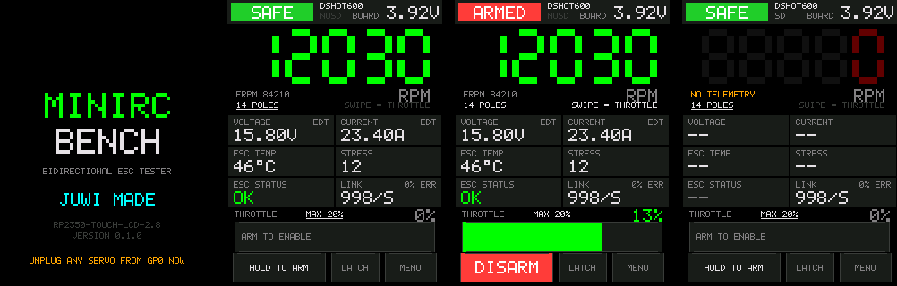
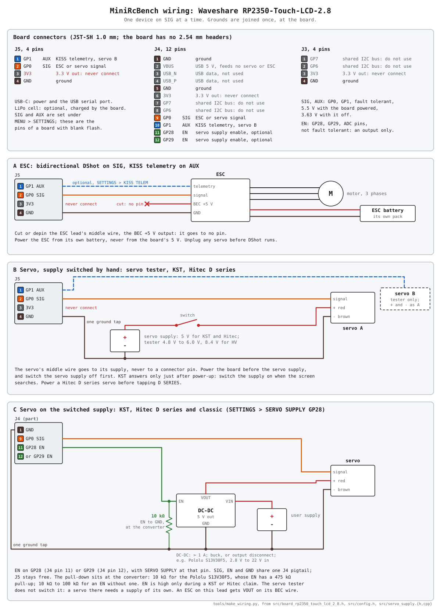
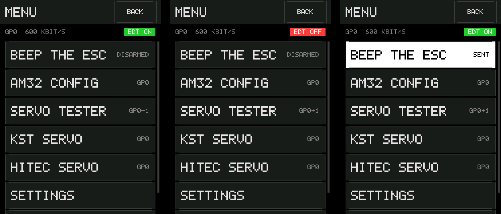
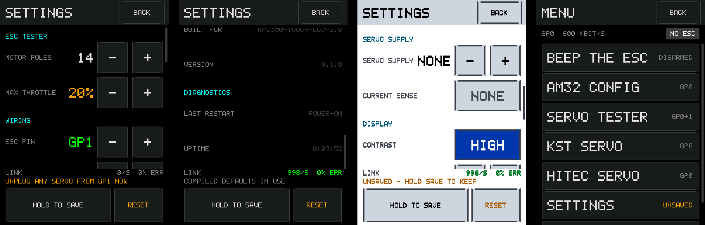
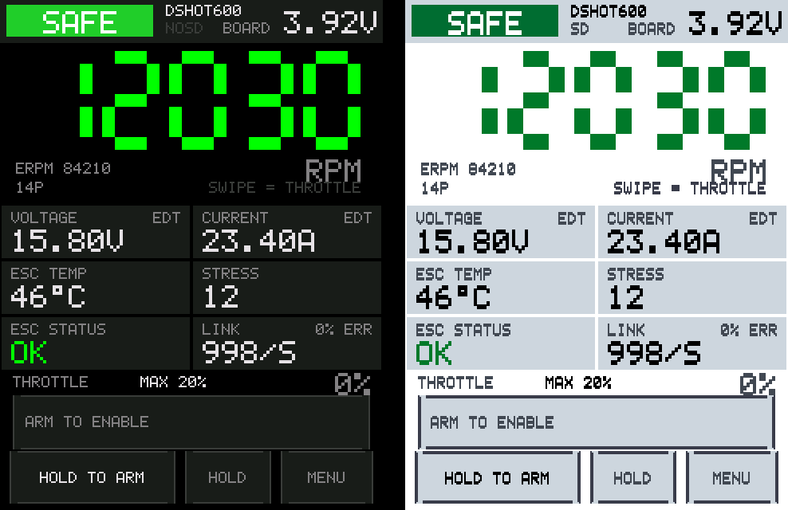
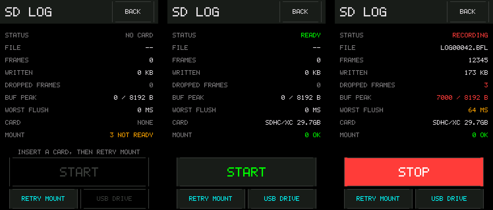
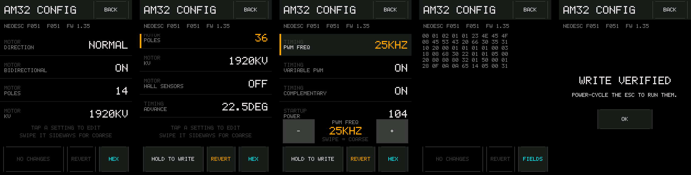
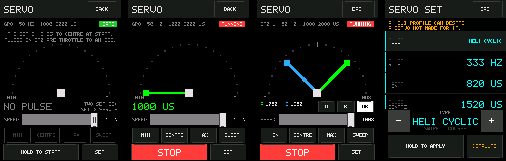
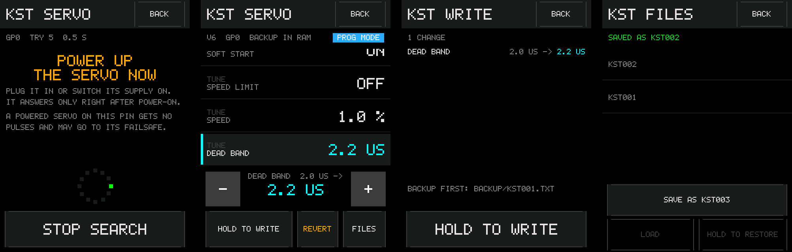
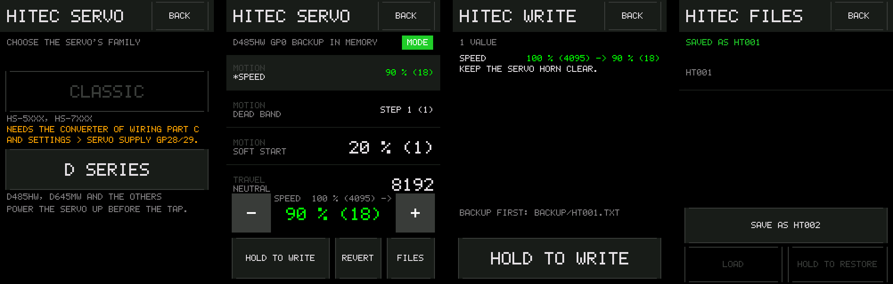

# MiniRcBench

[](https://github.com/subtilitas/MiniRcBench/actions/workflows/ci.yml)

A bench tester for RC (radio-controlled) model parts. It runs on the
**Waveshare RP2350-Touch-LCD-2.8** and needs no flight controller, laptop or
Betaflight. MiniRcBench continues the DshotDisplay firmware, which remains at
[github.com/subtilitas/DshotDisplay](https://github.com/subtilitas/DshotDisplay)
as a separate project.

Today it is a bidirectional DShot tester for one electronic speed controller
(ESC). The board sends bidirectional DShot to the ESC from an on-screen
throttle. On the same wire it decodes the electrical RPM (eRPM) and Extended
DShot Telemetry (EDT) that the ESC returns: RPM (revolutions per minute),
voltage, current, ESC temperature, stress and status. The touch panel shows all
of it. An optional third wire carries KISS telemetry, with finer voltage and
current steps. The board records the telemetry to microSD as a Betaflight
blackbox log, offers the card to a USB (Universal Serial Bus) host as a
read-only drive, and reads and writes AM32 ESC settings over the signal wire.

It is also a servo tester: PWM (pulse-width modulation) servo output on the
same two signal pins, with manual position, sweep and two servos at once (see
[Servo tester](#servo-tester); design note `docs/design/servo-tester.md`).
It programs KST and Chaservo servos on the ESC pin (see
[KST servo programming](#kst-servo-programming); design note
`docs/design/kst-programming.md`), and Hitec D series and classic servos (see
[Hitec servo programming](#hitec-servo-programming); design note
`docs/design/hitec-programming.md`). The AM32 editor, the servo tester and
the two servo programmers take the pins through the pin claim of
`docs/design/pin-claim.md`. An optional INA219 current sensor on the
board's I2C (Inter-Integrated Circuit) bus reads the servo supply's current
and voltage (see [Current sensor](#current-sensor); design note
`docs/design/current-sense.md`). SETTINGS shows the firmware version and,
under DIAGNOSTICS, the reason for the last restart and the time since boot
(design note `docs/design/diagnostics.md`).

Two features are designed and not built. An S.BUS (Futaba's serial bus for
receiver channels) receiver monitor is described in
`docs/design/rx-signals.md`, with an S.BUS output that the owner decided on
and that is not designed yet; rcbench's S.BUS decoder is in the tree and
tested on the host, and the firmware does not build it. A PPM
(pulse-position modulation) output is not built, by the owner's decision.
Menu structure B is described in `docs/design/menu-b.md`; slices 1 to 5 and
8 of 10 are in the tree: its building blocks, its colour roles, its names and
SETTINGS, its layout table, its write rule and BACK guard, and SERVO
TESTER's title, the MENU row's label.
The uses that the design note's decision 11 names take their role's colour,
and a value changed and not yet written is cyan.



*The host test suite renders every screenshot here from the UI (user
interface) code.
`tools/make_previews.py` stitches them together.*

> ### [User manual — the Wiki](https://github.com/subtilitas/MiniRcBench/wiki)
>
> **[English](https://github.com/subtilitas/MiniRcBench/wiki/Setup)** ·
> **[Deutsch](https://github.com/subtilitas/MiniRcBench/wiki/Einrichtung)**
>
> Setup, wiring, first run, every screen, telemetry, logging, AM32
> configuration, the servo tester, KST and Hitec programming, and
> troubleshooting, for someone using the board. This README describes the
> firmware and the build.

Project state and open items: [STATUS.md](https://github.com/subtilitas/MiniRcBench/blob/main/STATUS.md). Changes by release: [CHANGELOG.md](https://github.com/subtilitas/MiniRcBench/blob/main/CHANGELOG.md).

---

## Core split

Bidirectional DShot is half-duplex. The ESC answers only frames it receives,
and it disarms when frames stop. A telemetry display therefore cannot listen
passively. It has to be the throttle source. This makes the device a bench
tester, not an inline monitor.

The display transfers 153,600 bytes per full frame (240 × 320 pixels in RGB565,
16 bits per pixel: 5 red, 6 green, 5 blue) over SPI (Serial Peripheral
Interface) by DMA (direct memory access). At the 62.5 MHz write maximum in
`LCD_SPI_HZ` that is at least 19.7 ms (computed, not measured). DShot frame
timing cannot share a core with that, so the work is split:

| | core0 | core1 |
|---|---|---|
| Job | touch, rendering, battery sense | DShot frame pump + telemetry decode |
| Rate | 40 Hz (`UI_PERIOD_MS` = 25 ms) | 1 kHz (`DSHOT_PERIOD_US` = 1000 µs) |
| Allowed to block | yes | never |

The two cores share one struct guarded by a `critical_section`. Core0 calls
`escHeartbeat()` every frame. If no heartbeat arrives for
`UI_HEARTBEAT_TIMEOUT_MS` (250 ms), core1 forces the throttle to zero.

A screen that needs the signal pins claims them (`src/pin_claim.h`). The claim
asks core1 to suspend the DShot pump. Once core1 sees the request, it sends
zero frames for at least 250 ms (`ARM_ZERO_THROTTLE_MS`) after the last
throttle frame, then stops the pump with no edges, releases the pin (a plain
input with the pulls off), puts the pull-up back on it and ends the KISS
receiver. Core1 then runs that screen's job instead (`src/core1_job.h`), and
`loop1()` is `escTaskPoll(); core1JobPoll();`. The AM32 editor's transport runs
on core0 and has no core1 job; no other job is built yet. Leaving the screen
rebuilds the pump from the wiring it had, disarmed.

---

## Hardware

**Board:** [Waveshare RP2350-Touch-LCD-2.8](https://www.waveshare.com/wiki/RP2350-Touch-LCD-2.8).
An RP2350A with a 240×320 IPS (in-plane switching) portrait panel (ST7789T3
over SPI1), CST328 capacitive touch, a QMI8658 IMU (inertial measurement
unit), a PCF85063 RTC (real-time clock), a PCM5101A audio codec, a microSD
slot and a LiPo (lithium-polymer) battery charger. In the tables below, I2C is
the two-wire Inter-Integrated Circuit bus, PIO is the RP2350's programmable
I/O block, and GPIO means general-purpose input/output pin.

### Pin map (from the official schematic)

The pin map is `src/board_rp2350_touch_lcd_2_8.h`.

| Function | GPIO | Notes |
|---|---|---|
| LCD (liquid-crystal display) SCK / MOSI / CS / DC / RST | 10 / 11 / 13 / 14 / 15 | SPI1. SCK is serial clock, MOSI master out, slave in, CS chip select, DC data/command, RST reset. GP12 is the panel's MISO (master in, slave out) line, wired and not used |
| LCD backlight | 16 | NPN (negative-positive-negative) transistor as low-side switch, 20 kHz, 8-bit, from a PIO state machine on pio0 (`src/backlight.pio`), so PWM slice 0 stays free |
| Touch + IMU + RTC I2C SDA / SCL | 6 / 7 | I2C1, **shared bus** (touch 0x1A, IMU 0x6B, RTC 0x51), 400 kHz, on J3 too. SDA is serial data, SCL serial clock. An optional INA219 current sensor at 0x40 shares it, under SETTINGS → CURRENT SENSE |
| Touch INT / RESET | 18 / 17 | Interrupt, active low. The touch reset is a net of its own, separate from LCD_RST |
| microSD CLK / CMD / D0–D3 | 19 / 20 / 21–24 | 4-bit SDIO (Secure Digital Input/Output) on PIO, blackbox logging, see below. CLK is clock, CMD command, D0–D3 the data lines |
| Power latch | 26 | `PIN_BAT_EN`, driven high first at boot |
| Power button | 25 | 10 kΩ pull-up, reads low while pressed |
| Battery sense | 27 | ADC (analog-to-digital converter) input 1, 200k/100k divider → `VBAT = Vadc × 3` |
| I2S audio BCK / LRCK / DIN | 2 / 3 / 4 | PCM5101A codec, not used by the firmware. I2S is Inter-IC Sound; BCK is bit clock, LRCK left-right clock, DIN data in |
| RTC INT, IMU INT1 / INT2 | 5, 8 / 9 | Not used by the firmware |
| ESC signal (SIG) | 0 | J4 pin 9, J5 pin 2, free. The TX (transmit) pin of UART0 (universal asynchronous receiver-transmitter 0), which the firmware does not use. Set under SETTINGS → SIG PIN |
| KISS telemetry RX (receive; KISS is a serial ESC telemetry protocol), AUX | 1 | J4 pin 10, J5 pin 1, free. The RX pin of UART0. Optional third wire; also the servo tester's second servo. Set under SETTINGS → AUX PIN |
| Switched servo supply enable (EN) | 28 or 29 | J4 pin 11 or J4 pin 12. Optional, under SETTINGS → SERVO SUPPLY. An output at 3.3 V |

Only GP0 and GP1 are free (`BOARD_FREE_GPIO_MASK` = `0x00000003`). Both are
"Digital IO (FT)" pins, fault tolerant (RP2350 datasheet, Tables 1674 and
1680): they are rated 5.5 V while IOVDD, the board's I/O supply, is at
3.3 V, and 3.63 V while it is off. GP28 and GP29 are "Digital IO /
Analogue" pins, ADC inputs, and not fault tolerant: they are rated IOVDD +
0.5 V. They carry only the switched supply's enable, an output.

### Wiring diagram



One sheet, four parts:

| Part | Wiring | Details |
|---|---|---|
| Board connectors | J5, J4 and J3 pin by pin, each with its role | [Pin map](#pin-map-from-the-official-schematic) |
| A | ESC: signal on SIG, ground, KISS telemetry on AUX, the BEC (battery eliminator circuit) wire cut | [Wiring the ESC](#wiring-the-esc), [KISS telemetry](#kiss-telemetry-optional-third-wire) |
| B | Servo on its own supply with a switch in the positive lead; a second servo on AUX for the servo tester | [Servo tester wiring](#wiring), [KST wiring](#wiring-1), [Hitec wiring](#wiring-2) |
| C | Servo on a DC-DC (direct current to direct current) converter whose enable input (EN) is on GP28 or GP29, with a 10 kΩ pull-down at the converter; SIG, EN and GND (ground) on J4 | [KST wiring, switched supply](#wiring-1), [Classic servos](#classic-servos) |

`tools/make_wiring.py` draws `docs/wiring.svg` (Scalable Vector Graphics)
from the connector table in `src/board_rp2350_touch_lcd_2_8.h`, the start
pins in `src/config.h` and the enable pins in `src/servo_supply.h`, checked
against `servoSupplyPinOf()` in `src/servo_supply.cpp`. The Docs
job in `ci.yml` runs `python3 tools/make_wiring.py --check`, which fails when
the file differs from what the script draws.

### Wiring the ESC

Two wires:

| ESC | Board |
|---|---|
| Signal | **GP0**, J4 pin 9 or J5 pin 2 |
| Ground | **GND** (ground), J4 pin 1 or 5, or J5 pin 4 |

The board has no 2.54 mm headers. All signals are on JST-SH 1.0 mm
connectors, so an ESC lead needs a pigtail:

```
J4 (12P): 1=GND  2=VBUS 3=USB_N 4=USB_P 5=GND   6=3V3
          7=GP7* 8=GP6* 9=GP0   10=GP1  11=GP28 12=GP29
J3  (4P): 1=GP7* 2=GP6* 3=3V3   4=GND
J5  (4P): 1=GP1  2=GP0  3=3V3   4=GND
                                (* = on the shared I2C bus: only the optional
                                     INA219, at 0x40, joins it)
                                (J5 pin 3: never connect)

ESC signal (SIG)     GP0   J4 pin 9  or J5 pin 2
KISS telemetry (AUX) GP1   J4 pin 10 or J5 pin 1
GND                        J4 pin 1 or 5, or J5 pin 4
servo supply EN      GP28  J4 pin 11, or GP29  J4 pin 12 (optional)
```

> **Cut or depin the middle wire first.** The middle conductor of an ESC lead
> is the BEC (battery eliminator circuit) **+5 V** output, and it goes to no
> pin. GP0 and GP1 tolerate 5.5 V on the signal while the board is powered
> (IOVDD at 3.3 V) and 3.63 V while it is off. The tester needs signal and
> ground only.

> **Warning: J5 pins 2, 3 and 4 are in the order of a servo plug.** They are
> SIG (GP0), 3V3 and GND: signal, plus and minus, as on a servo or ESC lead.
> **Never connect a servo or ESC lead straight across to J5.** Pin 3 is the
> board's 3.3 V supply. Joined straight across, it gets the ESC's BEC output,
> +5 V, or the servo's supply, 4.8 V to 6.0 V or 8.4 V for an HV
> (high-voltage) servo, and that can destroy the board. Leave J5 pin 3
> unconnected.

SIG, the ESC pin, and AUX, the KISS telemetry pin, are set on the board
under **MENU → SETTINGS → SIG PIN** and **AUX PIN** and stored in flash. A
step of either row swaps SIG and AUX, so the two never share a GPIO; the
J5 pin of each shows under its value. `DSHOT_PIN_LCD_2_8` in `config.h` is
the pin a board with blank flash starts on, **GP0**, J4 pin 9 or J5 pin 2.
The KISS telemetry wire starts on **GP1**. To swap them at build time,
build with `-DDSHOT_PIN_LCD_2_8=1 -DKISS_PIN_LCD_2_8=0`. The two must move
together. A build that puts both on one pin fails a `static_assert`.

An ESC on the wrong one of the two pins produces no error. **LINK** stays at
`0/S`.

**Power the ESC from its own battery.** Do not power a motor from the board's
5 V pin. Connect the ESC ground to the board ground, and keep the signal wire
short. The maximum working lead length is not measured. If the **LINK** error
rate rises, set **DSHOT** to 300 under **MENU → SETTINGS**.

The board has a power-button latch on GP26 (`PIN_BAT_EN`). The firmware drives
it high as the first action at boot. Without it, the board loses power when
the button is released while running on battery. On USB the latch has no
effect.

### Other boards

The image is for the RP2350-Touch-LCD-2.8 only. It does not check which board
it runs on: flashed onto another board, it can drive pins that are wired to
other parts there. The splash and SETTINGS → BUILT FOR name the board the
image is built for. DshotDisplay supports the RP2350-Touch-LCD-2.

---

## Building

Native [Pico SDK](https://github.com/raspberrypi/pico-sdk) (software
development kit) with CMake. No Arduino core, no IDE (integrated development
environment).

Requirements: `cmake` 3.18 or later, `ninja` and an `arm-none-eabi` toolchain.

```sh
sudo apt install cmake ninja-build gcc-arm-none-eabi   # Debian/Ubuntu
brew install cmake ninja arm-none-eabi-gcc             # macOS
```

Fetch the SDK once and set `PICO_SDK_PATH`:

```sh
git clone --depth 1 --branch 2.1.1 https://github.com/raspberrypi/pico-sdk.git ~/pico-sdk
git -C ~/pico-sdk submodule update --init --depth 1 lib/tinyusb
export PICO_SDK_PATH=~/pico-sdk
```

`lib/tinyusb` is required. Serial telemetry runs over USB CDC (communications
device class). Without the submodule the SDK builds with no USB support and
reports no error.

Build:

```sh
cmake -B build -G Ninja -DPICO_BOARD=pico2 -DPICO_PLATFORM=rp2350-arm-s .
ninja -C build
```

Build options:

```sh
-DDSHOT_PIN_LCD_2_8=1    # the ESC pin a blank board starts on
-DKISS_PIN_LCD_2_8=0     # ...and the telemetry pin; the two move together
-DSTRICT=ON              # warnings fatal, for this project's sources
```

The ESC pin defaults to **GP0** (`DSHOT_PIN_LCD_2_8`) and the telemetry pin
to **GP1** (`KISS_PIN_LCD_2_8`). The suffix names the board, as the image's
file name does. There is no board to select, and a `-DBOARD` is ignored.
Configuring with `-DDSHOT_PIN`, `-DKISS_PIN`, `-DDSHOT_PIN_LCD_2` or
`-DKISS_PIN_LCD_2` fails, with a message naming the options this build takes.

The output is `build/MiniRcBench-touch-lcd-2.8.uf2`. UF2 is the USB Flashing
Format.

To flash: hold **BOOT**, tap **RESET**, release **BOOT**, and copy the `.uf2`
onto the USB drive that appears.

A board whose flash holds a settings block of another layout version starts
from the compiled defaults. This image's layout is version 5: flashed over an
image with an earlier version, it returns every saved setting to its default
once, and the ESC pin is GP0. See SETTINGS under [Using it](#using-it).

`-DSTRICT=ON` adds `-Werror` for this project's own sources. CI (continuous integration) sets it. It is
off by default, so a toolchain update that adds a warning does not stop a
local build.

Only the Cortex-M33 build (`rp2350-arm-s`) is supported. This project does not
build or test for the RP2350's Hazard3 RISC-V cores.

### Prebuilt image

Every [release](https://github.com/subtilitas/MiniRcBench/releases) has the
`.uf2` attached. Flash it as above.

Every green CI run uploads the `.uf2` as an
artifact, so an untagged commit can be tested on hardware.

`tools/sdtest` is not among them. It is a bench diagnostic for the SD card
wiring, not firmware, and builds for the RP2350-Touch-LCD-2.8 only. A plain
`ninja -C build` builds it locally next to the firmware, as
`build/sdtest.uf2`.

### Reproducible builds

`CMakeLists.txt` pins each dependency and fetches it at configure time. The
tree contains no third-party source. The DShot driver in `src/dshot/` is part
of the tree: it comes from [rcbench](https://github.com/subtilitas/rcbench),
which has the same copyright holder and the same MIT licence, and each of its
files names the rcbench commit it was taken from.

| Dependency | Version | Pinned by |
|---|---|---|
| pico-sdk | 2.1.1 | commit hash |
| no-OS-FatFS-SD-SDIO-SPI-RPi-Pico | v3.6.2 | commit hash |

Each hash has its tag in a comment beside it. A tag can be moved; a hash cannot.

Two constraints on these dependencies:

- Only part of the SD library is built: FatFs, its glue, its card layer and
  its SPI card driver. The board's card is on SDIO, but the card layer's init
  path calls into the SPI driver, so the image does not link without it. The
  library's own `CMakeLists.txt` would also compile its SDIO driver, which
  its README derives from GPL-3.0 (GNU General Public License version 3)
  code. So `CMakeLists.txt` fetches the source without adding it, and defines
  the target `sd_fatfs` from a copy of the library's `src/` without the SDIO,
  ZuluSCSI-firmware and SdFat directories. The SDIO driver is `src/sdio/`, in
  this tree; its design note is `docs/design/sdio-driver.md`.
- The SD driver is the **SDIO-SPI** repository, not the older SPI-only one. The
  SPI-only driver's `rtc.c` includes `hardware/rtc.h`. The RP2040 has that RTC
  peripheral; the RP2350 does not (it has powman instead), so that driver fails
  to compile for the RP2350.

---

## Using it

**Splash**

For 3 s (`SPLASH_MS`) after power-up the board shows its name, the board the
image is built for, `RP2350-TOUCH-LCD-2.8`, and the firmware version, for
example `VERSION 0.1.0`. DShot starts on the ESC pin when the splash ends,
so the last line names that pin in amber: `UNPLUG ANY SERVO FROM GP0 NOW`. A
servo left on it reads the DShot frames as pulses and drives towards one end
of its travel. When `settingsLoad()` carried a block of settings version 2,
3 or 4 over (`settingsCarriedOver()`), two amber lines at y 40 and y 52 read
`SETTINGS CARRIED OVER FROM AN UPDATE` and
`CHECK MENU > SETTINGS, THEN SAVE`; when it discarded a whole block of a
version it has no layout for (`settingsResetByUpdate()`), they read
`SETTINGS RESET BY UPDATE` and `CHECK MENU > SETTINGS`. Blank flash and a
damaged block show neither. While the touch controller has not
answered once since `touchInit()`, the splash shows
`TOUCH CONTROLLER NOT FOUND` in amber at y 64, under those two lines and
above the name; the line goes at the controller's first answer
(`uiSplashTick()`). The splash reads the touch every 25 ms into a state of
its own, so a finger resting on the glass when the tester appears gives no
press edge: it does not arm, does not move the throttle and does not start
a hold. Lifting it still ends a tap where it rests, on a button that acts
on release such as HOLD or MENU, because the driver keeps where the press
began. If you touched the screen at power-up, lift the finger before HOLD
TO ARM.

**Main screen**

- **HOLD TO ARM**: press and hold for 1 s (`ARM_HOLD_MS`). Arming is refused
  unless the throttle has been at zero for 250 ms (`ARM_ZERO_THROTTLE_MS`).
  The hold counts only for a press that starts on the button while disarmed
  and while no USB host holds the card. A host that takes the card during
  the hold cancels that press. The press that disarms, kept down, does not
  arm again.
  While a USB host holds the card the button is drawn as an outline, the
  disabled look, and the throttle bar reads `EJECT THE USB DRIVE TO ARM` in
  amber.
  Once armed the button reads **DISARM** and acts on touch-down.
- **Throttle bar**: the gesture depends on HOLD.

  | | HOLD off (default) | HOLD on |
  |---|---|---|
  | Bar label | `THROTTLE` | `THROTTLE REL` + grab handle |
  | Gesture | **absolute**: finger position sets the throttle | **relative**: throttle moves by the finger's travel |
  | Touching the bar | jumps to that position | changes nothing |
  | On release | returns to zero | stays |

  The bar is 34 px tall (`THR_TRACK_H`). The outer 16 px at each end
  (`THR_EDGE_SAT`) count as the rail, so zero and the ceiling are reachable
  with a finger. Relative drags accumulate across several swipes and
  re-anchor at both rails. `HOLD_DRAG_SENSITIVITY_PCT` (default 100) sets how
  much of the ceiling one track width of travel covers.

  The percentage shown is of the full 0–2000 DShot range. The bar's full width
  is the configured ceiling.
- **Throttle pad**: the area above the gauge (RPM readout and telemetry tiles)
  is a relative throttle surface in both modes. Swipe **up** for more,
  **down** for less. Swipes accumulate.

  A tap on the pad never changes the throttle. A drag engages after 6 px of
  travel (`PAD_DEADZONE_PX`). One full-height swipe covers 60 % of the ceiling
  (`PAD_DRAG_SENSITIVITY_PCT`).

  The pad ends where the gauge's grab area begins, with no overlap and no gap.
  The hint under the RPM readout reads `SWIPE = THROTTLE`, grey while
  disarmed and in the text colour while armed, and changes to `SWIPE ACTIVE`
  in green while a drag is engaged. While the
  3D note shows ([Telemetry and logging](#telemetry-and-logging)), the note
  stands in the hint's place until a drag engages; `SWIPE ACTIVE` then
  replaces the note, and the note returns on release. The pad works the same.
- **HOLD**: off by default. Turning it off sets the throttle to zero.
- **MENU**: the list of tools and settings. Opening it disarms, sets the
  throttle to zero and turns HOLD off.

**Touch**

The CST328 driver (`src/cst328.cpp`) reads only the controller's first
contact slot, a 5-byte read of finger 1. Which contact the controller puts
there while two touch the glass is not measured, so a press made while the
throttle finger rests on the glass may not register: lift the throttle
finger before DISARM. A wet screen, or a lead lying across the glass, can
count as a contact and block every tap.

**Button behaviour**

Every button except DISARM acts on release and shows a pressed outline while
held. Sliding off before release cancels the press.

DISARM acts on touch-down.

The `-` / `+` steppers step once on press. After 400 ms held
(`REPEAT_DELAY_MS`) they repeat every 120 ms, after 1.2 s every 60 ms, and
after 2.5 s every 25 ms.

Arming and disarming dim the backlight to a quarter for 120 ms
(`BL_DIP_MS`), so the event is visible while watching the motor.

**MENU**



*EDT live, EDT silent, and BEEP acknowledging a press.*

MENU is a list of rows. Each row is 40 px tall at a 42 px pitch, with the name
at scale 2 on the left and its state right-aligned. **BACK** returns to the
tester. Every tool's **BACK** returns to MENU.

- **EDT ON / EDT OFF / NO ESC**: a read-only chip on the strip under the
  title, square and 12 px tall, so it does not look like a button.
  `EDT ON` in green while EDT frames arrive; `EDT OFF` in red while
  eRPM frames arrive without EDT; `NO ESC` in dim grey while no eRPM frame
  has arrived for 500 ms (`ESC_LINK_STALE_MS`), the normal state with no ESC
  connected. The firmware sends the enable command itself (see
  [Telemetry and logging](#telemetry-and-logging)). The ESC does not
  acknowledge the command, so the chip shows received frames, not sent
  commands. The strip's caption names both signal pins by role and number
  and the DShot rate, for example `SIG GP0  AUX GP1  DSHOT600`.

| Row | State on the right | A tap |
|---|---|---|
| **BEEP THE ESC** | `DISARMED`; for 350 ms after a tap, `SENT` or `REFUSED` | Sends `DSHOT_CMD_BEACON1` for 6 frames (`BEEP_REPEATS`), 6 ms at 1 kHz. Use it to identify which ESC is connected |
| **AM32 CONFIG** | the ESC pin, `GP0` | Opens the ESC settings editor. See [AM32 ESC configuration](#am32-esc-configuration) |
| **SERVO TESTER** | the signal pins, `GP0+1` | Opens the servo tester. See [Servo tester](#servo-tester) |
| **KST SERVO** | the ESC pin, `GP0` | Opens the KST servo programmer. See [KST servo programming](#kst-servo-programming) |
| **HITEC SERVO** | the ESC pin, `GP0` | Opens the Hitec servo programmer. See [Hitec servo programming](#hitec-servo-programming) |
| **SETTINGS** | `UNSAVED` while the live settings differ from flash; else `UPDATED` while an update's reset or carry-over is not saved over (`settingsResetByUpdate()`, `settingsCarriedOver()`); else nothing; both amber | Opens SETTINGS: the tester, the wiring, the servo supply and current sensor, the display, the board, diagnostics. See below |
| **SD LOG** | `NO CARD`, `READY`, `RECORDING`, `CARD ERROR`, or `USB DRIVE` while a USB host holds the card | Opens the logging status. See below |

- **BEEP flash**: a tap fills the row for 350 ms (`BEEP_FLASH_MS`): white
  with `SENT`, amber with `REFUSED`. Without it a 6 ms command is not visible
  against a 25 ms repaint. BEEP is refused while armed. Opening MENU disarms,
  so the refusal is not reachable through the UI; the flash stays as a
  backstop.
- **DSHOT RESTARTING**: AM32 CONFIG, SERVO TESTER, KST SERVO and HITEC
  SERVO claim the signal pins, and SETTINGS changes the wiring a claim
  latched. While the claim is not free, for example after RESTART DSHOT
  until the DShot pump runs again, these rows are drawn disabled, an outline
  under their own status, a tap opens nothing, and the strip's caption reads
  `DSHOT RESTARTING ON SIG GP0` in amber. A tool opened some other way
  while another claim holds reads `WAIT: DSHOT RESTARTING`; no path through
  the screens reaches that.
- **Rows**: six rows fit the screen without scrolling. MENU holds seven, so
  it scrolls by 36 px, with a 3 px scroll bar at x 235. SETTINGS is the sixth
  row, whole and tappable without a drag, so its `UNSAVED` status stays in
  view. SD LOG, the seventh, shows 6 px until MENU is dragged up, and takes
  a tap only then.

**SD LOG screen**

- **STATUS**: `NO CARD`, `READY`, `RECORDING` or `CARD ERROR`. The board has
  no card-detect pin, so the firmware learns of a card only by mounting it.
- **START / STOP**: starts or ends a log. Disabled with no card.
- **FILE**, **FRAMES**, **WRITTEN**: the open file, frames logged, kB written.
  After a log ends, FILE keeps its name with `(LAST)`, for example
  `LOG00012.BFL (LAST)`, until the next start or mount; `--` before the first
  log and after a mount (`sdLogBegin()`), which also zeroes the counters: the
  card may be another one.
- **Note lines** (y 217 and y 228): how the last log ended, when it ended
  on its own or a tool took the card, in amber (`SdLogEnd`); a card's fault
  until the next start or mount, a tool's stop until the next start
  (`sdLogMountForget()`), with a mount hint on its second line:
  `RECORDING STOPPED: CARD FULL` / `FREE SPACE ON A COMPUTER, RETRY MOUNT`
  (FatFs wrote fewer bytes than asked with `FR_OK`),
  `RECORDING STOPPED: CARD WRITE FAILED` / `REMOVED? REINSERT, THEN RETRY MOUNT`
  (a write, sync or close returned an error),
  `NO LOG STARTED: THE FILE DID NOT OPEN` / `CHECK THE CARD, THEN RETRY MOUNT`
  (`LOGS` not made or read, or the file not opened),
  `NO LOG STARTED: LOG99999.BFL EXISTS` / `MOVE LOGS TO A COMPUTER, RETRY MOUNT`
  (no number after the highest file),
  and `RECORDING STOPPED BY KST SERVO`, `HITEC SERVO` or `AM32 CONFIG` when
  the tool's claim stopped the log (`cardCacheBegin()`). A USB DRIVE refusal
  outranks them for its 4000 ms.
- **DROPPED FRAMES**: frames the ring buffer refused because the card was
  slower than the data. Red when non-zero. Non-zero means the buffer is too
  small for that card.
- **BUF PEAK**: buffer high-water mark against `SD_LOG_BUFFER_BYTES`. Amber
  above 1/2, red above 3/4.
- **WORST FLUSH**: the longest single card write, in ms. Amber above 50 ms.
- **CARD**: card type and size. **MOUNT**: the FatFs result code and name,
  for example `0 OK`, `3 NOT READY`, `13 NO FILESYSTEM`.
- **RETRY MOUNT**: mounts again. The card is otherwise mounted only once, at
  boot. With `NO CARD` and `3 NOT READY` and no card size, the note line
  above START reads `INSERT A CARD, THEN RETRY MOUNT` when nothing answered
  the card initialisation, and `CARD NOT USABLE: RESEAT OR REPLACE` when a
  card answered and failed.
- **USB DRIVE**: serves the card to the USB host. See
  [Blackbox logging to microSD](#blackbox-logging-to-microsd).
- **BACK**: returns to MENU, also while a host holds the card. The handover
  continues, and arming stays blocked until the card is ejected.

**SETTINGS screen**



*SETTINGS at the top, scrolled to the end, in high contrast, and the UNSAVED
marker it puts on MENU.*

SETTINGS is one list in sections. The list fills y 40 to 239 (to y 227 while
the ESC pin's warning shows, see below) and scrolls under a drag. A row is
44 px tall at a 50 px pitch. **MOTOR POLES** and
**MAX THROTTLE** lead it, so they need no scroll. The sections, in order:
ESC TESTER, WIRING, SERVO SUPPLY, DISPLAY, BOARD and DIAGNOSTICS. On a row
with a connector line, SIG PIN, AUX PIN and SERVO SUPPLY, the value sits at
y+8 to y+21 of the row and the line, scale 1, at y+27 to y+33, both ending at
x 132. Section captions and the values of the rows that change are in the text
colour, read-only values grey, and a toggle that is on fills blue.

| Section | Row | What it does |
|---|---|---|
| ESC TESTER | **MOTOR POLES** | eRPM to RPM is `RPM = eRPM / (poles / 2)`. Range 2–28, even values only. Default 14 |
| ESC TESTER | **MAX THROTTLE** | The throttle ceiling. Default 20 % (400 of 2000). Steps of 5 %, range 5–100 % |
| WIRING | **SIG PIN** | SIG, the GPIO of the DShot signal, with its connector pin under the value: `GP0` over `J5 PIN 2`, `GP1` over `J5 PIN 1`. Steps through the board's two free GPIOs; a step onto AUX's GPIO swaps SIG and AUX, so on this board every step is a swap |
| WIRING | **DSHOT** | The DShot bitrate in kbit/s, 150 / 300 / 600 / 1200, wrapping at the ends. Applies at once: the driver is rebuilt on the new pin and rate before the next frame |
| WIRING | **KISS TELEM** | Whether to listen for the telemetry wire, on AUX. A toggle; it moves no pin |
| WIRING | **AUX PIN** | AUX, the GPIO of the KISS telemetry wire and of the servo tester's second servo, with its J5 pin under the value. Acts whatever KISS is, and swaps with SIG as SIG PIN does. The receiver is a PIO state machine, so any free GPIO works |
| SERVO SUPPLY | **SERVO SUPPLY** | `OWN`, the default, `GP28` or `GP29`: whether the enable input of a DC-DC converter for the programmed servo's supply is wired, and to which pin. `OWN`: the servo has a supply of its own and the bench switches nothing. With `GP28` the value has `J4 PIN 11` under it, with `GP29` `J4 PIN 12` (design note `docs/design/kst-programming.md`, "Switched servo supply"). A core section after WIRING, whichever tools MENU lists. A stepper: - and + step OWN, GP28, GP29 and stop at the ends; it applies at once. With a pin chosen, that pin is an input with both pulls off and its input disabled outside a KST or Hitec claim, so the converter's external pull-down holds it off; during a claim the bench switches the servo's supply (KST servo programming, Hitec servo programming) |
| SERVO SUPPLY | **CURRENT SENSE** | `NONE`, the default, or `INA219`: whether an INA219 current sensor is on the I2C bus at 0x40 ([Current sensor](#current-sensor)). A toggle; it applies at once. With `NONE` nothing is sent to 0x40. With `INA219` the bench probes the part at once and every 1000 ms while it is not found, and a caption under the label reads `FOUND`, `NOT FOUND` or `OTHER PART`. `OTHER PART` is another chip at 0x40, or an INA219 left on another configuration, which a power-cycle of the module clears |
| DISPLAY | **CONTRAST** | `NORMAL` or `HIGH`. See below |
| DISPLAY | **BACKLIGHT** | 16–255 in steps of 32. High contrast forces 255 while on |
| BOARD | **BUILT FOR** | `RP2350-TOUCH-LCD-2.8`, the board the image is built for. Read-only |
| BOARD | **VERSION** | The firmware version from `src/version.h`, for example `0.1.0`. Read-only |
| DIAGNOSTICS | **LAST RESTART** | Why the chip last restarted, read once at boot: `POWER-ON`, `BROWN-OUT`, `RUN PIN`, `WATCHDOG`, `UPDATE`, `REBOOT`, `DEBUGGER`, `GLITCH`, `POWER-DOWN` or `UNKNOWN`. Amber for `BROWN-OUT`, `GLITCH` and `WATCHDOG`. Read-only. See below |
| DIAGNOSTICS | **UPTIME** | Time since boot as hours, minutes and seconds, `H:MM:SS`, for example `1:02:03`. Redrawn once a second while its row shows. Read-only |

The `-` and `+` buttons are 44 × 44 px and the toggles 94 × 44 px.

**LAST RESTART.** `src/diag.cpp` reads four values first thing in
`setup()`: the power manager's CHIP_RESET register
(`powman_hw->chip_reset`), the watchdog's REASON register
(`watchdog_hw->reason`), `watchdog_enable_caused_reboot()` and the boot ROM's
`rom_get_last_boot_type()`. A pure function, `diagDecodeRestart()`, turns
them into the reason; the first line that matches decides:

| Read | Shows |
|---|---|
| `watchdog_enable_caused_reboot()` | `WATCHDOG`: an armed watchdog timed out |
| REASON non-zero and boot type `BOOT_TYPE_FLASH_UPDATE` (4) | `UPDATE`: the reboot after a UF2 copy |
| REASON non-zero otherwise | `REBOOT`: a reboot through the watchdog that another program asked for, for example picotool |
| HAD_GLITCH_DETECT | `GLITCH` |
| HAD_WATCHDOG_RESET_RSM, HAD_WATCHDOG_RESET_SWCORE | `WATCHDOG` |
| HAD_HZD_SYS_RESET_REQ | `DEBUGGER` |
| HAD_SWCORE_PD | `POWER-DOWN` |
| HAD_POR | `POWER-ON` |
| HAD_BOR | `BROWN-OUT` |
| HAD_RUN_LOW | `RUN PIN` |
| HAD_DP_RESET_REQ, HAD_RESCUE | `DEBUGGER` |
| HAD_WATCHDOG_RESET_POWMAN, HAD_WATCHDOG_RESET_POWMAN_ASYNC | `WATCHDOG` |
| none of these | `UNKNOWN` |

The SDK's register header marks for each CHIP_RESET flag whether its reset
resets the power manager. The flags of resets that leave it alone come
first: CHIP_RESET may still hold an older flag beside them, and theirs is the
newer. Whether the chip clears older flags when it records a new one is not
known.

According to the boot ROM source, not verified on hardware, the reboot after
a UF2 copy goes through the watchdog with the boot type of a flash update,
so it reads `UPDATE`, not the CHIP_RESET flag of an older reset. The
firmware arms no watchdog: nothing calls `watchdog_enable()`. So `WATCHDOG`
can only appear once a watchdog is armed. Nothing in the firmware calls
`watchdog_reboot()` either. Not tested on hardware: which reason a given
restart shows on the board is not recorded. The design note is
`docs/design/diagnostics.md`.

**Scrolling.** A drag scrolls the list when it starts off a control: on a
section name, a row's label or value, or the gap between rows. After 6 px of
vertical travel the list follows the finger. A press on a control never
scrolls: `-` and `+` step on touch-down and repeat while held, and a toggle
acts on release. A control cut by the edge of the list takes a press only
while at least 40 px of it show (`UI_LIST_TAP_MIN`). Opening SETTINGS sets the
scroll to 0 px.

Below the list, fixed and not scrolled:

- **LINK**: live packets per second and checksum error rate. Green when
  packets arrive, amber above 5 % errors.
- The note line.
- **HOLD TO SAVE** (150 × 46 px, from x 6) and **HOLD DEFAULTS**
  (72 × 46 px, to x 233), at y 268. HOLD DEFAULTS' label takes two lines,
  `HOLD` over `DEFAULTS`, in amber.

A wrong ESC pin produces no error: the ESC receives no frames. **LINK** on this
screen shows the result of each pin change. A non-zero packet rate means the
pin is correct.

The settings block is version 5 (`SETTINGS_VERSION`). By the owner's
decision of 2026-11-14 a whole block of version 2, 3 or 4 is carried over
(`settingsCarriedOver()`): `settings.cpp` describes each older layout as
byte offsets, recovered from the commits that wrote it (version 2: 12 bytes
of payload, the CRC at byte 20; versions 3 and 4: 14 bytes, the CRC at
byte 24), and the host suite builds each block byte by byte. Whole means
the magic, the version, that layout's payload size and its CRC-32 right.
Every field the old layout has keeps its value, judged by
`settingsValidate()` as a version 5 block is; every newer field takes its
default, CURRENT SENSE `NONE`. A version 3 SERVO SUPPLY of 1 named an
enable on GP0, the ESC wire's pin since version 4, and loads as 0, `OWN`; an
ESC pin on GP28 or GP29 from a block before version 4 is not free here and
takes the default, KISS on such a pin is switched off, and a KISS pin this
board does not free takes the default. DshotDisplay 2.x's block carries
over the same way: its `src/settings.h` at the tags v2.0 and v2.3 and at
b9e94dc, the file's last change, holds version 2 with the same layout.
Flash is not rewritten at the load: the old block stays the only copy until
a save lands, so a power loss at boot cannot lose it, and every boot until
then carries it over again. Until a save lands the splash shows its two lines,
MENU's SETTINGS row `UPDATED`, and the note line
`CARRIED OVER BY UPDATE - CHECK, SAVE` while nothing else is pending; HOLD
TO SAVE writes a version 5 block even with nothing changed.

A whole block of a version with no layout here, 1 or above 5, or of version
2, 3 or 4 with another layout's payload size, is discarded, and the
compiled defaults load, every setting and the ESC pin included.
DshotDisplay discards this project's blocks the same way. Such a block (the
magic, another version, at most `SETTINGS_OTHER_MAX` bytes of payload and
its own CRC right) sets `settingsResetByUpdate()` until a save lands: the
splash's two lines, `UPDATED` on MENU's SETTINGS row, and the note line
`RESET BY UPDATE - CHECK AND SAVE` while nothing else is pending.

**HOLD TO SAVE** (1 s, `UI_HOLD_MS`) writes all settings to flash: every row
above, pole count and throttle ceiling included. Erasing the flash sector stops
core1, and with it the DShot pump, for the length of the erase. That duration
is not measured. Saving is refused while armed (`NOT WHILE ARMED - DISARM TO
SAVE`); opening MENU disarms, so the refusal is a backstop. **HOLD DEFAULTS**
(1 s, `UI_HOLD_MS`, the same hold widget, `src/ui_hold.*`) loads the compiled
defaults, pole count and throttle ceiling included, into the live settings. A
tap loads nothing, a slide off the button cancels the hold, and a bar over
the button and a `C_RED` fill, as on every hold of `src/ui_hold.*`, show it
running. It has no armed check: SETTINGS opens only through MENU, which
disarms. Flash changes only on the next save.

Every value applies when changed. Only persistence needs the hold, so a value
can be tried and then discarded by leaving without saving. The note line reads
`UNSAVED - HOLD SAVE TO KEEP` after a change, and otherwise
`SAVED SETTINGS IN USE` or, with nothing stored,
`NOTHING SAVED: DEFAULTS IN USE`. After HOLD DEFAULTS it
reads `DEFAULTS LOADED - RESTART TO UNDO` while the live settings are what it
left and differ from what the next boot loads (the saved settings, or the
compiled defaults when none are stored). Any other change ends it, and so
does every completed HOLD TO SAVE, failed saves included: a save whose
read-back fails has already rewritten the sector. MENU shows `UNSAVED` on
the SETTINGS row while the live settings differ from flash.

SIG PIN moves DShot at once (`escTaskConfigure()`). While the live ESC pin is
not the one `settingsLoad()` put live, the pin the splash named
(`settingsBootDshotPin()`), a line of its own at y 230 (`PIN_Y`) repeats the
splash's warning for the live pin in amber, for example
`UNPLUG ANY SERVO FROM GP1 NOW`, and the list ends at y 227 (`VIEW_H_PIN`), so
it scrolls 12 px further; its top rows do not move. The rule is the boot pin
rather than the saved pin, which a save would end, or the pin at opening, which
a return to SETTINGS would end, while DShot stays on a pin the splash did not
name. With KISS on, a step of SIG PIN or AUX PIN swaps the two, so DShot runs on
the wire the ESC's KISS pad was on until the wires are swapped as well: the line
then reads `SWAP THE ESC'S SIGNAL AND KISS WIRES` (`SETTINGS_SWAP_NOTE`, 36
characters, 215 px). The note line keeps its own order: SAVE FAILED and NOT
WHILE ARMED, until the next save or leaving; ADJUSTED and KISS OFF, until the
next change (KISS OFF follows a KISS pin the board does not free, which no
SETTINGS row sets: the steppers offer free pins only); DEFAULTS LOADED; UNSAVED;
SAVED; the reset by an update; then the set in use. SAVED is green, SAVE
FAILED and NOT WHILE ARMED red, and the other notes but the set in use amber.

**High contrast**



*The tester screen in the normal and the high-contrast palette.*

High contrast is black on white. Accents are darkened to carry white text,
every glyph stroke gets one extra pixel of weight, frames are 2 px, the
seven-segment stroke is thicker, and the backlight is forced to 255. It is
meant for direct sunlight on the transmissive IPS panel.

The palette has fewer distinct greys than the dark one. Label greys are
merged so that labels stay legible outdoors.

The extra glyph weight is a 1 px vertical smear. The 5×7 font sits in a 6 px
cell, so a horizontal smear would close the gap between glyphs. A vertical
smear adds no width, so no layout changes.

**Reading the telemetry**

`--` means no source has supplied that field within its timeout. Plain eRPM
works on any bidirectional DShot ESC. Voltage, current, temperature, stress and
status need EDT support in the ESC firmware (BLHeli_32, Bluejay, AM32). The
**LINK** tile shows good packets per second and the checksum error rate over
the last second. At 1 kHz a clean link reads close to `1000/S` and `0% ERR`.
A rising error rate points at signal integrity.

The voltage and current tiles carry a source tag: **KISS** in the text colour
or **EDT** dimmed. EDT reports voltage in 0.25 V steps and KISS in 0.01 V steps.
A tag that drops from KISS to EDT means the telemetry wire has stopped, and the
reading is 25 times coarser. Consumption in mAh appears on the temperature
tile with KISS only. EDT does not carry it.

The tester's top row shows `DSHOT` plus the bitrate the DShot driver runs
at, for example `DSHOT600`, as set under SETTINGS → DSHOT, dim, and in the
text colour once an EDT enable has been sent; `DSHOT1200`, the widest, ends
at x 156. `DSERR` in amber replaces it when the driver could not claim its
two PIO state machines; nothing is sent to the ESC then.

The large voltage at the top right, captioned `BOARD`, is the board's own
battery, read through the 200 kΩ/100 kΩ divider on GP27. It reads at most
9.90 V. The ESC's pack voltage is the **VOLTAGE** tile. It is drawn amber
below 3.50 V (`BOARD_CELL_LOW_MV`) and red below 3.30 V
(`BOARD_CELL_CRIT_MV`), a lithium-polymer cell's usual low range, not
measured on this board, and goes back only 50 mV (`BOARD_CELL_HYST_MV`)
above each threshold (`uiBoardCell()`). The band is taken from the value as
drawn, rounded to centivolts, so `3.50V` is never amber and `3.30V` never
red. What the divider reads with USB power alone is not measured, and no
GPIO senses USB power, so the firmware cannot tell USB from the cell. With
USB power alone the value can be low and then says nothing about a cell;
below 2.50 V (`BOARD_CELL_IMPLAUSIBLE_MV`), implausible for a working cell,
it is drawn in the normal text colour, and red again from 2.55 V, the same
50 mV band.

While the value is red (`BoardCell::Critical`, `uiBoardWriteRefused()`), KST
SERVO, HITEC SERVO and AM32 CONFIG refuse a write and a KST or Hitec restore.
KST SERVO and HITEC SERVO ask at the end of the write page's hold: refused
there, no file goes to the card and no frame to the servo. They ask again just
before their files and their write go out, after a wait for a card flush:
refused there, the backup and the write's record may be on the card already, and
no frame goes out. AM32 CONFIG asks once, before its backup: refused, no file
goes to the card and no byte to the ESC. A write already running is not stopped:
cut off, it would leave the servo partly written and unverified, while one that
finishes ends with its read-back. The KST and Hitec write pages read, in amber
at y 196 and y 208, `BOARD VOLTAGE IS RED: NOT WRITTEN.` and `CHARGE THE BOARD'S
CELL, HOLD AGAIN.`; AM32 CONFIG shows the two lines as its write's result on
`AM32 WRITE`, in amber at the same place. Amber, the text colour, and a value
below 2.50 V (no cell to judge) refuse no write. The bands are a lithium-polymer
cell's usual range, not measured on this board; what the divider reads with USB
power and no cell is not measured either, so a board on USB alone may refuse
writes.

---

## Telemetry and logging

The firmware enables EDT itself. There is no button.

The first frames the DShot pump sends after it starts are the enable,
`EDT_ENABLE_REPEATS` (10) identical frames of DShot command 13. The pump starts
at power-up, after a change of the ESC pin, the bitrate, KISS or the KISS pin
under SETTINGS, and when the AM32 editor hands the pin back. Every reply is
decoded with EDT on, from the first one:

- an ESC that kept EDT on across one of those restarts is read correctly from
  its first reply, and none of its EDT frames is shown as an RPM;
- an ESC without EDT, or with EDT off, sends eRPM frames only. AM32 and
  Bluejay normalise the exponent of every eRPM frame, with EDT on or off, and
  those frames decode the same with EDT on. For other ESC firmware this is
  unknown: an eRPM frame that is not normalised, an exponent above 0 with
  bit 8 of the payload clear, decodes as an EDT reading and gives no RPM;
- the replies to the enable frames are decoded like any other. AM32 answers
  the enable with a status frame.

At the 1 kHz frame rate the enable at pump start takes 10 ms. Arming
during it sends the throttle on the next frame and drops the rest of the
enable. A BEEP and the first KISS telemetry request wait for its end.

An ESC that is not yet ready for commands ignores that enable, and it does
not count as an attempt. While an ESC answers with eRPM and no EDT frame has
arrived for `EDT_STALE_MS` (1000 ms), the enable is sent again every
`EDT_RETRY_MS` (1000 ms), counted from the last frame of the one before.
After `ESC_LINK_STALE_MS` (500 ms) without eRPM the state resets. An ESC
connected later, power-cycled or replaced then gets its own enable.

Each repeated enable is `EDT_ENABLE_REPEATS` (10) identical frames. It is
sent only when all of these hold:

- the link has been up for `EDT_SETTLE_MS` (300 ms). An ESC answers eRPM
  within milliseconds of power-up but executes commands only after a run of
  valid zero-throttle frames;
- the tester is disarmed and eRPM is zero. DShot commands execute only with
  the motor stopped, and a motor coasts for seconds after a disarm;
- no other command is on the wire. An ESC executes a command only after a run
  of identical frames, so a BEEP inside an enable would break both.

Every reading expires. An EDT field not refreshed for `EDT_STALE_MS` (1 s)
shows `--`. RPM shows a dark red zero, and the line under it reads
`NO TELEMETRY`, after `ESC_LINK_STALE_MS` (500 ms) without eRPM. A display that
held old values would show a plausible reading from an ESC that is no longer
connected.

The RPM area's bottom row, y 114, holds the pole count and the swipe hint. While
`uiAm32Esc3d()` is true it holds `3D MODE ESC: THROTTLE SCALE DIFFERS`
(`AM32_UI_TESTER_3D`, 35 characters, 209 px, x 10 to x 218) in amber in their
place, armed or not, while the pad is not engaged. While a drag is engaged,
`SWIPE ACTIVE` in green takes the row alone, as the only sign the drag took
hold, and the note returns on release. The `ERPM` / `NO TELEMETRY` line above
it, y 102, does not change. Arming is not refused on it. The flag is set by an
AM32 CONFIG read that opens the list on settings with 3D MODE on and by a write
of settings with 3D MODE on that the ESC accepted (`am32BlWrite()` returned OK),
whether the read-back then verifies, fails or differs: such an ESC may run in 3D
mode. Only a list read or a verified write with 3D MODE off clears it, and a
restart does, since it is not stored ([AM32 ESC configuration](#editing)
explains the throttle scale). A failed read, a read that does not open the list
(the read-only view of a layout not known among them: byte 0x12 may be another
field there), a write the ESC refused and a write of 3D MODE off that is not
verified leave it. It describes the last ESC AM32 CONFIG reached, not the one on
the pin now: a swapped ESC is not detected.

An expired **ESC STATUS** reads `--`, never `OK`.

Bidirectional DShot and EDT work on hardware. No defect is known as of
DshotDisplay v2.3.

### KISS telemetry (optional third wire)

EDT rides in the eRPM frame and needs no extra wire. Its resolution is 0.25 V
and 1 A. On a 6S pack a 200 mV sag is below one step, and idle current reads
0 A.

An ESC with KISS telemetry (BLHeli_32 and AM32 implement it) sends a 10-byte
frame at 115200 baud on a separate wire when the DShot frame requests it. The
frame carries voltage and current in 0.01 V and 0.01 A steps, plus consumed
mAh, which EDT does not carry.

| ESC | Board |
|---|---|
| Telemetry pad | **GP1**, J4 pin 10 or J5 pin 1 |

The line is transmit-only from the ESC. Requests go out every 20th DShot frame
(`KISS_REQUEST_EVERY_N`), which is 50 Hz at 1 kHz.

**Status:** working on hardware (owner report). It is off by default
(`KISS_ENABLE_LCD_2_8` = 0) because the board has two free pins and the ESC
uses one.

**Any free GPIO can receive it.** The receiver is a UART built from one PIO state machine. The
RP2350's two hardware UARTs receive only on GPIOs where `n % 4 == 1`: of the
two free pins, GP1 only. The PIO receiver also takes GP0, so the ESC and
telemetry pins can swap. See `src/pio_uart_rx.h`.

The tiles fall back from KISS to EDT `KISS_STALE_MS` (500 ms) after the last
KISS frame.

> **Voltage.** The KISS specification puts this line at 3.6 V. GP1 tolerates
> 5.5 V while the board is powered (IOVDD at 3.3 V) and 3.63 V while it is
> off. The level a given ESC drives is not measured by this project.

RPM is **not** taken from KISS. KISS arrives at 50 Hz and bidirectional DShot at
1 kHz, and spin-up, oscillation and desync show in the 1 kHz stream. KISS
resolves 100 eRPM. Bidirectional DShot encodes a period with a 9-bit mantissa,
so its step grows with RPM. Above about 5,500 mechanical RPM on a 14-pole motor
(about 6,500 on 12 poles, 4,800 on 16) the KISS step is finer. The log
records both. The arithmetic is in `docs/design/erpm_resolution.py`.

### Blackbox logging to microSD

Logs are written in Betaflight's blackbox format. They open in
[**logwiju**](https://subtilitas.github.io/logwiju/), the viewer written for
them, and in Blackbox Explorer, `blackbox_decode` and PIDtoolbox. Files are
named `LOGS/LOGnnnnn.BFL` on a card formatted with FAT (File Allocation
Table). Each new file takes the highest number in `LOGS` plus 1, so the
highest number is the newest log; an empty `LOGS` starts at 00001. A name
counts in any letter case, as FAT compares names without it; any other name
is ignored (`sdLogNameNumber()`). The first start after a mount reads `LOGS`
once with `f_readdir()`, every directory entry once, about one 512-byte
sector per 16 short-named files; later starts count on from memory. A
mount (`RETRY MOUNT`, the end of USB DRIVE, a tool's remount), FatFs
mounting the card again on its own after a card fault, and every logging
error forget the number, since a card swapped or edited in a card reader
looks the same to a board with no card-detect line
(`src/sd_log_next.cpp`, tested over FatFs by `make -C test lognum`). After
`LOG99999.BFL` no log starts and SD LOG says so. A file is
created new, never over an existing one. Logs an earlier firmware wrote to
the card's root stay there and are not counted. The board sets no clock.



The card runs over 4-bit PIO SDIO at 10 MHz (`SD_LOG_SDIO_HZ`), with the
driver in `src/sdio/`, which is not tested on hardware. The board cannot use
hardware SPI for the card: its SD clock is on GP19, which is SPI0 TX in the
pin mux.

Open the screen with **MENU → SD LOG**, the seventh row: drag MENU up 36 px
first. By default arming starts a log and disarming stops it
(`SD_LOG_AUTO_ON_ARM`). Auto-stop ends only a log that auto-start began.
**START/STOP** is always available.

At the default 500 Hz (`SD_LOG_RATE_HZ`) a frame averages 14.5 bytes
(measured). That is 7.3 kB/s, or 26 MB per hour.

Size the buffer from **BUF PEAK** and **WORST FLUSH**. `SD_LOG_BUFFER_BYTES`
defaults to 8192 bytes, about 1.1 s at 7.3 kB/s. Whether that covers a given
card's erase stalls is not measured. A peak near the buffer size, or a flush
longer than the buffer covers, means raise it. **DROPPED FRAMES** above zero
means it was too small.

The logger drops frames rather than block. The UI never waits for the card.

**Getting the files off:** **MENU → SD LOG → USB DRIVE** (SD LOG is the seventh
row: drag MENU up 36 px) presents the card to the USB host as a read-only
removable drive, using MSC (mass storage class) on the same USB cable as the
serial port. The logger unmounts before the drive appears and touches the card
again only after eject. The host and the firmware never share the FAT volume.
While the host holds the card, SD LOG counts what it has read, for example
`3.0 MB READ`, in lime, a live reading.
Without a card the button is drawn unavailable and does nothing. With a card,
the request is refused while armed (`DISARM FIRST`) or while recording (`STOP
RECORDING FIRST`). Arming is blocked while the host holds the card. See
`src/usb_msc.h`. A host that unconfigures the device (`tud_umount_cb()`)
gives the card back as an eject does. TinyUSB 0.18.0's RP2040 port, which the
RP2350 uses, forces VBUS detection on and never reports an unplug: a cable
pulled with the board on its battery arrives as a bus suspend, as a sleeping
host does, and a suspend is not handled. EJECT on SD LOG takes the card back
then. Not tested on hardware.

### Tuning

All in `config.h`. Unless a row says otherwise, a default is a starting value,
not one derived from measurement.

Six of these are only *defaults*: the ESC pin, the DShot bitrate, the KISS
wire, the pole count, the throttle ceiling and the backlight. Each can be
changed under **MENU → SETTINGS** and stored in flash. On a board with saved
settings the stored value wins, so editing `config.h` and reflashing changes
nothing for those six. The SETTINGS note line says which set is in use.

| Setting | Default | What it does |
|---|---|---|
| `DSHOT_PIN_LCD_2_8` | `0` | ESC signal GPIO the board starts on |
| `KISS_TELEM_ENABLE` | `1` | Compile the KISS path in at all |
| `KISS_ENABLE_LCD_2_8` | `0` | Whether the board listens for a KISS wire. **Off**: the board has two free pins and the ESC takes one. One tap under SETTINGS turns it on |
| `KISS_PIN_LCD_2_8` | `1` | GPIO for the telemetry wire. Receive only, changeable under SETTINGS. The other of the two free pins; `DSHOT_PIN_LCD_2_8` has GP0 |
| `KISS_REQUEST_EVERY_N` | `20` | Request every Nth DShot frame; 20 at 1 kHz is 50 Hz. Values below 2 overlap replies and fail an `#error` |
| `KISS_STALE_MS` | `500` | How long a KISS frame stays in use before the display falls back to EDT |
| `EDT_STALE_MS` | `1000` | How long an EDT field stays valid after its last frame. Then the tile shows `--` |
| `ESC_LINK_STALE_MS` | `500` | Time without eRPM before the ESC counts as gone. Resets the automatic EDT enable |
| `EDT_RETRY_MS` | `1000` | Interval between EDT enables while eRPM arrives and EDT does not |
| `EDT_SETTLE_MS` | `300` | Time the link must be up before the first repeated EDT enable. The enable at pump start does not wait |
| `KISS_REPLY_TIMEOUT_MS` | `10` | Abandon an incomplete reply after this long; affects only the timeout counter |
| `SD_LOG_ENABLE` | `1` | Compile the logging path in at all |
| `SD_LOG_SDIO_HZ` | `10 MHz` | SDIO card clock |
| `SD_LOG_RATE_HZ` | `500` | Log frame rate. eRPM is the only 1 kHz signal |
| `SD_LOG_I_INTERVAL` | `32` | Frames between keyframes (I frames). Lower values resynchronise sooner after damage and cost size |
| `SD_LOG_BUFFER_BYTES` | `8192` | Ring buffer. Size it from BUF PEAK and WORST FLUSH |
| `SD_LOG_CHUNK_BYTES` | `512` | Flush size. Keep it a multiple of 512 to avoid read-modify-write in the card |
| `SD_LOG_PREALLOC_BYTES` | `16 MiB` | Contiguous space reserved per file, so the FAT is not rewritten mid-log. About 38 min at 7.3 kB/s. Unused space is released at close |
| `SD_LOG_SYNC_MS` | `2000` | Interval for committing the file's directory entry, the first 2000 ms after the start. A log cut before the first commit reads 0 bytes. After it, with the 16 MiB reservation, the entry says 16 MiB and data written since the last commit is readable; without it, or past 16 MiB, the size is the one at the last commit |
| `SD_LOG_AUTO_ON_ARM` | `1` | Start and stop logging with ARM, in addition to the manual button |

### Reading the logs

Files are written to the directory `LOGS` as `LOGnnnnn.BFL`.

<div align="center">

[](https://subtilitas.github.io/logwiju/)

### **[logwiju](https://subtilitas.github.io/logwiju/)** — the viewer for these logs

</div>

Drop a `.BFL` file onto the page to plot it. It needs no install, upload or
account, and the file stays in the browser. Wheel zooms, drag pans,
shift+drag zooms to a box, double-click fits. The side panel selects fields.

The name, read in German (`w` as English *v*, `j` as English *y*), sounds like
"logview". The tail is **WI**ngert **JU**lian.

The logs also open in
[Blackbox Explorer](https://github.com/betaflight/blackbox-log-viewer), or on the
command line:

```sh
blackbox_decode LOG00001.BFL      # -> LOG00001.01.csv and .01.event
```

The `.event` file holds the end-of-log marker. The CSV (comma-separated values) file holds the data.

Fields per frame: `loopIteration`, `time`, `motor[0]` (throttle), `eRPM[0]`,
`eRPMkiss[0]`, `vbatLatest`, `amperageLatest`, `vbatEdt`, `amperageEdt`,
`escTemperature[0]`, `escConsumption` and `escStress`.

Both eRPM sources are logged: `eRPM[0]` (bidirectional DShot, 1 kHz) and
`eRPMkiss[0]` (KISS, 50 Hz). Both voltage and current sources are logged:
`vbatLatest` / `amperageLatest` carry KISS where it was live, `vbatEdt` /
`amperageEdt` always carry EDT. This allows the KISS decoder to be checked
against EDT from the log itself.

## AM32 ESC configuration

**MENU → AM32 CONFIG** reads and edits an AM32 ESC's settings over the signal wire. It
does not flash ESC firmware. The transport is `src/am32_bl.h`.



Entering the screen claims the signal pin (`src/pin_claim.h`): it disarms,
sends throttle zero for at least 250 ms after the last throttle frame,
stops the DShot driver and hands the pin to the bootloader transport; the
strip reads `RELEASING SIG GP0` meanwhile. Leaving hands it back.

Leaving sends the bootloader no `RUN` command. The transport has one,
`am32BlRun()` in `src/am32_bl.h`, and nothing calls it. An ESC that answered
is in its bootloader when the screen closes, and DShot frames follow on the
signal wire. What the ESC does after the screen is left, its firmware
started on its own, on those frames or not at all, is not recorded.
Power-cycle the ESC after leaving, before driving a motor. After a session
whose handshake succeeded, MENU's strip shows `POWER-CYCLE THE ESC TO RUN IT`
in amber on a second line under its caption (`uiAm32RunCue()`), until an eRPM
frame stamped after that handshake arrives or the board restarts.

### Connecting

Open the screen, then power-cycle the ESC: the page says so in amber,
`POWER-CYCLE THE ESC`, the step to take now. The AM32 bootloader listens only in
a short window after power-up. The firmware repeats the 21-byte init string,
waiting 30 ms (`AM32_GREET_TMO_MS`) for each reply, so that it is sending when
the window opens. The window's length is not measured.

`AM32_FORCE_LOW_JUMP` (default 0) instead holds the signal low for
`AM32_BOOT_LOW_MS` (200 ms) once before the first attempt. The reference
configurator does not do this, and the firmware cannot receive while it holds
the line.

The screen shows which half failed:

| Message | Meaning | What to change |
|---|---|---|
| `WAITING... (TRY n)` | No reply yet | Power-cycle the ESC while the screen is open |
| `nB: xx xx xx @19200`, then `REPLY NOT UNDERSTOOD:` and `IS THE ESC RUNNING AM32?` | The ESC sent bytes that did not parse | Baud rate or framing, or firmware other than AM32. The first three bytes are shown |
| `READ FAILED (...)` | Handshake succeeded, settings read failed | Retry; check the wire |
| `NO VALID SETTINGS`, with `NOT AN AM32 ESC, OR BLANK SETTINGS.` and `NOTHING WILL BE WRITTEN.` | The settings block is implausible (`am32Plausible()`): among others a layout revision of 0 or above 8 | Nothing to do: the screen stays on the connect page, which has no `WRITE...` |

### Layouts outside 2 to 4

The field table is checked against layout revisions 2 to 4
(`AM32_LAYOUT_MIN_KNOWN`, `AM32_LAYOUT_MAX_KNOWN`): layout 1 is AlkaMotors'
firmware before 1.78, which reads nothing above byte 0x29, and 4 is the
newest AM32 v2.22 writes. A plausible block in layout 1 or 5 to 8 opens a
read-only view (`S_VIEW` in `src/ui_am32.cpp`): the 48 bytes in hex, 8 to a
line, and no field, since a layout the table does not know may have moved
any of them (`am32FieldShown()`). The strip reads, in amber,
`LAYOUT 5 NOT KNOWN: READ-ONLY.` over `NOT VERIFIED. BACKUP AM001`, or
`NOT VERIFIED. NO CARD: NO BACKUP.` without a card or with the card held by
USB, or `NOT VERIFIED. BACKUP FAILED.` when the card refuses it. Under the
bytes, in grey: `THE BYTES AS READ. THE FIELD TABLE` /
`IS NOT CHECKED FOR THIS LAYOUT.`

The backup goes to the card as the view opens, since no write follows. The
view's one control is BACK: no row, no `WRITE...`, REVERT or HEX, and the
screen has no transition from the view to the write. The view keeps the title
`AM32 CONFIG`, and its BACK goes to MENU. The write itself checks the
layout of the bytes as read before anything else (`writeRefused()`), so a
way to it would still write nothing: `LAYOUT NOT KNOWN: NOT WRITTEN`.

### Editing

| Gesture | Effect |
|---|---|
| Tap a row | Selects it; the editor bar at the bottom shows its name and value |
| **Swipe the row sideways** | **Coarse**: one coarse step per 16 px of travel; 11 steps, 176 px, cover any field's range |
| `-` / `+` buttons | **Fine**: one step per press; hold to repeat, accelerating |
| Drag up/down | Scrolls the list 1:1 with the finger |

A press selects nothing on its own. It becomes a selection on release if the
finger did not move, or when a sideways swipe is recognised, so a swipe adjusts
the row it started on. A vertical drag never selects.

The axis locks after 6 px of travel (`UI_AXIS_LOCK_PX`), so a gesture is
either a scroll or an edit. Scrolling is measured from the touch point, so no
travel is lost to the lock. A coarse step (`UI_SWIPE_STEP_PX`, 16 px) is
⌈range ÷ (11 × step)⌉ × step: 24 for a field of 0 to 255 at step 1, 4 for
motor poles at step 2. It is made of the field's own steps, so a value on the
field's step stays on it, and an even pole count stays even; a value read off
the step moves by the step from where it is. A coarse step that would pass
the end of the range stops at the end. Travel past the end is not stored, so
the first coarse step back moves the value off it.

A value that differs from the ESC as read is cyan, with a 3 px cyan bar at
its row's left edge; the editor bar's value is cyan too, and the bar's top
line names the value as read: `PWM FREQ  24KHZ ->` over the new value, or
`24KHZ ->` alone where the label and the value do not fit the 140 px between
`-` and `+`. Selecting a row fills it and lights its label, and leaves the
value's colour as it is: a value as read is in the text colour. **REVERT**,
labelled in amber, restores the values that were read. **HEX** shows the raw
48 bytes for checking a field's decoding, titled `AM32 HEX`; its BACK
returns to the list.

BACK on the list with edits not written arms a guard (decision 7 of
`docs/design/menu-b.md`): the strip reads, in amber,
`2 CHANGES NOT WRITTEN.` over `BACK AGAIN DISCARDS THEM.`, or
`1 CHANGE NOT WRITTEN.` over `BACK AGAIN DISCARDS IT.` A second BACK goes
to MENU and drops the edits; a press anywhere else disarms the guard and the
strip returns. There is no timer. Without edits BACK goes to MENU at once.

**WRITE...** opens `AM32 WRITE` on a tap; nothing on the list is held. The
page lists each field that changes, from the ESC as read to the edit: the
label, then `old -> new`, the old value grey and the new one cyan, at most 4
lines and then `AND n MORE`; the strip counts them, `2 CHANGES`. A line at
the bottom names the backup: `BACKUP FIRST: BACKUP/AM001.TXT` before the
session's first write with a card in, `BACKUP: BACKUP/AM001.TXT` once it is
on the card, and in amber `NO CARD: OLD VALUES LOST ON LEAVING`, or
`USB DRIVE: OLD VALUES LOST ON LEAVING` while USB holds the card: without a
card the settings as read stay in RAM until a write with a card saves them,
and leaving AM32 CONFIG loses them. Writing needs a 1 s hold on the page's
`HOLD TO WRITE`, the wide button; the tap that opened the page is not timed.
While the write runs the page reads `WRITING: DO NOT UNPLUG.` in amber and
BACK is drawn disabled. BACK before the hold, or under the result, returns to
the list. While the BOARD voltage is red the hold writes nothing: the result
reads `BOARD VOLTAGE IS RED: NOT WRITTEN.` with `CHARGE THE BOARD'S CELL,
HOLD AGAIN.` under it, both amber, and OK returns to the list with the edits
kept ([Using it](#using-it), the BOARD voltage). OK is the wide button where
HOLD TO WRITE was; it takes a fresh tap, and lifting the finger that held
HOLD TO WRITE leaves the result up. After the write the firmware waits
`AM32_WRITE_SETTLE_MS` (300 ms), reads the block back, and compares it byte
for byte. It shows `WRITE VERIFIED`, in green, only on a full match, with
`POWER-CYCLE THE ESC TO APPLY.` under it: the bench sends no command that
starts the ESC's firmware, and whether the ESC runs the new settings without
a power cycle is not tested. On a mismatch it shows the first differing
byte: `DIFF @xx: GOT xx WANT xx`. The result is drawn at scale 1 from x 8,
y 196, under the page's change lines; every result fits one 37-character
line. A result that is not a verified write is amber: under `WRITE FAILED:
...`, `VERIFY READ: ...` or `DIFF ...` a second amber line reads `NOT
VERIFIED. TAP OK, WRITE AGAIN.`: OK returns to the list with the edits kept,
and `WRITE...` and the hold write again. Under `NO BACKUP ON THE CARD: NOT
WRITTEN` it reads `CHECK THE CARD, THEN WRITE AGAIN.`.

Some values put two amber lines on the strip in place of the ESC name
(`listNote()` in `src/ui_am32.cpp`): the selected row's first, then 3D
MODE, then PROTOCOL, then firmware below 1.80. The facts behind them are
from the AM32 source, not from the bench: am32-firmware/AM32 at the tags
v2.05, v2.16 and v2.18 to v2.22 and `main` at 077b6a4, the AM32
configurator at 06955fe, and for firmware below 2.00 the tags v1.77 to v2.01
of AlkaMotors/AM32-MultiRotor-ESC-firmware and its commits 9909ea7, f917c01
and aa590e8. The
firmware version is bytes 0x03 and 0x04 (`am32Firmware()`); a major outside
1 to 9 or a minor above 99 counts as 0, the oldest.

| Value | Strip | AM32 source |
|---|---|---|
| `3D MODE` on, byte 0x12 | `3D MODE: 50% THROTTLE IS FULL POWER,` / `ABOVE 50% THE OTHER WAY. PROP OFF.` | `bi_direction`; `setInput()` runs 48..1047 one way and 1048..2047 the other. The tester sends 47 + throttle (1..2000) |
| `TEMP LIMIT` selected, `OFF` (141) | `PROTECTION OFF: THE ESC DOES NOT` / `CUT POWER ON THIS LIMIT.` | `loadEEpromSettings()` sets a value outside 70..140 to 255, no limit |
| `CURRENT LIMIT` selected, `OFF` (0, 101, 102; 100 below 2.21) | as TEMP LIMIT | the limit acts for 1..100 from v2.21 (`<= 100`), for 1..99 in v2.05 to v2.20 (`< 100`), in 2 A steps |
| `LOW VOLT CUTOFF` selected, `OFF` or `? (2)` | as TEMP LIMIT | 0 is off; 1 per cell; 2 absolute, which trips from v2.21 (`absolute_voltage_cutoff * 50`). v2.19 and v2.20 compare the raw byte with the voltage in 10 mV, so it never trips; v2.18 and older act on 1 alone |
| `PROTOCOL` at 2 to 9 | `THE TESTER SENDS DSHOT ONLY:` / `THE ESC WILL NOT RUN HERE.` | `enum inputType`, zero-based: 0 AUTO, 1 DSHOT, 2 SERVO, 3 SERIAL, 4 EDT ARM, 5 DRONECAN. SERVO detects servo pulses only. SERIAL, 5 and 6 to 9 leave `EDT_ARMED` at 0, and `dshot.c` takes a throttle above 47 only with it set; 10 and above are AUTO. EDT ARM sets it on the EDT enable (command 13, after 6 frames, armed and stopped) and clears it on every zero frame; the tester sends the enable only while disarmed (`escFrameAction()`) and zero frames after it, so the throttle is dropped too. The editor offers 0 to 4, as the configurator does |
| Firmware below 1.80, or a version byte AM32 did not write | `FIRMWARE BELOW 1.80 OR UNKNOWN:` / `FIELDS IT MAY NOT READ ARE HIDDEN.` | A field the firmware does not read is not listed (`am32FieldShown()`, `Am32Field::readFw`): 0x2A..0x2D from 1.80 (`AM32_FW_READS_2A`; AlkaMotors commit 9909ea7 adds the reads and raises VERSION_MINOR 79 to 80), 0x2E from 1.94 (`AM32_FW_READS_2E`; aa590e8, 93 to 94), 0x2F from 2.16 (`AM32_FW_READS_2F`; the tags v2.05 to v2.12 do not read it). A tag may store a lower version than its code (v1.99 stores 1.95), never a higher one. At 1.80 CURRENT LIMIT acts on 2..99, from 1.81 (f917c01) on 1..99. The backup file lists the fields the firmware reads; its hex lines hold every byte |

After a list read with 3D MODE on, or a write of 3D MODE on that the ESC
accepted, verified or not, the tester shows
`3D MODE ESC: THROTTLE SCALE DIFFERS` (`uiAm32Esc3d()`, set and cleared in
`tryConnect()` and `doWrite()`;
[Telemetry and logging](#telemetry-and-logging) says where it is drawn).
Arming is not refused on it.

### Backup

Before the first write of a session, the settings block as read at entry goes
to the card as `BACKUP/AMnnn.TXT` ([Device backups](#device-backups)). The
read-only view saves it as it opens. A block in a layout outside 2 to 4 is
saved with no field line and the line
`Layout not known: fields not read, not verified`. The
result line then reads `WRITE VERIFIED. BACKUP AM018`, for example. A card
that refuses the backup stops the write: `NO BACKUP ON THE CARD: NOT WRITTEN`.
The melody and the CAN block are not saved; nothing reads the file back yet.

### Protocol

| | |
|---|---|
| Link | one-wire half-duplex serial, 19200 8N1, on the ESC signal pin |
| Init string | 21 bytes: twelve `0x00`, `0x0D`, `"BLHeli"`, `0xF4 0x7D` |
| Commands | `SET_ADDRESS 0xFF 00 hi lo`, `SET_BUFFER 0xFE 00 00 len`, `PROG_FLASH 0x01 0x01`, `READ_FLASH 0x03 len`, `ERASE 0x02`, `RUN 0x00` |
| Checksum | CRC-16/ARC (cyclic redundancy check): polynomial `0xA001`, init 0, appended low byte first |
| ACK (acknowledge) | `0x30`, always the last byte received |
| Settings | 48 bytes, at an address that depends on the MCU (microcontroller) |

The settings address depends on the MCU family. The handshake reply gives the
family in its fifth-from-last byte:

| Type byte | Family | Settings at |
|---|---|---|
| `0x2B` | STM32G071, 2 KB pages | `0x7E00` |
| `0x1F` | STM32F051, 1 KB pages | `0x7C00` |
| `0x35` | STM32F3, 2 KB pages | `0xF800` |

The reply is indexed from the end. A host with a hardware UART on the shared
wire also captures its own transmission, so only the tail is at a fixed
position.

Bytes `0x05..0x0C` hold the device name before layout revision 3, and ramp and
current-PID (proportional-integral-derivative controller) settings from revision 3 on. Fields are gated by revision, so only
the set that applies is shown.

Host and ESC share one conductor, so every transmitted byte is echoed back and
discarded before the reply is read. Interrupts are masked per byte, not per
frame. One byte at 19200 8N1 is 0.52 ms; masking for a whole frame would block
the system for several milliseconds.

### Verification

The host test harness runs two cross-checks:

- Every protocol constant is asserted against a known-working Python
  configurator: init string, all six command encodings, CRC polynomial and
  byte order, ACK position, and all three MCU-to-address mappings.
- The field table is decoded against that tool's default settings blob and
  compared to the meanings in its byte comments: 14 poles, 24 kHz, 15°
  advance, 3.0 V cell cutoff, 1502 µs servo neutral, a 40 A current limit,
  and others. Where the tool's comments and AM32's source disagree, the
  source wins: the tool numbers the protocol from 1, AM32's
  `enum inputType` from 0; its "55 = 2200kv" is 2220 KV (motor velocity
  constant, RPM per volt) in AM32, raw x 40 + 20; and its 141 and 102 are
  the values at which AM32 applies no limit, shown as `OFF`.
- The field table is checked against AM32's `Inc/eeprom.h`, its
  `loadEEpromSettings()` and the configurator's field definitions, at the
  versions named above. Where the accepted range depends on the firmware,
  the field says from which version (`Am32Field::topFw`, `onFw`, `scaleFw`;
  `am32FieldMax()`): ABSOLUTE low-voltage cutoff from 2.21, BY RPM PWM from
  2.18, ACTIVE brake from 2.19, PWM FREQ above 48 kHz from 2.19, a 200 A
  current limit from 2.21, ABS VOLT CUT in volts from 2.21, ADVANCE in the
  10..42 encoding from 2.19 (`AM32_ADVANCE_NEW_FW`; before it 0..3 in 7.5°
  steps, v2.05 main.c:629-633, v2.18 main.c:591). On older
  firmware the editor stops at that firmware's top, and a stored value
  outside the range offered on that firmware, a number included, reads
  `? (n)`, as does an on/off byte of 2 or more. A host test runs every
  field over all 256 byte values on eight firmware versions: a press changes
  no byte of the 48 but its own, and lands inside a literal table of ranges
  per firmware written from AM32's source, on the end of it when it starts
  outside. A screen test writes eight blocks of arbitrary bytes, layouts 2
  to 4, on those firmware versions back through the UI after one press on
  POLES: the ESC holds every other byte as read.

---

## Servo tester

**MENU → SERVO TESTER** drives one servo on SIG, the ESC pin, or two servos on
SIG and AUX, the KISS pin, with servo pulses from the RP2350's hardware PWM. It
does not measure the servo: there is no position feedback, so the horn on the
screen is drawn where the pulse puts it. Not tested on hardware. Design note:
`docs/design/servo-tester.md`; the rules are pure functions in
`src/servo_model.h`, and core1 makes the pulses (`src/servo_job.h`).



### Wiring

The servo takes power from its own supply. The board supplies signal and
ground only.

```
  servo supply, 4.8 V to 6.0 V (8.4 V for an HV (high-voltage) servo)
     +  ----------------------------------------------  servo +   (red, middle)
     -  ----------------+-----------------------------  servo -   (brown or black)
                        |
  board GND  -----------+
  board SIG  ------------------------------------------  servo A signal (orange or white)
  board AUX  ------------------------------------------  servo B signal, two servos only

  SIG GP0 = J4 pin 9 or J5 pin 2, AUX GP1 = J4 pin 10 or J5 pin 1,
  GND = J4 pin 1 or 5, or J5 pin 4
```

- The servo's middle wire goes to its supply, never to a connector pin. The
  board's 5 V pin is its USB supply, and a servo can draw more than 1 A at
  stall.
- Power the board before the servo supply, and switch the servo supply off
  before the board. A servo fed while the board is off can drive its signal
  wire into an unpowered pin, rated 3.63 V.
- The two grounds are joined once, at the board.
- SIG and AUX are the pins set under MENU → SETTINGS → SIG PIN and AUX PIN,
  both whatever KISS is. A step of either swaps the two, so SETTINGS never
  puts both on one GPIO, and `settingsValidate()` moves AUX off SIG in a
  stored block. Pins on one GPIO set some other way leave one servo only,
  with `SIG AND AUX ARE THE SAME GPIO.` and
  `SET SIG PIN OR AUX PIN IN SETTINGS.` on the SET screen.

> **Unplug the servo before DShot runs.** Outside the servo screen the ESC pin
> carries bidirectional DShot, which idles high and pulls low for about 27 µs
> per frame at 600 kbit/s, once every 1000 µs. A servo on that pin reads it as
> a pulse of about 970 µs at 1 kHz: it drives towards one end of its travel,
> at a frame rate that overheats an analogue servo. That happens at **boot**
> for a servo left on SIG, which the splash warns of with
> `UNPLUG ANY SERVO FROM GP0 NOW`, and after the servo screen, which therefore
> shows `UNPLUG THE SERVO.` and restarts DShot only on `RESTART DSHOT`.

### Using it

The screen is titled `SERVO TESTER`, its MENU row's label, on the main view and
on the unplug page (`SERVO_UI_TITLE` in `src/ui_servo.h`). It claims the pins
(`src/pin_claim.h`). It does not claim while an ESC answers on SIG within
500 ms, because servo pulses of 1000 µs to 2000 µs are a valid PWM throttle
signal; it claims by itself 500 ms after the ESC goes quiet. That check misses
an ESC that does not answer in bidirectional DShot, so the screen says
`PULSES ON GP0 ARE THROTTLE TO AN ESC.` Two servos also need AUX free: a KISS
frame within 500 ms, or SIG and AUX on one GPIO, leaves one servo only, with the
reason on the SET screen. While the screen waits for the pins, for example while
an ESC answers, it cannot know whether AUX is free, and TWO can be chosen. If
the claim then finds AUX refused, the screen takes SIG alone and goes back to
one servo, and TWO stays off until the screen is opened again. A TWO still
waiting for `HOLD TO APPLY` goes back to one servo too (`claimPins()`); the wait
is decided again, so one that held only for TWO ends and the rest of the change
applies.

| Control | What it does |
|---|---|
| `SAFE` chip | The pins are bound to PWM at level 0: no pulses, the line low |
| `HOLD TO START` | Hold 1 s (`ARM_HOLD_MS`). Every bound pin goes to CENTRE at once, whatever was commanded before. The chip reads `RUNNING` |
| `STOP` | Acts on touch. The pulses end from the next PWM frame; the last one ends within one frame, 20 ms at 50 Hz |
| The horn | Press on the dial and drag: the servo goes to the angle under the finger, −90° MIN, +90° MAX. Release holds. Refused while SAFE; a press that starts off the dial never drags |
| `MIN` `CENTRE` `MAX` | Act on release, while RUNNING |
| `SWEEP` / `STOP SWEEP` | A square, sine or triangle about the centre, run on core1; a stopped sweep leaves the servo where the curve was |
| `SPEED` | A slew, 10 % to 100 %: at 10 % a full MIN to MAX travel takes 5 s; 100 % is no slew |
| `A` `B` `AB` | Two servos: what the horn and the buttons drive. With `AB`, REVERSE B mirrors B. A's horn and letter are lime, B's blue |
| `SET` | Profile, rate, range, servo count, REVERSE B and the sweep |

If the screen stalls for 250 ms (`UI_HEARTBEAT_TIMEOUT_MS`), core1 ends the
pulses and the sweep, the chip reads `STALLED`, and nothing restarts until the
next HOLD TO START.

The strip's caption names the pin by role and number, the frame rate and
the travel, `SIG GP0  50 HZ  1000-2000 US`, and `SIG+AUX  50 HZ  1000-2000 US`
with two servos. Where that would run within 4 px of the widest chip,
`RUNNING` at x 179, at a three-digit rate with a four-digit MIN, the pin goes
by its role alone, `SIG  333 HZ  1000-2000 US`, and with two servos the
travel goes, `SIG+AUX  333 HZ`. While the screen takes the pins the dial band
reads `RELEASING SIG GP0`, then `TAKING SIG GP0`; a refused bind reads, for
example, `SIG GP0 COULD NOT BE TAKEN (PWM)`.

While SAFE with one servo, the readout row reads `TWO SERVOS:` and
`SET > SERVOS` on the right: SET's SERVOS row switches the second servo on.
The hint is not shown while the claim refuses AUX.

The servo tester never drives the switched supply's enable pin. With SERVO
SUPPLY at `GP28` or `GP29` the converter stays off on this screen, and a servo
with no supply of its own does not move: the strip reads
`GP28 SUPPLY STAYS OFF HERE.` in amber under its caption.

**SET.** The PULSE rows change only while SAFE. TYPE loads one of rcbench's
profiles:

| TYPE | MIN | CENTRE | MAX | Rates | Default |
|---|---|---|---|---|---|
| STANDARD PWM | 1000 µs | 1500 µs | 2000 µs | 50 to 333 Hz | 50 Hz |
| NARROW 760 | 660 µs | 760 µs | 860 µs | 50 to 333 Hz | 50 Hz |
| WIDE | 800 µs | 1500 µs | 2200 µs | 50 to 333 Hz | 50 Hz |
| HELI CYCLIC | 820 µs | 1520 µs | 2220 µs | 50, 120, 200, 333 Hz | 333 Hz |
| HELI TAIL 760 | 410 µs | 760 µs | 1110 µs | 200, 333, 560 Hz | 560 Hz |

MIN, CENTRE and MAX move in 10 µs steps between 400 µs and 2500 µs and keep a
pause of 1000 µs after the longest pulse (500 µs for the heli profiles), so the
rates offered depend on MAX: 333 Hz at most for 2000 µs. A heli profile, or a
rate above 60 Hz, at which an analogue servo overheats, is held behind a warning
until `HOLD TO APPLY` (1 s). So is a TYPE, MIN or MAX step that leaves the
profile past its travel (`servoPastTravel()`: TYPE WIDE, MIN below 900 µs or MAX
above 2100 µs, NARROW 760 and HELI TAIL 760 more than 100 µs outside their own
range) and either changes TYPE or takes MIN below or MAX above the applied
profile's (`servoTravelNeedsHold()`). Its warning is the amber end-stop note,
`PAST ITS TRAVEL A SERVO STALLS AND` / `HEATS. TRY MIN AND MAX HORN-FREE.`; a
heli or 60 Hz warning comes first when both apply. Each step decides again
against the applied profile: a step back inside the margin, or back to the
applied MIN or MAX, ends the wait and applies when nothing else waits. A step
toward the centre, SERVOS TWO to ONE, a CENTRE or REVERSE B change, and a RATE
change up to 60 Hz on a type that is not a heli type apply at once while nothing
waits and join a waiting change otherwise. SERVOS ONE to TWO waits for the hold
when the profile is past its travel, since it drives a second servo there, and
applies at once on a profile within it. HELI CYCLIC's own 820 µs
to 2220 µs are past the travel; its one hold covers both warnings. A value that
waits for the hold is cyan, with a 3 px cyan bar at its row's left edge, until
HOLD TO APPLY; while RUNNING the PULSE rows are grey. BACK from SET with a
change waiting arms a guard (decision 7 of `docs/design/menu-b.md`): the
strip reads, in amber, `1 CHANGE NOT APPLIED.` over
`BACK AGAIN DISCARDS IT.`, or `n CHANGES NOT APPLIED.` over
`BACK AGAIN DISCARDS THEM.`, counting the rows in cyan. A second BACK
returns to the servo screen and drops the change, and SET opens again on the
applied profile; a press anywhere else disarms the guard. With nothing
waiting BACK returns at once. The SWEEP
rows (shape, 0.05 Hz to 5.00 Hz, amplitude 0 % to 100 %, dwell 0 ms to 5000 ms,
endless or 1 to 9999 movements) change at any time and apply to the next SWEEP.
`DEFAULTS`, offered only while SAFE, returns to STANDARD PWM 50 Hz, one servo, a
sine at 0.50 Hz. While RUNNING the footer shows `STOP` in its place, which acts
on touch as `STOP` on the servo screen does. Nothing of the servo tester is
stored: every entry starts at STANDARD PWM 50 Hz.

**BACK.** `BACK` ends the pulses and shows `UNPLUG THE SERVO.` Core1 lets the
pins go only after the last pulse has completed: it writes level 0 and waits
two frames plus 1 ms, 41 ms at 50 Hz, before the pins leave PWM, so no pulse
is cut short. A profile change waits the same way before the rebind. The
released pins are inputs with the pull-down on until DShot takes SIG back
and, with KISS on, the KISS receiver takes AUX. Until the pins are let go the
page reads `RELEASING THE PINS`, and its BACK is drawn disabled, an outline,
and does nothing; it returns to the servo screen once `UNPLUG THE SERVO.`
shows.

## KST servo programming

**MENU → KST SERVO** reads and writes the settings of a KST or Chaservo servo
over its signal wire, on SIG (GP0 or GP1). Both brands share one programming
protocol and one set of 32 registers. The protocol code is rcbench's
(`lib/rcbench/protocols/kst/`): Manchester-coded frames, half duplex, from
the RP2350's PIO (programmable I/O). Not tested on hardware: no frame of the
line driver has been on a pin. Design note: `docs/design/kst-programming.md`.



### Wiring

As for the servo tester: the servo on its own supply, signal on SIG, the
grounds joined once at the board. The servo answers only in the first
moments after its supply comes on, so the supply has to be switchable by
hand: a plug, or a switch in its positive lead.

```
  servo supply, 5 V
     +  ----/ switch /--------------------------------  servo +   (red, middle)
     -  ----------------+-----------------------------  servo -   (brown or black)
                        |
  board GND  -----------+
  board SIG  ------------------------------------------  servo signal (orange or white)

  SIG GP0 = J4 pin 9 or J5 pin 2, GND = J4 pin 1 or 5, or J5 pin 4
```

- The owner programs every KST servo, HV (high-voltage) servos included, at
  5 V. Other voltages are not tested.
- The power-on order and the unplug rule of the [servo tester
  wiring](#wiring) apply here too.

**Switched supply (optional).** With SETTINGS → SERVO SUPPLY at `GP28` or
`GP29`, the bench powers the servo itself through a DC-DC converter whose
enable input (EN) is on that pin, GP28 at J4 pin 11 or GP29 at J4 pin 12:

```
  user supply +  ------- VIN    DC-DC    VOUT  ---------  servo +  (red)
  user supply -  ---+--- GND             EN  ----+------  GP28, J4 pin 11
                    |                            |        or GP29, J4 pin 12
                    |                       10 k pull-down
                    |                            |
                    +----------------------------+------  servo -  (brown)
                    |
  board GND  -------+    one tap: J5 pin 4, or J4 pin 1 or 5
  board SIG  -------------------------------------------  servo signal (GP0, J4 pin 9 or J5 pin 2)
```

- The converter: 5 V out, rated above the servo's stall current, more than
  1 A; a buck, or a type with output disconnect. A plain boost module with
  no EN passes its input to the servo and does not qualify.
- EN takes 3.3 V as high: the enable pin is a 3.3 V output, on GP28 or
  GP29, ADC pins that are not fault tolerant. An external pull-down from EN
  to the supply's minus holds the converter off while the enable pin is not
  driven: 10 kΩ to 100 kΩ for an EN with no internal pull-up. Fitted at the
  converter, it also holds EN low when the EN wire comes off at a
  connector. An EN with an internal pull-up needs a pull-down small enough
  to keep EN below its off threshold and at most 3.6 V at the highest VIN
  used, and at most 0.5 V while the board is off: 10 kΩ for the Pololu
  S13V30F5 (design note, "Example modules").
- The converter's output is the lead's middle wire. **An ESC on this lead
  gets the converter's output on its BEC wire**, its own regulated supply.
  The claim's ESC check sees only an ESC that answers bidirectional DShot.
- The enable pin is driven only during a KST or Hitec claim; outside it the
  pull-down alone holds EN low. A reset or a power-off of the board returns
  the pin to that state; nothing in the firmware switches the supply off if
  core1 hangs.

### Using it

1. Open KST SERVO. The screen claims SIG and searches: it repeats rcbench's
   entry sequence, one attempt every 116.6 ms to 118.8 ms, for 30 s. The
   strip reads `SIG GP0  TRY 12  1.4 S`. With the switched supply, each
   attempt is the supply off for 2 s, then on and the entry at once: 14
   power-ups in 30 s, the strip `SIG GP0  TRY 3  SUPPLY OFF 1.4 S` or
   `SUPPLY ON`. A timed-out switched search reads `NO ANSWER IN 14 POWER-UPS`
   and names the converter, and that a servo on its own supply needs
   `SETTINGS > SERVO SUPPLY AT OWN`. While an ESC answers on SIG the screen
   claims nothing and reads `AN ESC ANSWERS ON SIG GP0.`, the strip
   `CHECKING SIG GP0 FOR AN ESC`.
2. Power the servo up during the search: the screen says `POWER UP` /
   `THE SERVO NOW` in amber, the step to take now (`SWITCHED SUPPLY` with the
   switched supply). The servo enters programming mode,
   and the screen reads its 32 registers, each until 3 of 5 reads agree.
   A powered servo on SIG gets no pulses while the screen is open and may go
   to its failsafe position.
3. The field list shows 27 named fields in four groups: TUNE, PULSE,
   FAILSAFE and LOCKED. The strip's chip reads `PROG MODE` on blue while the
   servo is in programming mode, and `IN DOUBT` on red after a write whose
   outcome is not known. LOCKED fields are read-only and grey. A tap
   selects a field; − and + step it, and a sideways swipe steps it by an
   eleventh of its range. The stepper skips values that break a hard limit,
   for example MAX. DUTY above 98 %. A value that differs from the servo as
   read is cyan, with a 3 px cyan bar at its row's left edge, and the editor
   bar's value is cyan too; selection fills the row and leaves the value's
   colour as it is. A value that breaks a soft rule is taken, with the bar
   in amber and the rule's text in the editor bar. REVERT is labelled in
   amber.
4. A tap on `WRITE...` opens the write page, `KST WRITE` (decision 6 of
   `docs/design/menu-b.md`): the changes, counted on the strip
   (`1 CHANGE`, `2 CHANGES`) and listed 4 at most, then `AND n MORE`, each old
   value dim and each new value cyan, their soft rules, and where the backup
   goes. Only the page holds: its HOLD TO WRITE, 1 s, writes, and the tap
   that opened it is not timed. While the write runs, or waits for the card,
   BACK is drawn disabled and does nothing, so no BACK leaves a servo half
   written; BACK before the hold or under the result returns to the list.
   Before the first frame of the session's first
   write with a card mounted, the image read at entry goes to the card as the
   backup `BACKUP/KSTnnn.TXT`, and the servo as it stands as the record
   `KST/KST.TXT`. Later writes of the session save no backup and write no
   record. The write runs as single-register writes with read-back, then a full
   verify. A verified write removes the record, and so does LEAVE from a servo
   in programming mode that is not in doubt: only the record this session wrote,
   while its card stays mounted and the file holds the bytes the session wrote.
   With a card mounted at the screen's opening, the card's writes queue in
   memory and go to the card while the screen keeps drawing: the write page
   reads `SAVING THE BACKUP TO THE CARD.` and `BLOCKS LEFT: n` until the card
   holds the backup and the record, and the servo is written only then. A flush
   the card does not take stops the write: `THE CARD DID NOT TAKE THE BACKUP
   (REMOVED OR SWAPPED?). NOTHING WENT TO THE SERVO. CHECK THE CARD, HOLD
   AGAIN.` A flush fails on a block write that fails or a card swapped since
   (`src/sdio/sd_cache.h`), not on a full card, which FatFs refuses before
   anything is queued. Nothing is sent to the servo; the card is mounted again
   and the first write forgotten, so the next hold saves the backup again and
   then writes.
5. BACK from the list opens the leave page: `POWER THE SERVO OFF.` The servo
   stays in programming mode until its supply is off. LEAVE holds the line
   low for 100 ms, lets the pin go, and shows `UNPLUG THE SERVO.` RESTART
   DSHOT returns to MENU. With the switched supply the page reads
   `LEAVE SWITCHES THE SERVO'S SUPPLY OFF.`: LEAVE switches it off, and the
   unplug page reads `SUPPLY OFF FOR 2.0 S: 1.4 S LEFT.` until the line
   closes 2 s after the switch-off. Every claim end does the same once the
   supply was on. Until the pin is let go, the unplug page's BACK is drawn
   disabled and does nothing. **HOLD TO REBOOT** (1 s) switches the supply
   off for 2 s and on for 1 s, then enters programming mode and reads the
   servo as it is: the new backup. The pending changes go; without a card
   the backup in memory is lost, and the page says so above the button.
   BACK during REBOOT closes as LEAVE does.
6. With the switched supply, the supply is on only while the screen runs. A
   screen that stalls for 250 ms switches it off once a running operation
   has ended; the servo leaves programming mode and its backup in memory goes.
   The page then reads `THE SCREEN STALLED, SO THE BENCH SWITCHED THE
   SERVO'S SUPPLY OFF.`, and RETRY powers it up and reads it again.

| Result | Colour | Meaning |
|---|---|---|
| `WRITE VERIFIED` | green | The servo holds the new values |
| `... NOTHING WAS WRITTEN.` | amber | No register changed |
| `ROLLED BACK: THE SERVO HOLDS ITS OLD VALUES` | amber | A write did not take and was undone |
| `IN DOUBT: ... RESTORE FROM FILES.` | red | The servo state is unknown; only a restore is taken |

**FILES** lists the record first when one is there, then the KST backups of
`BACKUP/`, the latest first, then `KST/*.TXT` by name, the KSTnnn files
together. SAVE AS writes the servo as it stands into `KST/` under the next free
KSTnnn, never over a file, and refuses once `KST/` holds 50 files:
`KST/ HOLDS 50 FILES. REMOVE SOME.` LOAD holds the file against the
servo (type, access classes, hard limits) and puts its values into the list as
pending changes; a refusal names its line, for example
`LINE 14: NOT A VALUE OF DEAD BAND`. A tap on `RESTORE...` opens the restore
page, `KST RESTORE`, whose HOLD TO RESTORE (1 s) writes the image read at
entry back.

The backups go to the ring of `BACKUP/` that every device shares: see
[Device backups](#device-backups).

Without a card, or with the card held by a USB host, the backup stays in
memory, and reading, editing and writing still work. The write page's backup
line then reads, in amber, `NO CARD: OLD VALUES LOST AT LEAVE` or
`CARD ON USB: OLD VALUES LOST AT LEAVE`, and
`NO BACKUP ON THE CARD: LOST AT LEAVE` when the card took the record and
refused the backup: until a later write with a card mounted saves it, the
session's backup is the only copy of the
servo's old values, and LEAVE, REBOOT or a power loss ends it. Such a write
stays allowed, by the owner's decision of 2026-11-14 (STATUS.md, open item
20). A card that is
mounted but takes neither the backup nor the record stops the write before
any frame:
`THE CARD TOOK NO FILE (FULL OR REMOVED?). NOTHING WENT TO THE SERVO. CHECK THE CARD, HOLD AGAIN.`

While the BOARD voltage is red, the write page's HOLD TO WRITE and HOLD TO
RESTORE write nothing, no file and no frame, and the page reads
`BOARD VOLTAGE IS RED: NOT WRITTEN.` and `CHARGE THE BOARD'S CELL, HOLD
AGAIN.` in amber ([Using it](#using-it), the BOARD voltage).

An image that fails rcbench's layout fingerprint is shown and not written:
the write button reads `READ ONLY`, and with no row selected the editor bar
reads `READ ONLY: UNKNOWN LAYOUT`.

**Current limitations**

- With the switched supply, the screen's card calls run in a card phase:
  the card driver's waits keep the supply on for at most 15 s
  (`KST_CARD_PHASE_MAX_MS`) while the screen does not redraw. A card call
  that blocks longer, or blocks outside the driver's waits for 250 ms or
  more, counts as a stall: the supply goes off and the backup in memory is
  lost. A card call while a read, write, search or REBOOT runs gets no
  phase. The card phase is tested on the host only, not on a card.
- The converter's start-up time, the servo's power-on window and the entry
  delay (`KST_SUPPLY_ENTRY_DELAY_MS`, 0 ms) are not measured.
- The first write's card reads run on core0, and the screen does not redraw
  until they end; its writes queue and flush while the screen keeps drawing.
  With no card at the screen's opening the cache stays off, and a card
  mounted later blocks for the writes too. Without the cache the first
  write's card calls take up to 1.0 s on a full card with access and busy
  times of 10 ms, and at the SD specification's full times up to 13.3 s on a
  FAT32 SDHC (Secure Digital High Capacity) card and 16.5 s on an exFAT SDXC
  (Secure Digital eXtended Capacity) card, however many logs `LOGS/` holds.
  Logs an earlier firmware wrote to the card's root slow every lookup in it:
  with 1000 of them, up to 135.0 s. These are FatFs block counts
  times card times (`make -C test kstcount`), not measured on a card.
- The board has no card-detect line, so a card swapped during a session
  is not seen as an unmount. A record on the new card with the same bytes
  as the session's own record, the same servo image, is removed as the
  session's. The strip, the write page's backup line and the `(BACKUP)`
  tag in FILES name the session's backup file, which is on the first card,
  until the next write: a file of that name on the new card carries the tag
  meanwhile. The next write sees the swap and saves the backup to the new
  card first.

---

## Hitec servo programming

**MENU → HITEC SERVO** reads and writes the settings of a Hitec D series or
classic servo over its signal wire, on SIG (GP0 or GP1). A classic servo needs
SERVO SUPPLY at `GP28` or `GP29`. The protocol code is rcbench's
(`lib/rcbench/protocols/hitec/`): its session, register model, wire and PIO
(programmable I/O) line driver. D series frames run at 115,200 bit/s, half
duplex, and the bench receives the servo's answer without a pull-up
resistor (PRECHARGE: the pin lifts the line for 100 ns before each sample).
The classic family (HS-5xxx, HS-7xxx) needs the switched servo supply:
see [Classic servos](#classic-servos). Not tested on hardware: no byte of
the line driver has been on a pin of this board, and no write plan of
rcbench's has run on a servo. Design note:
`docs/design/hitec-programming.md`.



### Wiring

As for KST: the servo on its own supply, signal on SIG, the grounds joined
once at the board. **One servo on the lead**: every frame goes to ID 0, and
the frame carries no other address. rcbench records two D series servos on
one port both taking a frame sent to ID 0. Whether a servo whose own ID is
not 0 answers ID 0 is not measured.

```
  servo supply, 5 V
     +  ----/ switch /--------------------------------  servo +   (red, middle)
     -  ----------------+-----------------------------  servo -   (brown or black)
                        |
  board GND  -----------+
  board SIG  ------------------------------------------  servo signal (orange or white)

  SIG GP0 = J4 pin 9 or J5 pin 2, GND = J4 pin 1 or 5, or J5 pin 4
```

- No pull-up resistor on the signal wire: the bench's PRECHARGE receive
  needs none, and rcbench's PULL-UP receive is not offered.
- With SETTINGS → SERVO SUPPLY at `GP28` or `GP29`, the bench powers the servo through
  the converter of the [KST switched supply](#kst-servo-programming) and
  power-cycles it for the entry. **An ESC on this lead gets the converter's
  output on its BEC wire**, its own regulated supply; the claim's ESC check
  sees only an ESC that answers bidirectional DShot.
- rcbench's runs used a 5.0 V servo supply. Other supplies are not tested,
  and nothing has run on this board.

### Using it

1. Open HITEC SERVO. The screen claims SIG on its first frame, before a
   family is chosen: DShot sends zero frames for at least 250 ms after the
   last throttle frame, stops and leaves the pin an input with the pull-up
   on, so no DShot frame reaches a servo connected on the family view. The
   strip reads `RELEASING SIG GP0 FROM DSHOT`, then `GP0 IS THE SERVO'S: DSHOT
   IS OFF.` in green over `CONNECT THE SERVO, CHOOSE ITS FAMILY`. While an
   ESC answers on SIG it reads `AN ESC ANSWERS ON SIG GP0: UNPLUG IT.` over
   `DSHOT STAYS ON THE PIN UNTIL THEN.` in amber, both families are drawn
   disabled, and the claim follows once the ESC has been quiet for 500 ms.
   The tap on D SERIES starts the Hitec job and the entry: with `GP28` or
   `GP29` it switches the supply off for 2.0 s and on again, the strip
   counting `SUPPLY OFF 1.4 S`, then waits for the servo's start, about 1 s;
   with `OWN` it reads the servo at once on the supply it has, so the servo
   must be powered before the tap. The headline of each step, `SUPPLY OFF`,
   `SERVO STARTING`, `READING THE MODEL` or, for a classic servo,
   `LISTENING`, is amber. The family view says so under D SERIES:
   `POWER THE SERVO UP, THEN TAP.` With the switch the supply stays off on
   the family view. Once the pin is held, BACK on the family view passes
   the unplug page and RESTART DSHOT, as LEAVE does, and BACK on that page
   returns to the family view; before that, BACK returns to MENU. The ESC
   check runs only before the claim holds: an ESC connected after that is
   not detected.
2. The screen reads the 21 registers, `READING 21 REGISTERS`, `7 OF 21`, and
   keeps this first full read as the session's backup. A servo that does
   not answer gives `NO SERVO ANSWERS` with the decoder's word, for example
   `REPLY: SILENT`, and RETRY.
3. The field list shows rcbench's 20 parameters in four groups: MOTION, TRAVEL,
   PROTECT and INFO. Each value shows its unit and the stored value in brackets,
   `90 % (18)`; the counts of NEUTRAL, the ends and POSITION, ID, SENSITIVITY
   and the INFO numbers show no bracket. A stored value no encoding takes reads
   `RAW 1234` in amber. Read-only rows are grey, a `RAW` value in them amber,
   and cannot be selected. The strip's chip reads `PROG MODE` on blue. A tap
   selects a row; - and + step it to the next value the encoding takes, and a
   sideways swipe steps it by an eleventh of its range. LEFT END stays below
   NEUTRAL, below RIGHT END. A value that differs from the servo as read is
   cyan, with a 3 px cyan bar at its row's left edge; the label carries no mark.
   The editor bar's value is cyan too, and selection fills the row and leaves
   the value's colour as it is. A value that breaks one of rcbench's seven soft
   rules, for example SPEED below 30 %, is taken with the bar in amber and the
   rule's text. REVERT is labelled in amber. Reversing DIRECTION mirrors NEUTRAL
   and both ends, as Hitec's programmer does.
4. ID edits the servo's own ID. The bench addresses ID 0 whatever the
   servo holds, and whether a servo with another ID still answers ID 0 is
   not measured, so one write may leave a servo the bench cannot read or
   restore. The editor bar says
   `BENCH ADDRESSES ID 0. A WRITE MAY LOCK OUT READ AND RESTORE.` and the
   write page `THE BENCH ADDRESSES ID 0 AND MAY NOT READ OR RESTORE THIS
   SERVO AGAIN.`
5. A tap on `WRITE...` opens the write page, `HITEC WRITE` (decision 6 of
   `docs/design/menu-b.md`): the changes, their soft rules
   and where the backup goes, and `KEEP THE SERVO HORN CLEAR.` on the
   session's first write and on a write that moves DIRECTION, NEUTRAL or an
   end point. The horn line, the ID note, `FILE OF ANOTHER MODEL` and
   `MODEL NOT MEASURED` always show when they apply; the changed values,
   counted on the strip (`1 CHANGE`, `2 CHANGES`), a changed ID first, take
   the room left, 4 rows at most, then `AND n MORE`, and soft rules that do
   not fit are counted on the last line, `AND n MORE RULES: SEE EACH ROW.`
   Each change reads `old -> new`, the old value and the arrow dim, the new
   value cyan.
   Only the page holds: its HOLD TO WRITE, 1 s, writes, and the tap that
   opened it is not timed. While the write runs, or waits for the card, BACK
   is drawn disabled and does nothing; BACK before the hold or under the
   result returns to the list. Before the first frame of the session's first
   write with a card mounted, the backup goes to the card as
   `BACKUP/HTnnn.TXT`; before every write, the servo as it is and the
   target go to `HITEC/HITEC.TXT` as the record of the write. The write
   sends the changed registers 20 ms apart, saves, reboots the servo
   (1.0 s) and reads all 21 registers back: about
   1.7 s for one setting, computed from rcbench's timings and not measured.
   The page reads `WRITES SENT: 2 OF 4`, then `READING BACK`. A verified
   write removes its record. While the BOARD voltage is red the hold writes
   nothing, no file and no frame, and the page reads
   `BOARD VOLTAGE IS RED: NOT WRITTEN.` and `CHARGE THE BOARD'S CELL, HOLD
   AGAIN.` in amber; HOLD TO RESTORE is refused the same way
   ([Using it](#using-it), the BOARD voltage).
6. BACK from the list opens the leave page. LEAVE with `GP28` or `GP29` switches the
   supply off; the unplug page reads `SUPPLY OFF FOR 2.0 S: 1.4 S LEFT.`
   until the line closes, and its BACK is drawn disabled until then. With
   `OWN`, LEAVE restarts the servo from its saved values; the unplug page
   reads `RELEASING THE PIN`, and its BACK is drawn disabled until
   `UNPLUG THE SERVO.` shows. RESTART DSHOT
   returns to MENU. READ AGAIN on the leave page reads the servo again and
   keeps the pending changes.
7. With `GP28` or `GP29` the supply is on only while the screen runs. A screen that
   stalls for 250 ms switches it off: at once during the entry, else once
   a running read or write has ended. The page then reads
   `THE SCREEN STALLED, SO THE BENCH SWITCHED THE SERVO'S SUPPLY OFF.` with
   RETRY.

| Result | Colour | Meaning |
|---|---|---|
| `n VALUES WRITTEN AND VERIFIED.` | green | The servo holds the new values |
| `NOTHING WAS WRITTEN ...` | amber | No frame reached the servo |
| `THE SERVO DOES NOT HOLD THE VALUES: 0x54. READ AND CHECK.` | red | The read-back differs at the named registers |
| `THE WRITE STOPPED AT STEP 2 OF 4. READ THE SERVO BEFORE A WRITE.` | red | Part of the plan ran; the servo state is not known |
| `ALL WRITES SENT; READ-BACK FAILED. ...` | red | Every write went out and the read-back did not end |

After a write that failed once frames had gone out, the image no longer
holds the registers the write touched: the write button reads READ AGAIN
until a read fills them.

**FILES** lists the record `HITEC/HITEC.TXT` first when one is there, then
the Hitec backups of `BACKUP/`, the latest first, then the `.TXT` files of
`HITEC/` by name without case, at most 64. SAVE AS writes the servo as last
read into `HITEC/` under the next free `HTnnn`, never over a file, and
refuses once `HITEC/` holds 50 `.TXT` files, the record left out. LOAD puts
the file's writable values into the list as pending changes; a file of the
other family or of another layout is refused:
`NOT A FILE FOR THIS SERVO: CLASSIC`. A file of another model of the same
layout loads, and the write page names it. The files are rcbench's servo
file text with a CRC-16 (cyclic redundancy check) line, so a file from
rcbench's card loads once copied into `HITEC/`, and a file edited by hand
does not. A tap on `RESTORE...` opens the restore page, `HITEC RESTORE`,
whose HOLD TO RESTORE (1 s) writes the session's backup back.

Without a card, or with the card held by a USB host, the backup stays in
memory, and reading, editing and writing still work. The write page's backup
line then reads, in amber, `NO CARD: OLD VALUES LOST AT LEAVE` or
`CARD ON USB: OLD VALUES LOST AT LEAVE`, and
`NO BACKUP ON THE CARD: LOST AT LEAVE` when the card took the record and
refused the backup: until a later write with a card mounted saves it, the
session's backup is the only copy of the
servo's old values, and LEAVE or a power loss ends it. Such a write stays
allowed, by the owner's decision of 2026-11-14 (STATUS.md, open item 20). A
card that is
mounted but takes neither the backup nor the record stops the write before
any frame:
`THE CARD TOOK NO FILE (FULL OR REMOVED?). NOTHING WENT TO THE SERVO. CHECK THE CARD, HOLD AGAIN.`
With a card mounted at the screen's opening, the card's writes queue in
memory, as for KST, and the servo is written only once the card holds the
files. A flush that fails stops the write with
`THE CARD DID NOT TAKE THE BACKUP (REMOVED OR SWAPPED?). NOTHING WENT TO THE SERVO. CHECK THE CARD, HOLD AGAIN.`,
or `A FILE` in place of `THE BACKUP` when the batch held a later write's
files.

A record left by an interrupted write is named while the screen enters and
reads the servo: `A WRITE WAS INTERRUPTED. HITEC/HITEC.TXT HOLDS THE SERVO AS IT WAS.`
LOAD of the record puts that servo back into the list. The session's first
write moves the record into the ring of `BACKUP/` before it writes its own.

A model rcbench has not measured is read and written in the D series
layout, and the write page says so in amber:
`MODEL NOT MEASURED: WRITTEN IN THE D LAYOUT.` The measured D series model
is the D485HW.

### Classic servos

HITEC SERVO offers CLASSIC (HS-5xxx, HS-7xxx) with SERVO SUPPLY at `GP28`
or `GP29`, since a classic servo enters programming mode only at its
power-up. Under `OWN` it is drawn disabled, with
`NEEDS THE CONVERTER OF WIRING PART C` and
`AND SETTINGS > SERVO SUPPLY GP28/29.`: the switched supply is the DC-DC
converter of part C of the [wiring diagram](#wiring-diagram), and the
setting only names its enable pin. A classic servo drives the signal line
high itself, through about 1 kΩ, to its supply: 5 V nominal from the
converter. SIG is GP0 or GP1, both fault tolerant, rated 5.5 V while the
board is powered and 3.63 V while it is off. The line voltage is not
measured. The classic screens are built and tested on the host:
REPAIR of a checksum that does not sum, `FACTORY VALUES` from the servo's
own factory cells, and the HS-5xxx and HS-7xxx layouts.

**Current limitations**

- The bench sends every frame to ID 0. Whether a D series servo with
  another ID answers it is not measured.
- With `GP28` or `GP29`, the screen's card calls run in a card phase that
  keeps the supply on for at most 15 s while the screen does not redraw, as for KST.
  At the SD specification's full times the first write that keeps an old
  record takes 17.9 s on an exFAT SDXC (Secure Digital eXtended Capacity)
  card, over that cap, and the supply goes off; on FAT32 every Hitec card
  phase takes at most 13.2 s with no logs in the card's root. These are FatFs
  block counts times card times (`make -C test kstcount`), not measured on a
  card.
- A later write whose record the card does not take still runs, on the
  first write's backup; the write page does not say so.
- READ AGAIN drops a pending REPAIR, which READ AGAIN shows as `BAD` again.
- The entry views show no countdown for the servo's 1 s start.
- No classic entry, read or write has run on a servo on this board. The
  classic line voltage is not measured. The pad sinks about 5 mA against the
  servo's 1 kΩ at 5 V, above its 4 mA drive setting; the low level at that
  current is not specified.

---

## Current sensor

An optional INA219, Texas Instruments' current and power monitor, measures
the servo supply's current and voltage. It sits on the high side of the
supply: the current flows through the shunt of the module, 0.1 Ω, between
the supply's output and the servo's plus wire. Not tested on hardware: no
INA219 has been on the board's bus. Design note:
`docs/design/current-sense.md`.

**What it measures.**

- The current through the shunt, from the shunt voltage, 10 µV a step:
  100 µA a step on 0.1 Ω, ±3.2 A at the gain the bench sets (/8,
  ±320 mV). A reading at the end of that range is clipped and reads
  `>3.2 A`; past it the part gives no value.
- The voltage at the shunt's servo side, IN-, against the board's ground,
  4 mV a step, in the 16 V range.
- The bench writes one configuration, 19EFh: the shunt averaged over
  32 samples, 17.02 ms, the bus voltage at 12 bit, 532 µs, both
  continuously. Each reading represents 17.02 ms of the 25 ms between two
  reads.

It does not measure the horn's angle and does not set the supply's
voltage.

**Wiring.** The module's VCC, GND, SDA and SCL go to J3, the connector of
the board's I2C1 bus: SCL to J3 pin 1, SDA to pin 2, VCC to pin 3, 3.3 V,
GND to pin 4, and the module's GND to nothing else. A pigtail goes to the
module's header pins; a Qwiic or STEMMA QT cable puts SCL on the module's
GND. The module is never fed from 5 V: its pull-ups would pull SDA and SCL,
and with them the touch controller, to 5 V. The servo's current goes through
the module's screw terminal only: IN+ from the supply's output, IN- to the
servo's plus wire. The VIN- and VIN+ pins of the module's header stay
unconnected. The address is 0x40, both address pins at GND, the common
module's default (`INA219_ADDR`). The design note's "Electrical" section
has the circuit, the ratings and the bus's pull-ups.

**SETTINGS → CURRENT SENSE.** `NONE`, the default, or `INA219`, in the
SERVO SUPPLY section below SERVO SUPPLY. With `INA219` the bench probes the
part at boot and every 1000 ms while it is not online, and the row's caption
reads `FOUND`, `NOT FOUND`, or `OTHER PART` for a part at 0x40 that is no
INA219. An INA219 left on another configuration by other firmware also reads
`OTHER PART`, which a power-cycle of the module clears. With `NONE` nothing is
sent to 0x40.

**Readout.** With CURRENT SENSE at `INA219`:

- SERVO TESTER: the current at scale 2 right of the pulse, `0.42 A`, and
  under it the bus voltage, `5.02 V`. With two servos on the one supply the
  row reads their sum, `A+B 0.84 A`. A clipped reading reads `>3.2 A` in
  amber. The sweep's count moves to the first line of the dial.
- KST SERVO and HITEC SERVO: on the strip, after the supply's state,
  `SUPPLY ON 0.08 A`.
- A reading 250 ms old or older, or none, reads `-- A`.

**How it is read.** Core0 reads the shunt and bus registers once per UI
frame, 25 ms, directly after the touch read, so the touch read is never
delayed by the sensor; one core owns the bus and no lock is needed. A
frame's sensor read is 96 clocks of the bus, 240 µs at 400 kHz; the
configuration is read back once a second, and a part found on its power-on
configuration twice in a row is probed and configured again. rcbench's
`sense_bus.c`, copied into `lib/rcbench/shared/sense/`, decides on faults:
three failed transactions take the part offline, two timeouts of 1000 µs in
a row or a line held low mark the bus stuck, and a recovery, 9 clocks on SCL
and a STOP, runs at once and every 100 ms while it is stuck. The touch
driver reports its own transfers to the same record; an abort with a line
still low 10 µs after it counts as a stuck bus, not as a missing part. The
probe reads the configuration register first and writes a register only
when it reads as an INA219's, 399Fh or 19EFh; another chip at 0x40 is read
once a second, and nothing but the register pointer is written to it. Each
reading is published as a `SenseSample` (`src/sense.h`), under a lock of its
own, for core1; slices 3 and 4 of the design note read it there, and nothing
on core1 reads it yet.

## Device backups

A tool that writes settings into a device saves the device's settings, as
read before the session's first write, to the card first. KST SERVO, AM32
CONFIG and HITEC SERVO do. All backups share one directory and one ring of
50 numbers:

| File | What |
|---|---|
| `BACKUP/KSTnnn.TXT` | a KST or Chaservo servo's image, rcbench's KST text format |
| `BACKUP/HTnnn.TXT` | a Hitec servo's first full read as rcbench's servo file text, or a record of an interrupted write moved into the ring |
| `BACKUP/AMnnn.TXT` | an AM32 ESC's 48-byte settings block as text: one line per field its firmware reads, the bytes in hex, a checksum line |
| `BACKUP/LAST` | the latest number, 3 digits and a line feed |

- The numbers 001 to 050 are one sequence for every device. The next backup
  takes the number after the latest, 001 after 050.
- Once all 50 are taken, the next backup writes over the oldest, whatever
  device it belongs to. 50 servo sessions in a row push out every ESC backup
  before them.
- A file with another name, KST051 and up included, is never written over.
- Without `BACKUP/LAST` the latest number is guessed from the names; a ring
  with all 50 numbers taken then writes over number 001.
- A card that is mounted and refuses the backup stops the write. Without a
  card the write runs, and the backup stays in memory until a write with a
  card saves it, or the tool closes.
- While one of these tools' screens is open, card writes queue in memory and go to
  the card in the order they were made, one block per pass of the main loop,
  and the device is written only once the card holds the backup. A running
  blackbox log stops when the screen opens. Before each batch the card's
  volume serial number is checked, so a card swapped in the meantime gets no
  block of the old card. Before each later write to the device the number is
  read again: a card swapped since the backup is mounted again and gets the
  backup before the device is written.

Blackbox logs go to `LOGS/`, KST's SAVE AS files and its record to `KST/`,
Hitec's to `HITEC/`.

---

## Safety

A motor on a bench can injure, and more so with a propeller fitted.

In the firmware:

- Boots disarmed and sends `MOTOR_STOP` (throttle 0) continuously.
- Arming needs a 1 s hold with the throttle at zero for at least 250 ms.
  Only a press that lands on the button while arming is allowed counts: the
  press that disarms, or one made while a USB host holds the card, does not
  arm however long it stays.
- With HOLD off, the throttle returns to zero on finger lift.
- Throttle ceiling, default 20 %.
- Auto-disarm after 30 s with no touch input (`IDLE_DISARM_MS`). For the last
  5 s, `IDLE ns` replaces the board's battery voltage and its `BOARD`
  caption in the top row. The time counts from the last contact the touch
  controller reports, so a wet screen or something lying on the glass keeps
  the tester armed.
- Core1 sets the throttle to zero if core0 sends no heartbeat for 250 ms.
- Opening MENU disarms. The wiring settings and every tool are reachable only
  from there. While a pin claim is not free, after RESTART DSHOT until the
  DShot pump runs again, MENU draws the tools that claim the pins and
  SETTINGS disabled, and its strip reads `DSHOT RESTARTING ON SIG GP0`.
- Before DShot gives up the signal pin, to the AM32 editor or for a pin
  change, it sends throttle zero for at least 250 ms after the last throttle
  frame.
- A settings save is refused while armed, because erasing flash stops the
  DShot pump.
- A stored settings block that fails its CRC, version or size check is
  discarded whole and the compiled defaults are used. Fields are never merged
  one by one, so a corrupted byte cannot raise the throttle ceiling. A whole
  block of an older layout, version 2 to 4, is read field by field from
  that layout and validated as a current block.
- Arming is blocked while a USB host holds the SD card.
- After AM32 CONFIG read 3D MODE on, or wrote it and the ESC accepted the
  write, verified or not, the tester shows
  `3D MODE ESC: THROTTLE SCALE DIFFERS`; arming is not refused on it.
- AM32 CONFIG, KST SERVO and HITEC SERVO write a device only from their
  write page: a tap on `WRITE...` or `RESTORE...` opens it, it names every
  change, and its 1 s hold writes. While a write runs, or waits for the
  card to hold the backup, BACK is drawn disabled and does nothing. While
  the BOARD voltage is red the hold writes nothing.
- BACK on AM32 CONFIG's list with edits not written, and on SERVO TESTER →
  SET with a change waiting, names the changes in amber first; a second
  BACK drops them.
- On SERVO TESTER → SET a heli profile, a rate above 60 Hz, a profile taken
  further past its travel and a second servo on such a profile wait for
  HOLD TO APPLY (1 s).
- SETTINGS loads the compiled defaults only after a 1 s hold of HOLD
  DEFAULTS.
- The servo tester starts SAFE, with no pulses; HOLD TO START is a 1 s hold
  that puts every pin at CENTRE, and STOP acts on touch. A hold counts only
  a press that lands on the button while it is live, so a press made while
  the button is drawn disabled starts nothing. Core1 ends the
  pulses if core0 sends no heartbeat for 250 ms. The servo screen does not
  claim the pins while an ESC answers on them, and DShot restarts only after
  the unplug page.

Not in the firmware:

- Remove the propeller unless the test needs it.
- Clamp the motor down.
- Wear eye protection and stay out of the plane of rotation.
- Keep a way to cut battery power that does not depend on the touchscreen.

The software interlocks back up these habits. They do not replace them.

---

## Layout

```
CMakeLists.txt          build + pinned dependency versions
pico_sdk_import.cmake   locates the SDK via PICO_SDK_PATH
src/
  main.cpp              core0 main(), core1 launch, @page architecture
  plat.h                millis/micros/delay over the SDK timebase
  config.h              defaults for every tunable setting
  version.h             the firmware version, read by CMake and release.yml
  settings.{h,cpp}      the persisted subset: rules, validation, fallback (pure)
  settings_flash.cpp    the one flash sector those live in
  theme.{h,cpp}         the two palettes and the stroke weights
  board_pins.h          includes the board's pin map
  board_rp2350_touch_lcd_2_8.h  the pin map itself, from the schematic
  board_desc.{h,cpp}    the pins and defaults the drivers and settings read, as data
  esc_task.{h,cpp}      core1 DShot pump, EDT decode, cross-core state
  pin_claim.{h,cpp}     one screen at a time takes the two signal pins from DShot; the PIN_USERS table
  core1_job.{h,cpp}     the core1 job on the claimed pins: start, bind, step, stop
  dshot/                bidirectional DShot, from rcbench
    dshot.h, dshot_{frame,telem,edt}.c  frame, reply decode, EDT schedule (pure C)
    out_dshot.{h,c}, dshot.pio          RP2350 pin driver: 2 state machines, 16 instructions
  ui.{h,cpp}            the tester (arm/throttle state machine, touch handling) and the navigation
  ui_screen.h           UiScreen, SettingsRow, SettingsSection, UiMenuEntry and the control ids
  ui_registry.{h,cpp}   one line per MENU row, and the check that each row's text fits
  ui_menu.{h,cpp}       MENU and the BEEP action with its flash
  ui_settings.{h,cpp}   SETTINGS: sections, pins, bitrate, contrast, hold-to-save
  diag.{h,cpp}          the restart reason, decoded from the reset registers, and the uptime
  ui_sdlog.{h,cpp}      SD LOG screen
  ui_widgets.{h,cpp}    shared header, buttons, rows and chips
  ui_list.{h,cpp}       the scrolling list: pixel scroll, axis lock, tap, swipe
  ui_hold.{h,cpp}       the hold-to-act control: 1 s timer, one firing, its bar
  ui_leave.{h,cpp}      the leave page: phases, numbered steps, RESTART DSHOT's wait
  ui_am32.{h,cpp}       AM32 config screen: connect, edit, verified write
  ui_servo.{h,cpp}      servo tester screens: SERVO, SET, the unplug page
  ui_slider.{h,cpp}     slider with delta drag, tap-to-set and presets, from rcbench
  servo_model.{h,cpp}   servo profiles, limits, steppers and mappings (pure)
  servo_pwm.{h,cpp}     hardware PWM servo outputs, from rcbench
  servo_job.{h,cpp}     the servo tester's core1 job: SAFE, START, slew, sweep, trip
  ui_kst.{h,cpp}        KST SERVO: the search, the field list, the write, FILES, the leave
  kst_view.{h,cpp}      what KST SERVO shows: rows, values with units, the stepper, the texts
  kst_seek.{h,cpp}      the KST search: the entry sequence repeated until a servo answers
  kst_job.{h,cpp}       the KST programmer's core1 job: search, read, write, leave
  kst_line_port.{h,cpp} the job's KST line, rcbench's RP2350 line driver
  kst_files.{h,cpp}     KST's SAVE AS files, its record of a write and its backups
  ui_hitec.{h,cpp}      HITEC SERVO: the family, the entry, the field list, the write, FILES
  hitec_view.{h,cpp}    what HITEC SERVO shows: rows, values with units, the stepper, the texts
  hitec_job.{h,cpp}     the Hitec programmer's core1 job: rcbench's session, entry, read, write
  hitec_line_port.{h,cpp} the job's Hitec line, rcbench's RP2350 line driver
  hitec_files.{h,cpp}   Hitec's SAVE AS files, its record of a write and its backups
  backup_ring.{h,cpp}   the ring of device backups in BACKUP/
  card_dir.{h,cpp}      the card's mount rule, directory scope and file calls
  sense.{h,cpp}         the INA219 current sensor on the shared I2C bus: codec, probe, readings, recovery
  servo.cmake, kst.cmake, hitec.cmake, sense.cmake  each feature's firmware sources (test/*.mk: its tests)
  ui_input.{h,cpp}      tap-on-release and held-repeat rules, shared (pure)
  rpm_filter.h          display smoothing of the RPM readout
  am32_bl.{h,cpp}       one-wire bootloader transport
  am32_eeprom.{h,cpp}   AM32 settings layout, decoding and presentation
  am32_backup.{h,cpp}   the AM32 settings block as a backup file
  gfx.{h,cpp}           RGB565 framebuffer, dirty bands, 5x7 font, 7-seg digits, lines, arcs
  st7789.{h,cpp}        panel init + DMA blitter
  touch.h               capacitive touch interface
  cst328.cpp            CST328 touch controller driver
  kiss_telem.{h,cpp}    KISS ESC telemetry decode (pure)
  pio_uart_rx.{h,cpp}   receive-only UART on a PIO state machine, any GPIO
  pio_uart_rx.pio       ...and its nine instructions
  esc_merge.{h,cpp}     per-field preference between KISS and EDT (pure)
  blackbox_encode.{h,cpp} Betaflight blackbox log writer (pure)
  log_ring.{h,cpp}      ring buffer between encoder and card (pure)
  sd_log.{h,cpp}        FatFs writer, lifecycle, drop accounting
  sd_hw_config.c        SD wiring for the FatFs driver
  sdio/                 SDIO card driver, MIT, written from the SD specification
    sd_proto.{h,c}, sd_host.{h,c}  wire formats and card protocol (pure C)
    sd_pio.{h,c}, sd_pio.pio       RP2350 bus: 2 state machines, 32 instructions, 2 DMA channels
    sd_card_glue.c, compat/SDIO/   the SD library's callbacks and the two headers it includes
  usb_dev.{h,cpp}       USB device: CDC serial plus MSC
  usb_descriptors.c     USB descriptors
  usb_msc.{h,cpp}       the SD card as a read-only USB drive
  tusb_config.h         TinyUSB configuration
lib/rcbench/            rcbench files copied unchanged: servo sweep, GPIO-to-PWM fold,
                        KST core and line driver, KST file store, Hitec core,
                        S.BUS decoder, sensor bus
tools/
  sdtest/               standalone SD bring-up test, 2.8" only; built locally, never released
  make_previews.py      restitches docs/*.png and wiki/img/ from the test suite's frames
  make_wiring.py        draws docs/wiring.svg from the pin sources; --check fails on drift
  check_wiki.py         wiki link, anchor and image checks
  coverage.py           host-suite line coverage: writes and checks the README and STATUS.md figures
Doxyfile                API doc config -> docs/html/
docs/                   generated docs + preview images
docs/design/            design notes, kept in step with the code
test/                   host test suites + Pico SDK stubs; rcbench/: rcbench's own C tests
wiki/                   the user manual, mirrored to the GitHub wiki
.github/workflows/      ci.yml (CI), release.yml (Release), docs.yml (Docs: wiki publishing)
```

All firmware source is under `src/`, `main.cpp` included, except the rcbench
files copied unchanged into `lib/rcbench/` with rcbench's own layout
(`lib/rcbench/README.md`): the sweep curve, the GPIO-to-PWM map, the KST
programming core with its RP2350 line driver, the KST file store, and the
Hitec programming core with its RP2350 line driver, servo file text and CRC,
the S.BUS (Futaba's serial bus for receiver channels) decoder, and the
current sensor's bus record (`sense_bus.c`). The decoder is built in the host
suite only so far: nothing in `src/` calls it and the firmware does not build
it. Files include each other as plain
siblings, except two drivers with folders of their own: the DShot
driver in `src/dshot/`, so that it can be compared with its rcbench original,
and the SDIO card driver in `src/sdio/`, whose `compat/` headers have to keep
the paths the SD library includes.

Modules marked *pure* have no hardware dependency. They are compiled into the
host test binary and tested directly, without a board.

### Tests

The firmware's own logic runs on a host computer against stubs in `test/stubs/`
that mirror the Pico SDK signatures:

```sh
cd test && make
```

Needs nothing but a C++17 compiler and a C11 compiler: the DShot core in
`src/dshot/`, the SDIO protocol layers in `src/sdio/` and the rcbench files in
`lib/rcbench/` are compiled as C, as the firmware compiles them, and linked
into the C++ suite. `make run` also builds and runs rcbench's own tests of
those files as C11 programs: `test/rcbench/test_servo_sweep.c` and
`test_out_pwm_map.c`, and the seven KST tests `test_kst_wire.c`,
`test_kst_reg.c`, `test_kst_plan.c`, `test_kst_session.c`, `test_kst_pio.c`,
`test_kst_file.c` and `test_kst_store.c`, and the eight Hitec tests
`test_hitec_wire.c`, `test_hitec_pre.c`, `test_hitec_pio.c`,
`test_hitec_reg.c`, `test_hitec_reg_plan.c`, `test_hitec_session.c`,
`test_hitec_session_write.c` and `test_hitec_card.c`, with
`hitec_headers.cpp` built as C++11, and `test_sbus.c` (12 cases). The SDIO
tests run the card protocol against a simulated card. Time is virtual —
`millis()` advances only when a test says so — which makes hold-to-arm,
hold-to-write and gesture repeat deterministic rather than dependent on
machine speed. The fake ESC serves a real settings blob recovered from the
reference configurator, so the UI tests operate on values a real ESC would
report. The suite renders 47 screens to PPM (portable pixmap) images as it
runs, so a layout change is visible in the frames:

- the splash;
- seven of the main screen: disarmed, armed, live, stale, with KISS values,
  high contrast, the card held by a USB host;
- nine of MENU: on arrival, the EDT chip on, off and reading NO ESC, BEEP
  accepted and refused, unsaved settings, DSHOT RESTARTING, seven rows;
- four of MENU → SETTINGS: the top, scrolled to the end, high contrast, the
  CURRENT SENSE row with a sensor found;
- six of MENU → SD LOG: ready, recording, no card, a card found by RETRY
  MOUNT, USB DRIVE refused, USB DRIVE serving;
- six of the AM32 editor: list, field edit, scrolled, written, written with
  a backup, hex view;
- fourteen of the servo tester: SAFE, running, sweeping, two servos,
  stalled, an ESC answering, a refused bind, SET, SET with a warning, SET
  while running, SET with one GPIO for both pins, the unplug page, the
  switched supply's line, the current sensor's readout.

Failing tests dump their frame too.

`make previews` restitches the images in `docs/` from those frames. It is a separate
target so a test run does not leave the working tree dirty.

`make coverage` builds an instrumented copy of the suite in `test/cov/` and runs it, and
`python3 tools/coverage.py` writes the figure below from its gcov counters. The
figure counts `src/` only: the copied rcbench files in `lib/rcbench/` are
compiled into the instrumented suite but are not in it.

<!-- coverage:start -->
Host-suite line coverage of `src/` is **98.1%**: 9,588 of 9,769 lines in 59 files. CI fails below 93% in total or below 85% in any file.
<!-- coverage:end -->

`sd_log.cpp` cannot be linked on the host (FatFs and the SPI driver come with it), so the
logging UI is tested against a fake logger in `fakes.cpp`. The fake is the observable:
tapping START has to actually reach `sdLogStart()` for its state to change, which covers
navigation, hit-testing and dispatch without production code carrying test-only
accessors.

`test_ui.cpp` `#include`s `ui_am32.cpp` rather than linking it, so tests can read its
file-static state without production code carrying test-only accessors. For that reason the
Makefile does not list `ui_am32.cpp` in `SRCS`. `test_claim.cpp` includes `core1_job.cpp`
the same way, to put fake jobs in its job table, and the Makefile does not list it either;
`test_servo.cpp` includes `ui_servo.cpp`, and `test/servo.mk` does not list it. The servo
PWM driver runs against a register fake in `fakes.cpp` that records each pin's function,
level and pull and each slice's wrap, divider and enable.

The I2C1 bus is `test/fake_i2c.cpp`: the parts on it by address, the clocks of
each transaction (9 per byte, 2 for a start and a stop, 1 for a repeated
start), and faults on demand: a part absent, the next transfers failing with a
NACK (not acknowledged) or a timeout, SDA or SCL held low, SDA held until the
recovery's clocks. With no part added every address answers with a NACK. Its
INA219 model holds the six registers and their power-on values, RST, the
pointer, the PG (gain) range and the 16 V or 32 V range, the shunt code from a
current and a shunt, the bus code at IN-, and on request the conversion time
the configuration sets. `test_sense.cpp` runs the sensor against it: the codec
at the range ends, the probe, the readings, the faults rcbench's `sense_bus.c`
decides on, the read-back, the sample's 250 ms age across a `millis()` wrap,
the readout's text, and the touch driver, `cst328.cpp`, reading every frame
beside the sensor present, absent and failing. It includes `cst328.cpp` in a
namespace of its own, beside the scripted touch of `fakes.cpp` the screen tests
use. rcbench has no test of `sense_bus.c` of its own; its tests reach it
through drivers that are not copied.

`make pioemu`, which `make` runs too, runs `test/pio_sdio_emu.py`. It assembles
the two SDIO PIO programs from `src/sdio/sd_pio.pio` itself and runs them one
system clock at a time at 150 MHz against a model of an SD card, through a
host model that makes the calls `sd_pio.c` makes. The FIFO (first in, first
out) words come from `sd_proto.c`, compiled for the run, and its checks judge
the results. The scenarios:

- CMD0, which has no response;
- an R1 and an R2 response;
- CMD17, a single-block read whose data start during the response;
- CMD18, a multiple-block read over 3 blocks;
- CMD12, which stops it, and its busy on DAT0;
- CMD24, a single-block write, and its CRC status token.

Each runs at 400 kHz, 10 MHz and 25 MHz, with card output delays of 0, 1 and
2 system clocks, against a fast card and a slow one: 18 runs. A run fails on a
wrong response or block, on the host and the card driving one line at once,
and on a line that changes within 1 system clock of the point where the card
or a state machine samples it. A control run with a card delay of 3 system
clocks at 25 MHz has to fail.

What the model covers, from the PIO chapter of the RP2350 datasheet: the
instructions the programs use, side-set, delays, wrap, the fractional clock
divider, autopull and autopush, 4-word FIFOs, the 2-clock input synchroniser
and the forced instructions `sd_pio.c` issues. What it does not: it is a
model, not proof of hardware timing. It has no analogue behaviour and no trace
delay, its DMA is ideal, it has one card model and no card initialisation, and
its host side follows `sd_pio.c` by hand. The Firmware job in CI holds its
assembler to the SDK's `pioasm`.

`make pioemu` also runs `test/pio_backlight_emu.py`. It assembles
`src/backlight.pio` with the same assembler and runs it one state machine
cycle at a time for every level from 0 to 255, set up as `st7789Init()` sets
it up: the period is 516 cycles (515 at level 0, 20 kHz at a divider of
14.5), the pin is high for 2 × level cycles, and a level written into the
running machine, at a period's start or at 5 points inside one, takes effect
at the next period. It also runs the init's forced `pull noblock` and
`out isr, 32`. The Firmware job holds its words to `pioasm`.

### Continuous integration

`.github/workflows/ci.yml` runs one job per row:

| Job | What it catches |
|---|---|
| **Firmware** | Real Pico SDK build of the RP2350-Touch-LCD-2.8 image, pinned by `CMakeLists.txt`, plus UF2 validation, a check that no file of the SD library's SDIO driver is in the image, the third-party notices written and checked for the image, and the PIO emulator's assembler compared with `pioasm` |
| **Host tests** | Protocol, codec and UI regressions a compile cannot see, and the SDIO PIO programs run in a cycle-level model against a card model |
| **Coverage** | Line coverage below 93% in total or 85% in any file, or a README or STATUS.md coverage figure that no longer matches `tools/coverage.py` |
| **Blackbox round-trip** | Encodes a log and decodes it with Betaflight's own `blackbox_decode`, comparing every value |
| **Config permutations** | All 32 combinations of `AM32_PUSH_PULL_TX`, `AM32_FORCE_LOW_JUMP`, `LCD_ROTATION`, `KISS_TELEM_ENABLE` and `SD_LOG_ENABLE`, warnings fatal |
| **Docs** | Undocumented additions, through Doxygen and `test/check_docs.py`, and a `docs/wiring.svg` that differs from what `tools/make_wiring.py` draws |
| **Workflow lint** | `actionlint`, plus a duplicate-key check that PyYAML would otherwise let through and GitHub would not |

The firmware job also checks the size against ceilings of 1 MiB flash and 400,000 bytes of RAM (random-access memory), that
the two pin options reach the configure step, and that the options this build
does not take are refused. The check that a pin value reaches the firmware is
in the host job, which rebuilds the suite with the macros overridden.

The permutation job exists because those options are exactly the ones nobody
compiles by hand. `check_docs.py` enforces documentation precisely — public API
(application programming interface) documented, `@param` names matching
signatures, no dangling `@ref` — where Doxygen's `WARN_IF_UNDOCUMENTED` would
also demand a comment on every file-static `s_scroll`.

`docs.yml` publishes `wiki/` to the GitHub wiki after every successful Release run of a
tag without a pre-release suffix, from a tag push or started by hand, so the wiki
describes firmware that can be downloaded. A pre-release such as `v0.1.0-rc1` publishes no
manual. It
renders the screenshots, runs `tools/check_wiki.py`, and can be run by hand for any `v*`
tag; without one it takes the newest tag that has no pre-release suffix.

### Releases

```sh
git tag -a v0.1.0 -m "MiniRcBench 0.1.0"
git push origin v0.1.0
```

The tag names the firmware version in `src/version.h`, 0.1.0 at present, with
an optional pre-release suffix such as `-rc1`. CMake reads the same file, and
the image reports the version to `picotool info` and over USB.

`release.yml` runs the host and documentation checks, builds the `.uf2`,
writes `THIRD_PARTY_NOTICES.txt` for it (see [License](#license)), checksums
both, and publishes a GitHub Release with the image, the notices and the
checksums attached.

Assets per release:

```
MiniRcBench-v0.1.0-touch-lcd-2.8.uf2
THIRD_PARTY_NOTICES.txt
SHA256SUMS.txt
```

The workflow refuses six things:

- **A tag that names another version**: the tag is `v`, the version in
  `src/version.h`, and an optional pre-release suffix. A tag with a suffix
  is published as a GitHub pre-release.
- **Building from failing code**: host tests and documentation checks run first.
- **Publishing an implausible image**: each `.uf2` is checked for the `UF2\n`
  magic and a size that is a multiple of 512 bytes.
- **Publishing without the licences**: `tools/notices.py` fails on code in
  the image that no component covers, and its check fails on a missing or
  empty licence section, in the build job and again before publishing.
- **Inventing a tag**: `--verify-tag` aborts if the tag was never pushed.
- **Leaving a half-populated release**: creating a release and attaching assets
  are separate API calls, so the workflow reads the release back and confirms
  that the image, `THIRD_PARTY_NOTICES.txt` and `SHA256SUMS.txt` are present,
  and nothing else. It downloads them, checks them against `SHA256SUMS.txt`,
  and checks the notices again.

### API documentation

The source is annotated in Doxygen style, and a `Doxyfile` is checked in:

```sh
doxygen            # writes docs/html/index.html
```

`EXTRACT_ALL` is `NO`, so an undocumented addition produces a warning instead
of an empty page:

```sh
doxygen 2>&1 | grep -i warning
```

`EXTRACT_STATIC` is on, because most of this firmware is file-static. The
`@page architecture` block in `src/main.cpp` covers the two-core design. This
README is the front page.

### Rendering

The whole 240×320 RGB565 frame lives in SRAM (static random-access memory):
150 KB of the RP2350's 520 KB. Draw calls record the rows they touched. Only those
full-width bands are sent by DMA, each as one contiguous transfer. Each UI zone
caches the values it last drew and skips drawing when nothing changed, so a
static screen sends almost no SPI traffic.

**Pixel format**: the SPI peripheral uses 16-bit frames for pixel data, so
RGB565 words go out MSB-first (most significant byte first) with no software
byte swap. Commands use 8-bit frames. The panel clock is set to 62.5 MHz
(`LCD_SPI_HZ`); the SPI divider rounds down to the nearest achievable rate.

### The user manual

The [wiki](https://github.com/subtilitas/MiniRcBench/wiki) source is `wiki/`
in this repository, in English and German. `docs.yml` mirrors it to GitHub
after each successful Release run and overwrites edits made in the browser.
Every page says so in its footer.

Its screenshots are not committed. The host suite renders them, one PNG
(Portable Network Graphics) image per captured screen, with the same tool that
builds the previews above. The same tool copies `docs/wiring.svg` into
`wiki/img/`:

```bash
cd test && make wiki      # render wiki/img/, then check every link and image
```

The Host tests job in `ci.yml` runs the same render and check on every push to
`main` or `master` and on every pull request. A renamed page or a dropped
`fakeDumpFrame()` call fails that run.

---

## Credits

- The DShot implementation in `src/dshot/` comes from
  [rcbench](https://github.com/subtilitas/rcbench), `protocols/dshot` at commit 453cf334,
  by the same copyright holder under the same MIT licence. It is written from the
  published protocol descriptions.
- The SDIO card driver in `src/sdio/` is MIT and written for this project from the
  SD Association's
  [Physical Layer Simplified Specification](https://www.sdcard.org/downloads/pls/)
  v9.10 and the RP2350 datasheet. No other SD host driver was consulted; its design
  note, `docs/design/sdio-driver.md`, lists the sources with section numbers.
- FatFs is by ChaN. The SPI card driver and the FatFs glue are from carlk3's
  [no-OS-FatFS-SD-SDIO-SPI-RPi-Pico](https://github.com/carlk3/no-OS-FatFS-SD-SDIO-SPI-RPi-Pico),
  whose SPI driver builds on Arm Mbed OS's SDBlockDevice.
- The KST programming core, its RP2350 line driver and the KST file store in
  `lib/rcbench/` come from [rcbench](https://github.com/subtilitas/rcbench) at
  commit 453cf334, by the same copyright holder under the same MIT licence.
- The Hitec programming core, its RP2350 line driver, the Hitec servo file
  text and its CRC in `lib/rcbench/` come from rcbench at commit 3e29dc1b,
  by the same copyright holder under the same MIT licence.
- The S.BUS decoder in `lib/rcbench/` comes from rcbench at commit 5ef42efd,
  by the same copyright holder under the same MIT licence.
- [logwiju](https://subtilitas.github.io/logwiju/): the browser-based blackbox viewer
  for these logs.
- [DShot — the missing handbook](https://brushlesswhoop.com/dshot-and-bidirectional-dshot/)
- [Extended DShot Telemetry](https://github.com/bird-sanctuary/extended-dshot-telemetry)
- [Waveshare RP2350-Touch-LCD-2.8 wiki](https://www.waveshare.com/wiki/RP2350-Touch-LCD-2.8)
  and [schematic](https://files.waveshare.com/wiki/RP2350-Touch-LCD-2.8/RP2350-Touch-LCD-2.8-Schematic.pdf)

## Legal notice and disclaimer

### Trademark notice

KST and Chaservo are names or trademarks of their respective owners. They
are used in this repository only to say which servos its KST programming
code works with. MiniRcBench is not affiliated with
them and is neither supported nor sponsored by them. The protocol is
implemented from the author's own wire captures of a programming card and a
servo; no vendor code and no vendor documentation is included.

Hitec is a name or trademark of its owner. It is used in this repository
only to say which servos its Hitec programming code works with. MiniRcBench
is not affiliated with Hitec and is neither supported nor sponsored by it.
The Hitec protocol code is rcbench's, written from wire captures of Hitec's
programmers, the HPP-21 Plus and the HFP-30, and of servos. Some register
meanings rest on published documentation or third-party observation;
rcbench's register model marks the source of each (`hitec_src_t`). No
vendor code is included.

Futaba and S.BUS are names or trademarks of their owners. They are used in
this repository only to say which receivers its S.BUS decoder works with.
MiniRcBench is not affiliated with Futaba and is neither supported nor
sponsored by it. The S.BUS decoder is rcbench's; no vendor code is included.

Every other name of a maker, product, protocol or firmware in this
repository is a name or trademark of its owner, used only to describe
compatibility, identify a part or name a reference. MiniRcBench is not
connected with any of them.

### Disclaimer

MiniRcBench is open-source software for self-build. Use, replication and
the programming of servos are at one's own risk. To the extent permitted by
law, the author accepts no liability for:

- damage to servos, for example from a wrong voltage, timing errors or
  corrupted settings data in the servo;
- damage to computers, microcontrollers, ESCs or other connected hardware;
- injury or damage that results from operating the hardware.

The licence terms are in [LICENSE](LICENSE).

## License

This repository's code is MIT throughout (see `LICENSE`), the DShot driver in
`src/dshot/` and the SDIO card driver in `src/sdio/` included.

A firmware image also contains the libraries it links, each under its own
licence:

| Code in the image | Licence |
|---|---|
| MiniRcBench, `src/` | MIT |
| Pico SDK 2.1.1 | BSD-3-Clause |
| `printf` of the Pico SDK (`pico_printf`), by Marco Paland | MIT |
| CMSIS (Common Microcontroller Software Interface Standard) of the Pico SDK, by Arm | Apache-2.0 |
| TinyUSB 0.18.0, from the Pico SDK | MIT |
| `no-OS-FatFS-SD-SDIO-SPI-RPi-Pico` v3.6.2: SPI card driver, FatFs glue, utilities | Apache-2.0 |
| FatFs R0.15, from that library | FatFs licence, a one-clause BSD-style licence |
| newlib, the C library of the Arm GNU Toolchain 13.3.Rel1 | a collection of permissive licences, most of them BSD-style |
| libgcc and the GCC start-up files, from the same toolchain | GPL-3.0 with the GCC (GNU Compiler Collection) Runtime Library Exception |

The SD library's SPI card driver borrows from Arm Mbed OS's SDBlockDevice,
which is Apache-2.0, and its CRC code is partly derived from crcany, which is
under the zlib licence.

The build compiles nothing from that library's SDIO driver, which its README
derives from ZuluSCSI-firmware (GPL-3.0), nor from its ZuluSCSI-firmware and
SdFat directories, and CI checks the image for it. The only GPL-licensed code
in the image is the GCC runtime. Its Runtime Library Exception lets a program
compiled by GCC carry that code under the program's own terms. libstdc++'s
C++ name demangler, `cp-demangle.o`, is libiberty code under GPL-2.0-or-later
with its own link exception. The image does not contain it: the firmware has
no guarded function-level static, so nothing pulls in libstdc++'s exception
code and the terminate handler that calls the demangler.
`tools/notices.py` names the file and its exception if a build links it.

The image as a whole carries no licence of its own, and whoever distributes it
meets each component's conditions. For a binary those are a copy of the
Apache License 2.0 (section 4(a); neither the SD library nor the CMSIS files
of the Pico SDK have a NOTICE file), the copyright notices, conditions and
disclaimers of the BSD-style licences of the Pico SDK and of newlib in the
accompanying documentation, and the MIT notices of TinyUSB, `printf` and this
repository. The FatFs and zlib licences ask nothing of a binary.

Every release carries `THIRD_PARTY_NOTICES.txt`, which holds those texts.
`tools/notices.py` writes it from the image itself: the debug information
(DWARF compile units) of the ELF (Executable and Linkable Format) file names
each compiled source, and the linker map each member of the toolchain's
libraries. Each component's section gives its version or commit as
`CMakeLists.txt`, `release.yml` or the Pico SDK pins it, its files in the
image, the copyright lines of those files, and its licence text, copied from
the licence files that ship with the code: the SDK checkout, the SD library in
`build/_deps`, and the `license.txt` of the Arm GNU Toolchain. The script fails
on code in the image that no component covers, on a linker map entry with a
size that names no input, and on an SDK, TinyUSB or SD library checkout that
is not the pinned commit. After a firmware build:

```sh
python3 tools/notices.py --sdk "$PICO_SDK_PATH" --out build/THIRD_PARTY_NOTICES.txt
python3 tools/notices.py --check build/THIRD_PARTY_NOTICES.txt
```

The Arm GNU Toolchain keeps `license.txt` beside its `bin/`; for a toolchain
packaged without it, `--toolchain-licence` names the file. `--check` fails on
a section with an empty or unclosed licence text and on a section the index
lists and the file lacks; with `--sdk` it also fails on a component of the
image the file has no section for. The Firmware job of CI writes and checks
the file on every push, and the Release workflow checks it before publishing
and again after.

---

In collaboration with Claude Code.
