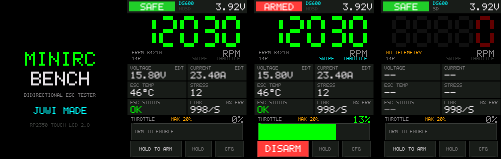
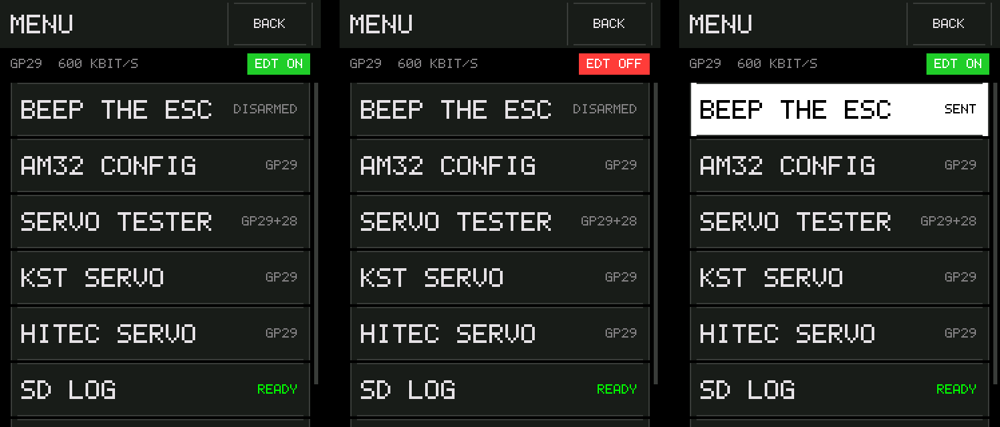
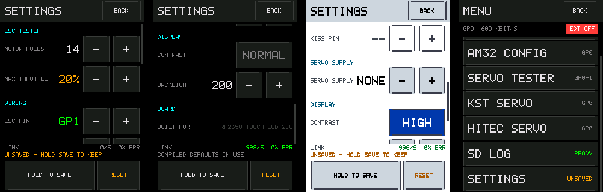
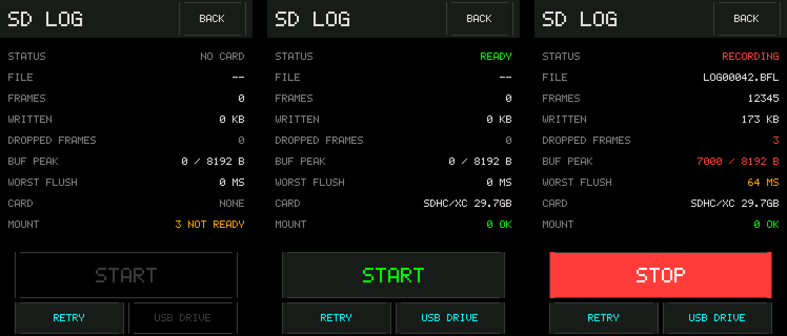
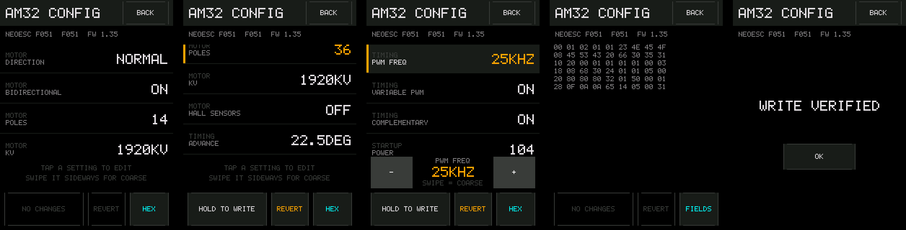
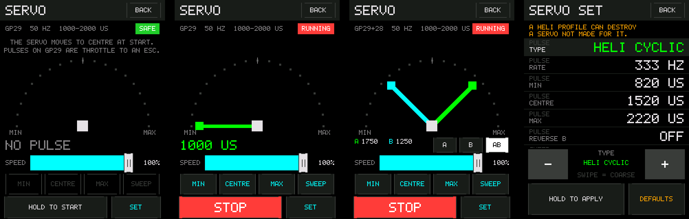
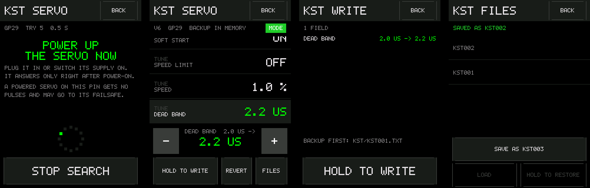

# MiniRcBench

[](https://github.com/subtilitas/MiniRcBench/actions/workflows/ci.yml)

A bench tester for RC (radio-controlled) model parts. It runs on the
**Waveshare RP2350-Touch-LCD-2.8** and needs no flight controller, laptop or
Betaflight. MiniRcBench continues the DshotDisplay firmware, which remains at
[github.com/subtilitas/DshotDisplay](https://github.com/subtilitas/DshotDisplay)
as a separate project.

Today it is a bidirectional DShot tester for one electronic speed controller
(ESC). The board sends bidirectional DShot to the ESC from an on-screen
throttle. On the same wire it decodes the electrical RPM (eRPM) and Extended
DShot Telemetry (EDT) that the ESC returns: RPM (revolutions per minute),
voltage, current, ESC temperature, stress and status. The touch panel shows all
of it. An optional third wire carries KISS telemetry, with finer voltage and
current steps. The board records the telemetry to microSD as a Betaflight
blackbox log, offers the card to a USB (Universal Serial Bus) host as a
read-only drive, and reads and writes AM32 ESC settings over the signal wire.

It is also a servo tester: PWM (pulse-width modulation) servo output on the
same two signal pins, with manual position, sweep and two servos at once (see
[Servo tester](#servo-tester); design note `docs/design/servo-tester.md`).
It programs KST and Chaservo servos on the ESC pin (see
[KST servo programming](#kst-servo-programming); design note
`docs/design/kst-programming.md`). The AM32 editor, the servo tester and the
KST programmer take the pins through the pin claim of
`docs/design/pin-claim.md`.



*The host test suite renders every screenshot here from the UI (user
interface) code.
`tools/make_previews.py` stitches them together.*

> ### [User manual — the Wiki](https://github.com/subtilitas/MiniRcBench/wiki)
>
> **[English](https://github.com/subtilitas/MiniRcBench/wiki/First-Run)** ·
> **[Deutsch](https://github.com/subtilitas/MiniRcBench/wiki/Erste-Schritte)**
>
> Wiring, first run, every screen, telemetry, logging, AM32 configuration and
> the servo tester, for someone using the board. This README describes the
> firmware and the build.

Project state and open items: [STATUS.md](https://github.com/subtilitas/MiniRcBench/blob/main/STATUS.md). Changes by release: [CHANGELOG.md](https://github.com/subtilitas/MiniRcBench/blob/main/CHANGELOG.md).

---

## Core split

Bidirectional DShot is half-duplex. The ESC answers only frames it receives,
and it disarms when frames stop. A telemetry display therefore cannot listen
passively. It has to be the throttle source. This makes the device a bench
tester, not an inline monitor.

The display transfers 153,600 bytes per full frame (240 × 320 pixels in RGB565,
16 bits per pixel: 5 red, 6 green, 5 blue) over SPI (Serial Peripheral
Interface) by DMA (direct memory access). At the 62.5 MHz write maximum in
`LCD_SPI_HZ` that is at least 19.7 ms (computed, not measured). DShot frame
timing cannot share a core with that, so the work is split:

| | core0 | core1 |
|---|---|---|
| Job | touch, rendering, battery sense | DShot frame pump + telemetry decode |
| Rate | 40 Hz (`UI_PERIOD_MS` = 25 ms) | 1 kHz (`DSHOT_PERIOD_US` = 1000 µs) |
| Allowed to block | yes | never |

The two cores share one struct guarded by a `critical_section`. Core0 calls
`escHeartbeat()` every frame. If no heartbeat arrives for
`UI_HEARTBEAT_TIMEOUT_MS` (250 ms), core1 forces the throttle to zero.

A screen that needs the signal pins claims them (`src/pin_claim.h`). The claim
asks core1 to suspend the DShot pump. Once core1 sees the request, it sends
zero frames for at least 250 ms (`ARM_ZERO_THROTTLE_MS`) after the last
throttle frame, then stops the pump with no edges, releases the pin (a plain
input with the pulls off), puts the pull-up back on it and ends the KISS
receiver. Core1 then runs that screen's job instead (`src/core1_job.h`), and
`loop1()` is `escTaskPoll(); core1JobPoll();`. The AM32 editor's transport runs
on core0 and has no core1 job; no other job is built yet. Leaving the screen
rebuilds the pump from the wiring it had, disarmed.

---

## Hardware

**Board:** [Waveshare RP2350-Touch-LCD-2.8](https://www.waveshare.com/wiki/RP2350-Touch-LCD-2.8).
An RP2350A with a 240×320 IPS (in-plane switching) portrait panel (ST7789T3
over SPI1), CST328 capacitive touch, a QMI8658 IMU (inertial measurement
unit), a PCF85063 RTC (real-time clock), a PCM5101A audio codec, a microSD
slot and a LiPo (lithium-polymer) battery charger. In the tables below, I2C is
the two-wire Inter-Integrated Circuit bus, PIO is the RP2350's programmable
I/O block, and GPIO means general-purpose input/output pin.

### Pin map (from the official schematic)

The pin map is `src/board_rp2350_touch_lcd_2_8.h`.

| Function | GPIO | Notes |
|---|---|---|
| LCD (liquid-crystal display) SCK / MOSI / CS / DC / RST | 10 / 11 / 13 / 14 / 15 | SPI1. SCK is serial clock, MOSI master out, slave in, CS chip select, DC data/command, RST reset. GP12 is the panel's MISO (master in, slave out) line, wired and not used |
| LCD backlight | 16 | NPN (negative-positive-negative) transistor as low-side switch, PWM at 20 kHz, 8-bit |
| Touch + IMU + RTC I2C SDA / SCL | 6 / 7 | I2C1, **shared bus** (touch 0x1A, IMU 0x6B, RTC 0x51). SDA is serial data, SCL serial clock |
| Touch INT / RESET | 18 / 17 | Interrupt, active low. The touch reset is a net of its own, separate from LCD_RST |
| microSD CLK / CMD / D0–D3 | 19 / 20 / 21–24 | 4-bit SDIO (Secure Digital Input/Output) on PIO, blackbox logging, see below. CLK is clock, CMD command, D0–D3 the data lines |
| Power latch | 26 | `PIN_BAT_EN`, driven high first at boot |
| Power button | 25 | 10 kΩ pull-up, reads low while pressed |
| Battery sense | 27 | ADC (analog-to-digital converter) input 1, 200k/100k divider → `VBAT = Vadc × 3` |
| I2S audio BCK / LRCK / DIN | 2 / 3 / 4 | PCM5101A codec, not used by the firmware. I2S is Inter-IC Sound; BCK is bit clock, LRCK left-right clock, DIN data in |
| RTC INT, IMU INT1 / INT2 | 5, 8 / 9 | Not used by the firmware |
| UART0 TX / RX | 0 / 1 | On J4 and J5. Not offered for the ESC wires. UART is universal asynchronous receiver-transmitter; TX is transmit, RX receive |
| ESC signal | 29 | J4 pin 12, free |
| KISS telemetry RX (receive; KISS is a serial ESC telemetry protocol) | 28 | J4 pin 11, free. Optional third wire |

Only GP28 and GP29 are free (`BOARD_FREE_GPIO_MASK` = `0x30000000`).

### Wiring the ESC

Two wires:

| ESC | Board |
|---|---|
| Signal | **GP29**, J4 pin 12 |
| Ground | **GND** (ground), J4 pin 1 or 5 |

The board has no 2.54 mm headers. All signals are on JST-SH 1.0 mm
connectors, so an ESC lead needs a pigtail:

```
J4 (12P): 1=GND  2=VBUS 3=USB_N 4=USB_P 5=GND   6=3V3
          7=GP7* 8=GP6* 9=GP0   10=GP1  11=GP28 12=GP29
J3  (4P): 1=GP7* 2=GP6* 3=3V3   4=GND
J5  (4P): 1=GP1  2=GP0  3=3V3   4=GND
                                (* = on the shared I2C bus, do not reuse)
```

> **Cut or depin the middle wire first.** The middle conductor of an ESC lead
> is the BEC (battery eliminator circuit) **+5 V** output. RP2350 GPIO is
> **not** 5 V tolerant. More than about 3.6 V on a pin exceeds the absolute
> maximum rating and damages it. The tester needs signal and ground only.

The ESC pin is set on the board under **MENU → SETTINGS** and stored in flash.
`DSHOT_PIN_LCD_2_8` in `config.h` is the pin a board with blank flash starts
on, **GP29**, the last pin on J4. The KISS telemetry wire starts on **GP28**.
To swap them at build time, build with
`-DDSHOT_PIN_LCD_2_8=28 -DKISS_PIN_LCD_2_8=29`. The two must move together. A
build that puts both on one pin fails a `static_assert`.

An ESC on the wrong one of the two pins produces no error. **LINK** stays at
`0/S`.

**Power the ESC from its own battery.** Do not power a motor from the board's
5 V pin. Connect the ESC ground to the board ground, and keep the signal wire
short. The maximum working lead length is not measured. If the **LINK** error
rate rises, set **DSHOT KBAUD** to 300 under **MENU → SETTINGS**.

The board has a power-button latch on GP26 (`PIN_BAT_EN`). The firmware drives
it high as the first action at boot. Without it, the board loses power when
the button is released while running on battery. On USB the latch has no
effect.

### Other boards

The image is for the RP2350-Touch-LCD-2.8 only. DshotDisplay supports the
RP2350-Touch-LCD-2.

---

## Building

Native [Pico SDK](https://github.com/raspberrypi/pico-sdk) (software
development kit) with CMake. No Arduino core, no IDE (integrated development
environment).

Requirements: `cmake` 3.18 or later, `ninja` and an `arm-none-eabi` toolchain.

```sh
sudo apt install cmake ninja-build gcc-arm-none-eabi   # Debian/Ubuntu
brew install cmake ninja arm-none-eabi-gcc             # macOS
```

Fetch the SDK once and set `PICO_SDK_PATH`:

```sh
git clone --depth 1 --branch 2.1.1 https://github.com/raspberrypi/pico-sdk.git ~/pico-sdk
git -C ~/pico-sdk submodule update --init --depth 1 lib/tinyusb
export PICO_SDK_PATH=~/pico-sdk
```

`lib/tinyusb` is required. Serial telemetry runs over USB CDC (communications
device class). Without the submodule the SDK builds with no USB support and
reports no error.

Build:

```sh
cmake -B build -G Ninja -DPICO_BOARD=pico2 -DPICO_PLATFORM=rp2350-arm-s .
ninja -C build
```

Build options:

```sh
-DDSHOT_PIN_LCD_2_8=28   # the ESC pin a blank board starts on
-DKISS_PIN_LCD_2_8=29    # ...and the telemetry pin; the two move together
-DSTRICT=ON              # warnings fatal, for this project's sources
```

The ESC pin defaults to **GP29** (`DSHOT_PIN_LCD_2_8`) and the telemetry pin
to **GP28** (`KISS_PIN_LCD_2_8`). The suffix names the board, as the image's
file name does. There is no board to select, and a `-DBOARD` is ignored.
Configuring with `-DDSHOT_PIN`, `-DKISS_PIN`, `-DDSHOT_PIN_LCD_2` or
`-DKISS_PIN_LCD_2` fails, with a message naming the options this build takes.

The output is `build/MiniRcBench-touch-lcd-2.8.uf2`. UF2 is the USB Flashing
Format.

To flash: hold **BOOT**, tap **RESET**, release **BOOT**, and copy the `.uf2`
onto the USB drive that appears.

`-DSTRICT=ON` adds `-Werror` for this project's own sources. CI (continuous integration) sets it. It is
off by default, so a toolchain update that adds a warning does not stop a
local build.

Only the Cortex-M33 build (`rp2350-arm-s`) is supported. This project does not
build or test for the RP2350's Hazard3 RISC-V cores.

### Prebuilt image

Every [release](https://github.com/subtilitas/MiniRcBench/releases) has the
`.uf2` attached. Flash it as above.

Every green CI run uploads the `.uf2` as an
artifact, so an untagged commit can be tested on hardware.

`tools/sdtest` is not among them. It is a bench diagnostic for the SD card
wiring, not firmware, and builds for the RP2350-Touch-LCD-2.8 only. A plain
`ninja -C build` builds it locally next to the firmware, as
`build/sdtest.uf2`.

### Reproducible builds

`CMakeLists.txt` pins each dependency and fetches it at configure time. The
tree contains no third-party source. The DShot driver in `src/dshot/` is part
of the tree: it comes from [rcbench](https://github.com/subtilitas/rcbench),
which has the same copyright holder and the same MIT licence, and each of its
files names the rcbench commit it was taken from.

| Dependency | Version | Pinned by |
|---|---|---|
| pico-sdk | 2.1.1 | commit hash |
| no-OS-FatFS-SD-SDIO-SPI-RPi-Pico | v3.6.2 | commit hash |

Each hash has its tag in a comment beside it. A tag can be moved; a hash cannot.

Two constraints on these dependencies:

- Only part of the SD library is built: FatFs, its glue, its card layer and
  its SPI card driver. The board's card is on SDIO, but the card layer's init
  path calls into the SPI driver, so the image does not link without it. The
  library's own `CMakeLists.txt` would also compile its SDIO driver, which
  its README derives from GPL-3.0 (GNU General Public License version 3)
  code. So `CMakeLists.txt` fetches the source without adding it, and defines
  the target `sd_fatfs` from a copy of the library's `src/` without the SDIO,
  ZuluSCSI-firmware and SdFat directories. The SDIO driver is `src/sdio/`, in
  this tree; its design note is `docs/design/sdio-driver.md`.
- The SD driver is the **SDIO-SPI** repository, not the older SPI-only one. The
  SPI-only driver's `rtc.c` includes `hardware/rtc.h`. The RP2040 has that RTC
  peripheral; the RP2350 does not (it has powman instead), so that driver fails
  to compile for the RP2350.

---

## Using it

**Main screen**

- **HOLD TO ARM**: press and hold for 1 s (`ARM_HOLD_MS`). Arming is refused
  unless the throttle has been at zero for 250 ms (`ARM_ZERO_THROTTLE_MS`).
  The hold counts only for a press that starts on the button while disarmed
  and while no USB host holds the card. A host that takes the card during
  the hold cancels that press. The press that disarms, kept down, does not
  arm again.
  Once armed the button reads **DISARM** and acts on touch-down.
- **Throttle bar**: the gesture depends on HOLD.

  | | HOLD off (default) | HOLD on |
  |---|---|---|
  | Bar label | `THROTTLE` | `THROTTLE REL` + grab handle |
  | Gesture | **absolute**: finger position sets the throttle | **relative**: throttle moves by the finger's travel |
  | Touching the bar | jumps to that position | changes nothing |
  | On release | returns to zero | stays |

  The bar is 34 px tall (`THR_TRACK_H`). The outer 16 px at each end
  (`THR_EDGE_SAT`) count as the rail, so zero and the ceiling are reachable
  with a finger. Relative drags accumulate across several swipes and
  re-anchor at both rails. `HOLD_DRAG_SENSITIVITY_PCT` (default 100) sets how
  much of the ceiling one track width of travel covers.

  The percentage shown is of the full 0–2000 DShot range. The bar's full width
  is the configured ceiling.
- **Throttle pad**: the area above the gauge (RPM readout and telemetry tiles)
  is a relative throttle surface in both modes. Swipe **up** for more,
  **down** for less. Swipes accumulate.

  A tap on the pad never changes the throttle. A drag engages after 6 px of
  travel (`PAD_DEADZONE_PX`). One full-height swipe covers 60 % of the ceiling
  (`PAD_DRAG_SENSITIVITY_PCT`).

  The pad ends where the gauge's grab area begins, with no overlap and no gap.
  The hint under the RPM readout reads `SWIPE = THROTTLE`, cyan while armed,
  and changes to `SWIPE ACTIVE` in green while a drag is engaged.
- **HOLD**: off by default. Turning it off sets the throttle to zero.
- **MENU**: the list of tools and settings. Opening it disarms, sets the
  throttle to zero and turns HOLD off.

**Button behaviour**

Every button except DISARM acts on release and shows a pressed outline while
held. Sliding off before release cancels the press.

DISARM acts on touch-down.

The `-` / `+` steppers step once on press. After 400 ms held
(`REPEAT_DELAY_MS`) they repeat every 120 ms, after 1.2 s every 60 ms, and
after 2.5 s every 25 ms.

Arming and disarming dim the backlight to a quarter for 120 ms
(`BL_DIP_MS`), so the event is visible while watching the motor.

**MENU**



*EDT live, EDT silent, and BEEP acknowledging a press.*

MENU is a list of rows. Each row is 40 px tall at a 42 px pitch, with the name
at scale 2 on the left and its state right-aligned. **BACK** returns to the
tester. Every tool's **BACK** returns to MENU.

- **EDT ON / EDT OFF**: a read-only chip on the strip under the title. Green
  while EDT frames arrive, red otherwise. The firmware sends the enable command
  itself (see [Telemetry and logging](#telemetry-and-logging)). The ESC does
  not acknowledge the command, so the chip shows received frames, not sent
  commands. The strip's caption reads the ESC pin and the DShot rate, for
  example `GP29  600 KBIT/S`.

| Row | State on the right | A tap |
|---|---|---|
| **BEEP THE ESC** | `DISARMED`; for 350 ms after a tap, `SENT` or `REFUSED` | Sends `DSHOT_CMD_BEACON1` for 6 frames (`BEEP_REPEATS`), 6 ms at 1 kHz. Use it to identify which ESC is connected |
| **AM32 CONFIG** | the ESC pin, `GP29`; `PINS BUSY` | Opens the ESC settings editor. See [AM32 ESC configuration](#am32-esc-configuration) |
| **SERVO TESTER** | the signal pins, `GP29+28`; `PINS BUSY` | Opens the servo tester. See [Servo tester](#servo-tester) |
| **KST SERVO** | the ESC pin, `GP29`; `PINS BUSY` | Opens the KST servo programmer. See [KST servo programming](#kst-servo-programming) |
| **SD LOG** | `NO CARD`, `READY`, `RECORDING`, `CARD ERROR`, or `USB DRIVE` while a USB host holds the card | Opens the logging status. See below |
| **SETTINGS** | `UNSAVED` while the live settings differ from flash, else nothing; `PINS BUSY` while the pin claim is not Free, drawn disabled | Opens SETTINGS. See below |

- **BEEP flash**: a tap fills the row for 350 ms (`BEEP_FLASH_MS`): white
  with `SENT`, amber with `REFUSED`. Without it a 6 ms command is not visible
  against a 25 ms repaint. BEEP is refused while armed. Opening MENU disarms,
  so the refusal is not reachable through the UI; the flash stays as a
  backstop.
- **PINS BUSY**: AM32 CONFIG, SERVO TESTER and KST SERVO claim the signal
  pins. While the claim is not free, for example after RESTART DSHOT until
  the DShot pump runs again, the row reads `PINS BUSY` in amber and a tap
  opens nothing.
- **Rows**: six rows fit the screen without scrolling. A seventh makes MENU
  scroll by 36 px, with a 3 px scroll bar at x 235.

**SD LOG screen**

- **STATUS**: `NO CARD`, `READY`, `RECORDING` or `CARD ERROR`. The board has
  no card-detect pin, so the firmware learns of a card only by mounting it.
- **START / STOP**: starts or ends a log. Disabled with no card.
- **FILE**, **FRAMES**, **WRITTEN**: the open file, frames logged, kB written.
- **DROPPED FRAMES**: frames the ring buffer refused because the card was
  slower than the data. Red when non-zero. Non-zero means the buffer is too
  small for that card.
- **BUF PEAK**: buffer high-water mark against `SD_LOG_BUFFER_BYTES`. Amber
  above 1/2, red above 3/4.
- **WORST FLUSH**: the longest single card write, in ms. Amber above 50 ms.
- **CARD**: card type and size. **MOUNT**: the FatFs result code and name,
  for example `0 OK`, `3 NOT READY`, `13 NO FILESYSTEM`.
- **RETRY**: mounts again. The card is otherwise mounted only once, at boot.
- **USB DRIVE**: serves the card to the USB host. See
  [Blackbox logging to microSD](#blackbox-logging-to-microsd).
- **BACK**: returns to MENU, also while a host holds the card. The handover
  continues, and arming stays blocked until the card is ejected.

**SETTINGS screen**



*SETTINGS at the top, scrolled to the end, in high contrast, and the UNSAVED
marker it puts on MENU.*

SETTINGS is one list in sections. The list fills y 40 to 239 and scrolls under
a drag. A row is 44 px tall at a 50 px pitch. **MOTOR POLES** and
**MAX THROTTLE** lead it, so they need no scroll.

| Section | Row | What it does |
|---|---|---|
| ESC TESTER | **MOTOR POLES** | eRPM to RPM is `RPM = eRPM / (poles / 2)`. Range 2–28, even values only. Default 14 |
| ESC TESTER | **MAX THROTTLE** | The throttle ceiling. Default 20 % (400 of 2000). Steps of 5 %, range 5–100 % |
| WIRING | **ESC PIN** | GPIO for the DShot signal. Steps through the board's two free GPIOs only, skipping the KISS pin while KISS is on |
| WIRING | **DSHOT KBAUD** | 150 / 300 / 600 / 1200, wrapping at the ends. Applies at once: the driver is rebuilt on the new pin and rate before the next frame |
| WIRING | **KISS TELEM** | Whether to listen for the telemetry wire. Turning it on moves the KISS pin off the ESC pin if they coincide |
| WIRING | **KISS PIN** | Steps through the same free GPIOs, skipping the ESC pin. The receiver is a PIO state machine, so any free GPIO works. Reads `--` and does not act while KISS is off |
| DISPLAY | **CONTRAST** | `NORMAL` or `HIGH`. See below |
| DISPLAY | **BACKLIGHT** | 16–255 in steps of 32. High contrast forces 255 while on |
| BOARD | **BUILT FOR** | `RP2350-TOUCH-LCD-2.8`, the board the image is built for. Read-only |

The `-` and `+` buttons are 44 × 44 px and the toggles 94 × 44 px.

**Scrolling.** A drag scrolls the list when it starts off a control: on a
section name, a row's label or value, or the gap between rows. After 6 px of
vertical travel the list follows the finger. A press on a control never
scrolls: `-` and `+` step on touch-down and repeat while held, and a toggle
acts on release. A control cut by the edge of the list takes a press only
while at least 40 px of it show (`UI_LIST_TAP_MIN`). Opening SETTINGS sets the
scroll to 0 px.

Below the list, fixed and not scrolled:

- **LINK**: live packets per second and checksum error rate. Green when
  packets arrive, amber above 5 % errors.
- The note line.
- **HOLD TO SAVE** (150 × 48 px) and **RESET** (70 × 48 px).

A wrong ESC pin produces no error: the ESC receives no frames. **LINK** on this
screen shows the result of each pin change. A non-zero packet rate means the
pin is correct.

**HOLD TO SAVE** (1 s, `UI_HOLD_MS`) writes all settings to flash: every row
above, pole count and throttle ceiling included. Erasing the flash sector stops
core1, and with it the DShot pump, for the length of the erase. That duration
is not measured. Saving is refused while armed (`NOT WHILE ARMED - DISARM TO
SAVE`); opening MENU disarms, so the refusal is a backstop. **RESET** loads the
compiled defaults, pole count and throttle ceiling included, into the live
settings. Flash changes only on the next save.

Every value applies when changed. Only persistence needs the hold, so a value
can be tried and then discarded by leaving without saving. The note line reads
`UNSAVED - HOLD SAVE TO KEEP` after a change, and otherwise
`SAVED SETTINGS IN USE` or `COMPILED DEFAULTS IN USE`. MENU shows `UNSAVED` on
the SETTINGS row while the live settings differ from flash.

**High contrast**


*The tester screen in the normal and the high-contrast palette.*

High contrast is black on white. Accents are darkened to carry white text,
every glyph stroke gets one extra pixel of weight, frames are 2 px, the
seven-segment stroke is thicker, and the backlight is forced to 255. It is
meant for direct sunlight on the transmissive IPS panel.

The palette has fewer distinct greys than the dark one. Label greys are
merged so that labels stay legible outdoors.

The extra glyph weight is a 1 px vertical smear. The 5×7 font sits in a 6 px
cell, so a horizontal smear would close the gap between glyphs. A vertical
smear adds no width, so no layout changes.

**Reading the telemetry**

`--` means no source has supplied that field within its timeout. Plain eRPM
works on any bidirectional DShot ESC. Voltage, current, temperature, stress and
status need EDT support in the ESC firmware (BLHeli_32, Bluejay, AM32). The
**LINK** tile shows good packets per second and the checksum error rate over
the last second. At 1 kHz a clean link reads close to `1000/S` and `0% ERR`.
A rising error rate points at signal integrity.

The voltage and current tiles carry a source tag: **KISS** (cyan) or **EDT**
(dimmed). EDT reports voltage in 0.25 V steps and KISS in 0.01 V steps. A tag
that drops from KISS to EDT means the telemetry wire has stopped, and the
reading is 25 times coarser. Consumption in mAh appears on the temperature
tile with KISS only. EDT does not carry it.

The tester's top row shows `DS` plus the bitrate the DShot driver runs at,
as set under SETTINGS, cyan once an EDT enable has been sent. `DSERR` in amber
replaces it when the driver could not claim its two PIO state machines;
nothing is sent to the ESC then.

---

## Telemetry and logging

The firmware enables EDT itself. There is no button.

The first frames the DShot pump sends after it starts are the enable,
`EDT_ENABLE_REPEATS` (10) identical frames of DShot command 13. The pump starts
at power-up, after a change of the ESC pin, the bitrate, KISS or the KISS pin
under SETTINGS, and when the AM32 editor hands the pin back. Every reply is
decoded with EDT on, from the first one:

- an ESC that kept EDT on across one of those restarts is read correctly from
  its first reply, and none of its EDT frames is shown as an RPM;
- an ESC without EDT, or with EDT off, sends eRPM frames only. AM32 and
  Bluejay normalise the exponent of every eRPM frame, with EDT on or off, and
  those frames decode the same with EDT on. For other ESC firmware this is
  unknown: an eRPM frame that is not normalised, an exponent above 0 with
  bit 8 of the payload clear, decodes as an EDT reading and gives no RPM;
- the replies to the enable frames are decoded like any other. AM32 answers
  the enable with a status frame.

At the 1 kHz frame rate the enable at pump start takes 10 ms. Arming
during it sends the throttle on the next frame and drops the rest of the
enable. A BEEP and the first KISS telemetry request wait for its end.

An ESC that is not yet ready for commands ignores that enable, and it does
not count as an attempt. While an ESC answers with eRPM and no EDT frame has
arrived for `EDT_STALE_MS` (1000 ms), the enable is sent again every
`EDT_RETRY_MS` (1000 ms), counted from the last frame of the one before.
After `ESC_LINK_STALE_MS` (500 ms) without eRPM the state resets. An ESC
connected later, power-cycled or replaced then gets its own enable.

Each repeated enable is `EDT_ENABLE_REPEATS` (10) identical frames. It is
sent only when all of these hold:

- the link has been up for `EDT_SETTLE_MS` (300 ms). An ESC answers eRPM
  within milliseconds of power-up but executes commands only after a run of
  valid zero-throttle frames;
- the tester is disarmed and eRPM is zero. DShot commands execute only with
  the motor stopped, and a motor coasts for seconds after a disarm;
- no other command is on the wire. An ESC executes a command only after a run
  of identical frames, so a BEEP inside an enable would break both.

Every reading expires. An EDT field not refreshed for `EDT_STALE_MS` (1 s)
shows `--`. RPM shows a dark red zero, and the line under it reads
`NO TELEMETRY`, after `ESC_LINK_STALE_MS` (500 ms) without eRPM. A display that
held old values would show a plausible reading from an ESC that is no longer
connected.

An expired **ESC STATUS** reads `--`, never `OK`.

Bidirectional DShot and EDT work on hardware. No defect is known as of
DshotDisplay v2.3.

### KISS telemetry (optional third wire)

EDT rides in the eRPM frame and needs no extra wire. Its resolution is 0.25 V
and 1 A. On a 6S pack a 200 mV sag is below one step, and idle current reads
0 A.

An ESC with KISS telemetry (BLHeli_32 and AM32 implement it) sends a 10-byte
frame at 115200 baud on a separate wire when the DShot frame requests it. The
frame carries voltage and current in 0.01 V and 0.01 A steps, plus consumed
mAh, which EDT does not carry.

| ESC | Board |
|---|---|
| Telemetry pad | **GP28**, J4 pin 11 |

The line is transmit-only from the ESC. Requests go out every 20th DShot frame
(`KISS_REQUEST_EVERY_N`), which is 50 Hz at 1 kHz.

**Status:** working on hardware (owner report). It is off by default
(`KISS_ENABLE_LCD_2_8` = 0) because the board has two free pins and the ESC
uses one.

**Any free GPIO can receive it.** The receiver is a UART built from one PIO state machine. The
RP2350's two hardware UARTs receive only on GPIOs where `n % 4 == 1`, which on
this board leaves only GP29, the ESC pin. See `src/pio_uart_rx.h`.

The tiles fall back from KISS to EDT `KISS_STALE_MS` (500 ms) after the last
KISS frame.

> **Voltage.** The KISS specification puts this line at 3.6 V, which equals the
> RP2350's absolute-maximum GPIO voltage. The level a given ESC drives is not
> measured by this project. Measure yours before connecting it, and consider a
> 1 kΩ series resistor.

RPM is **not** taken from KISS. KISS arrives at 50 Hz and bidirectional DShot at
1 kHz, and spin-up, oscillation and desync show in the 1 kHz stream. KISS
resolves 100 eRPM. Bidirectional DShot encodes a period with a 9-bit mantissa,
so its step grows with RPM. Above about 5,500 mechanical RPM on a 14-pole motor
(about 6,500 on 12 poles, 4,800 on 16) the KISS step is finer. The log
records both. The arithmetic is in `docs/design/erpm_resolution.py`.

### Blackbox logging to microSD

Logs are written in Betaflight's blackbox format. They open in
[**logwiju**](https://subtilitas.github.io/logwiju/), the viewer written for
them, and in Blackbox Explorer, `blackbox_decode` and PIDtoolbox. Files are
named `LOGnnnnn.BFL` on a card formatted with FAT (File Allocation Table). Each new file takes the lowest
unused number from 00001 to 09999. Existing files are not overwritten.



The card runs over 4-bit PIO SDIO at 10 MHz (`SD_LOG_SDIO_HZ`), with the
driver in `src/sdio/`, which is not tested on hardware. The board cannot use
hardware SPI for the card: its SD clock is on GP19, which is SPI0 TX in the
pin mux.

Open the screen with **MENU → SD LOG**. By default arming starts a log and
disarming stops it (`SD_LOG_AUTO_ON_ARM`). Auto-stop ends only a log that
auto-start began. **START/STOP** is always available.

At the default 500 Hz (`SD_LOG_RATE_HZ`) a frame averages 14.5 bytes
(measured). That is 7.3 kB/s, or 26 MB per hour.

Size the buffer from **BUF PEAK** and **WORST FLUSH**. `SD_LOG_BUFFER_BYTES`
defaults to 8192 bytes, about 1.1 s at 7.3 kB/s. Whether that covers a given
card's erase stalls is not measured. A peak near the buffer size, or a flush
longer than the buffer covers, means raise it. **DROPPED FRAMES** above zero
means it was too small.

The logger drops frames rather than block. The UI never waits for the card.

**Getting the files off:** **MENU → SD LOG → USB DRIVE** presents the card to
the USB host as a read-only removable drive, using MSC (mass storage class) on
the same USB cable as the serial port. The logger unmounts before the drive
appears and touches the card again only after eject. The host and the
firmware never share the FAT volume. Without a card the button is drawn
unavailable and does nothing. With a card, the request is refused while armed
(`DISARM FIRST`) or while recording (`STOP RECORDING FIRST`). Arming is
blocked while the host holds the card. See `src/usb_msc.h`.

### Tuning

All in `config.h`. Unless a row says otherwise, a default is a starting value,
not one derived from measurement.

Six of these are only *defaults*: the ESC pin, the DShot bitrate, the KISS
wire, the pole count, the throttle ceiling and the backlight. Each can be
changed under **MENU → SETTINGS** and stored in flash. On a board with saved
settings the stored value wins, so editing `config.h` and reflashing changes
nothing for those six. The SETTINGS note line says which set is in use.

| Setting | Default | What it does |
|---|---|---|
| `DSHOT_PIN_LCD_2_8` | `29` | ESC signal GPIO the board starts on |
| `KISS_TELEM_ENABLE` | `1` | Compile the KISS path in at all |
| `KISS_ENABLE_LCD_2_8` | `0` | Whether the board listens for a KISS wire. **Off**: the board has two free pins and the ESC takes one. One tap under SETTINGS turns it on |
| `KISS_PIN_LCD_2_8` | `28` | GPIO for the telemetry wire. Receive only, changeable under SETTINGS. The other of the two free pins; `DSHOT_PIN_LCD_2_8` has GP29 |
| `KISS_REQUEST_EVERY_N` | `20` | Request every Nth DShot frame; 20 at 1 kHz is 50 Hz. Values below 2 overlap replies and fail an `#error` |
| `KISS_STALE_MS` | `500` | How long a KISS frame stays in use before the display falls back to EDT |
| `EDT_STALE_MS` | `1000` | How long an EDT field stays valid after its last frame. Then the tile shows `--` |
| `ESC_LINK_STALE_MS` | `500` | Time without eRPM before the ESC counts as gone. Resets the automatic EDT enable |
| `EDT_RETRY_MS` | `1000` | Interval between EDT enables while eRPM arrives and EDT does not |
| `EDT_SETTLE_MS` | `300` | Time the link must be up before the first repeated EDT enable. The enable at pump start does not wait |
| `KISS_REPLY_TIMEOUT_MS` | `10` | Abandon an incomplete reply after this long; affects only the timeout counter |
| `SD_LOG_ENABLE` | `1` | Compile the logging path in at all |
| `SD_LOG_SDIO_HZ` | `10 MHz` | SDIO card clock |
| `SD_LOG_RATE_HZ` | `500` | Log frame rate. eRPM is the only 1 kHz signal |
| `SD_LOG_I_INTERVAL` | `32` | Frames between keyframes (I frames). Lower values resynchronise sooner after damage and cost size |
| `SD_LOG_BUFFER_BYTES` | `8192` | Ring buffer. Size it from BUF PEAK and WORST FLUSH |
| `SD_LOG_CHUNK_BYTES` | `512` | Flush size. Keep it a multiple of 512 to avoid read-modify-write in the card |
| `SD_LOG_PREALLOC_BYTES` | `16 MiB` | Contiguous space reserved per file, so the FAT is not rewritten mid-log. About 38 min at 7.3 kB/s. Unused space is released at close |
| `SD_LOG_SYNC_MS` | `2000` | Interval for committing the file's directory entry. A power cut loses at most the data since the last commit |
| `SD_LOG_AUTO_ON_ARM` | `1` | Start and stop logging with ARM, in addition to the manual button |

### Reading the logs

Files are written to the card root as `LOGnnnnn.BFL`.

<div align="center">

[](https://subtilitas.github.io/logwiju/)

### **[logwiju](https://subtilitas.github.io/logwiju/)** — the viewer for these logs

</div>

Drop a `.BFL` file onto the page to plot it. It needs no install, upload or
account, and the file stays in the browser. Wheel zooms, drag pans,
shift+drag zooms to a box, double-click fits. The side panel selects fields.

The name, read in German (`w` as English *v*, `j` as English *y*), sounds like
"logview". The tail is **WI**ngert **JU**lian.

The logs also open in
[Blackbox Explorer](https://github.com/betaflight/blackbox-log-viewer), or on the
command line:

```sh
blackbox_decode LOG00001.BFL      # -> LOG00001.01.csv and .01.event
```

The `.event` file holds the end-of-log marker. The CSV (comma-separated values) file holds the data.

Fields per frame: `loopIteration`, `time`, `motor[0]` (throttle), `eRPM[0]`,
`eRPMkiss[0]`, `vbatLatest`, `amperageLatest`, `vbatEdt`, `amperageEdt`,
`escTemperature[0]`, `escConsumption` and `escStress`.

Both eRPM sources are logged: `eRPM[0]` (bidirectional DShot, 1 kHz) and
`eRPMkiss[0]` (KISS, 50 Hz). Both voltage and current sources are logged:
`vbatLatest` / `amperageLatest` carry KISS where it was live, `vbatEdt` /
`amperageEdt` always carry EDT. This allows the KISS decoder to be checked
against EDT from the log itself.

## AM32 ESC configuration

**MENU → AM32 CONFIG** reads and edits an AM32 ESC's settings over the signal wire. It
does not flash ESC firmware. The transport is `src/am32_bl.h`.



Entering the screen claims the signal pin (`src/pin_claim.h`): it disarms,
sends throttle zero for at least 250 ms after the last throttle frame,
stops the DShot driver and hands the pin to the bootloader transport. Leaving
hands it back.

### Connecting

Open the screen, then power-cycle the ESC. The AM32 bootloader listens only in
a short window after power-up. The firmware repeats the 21-byte init string,
waiting 30 ms (`AM32_GREET_TMO_MS`) for each reply, so that it is sending when
the window opens. The window's length is not measured.

`AM32_FORCE_LOW_JUMP` (default 0) instead holds the signal low for
`AM32_BOOT_LOW_MS` (200 ms) once before the first attempt. The reference
configurator does not do this, and the firmware cannot receive while it holds
the line.

The screen shows which half failed:

| Message | Meaning | What to change |
|---|---|---|
| `WAITING... (TRY n)` | No reply yet | Power-cycle the ESC while the screen is open |
| `REPLY NOT UNDERSTOOD:` followed by `nB: xx xx xx @19200` | The ESC sent bytes that did not parse | Baud rate or framing. The first three bytes are shown |
| `READ FAILED (...)` | Handshake succeeded, settings read failed | Retry; check the wire |
| `NO VALID SETTINGS` | The settings block is implausible | Do not write |

`AM32_DEBUG` (default 1) mirrors every transport step to USB serial.

### Editing

| Gesture | Effect |
|---|---|
| Tap a row | Selects it; the editor bar at the bottom shows its name and value |
| **Swipe the row sideways** | **Coarse**: one coarse step per 16 px of travel; 11 steps, 176 px, cover any field's range |
| `-` / `+` buttons | **Fine**: one step per press; hold to repeat, accelerating |
| Drag up/down | Scrolls the list 1:1 with the finger |

A press selects nothing on its own. It becomes a selection on release if the
finger did not move, or when a sideways swipe is recognised, so a swipe adjusts
the row it started on. A vertical drag never selects.

The axis locks after 6 px of travel (`UI_AXIS_LOCK_PX`), so a gesture is
either a scroll or an edit. Scrolling is measured from the touch point, so no
travel is lost to the lock. A coarse step (`UI_SWIPE_STEP_PX`, 16 px) is
⌈range ÷ (11 × step)⌉ × step: 24 for a field of 0 to 255 at step 1, 4 for
motor poles at step 2. It is made of the field's own steps, so a value on the
field's step stays on it, and an even pole count stays even; a value read off
the step moves by the step from where it is. A coarse step that would pass
the end of the range stops at the end. Travel past the end is not stored, so
the first coarse step back moves the value off it.

Changed rows are marked amber on the left edge. **REVERT** restores the values
that were read. **HEX** shows the raw 48 bytes for checking a field's
decoding.

Writing needs a 1 s hold on `HOLD TO WRITE`. After the write the firmware
waits `AM32_WRITE_SETTLE_MS` (300 ms), reads the block back, and compares it
byte for byte. It shows `WRITE VERIFIED` only on a full match. On a mismatch it
shows the first differing byte: `DIFF @xx: GOT xx WANT xx`.

### Protocol

| | |
|---|---|
| Link | one-wire half-duplex serial, 19200 8N1, on the ESC signal pin |
| Init string | 21 bytes: twelve `0x00`, `0x0D`, `"BLHeli"`, `0xF4 0x7D` |
| Commands | `SET_ADDRESS 0xFF 00 hi lo`, `SET_BUFFER 0xFE 00 00 len`, `PROG_FLASH 0x01 0x01`, `READ_FLASH 0x03 len`, `ERASE 0x02`, `RUN 0x00` |
| Checksum | CRC-16/ARC (cyclic redundancy check): polynomial `0xA001`, init 0, appended low byte first |
| ACK (acknowledge) | `0x30`, always the last byte received |
| Settings | 48 bytes, at an address that depends on the MCU (microcontroller) |

The settings address depends on the MCU family. The handshake reply gives the
family in its fifth-from-last byte:

| Type byte | Family | Settings at |
|---|---|---|
| `0x2B` | STM32G071, 2 KB pages | `0x7E00` |
| `0x1F` | STM32F051, 1 KB pages | `0x7C00` |
| `0x35` | STM32F3, 2 KB pages | `0xF800` |

The reply is indexed from the end. A host with a hardware UART on the shared
wire also captures its own transmission, so only the tail is at a fixed
position.

Bytes `0x05..0x0C` hold the device name before layout revision 3, and ramp and
current-PID (proportional-integral-derivative controller) settings from revision 3 on. Fields are gated by revision, so only
the set that applies is shown.

Host and ESC share one conductor, so every transmitted byte is echoed back and
discarded before the reply is read. Interrupts are masked per byte, not per
frame. One byte at 19200 8N1 is 0.52 ms; masking for a whole frame would block
the system for several milliseconds.

### Verification

The host test harness runs two cross-checks:

- Every protocol constant is asserted against a known-working Python
  configurator: init string, all six command encodings, CRC polynomial and
  byte order, ACK position, and all three MCU-to-address mappings.
- The field table is decoded against that tool's default settings blob and
  compared to the meanings in its byte comments: 14 poles, 24 kHz, 2200 KV
  (motor velocity constant, RPM per volt), 15° advance, 3.0 V cell cutoff,
  1502 µs servo neutral, 204 A current limit, and others.

---

## Servo tester

**MENU → SERVO TESTER** drives one servo on the ESC pin, or two servos on the ESC and
KISS pins, with servo pulses from the RP2350's hardware PWM. It does not
measure the servo: there is no position feedback, so the horn on the screen
is drawn where the pulse puts it. Not tested on hardware. Design note:
`docs/design/servo-tester.md`; the rules are pure functions in
`src/servo_model.h`, and core1 makes the pulses (`src/servo_job.h`).



### Wiring

The servo takes power from its own supply. The board supplies signal and
ground only.

```
  servo supply, 4.8 V to 6.0 V (8.4 V for an HV (high-voltage) servo)
     +  ----------------------------------------------  servo +   (red, middle)
     -  ----------------+-----------------------------  servo -   (brown or black)
                        |
  board GND  -----------+
  board SIG  ------------------------------------------  servo A signal (orange or white)
  board AUX  ------------------------------------------  servo B signal, two servos only

  SIG GP29 = J4 pin 12, AUX GP28 = J4 pin 11, GND = J4 pin 1 or 5
```

- The servo's middle wire goes to its supply, never to a connector pin. The
  board's 5 V pin is its USB supply, and a servo can draw more than 1 A at
  stall.
- Power the board before the servo supply, and switch the servo supply off
  before the board. A servo fed while the board is off can drive its signal
  wire into an unpowered pin, rated 3.63 V.
- The two grounds are joined once, at the board.
- SIG and AUX are the pins set under MENU → SETTINGS. With KISS off, SETTINGS
  can put both on one GPIO; the screen then offers one servo only.

> **Unplug the servo before DShot runs.** Outside the servo screen the ESC pin
> carries bidirectional DShot, which idles high and pulls low for about 27 µs
> per frame at 600 kbit/s, once every 1000 µs. A servo on that pin reads it as
> a pulse of about 970 µs at 1 kHz: it drives towards one end of its travel,
> at a frame rate that overheats an analogue servo. That happens at **boot**
> for a servo left on SIG, and after the servo screen, which therefore shows
> `UNPLUG THE SERVO.` and restarts DShot only on `RESTART DSHOT`.

### Using it

The screen claims the pins (`src/pin_claim.h`). It does not claim while an ESC
answers on SIG within 500 ms, because servo pulses of 1000 µs to 2000 µs are a
valid PWM throttle signal; it claims by itself 500 ms after the ESC goes
quiet. That check misses an ESC that does not answer in bidirectional DShot,
so the screen says `PULSES ON GP29 ARE THROTTLE TO AN ESC.` Two servos also
need AUX free: a KISS frame within 500 ms, or SIG and AUX on one GPIO, leaves
one servo only, with the reason on the SET screen. While the screen waits for
the pins, for example while an ESC answers, it cannot know whether AUX is
free, and TWO can be chosen. If the claim then finds AUX refused, the screen
takes SIG alone and goes back to one servo, and TWO stays off until the
screen is opened again.

| Control | What it does |
|---|---|
| `SAFE` chip | The pins are bound to PWM at level 0: no pulses, the line low |
| `HOLD TO START` | Hold 1 s (`ARM_HOLD_MS`). Every bound pin goes to CENTRE at once, whatever was commanded before. The chip reads `RUNNING` |
| `STOP` | Acts on touch. The pulses end from the next PWM frame; the last one ends within one frame, 20 ms at 50 Hz |
| The horn | Press on the dial and drag: the servo goes to the angle under the finger, −90° MIN, +90° MAX. Release holds. Refused while SAFE; a press that starts off the dial never drags |
| `MIN` `CENTRE` `MAX` | Act on release, while RUNNING |
| `SWEEP` / `STOP SWEEP` | A square, sine or triangle about the centre, run on core1; a stopped sweep leaves the servo where the curve was |
| `SPEED` | A slew, 10 % to 100 %: at 10 % a full MIN to MAX travel takes 5 s; 100 % is no slew |
| `A` `B` `AB` | Two servos: what the horn and the buttons drive. With `AB`, REVERSE B mirrors B |
| `SET` | Profile, rate, range, servo count, REVERSE B and the sweep |

If the screen stalls for 250 ms (`UI_HEARTBEAT_TIMEOUT_MS`), core1 ends the
pulses and the sweep, the chip reads `STALLED`, and nothing restarts until the
next HOLD TO START.

**SET.** The PULSE rows change only while SAFE. TYPE loads one of rcbench's
profiles:

| TYPE | MIN | CENTRE | MAX | Rates | Default |
|---|---|---|---|---|---|
| STANDARD PWM | 1000 µs | 1500 µs | 2000 µs | 50 to 333 Hz | 50 Hz |
| NARROW 760 | 660 µs | 760 µs | 860 µs | 50 to 333 Hz | 50 Hz |
| WIDE | 800 µs | 1500 µs | 2200 µs | 50 to 333 Hz | 50 Hz |
| HELI CYCLIC | 820 µs | 1520 µs | 2220 µs | 50, 120, 200, 333 Hz | 333 Hz |
| HELI TAIL 760 | 410 µs | 760 µs | 1110 µs | 200, 333, 560 Hz | 560 Hz |

MIN, CENTRE and MAX move in 10 µs steps between 400 µs and 2500 µs and keep a
pause of 1000 µs after the longest pulse (500 µs for the heli profiles), so
the rates offered depend on MAX: 333 Hz at most for 2000 µs. A heli profile,
or a rate above 60 Hz, at which an analogue servo overheats, is held behind a
warning until `HOLD TO APPLY` (1 s). The SWEEP rows (shape, 0.05 Hz to
5.00 Hz, amplitude 0 % to 100 %, dwell 0 ms to 5000 ms, endless or 1 to 9999
movements) change at any time and apply to the next SWEEP. `DEFAULTS`,
offered only while SAFE, returns to STANDARD PWM 50 Hz, one servo, a sine at
0.50 Hz. While RUNNING the footer shows `STOP` in its place, which acts on
touch as `STOP` on the servo screen does. Nothing of the servo tester is
stored: every entry starts at STANDARD PWM 50 Hz.

**BACK.** `BACK` ends the pulses and shows `UNPLUG THE SERVO.` Core1 lets the
pins go only after the last pulse has completed: it writes level 0 and waits
two frames plus 1 ms, 41 ms at 50 Hz, before the pins leave PWM, so no pulse
is cut short. A profile change waits the same way before the rebind. The
released pins are inputs with the pull-down on until DShot takes SIG back
and, with KISS on, the KISS receiver takes AUX.

## KST servo programming

**MENU → KST SERVO** reads and writes the settings of a KST or Chaservo servo
over its signal wire, on SIG (GP29). Both brands share one programming
protocol and one set of 32 registers. The protocol code is rcbench's
(`lib/rcbench/protocols/kst/`): Manchester-coded frames, half duplex, from
the RP2350's PIO (programmable I/O). Not tested on hardware: no frame of the
line driver has been on a pin. Design note: `docs/design/kst-programming.md`.



### Wiring

As for the servo tester: the servo on its own supply, signal on SIG, the
grounds joined once at the board. The servo answers only in the first
moments after its supply comes on, so the supply has to be switchable by
hand: a plug, or a switch in its positive lead.

```
  servo supply, 5 V
     +  ----/ switch /--------------------------------  servo +   (red, middle)
     -  ----------------+-----------------------------  servo -   (brown or black)
                        |
  board GND  -----------+
  board SIG  ------------------------------------------  servo signal (orange or white)

  SIG GP29 = J4 pin 12, GND = J4 pin 1 or 5
```

- The owner programs every KST servo, HV (high-voltage) servos included, at
  5 V. Other voltages are not tested.
- The power-on order and the unplug rule of the [servo tester
  wiring](#wiring) apply here too.

### Using it

1. Open KST SERVO. The screen claims SIG and searches: it repeats rcbench's
   entry sequence, one attempt every 116.6 ms to 118.8 ms, for 30 s. The
   strip reads `GP29  TRY 12  1.4 S`.
2. Power the servo up during the search. The servo enters programming mode,
   and the screen reads its 32 registers, each until 3 of 5 reads agree.
   A powered servo on SIG gets no pulses while the screen is open and may go
   to its failsafe position.
3. The field list shows 27 named fields in four groups: TUNE, PULSE,
   FAILSAFE and LOCKED. LOCKED fields are read-only. A tap selects a field;
   − and + step it, and a sideways swipe steps it by an eleventh of its
   range. The stepper skips values that break a hard limit, for example MAX.
   DUTY above 98 %. A value that breaks a soft rule is taken, with an amber
   mark and the rule's text in the editor bar.
4. HOLD TO WRITE (1 s) opens the write page: the changes, their soft rules,
   and where the backup goes. A second 1 s hold writes. Before the first
   frame of the session's first write with a card mounted, the image read at
   entry goes to the card as `KST/KSTnnn.TXT`, and the servo as it stands as
   the record `KST/KST.TXT`. Later writes of the session save no backup and
   write no record. The write runs as single-register writes with read-back,
   then a full verify. A verified write removes the record, and so does LEAVE
   from a servo in programming mode that is not in doubt.
5. BACK from the list opens the leave page: `POWER THE SERVO OFF.` The servo
   stays in programming mode until its supply is off. LEAVE holds the line
   low for 100 ms, lets the pin go, and shows `UNPLUG THE SERVO.` RESTART
   DSHOT returns to MENU.

| Result | Colour | Meaning |
|---|---|---|
| `WRITE VERIFIED` | green | The servo holds the new values |
| `... NOTHING WAS WRITTEN.` | amber | No register changed |
| `ROLLED BACK: THE SERVO HOLDS ITS OLD VALUES` | amber | A write did not take and was undone |
| `IN DOUBT: ... RESTORE FROM FILES.` | red | The servo state is unknown; only a restore is taken |

**FILES** lists `KST/*.TXT` on the card by name, the KSTnnn files together with
the highest number first, which is the latest until KST999 is taken, and the
record first of all when one is there. SAVE AS writes the servo as it stands
under the next free KSTnnn, KST001 to KST999. LOAD holds the file against the
servo (type, access classes, hard limits) and puts its values into the list as
pending changes; a refusal names its line, for example
`LINE 14: NOT A VALUE OF DEAD BAND`. HOLD TO RESTORE writes the image read at
entry back.

Without a card, or with the card held by a USB host, the backup stays in
memory, and reading, editing and writing still work. A card that is
mounted but takes neither the backup nor the record stops the write before
any frame: `THE CARD TOOK NO FILE. NOTHING WAS WRITTEN TO THE SERVO.`

An image that fails rcbench's layout fingerprint is shown and not written:
the write button reads `READ ONLY`, and with no row selected the editor bar
reads `READ ONLY: UNKNOWN LAYOUT`.

**Current limitations**

- No switched supply: the servo is powered up and down by hand. The design
  note's step 5 adds a converter on GP0.
- The first write's card calls run on core0, and the screen does not
  redraw until they end. With 997 KSTnnn files on the card that is under
  7.3 s for a card with access and busy times of a few ms, and up to 82.2 s
  for an SDXC (Secure Digital eXtended Capacity) card at the
  specification's full times. Both are computed from FatFs block counts,
  not measured on a card.

---

## Safety

A motor on a bench can injure, and more so with a propeller fitted.

In the firmware:

- Boots disarmed and sends `MOTOR_STOP` (throttle 0) continuously.
- Arming needs a 1 s hold with the throttle at zero for at least 250 ms.
  Only a press that lands on the button while arming is allowed counts: the
  press that disarms, or one made while a USB host holds the card, does not
  arm however long it stays.
- With HOLD off, the throttle returns to zero on finger lift.
- Throttle ceiling, default 20 %.
- Auto-disarm after 30 s with no touch input (`IDLE_DISARM_MS`). For the last
  5 s, `IDLE ns` replaces the battery voltage in the top row.
- Core1 sets the throttle to zero if core0 sends no heartbeat for 250 ms.
- Opening MENU disarms. The wiring settings and every tool are reachable only
  from there.
- Before DShot gives up the signal pin, to the AM32 editor or for a pin
  change, it sends throttle zero for at least 250 ms after the last throttle
  frame.
- A settings save is refused while armed, because erasing flash stops the
  DShot pump.
- A stored settings block that fails its CRC, version or size check is
  discarded whole and the compiled defaults are used. Fields are never merged
  one by one, so a corrupted byte cannot raise the throttle ceiling.
- Arming is blocked while a USB host holds the SD card.
- The servo tester starts SAFE, with no pulses; HOLD TO START is a 1 s hold
  that puts every pin at CENTRE, and STOP acts on touch. A hold counts only
  a press that lands on the button while it is live, so a press made while
  the button is drawn disabled starts nothing. Core1 ends the
  pulses if core0 sends no heartbeat for 250 ms. The servo screen does not
  claim the pins while an ESC answers on them, and DShot restarts only after
  the unplug page.

Not in the firmware:

- Remove the propeller unless the test needs it.
- Clamp the motor down.
- Wear eye protection and stay out of the plane of rotation.
- Keep a way to cut battery power that does not depend on the touchscreen.

The software interlocks back up these habits. They do not replace them.

---

## Layout

```
CMakeLists.txt          build + pinned dependency versions
pico_sdk_import.cmake   locates the SDK via PICO_SDK_PATH
src/
  main.cpp              core0 main(), core1 launch, @page architecture
  plat.h                millis/micros/delay over the SDK timebase
  config.h              defaults for every tunable setting
  version.h             the firmware version, read by CMake and release.yml
  settings.{h,cpp}      the persisted subset: rules, validation, fallback (pure)
  settings_flash.cpp    the one flash sector those live in
  theme.{h,cpp}         the two palettes and the stroke weights
  board_pins.h          includes the board's pin map
  board_rp2350_touch_lcd_2_8.h  the pin map itself, from the schematic
  board_desc.{h,cpp}    the pins and defaults the drivers and settings read, as data
  esc_task.{h,cpp}      core1 DShot pump, EDT decode, cross-core state
  pin_claim.{h,cpp}     one screen at a time takes the two signal pins from DShot; the PIN_USERS table
  core1_job.{h,cpp}     the core1 job on the claimed pins: start, bind, step, stop
  dshot/                bidirectional DShot, from rcbench
    dshot.h, dshot_{frame,telem,edt}.c  frame, reply decode, EDT schedule (pure C)
    out_dshot.{h,c}, dshot.pio          RP2350 pin driver: 2 state machines, 16 instructions
  ui.{h,cpp}            the tester (arm/throttle state machine, touch handling) and the navigation
  ui_screen.h           UiScreen, SettingsRow, SettingsSection, UiMenuEntry and the control ids
  ui_registry.{h,cpp}   one line per MENU row, and the check that each row's text fits
  ui_menu.{h,cpp}       MENU and the BEEP action with its flash
  ui_settings.{h,cpp}   SETTINGS: sections, pins, bitrate, contrast, hold-to-save
  ui_sdlog.{h,cpp}      SD LOG screen
  ui_widgets.{h,cpp}    shared header, buttons, rows and chips
  ui_list.{h,cpp}       the scrolling list: pixel scroll, axis lock, tap, swipe
  ui_hold.{h,cpp}       the hold-to-act control: 1 s timer, one firing, its bar
  ui_am32.{h,cpp}       AM32 config screen: connect, edit, verified write
  ui_servo.{h,cpp}      servo tester screens: SERVO, SET, the unplug page
  ui_slider.{h,cpp}     slider with delta drag, tap-to-set and presets, from rcbench
  servo_model.{h,cpp}   servo profiles, limits, steppers and mappings (pure)
  servo_pwm.{h,cpp}     hardware PWM servo outputs, from rcbench
  servo_job.{h,cpp}     the servo tester's core1 job: SAFE, START, slew, sweep, trip
  ui_kst.{h,cpp}        KST SERVO: the search, the field list, the write, FILES, the leave
  kst_view.{h,cpp}      what KST SERVO shows: rows, values with units, the stepper, the texts
  kst_seek.{h,cpp}      the KST search: the entry sequence repeated until a servo answers
  kst_job.{h,cpp}       the KST programmer's core1 job: search, read, write, leave
  kst_line_port.{h,cpp} the job's KST line, rcbench's RP2350 line driver
  kst_files.{h,cpp}     the KST files and the record of a write on the SD card
  servo.cmake, kst.cmake  each feature's firmware sources (test/*.mk: its tests)
  ui_input.{h,cpp}      tap-on-release and held-repeat rules, shared (pure)
  rpm_filter.h          display smoothing of the RPM readout
  am32_bl.{h,cpp}       one-wire bootloader transport
  am32_eeprom.{h,cpp}   AM32 settings layout, decoding and presentation
  gfx.{h,cpp}           RGB565 framebuffer, dirty bands, 5x7 font, 7-seg digits, lines, arcs
  st7789.{h,cpp}        panel init + DMA blitter
  touch.h               capacitive touch interface
  cst328.cpp            CST328 touch controller driver
  kiss_telem.{h,cpp}    KISS ESC telemetry decode (pure)
  pio_uart_rx.{h,cpp}   receive-only UART on a PIO state machine, any GPIO
  pio_uart_rx.pio       ...and its nine instructions
  esc_merge.{h,cpp}     per-field preference between KISS and EDT (pure)
  blackbox_encode.{h,cpp} Betaflight blackbox log writer (pure)
  log_ring.{h,cpp}      ring buffer between encoder and card (pure)
  sd_log.{h,cpp}        FatFs writer, lifecycle, drop accounting
  sd_hw_config.c        SD wiring for the FatFs driver
  sdio/                 SDIO card driver, MIT, written from the SD specification
    sd_proto.{h,c}, sd_host.{h,c}  wire formats and card protocol (pure C)
    sd_pio.{h,c}, sd_pio.pio       RP2350 bus: 2 state machines, 32 instructions, 2 DMA channels
    sd_card_glue.c, compat/SDIO/   the SD library's callbacks and the two headers it includes
  usb_dev.{h,cpp}       USB device: CDC serial plus MSC
  usb_descriptors.c     USB descriptors
  usb_msc.{h,cpp}       the SD card as a read-only USB drive
  tusb_config.h         TinyUSB configuration
lib/rcbench/            rcbench files copied unchanged: servo sweep, GPIO-to-PWM fold,
                        KST core and line driver, KST file store
tools/
  sdtest/               standalone SD bring-up test, 2.8" only; built locally, never released
  make_previews.py      restitches docs/*.png and wiki/img/ from the test suite's frames
  check_wiki.py         wiki link, anchor and image checks
  coverage.py           host-suite line coverage: writes and checks the README and STATUS.md figures
Doxyfile                API doc config -> docs/html/
docs/                   generated docs + preview images
docs/design/            design notes, kept in step with the code
test/                   host test suites + Pico SDK stubs; rcbench/: rcbench's own C tests
wiki/                   the user manual, mirrored to the GitHub wiki
.github/workflows/      ci.yml (CI), release.yml (Release), docs.yml (Docs: wiki publishing)
```

All firmware source is under `src/`, `main.cpp` included, except the rcbench
files copied unchanged into `lib/rcbench/` with rcbench's own layout
(`lib/rcbench/README.md`): the sweep curve, the GPIO-to-PWM map, the KST
programming core with its RP2350 line driver, and the KST file store. Files include each other as
plain siblings, except two drivers with folders of their own: the DShot
driver in `src/dshot/`, so that it can be compared with its rcbench original,
and the SDIO card driver in `src/sdio/`, whose `compat/` headers have to keep
the paths the SD library includes.

Modules marked *pure* have no hardware dependency. They are compiled into the
host test binary and tested directly, without a board.

### Tests

The firmware's own logic runs on a host computer against stubs in `test/stubs/`
that mirror the Pico SDK signatures:

```sh
cd test && make
```

Needs nothing but a C++17 compiler and a C11 compiler: the DShot core in
`src/dshot/`, the SDIO protocol layers in `src/sdio/` and the rcbench files in
`lib/rcbench/` are compiled as C, as the firmware compiles them, and linked
into the C++ suite. `make run` also builds and runs rcbench's own tests of
those files as C11 programs: `test/rcbench/test_servo_sweep.c` and
`test_out_pwm_map.c`, and the seven KST tests `test_kst_wire.c`,
`test_kst_reg.c`, `test_kst_plan.c`, `test_kst_session.c`, `test_kst_pio.c`,
`test_kst_file.c` and `test_kst_store.c`. The SDIO tests run
the card protocol against a simulated card. Time is virtual — `millis()` advances only
when a test says so — which makes hold-to-arm, hold-to-write and gesture repeat
deterministic rather than dependent on machine speed. The fake ESC serves a real
settings blob recovered from the reference configurator, so the UI tests operate
on values a real ESC would report. The suite renders 41 screens to PPM (portable
pixmap) images as it runs, so a layout change is visible in the frames:

- the splash;
- six of the main screen: disarmed, armed, live, stale, with KISS values,
  high contrast;
- eight of MENU: on arrival, the EDT chip on and off, BEEP accepted and
  refused, unsaved settings, PINS BUSY, seven rows;
- three of MENU → SETTINGS: the top, scrolled to the end, high contrast;
- six of MENU → SD LOG: ready, recording, no card, a card found by RETRY, USB
  DRIVE refused, USB DRIVE serving;
- five of the AM32 editor: list, field edit, scrolled, written, hex view;
- twelve of the servo tester: SAFE, running, sweeping, two servos, stalled,
  an ESC answering, a refused bind, SET, SET with a warning, SET while
  running, SET with one GPIO for both pins, the unplug page.

Failing tests dump their frame too.

`make previews` restitches the images in `docs/` from those frames. It is a separate
target so a test run does not leave the working tree dirty.

`make coverage` builds an instrumented copy of the suite in `test/cov/` and runs it, and
`python3 tools/coverage.py` writes the figure below from its gcov counters. The
figure counts `src/` only: the copied rcbench files in `lib/rcbench/` are
compiled into the instrumented suite but are not in it.

<!-- coverage:start -->
Host-suite line coverage of `src/` is **98.0%**: 5,508 of 5,619 lines in 42 files. CI fails below 93% in total or below 85% in any file.
<!-- coverage:end -->

`sd_log.cpp` cannot be linked on the host (FatFs and the SPI driver come with it), so the
logging UI is tested against a fake logger in `fakes.cpp`. The fake is the observable:
tapping START has to actually reach `sdLogStart()` for its state to change, which covers
navigation, hit-testing and dispatch without production code carrying test-only
accessors.

`test_ui.cpp` `#include`s `ui_am32.cpp` rather than linking it, so tests can read its
file-static state without production code carrying test-only accessors. For that reason the
Makefile does not list `ui_am32.cpp` in `SRCS`. `test_claim.cpp` includes `core1_job.cpp`
the same way, to put fake jobs in its job table, and the Makefile does not list it either;
`test_servo.cpp` includes `ui_servo.cpp`, and `test/servo.mk` does not list it. The servo
PWM driver runs against a register fake in `fakes.cpp` that records each pin's function,
level and pull and each slice's wrap, divider and enable.

`make pioemu`, which `make` runs too, runs `test/pio_sdio_emu.py`. It assembles
the two SDIO PIO programs from `src/sdio/sd_pio.pio` itself and runs them one
system clock at a time at 150 MHz against a model of an SD card, through a
host model that makes the calls `sd_pio.c` makes. The FIFO (first in, first
out) words come from `sd_proto.c`, compiled for the run, and its checks judge
the results. The scenarios:

- CMD0, which has no response;
- an R1 and an R2 response;
- CMD17, a single-block read whose data start during the response;
- CMD18, a multiple-block read over 3 blocks;
- CMD12, which stops it, and its busy on DAT0;
- CMD24, a single-block write, and its CRC status token.

Each runs at 400 kHz, 10 MHz and 25 MHz, with card output delays of 0, 1 and
2 system clocks, against a fast card and a slow one: 18 runs. A run fails on a
wrong response or block, on the host and the card driving one line at once,
and on a line that changes within 1 system clock of the point where the card
or a state machine samples it. A control run with a card delay of 3 system
clocks at 25 MHz has to fail.

What the model covers, from the PIO chapter of the RP2350 datasheet: the
instructions the programs use, side-set, delays, wrap, the fractional clock
divider, autopull and autopush, 4-word FIFOs, the 2-clock input synchroniser
and the forced instructions `sd_pio.c` issues. What it does not: it is a
model, not proof of hardware timing. It has no analogue behaviour and no trace
delay, its DMA is ideal, it has one card model and no card initialisation, and
its host side follows `sd_pio.c` by hand. The Firmware job in CI holds its
assembler to the SDK's `pioasm`.

### Continuous integration

`.github/workflows/ci.yml` runs one job per row:

| Job | What it catches |
|---|---|
| **Firmware** | Real Pico SDK build of the RP2350-Touch-LCD-2.8 image, pinned by `CMakeLists.txt`, plus UF2 validation, a check that no file of the SD library's SDIO driver is in the image, the third-party notices written and checked for the image, and the PIO emulator's assembler compared with `pioasm` |
| **Host tests** | Protocol, codec and UI regressions a compile cannot see, and the SDIO PIO programs run in a cycle-level model against a card model |
| **Coverage** | Line coverage below 93% in total or 85% in any file, or a README or STATUS.md coverage figure that no longer matches `tools/coverage.py` |
| **Blackbox round-trip** | Encodes a log and decodes it with Betaflight's own `blackbox_decode`, comparing every value |
| **Config permutations** | All 32 combinations of `AM32_PUSH_PULL_TX`, `AM32_FORCE_LOW_JUMP`, `LCD_ROTATION`, `KISS_TELEM_ENABLE` and `SD_LOG_ENABLE`, warnings fatal |
| **Docs** | Undocumented additions, through Doxygen and `test/check_docs.py` |
| **Workflow lint** | `actionlint`, plus a duplicate-key check that PyYAML would otherwise let through and GitHub would not |

The firmware job also checks the size against ceilings of 1 MiB flash and 400,000 bytes of RAM (random-access memory), that
the two pin options reach the configure step, and that the options this build
does not take are refused. The check that a pin value reaches the firmware is
in the host job, which rebuilds the suite with the macros overridden.

The permutation job exists because those options are exactly the ones nobody
compiles by hand. `check_docs.py` enforces documentation precisely — public API
(application programming interface) documented, `@param` names matching
signatures, no dangling `@ref` — where Doxygen's `WARN_IF_UNDOCUMENTED` would
also demand a comment on every file-static `s_scroll`.

`docs.yml` publishes `wiki/` to the GitHub wiki after every successful Release run, from a
tag push or started by hand, so the wiki describes firmware that can be downloaded. It
renders the screenshots, runs `tools/check_wiki.py`, and can be run by hand for any `v*`
tag; without one it takes the newest tag that has no pre-release suffix.

### Releases

```sh
git tag -a v0.1.0 -m "MiniRcBench 0.1.0"
git push origin v0.1.0
```

The tag names the firmware version in `src/version.h`, 0.1.0 at present, with
an optional pre-release suffix such as `-rc1`. CMake reads the same file, and
the image reports the version to `picotool info` and over USB.

`release.yml` runs the host and documentation checks, builds the `.uf2`,
writes `THIRD_PARTY_NOTICES.txt` for it (see [License](#license)), checksums
both, and publishes a GitHub Release with the image, the notices and the
checksums attached.

Assets per release:

```
MiniRcBench-v0.1.0-touch-lcd-2.8.uf2
THIRD_PARTY_NOTICES.txt
SHA256SUMS.txt
```

The workflow refuses six things:

- **A tag that names another version**: the tag is `v`, the version in
  `src/version.h`, and an optional pre-release suffix.
- **Building from failing code**: host tests and documentation checks run first.
- **Publishing an implausible image**: each `.uf2` is checked for the `UF2\n`
  magic and a size that is a multiple of 512 bytes.
- **Publishing without the licences**: `tools/notices.py` fails on code in
  the image that no component covers, and its check fails on a missing or
  empty licence section, in the build job and again before publishing.
- **Inventing a tag**: `--verify-tag` aborts if the tag was never pushed.
- **Leaving a half-populated release**: creating a release and attaching assets
  are separate API calls, so the workflow reads the release back and confirms
  that the image, `THIRD_PARTY_NOTICES.txt` and `SHA256SUMS.txt` are present,
  and nothing else. It downloads them, checks them against `SHA256SUMS.txt`,
  and checks the notices again.

### API documentation

The source is annotated in Doxygen style, and a `Doxyfile` is checked in:

```sh
doxygen            # writes docs/html/index.html
```

`EXTRACT_ALL` is `NO`, so an undocumented addition produces a warning instead
of an empty page:

```sh
doxygen 2>&1 | grep -i warning
```

`EXTRACT_STATIC` is on, because most of this firmware is file-static. The
`@page architecture` block in `src/main.cpp` covers the two-core design. This
README is the front page.

### Rendering

The whole 240×320 RGB565 frame lives in SRAM (static random-access memory):
150 KB of the RP2350's 520 KB. Draw calls record the rows they touched. Only those
full-width bands are sent by DMA, each as one contiguous transfer. Each UI zone
caches the values it last drew and skips drawing when nothing changed, so a
static screen sends almost no SPI traffic.

**Pixel format**: the SPI peripheral uses 16-bit frames for pixel data, so
RGB565 words go out MSB-first (most significant byte first) with no software
byte swap. Commands use 8-bit frames. The panel clock is set to 62.5 MHz
(`LCD_SPI_HZ`); the SPI divider rounds down to the nearest achievable rate.

### The user manual

The [wiki](https://github.com/subtilitas/MiniRcBench/wiki) source is `wiki/`
in this repository, in English and German. `docs.yml` mirrors it to GitHub
after each successful Release run and overwrites edits made in the browser.
Every page says so in its footer.

Its screenshots are not committed. The host suite renders them, one PNG
(Portable Network Graphics) image per captured screen, with the same tool that
builds the previews above:

```bash
cd test && make wiki      # render wiki/img/, then check every link and image
```

The Host tests job in `ci.yml` runs the same render and check on every push to
`main` or `master` and on every pull request. A renamed page or a dropped
`fakeDumpFrame()` call fails that run.

---

## Credits

- The DShot implementation in `src/dshot/` comes from
  [rcbench](https://github.com/subtilitas/rcbench), `protocols/dshot` at commit 453cf334,
  by the same copyright holder under the same MIT licence. It is written from the
  published protocol descriptions.
- The SDIO card driver in `src/sdio/` is MIT and written for this project from the
  SD Association's
  [Physical Layer Simplified Specification](https://www.sdcard.org/downloads/pls/)
  v9.10 and the RP2350 datasheet. No other SD host driver was consulted; its design
  note, `docs/design/sdio-driver.md`, lists the sources with section numbers.
- FatFs is by ChaN. The SPI card driver and the FatFs glue are from carlk3's
  [no-OS-FatFS-SD-SDIO-SPI-RPi-Pico](https://github.com/carlk3/no-OS-FatFS-SD-SDIO-SPI-RPi-Pico),
  whose SPI driver builds on Arm Mbed OS's SDBlockDevice.
- The KST programming core, its RP2350 line driver and the KST file store in
  `lib/rcbench/` come from [rcbench](https://github.com/subtilitas/rcbench) at
  commit 453cf334, by the same copyright holder under the same MIT licence.
- [logwiju](https://subtilitas.github.io/logwiju/): the browser-based blackbox viewer
  for these logs.
- [DShot — the missing handbook](https://brushlesswhoop.com/dshot-and-bidirectional-dshot/)
- [Extended DShot Telemetry](https://github.com/bird-sanctuary/extended-dshot-telemetry)
- [Waveshare RP2350-Touch-LCD-2.8 wiki](https://www.waveshare.com/wiki/RP2350-Touch-LCD-2.8)
  and [schematic](https://files.waveshare.com/wiki/RP2350-Touch-LCD-2.8/RP2350-Touch-LCD-2.8-Schematic.pdf)

## Legal notice and disclaimer

### Trademark notice

KST and Chaservo are names or trademarks of their respective owners. They
are used in this repository only to say which servos its KST programming
code works with. MiniRcBench is not affiliated with
them and is neither supported nor sponsored by them. The protocol is
implemented from the author's own wire captures of a programming card and a
servo; no vendor code and no vendor documentation is included.

Every other name of a maker, product, protocol or firmware in this
repository is a name or trademark of its owner, used only to describe
compatibility, identify a part or name a reference. MiniRcBench is not
connected with any of them.

### Disclaimer

MiniRcBench is open-source software for self-build. Use, replication and
the programming of servos are at one's own risk. To the extent permitted by
law, the author accepts no liability for:

- damage to servos, for example from a wrong voltage, timing errors or
  corrupted settings data in the servo;
- damage to computers, microcontrollers, ESCs or other connected hardware;
- injury or damage that results from operating the hardware.

The licence terms are in [LICENSE](LICENSE).

## License

This repository's code is MIT throughout (see `LICENSE`), the DShot driver in
`src/dshot/` and the SDIO card driver in `src/sdio/` included.

A firmware image also contains the libraries it links, each under its own
licence:

| Code in the image | Licence |
|---|---|
| MiniRcBench, `src/` | MIT |
| Pico SDK 2.1.1 | BSD-3-Clause |
| `printf` of the Pico SDK (`pico_printf`), by Marco Paland | MIT |
| CMSIS (Common Microcontroller Software Interface Standard) of the Pico SDK, by Arm | Apache-2.0 |
| TinyUSB 0.18.0, from the Pico SDK | MIT |
| `no-OS-FatFS-SD-SDIO-SPI-RPi-Pico` v3.6.2: SPI card driver, FatFs glue, utilities | Apache-2.0 |
| FatFs R0.15, from that library | FatFs licence, a one-clause BSD-style licence |
| newlib, the C library of the Arm GNU Toolchain 13.3.Rel1 | a collection of permissive licences, most of them BSD-style |
| libgcc and the GCC start-up files, from the same toolchain | GPL-3.0 with the GCC (GNU Compiler Collection) Runtime Library Exception |

The SD library's SPI card driver borrows from Arm Mbed OS's SDBlockDevice,
which is Apache-2.0, and its CRC code is partly derived from crcany, which is
under the zlib licence.

The build compiles nothing from that library's SDIO driver, which its README
derives from ZuluSCSI-firmware (GPL-3.0), nor from its ZuluSCSI-firmware and
SdFat directories, and CI checks the image for it. The only GPL-licensed code
in the image is the GCC runtime. Its Runtime Library Exception lets a program
compiled by GCC carry that code under the program's own terms. libstdc++'s
C++ name demangler, `cp-demangle.o`, is libiberty code under GPL-2.0-or-later
with its own link exception. The image does not contain it: the firmware has
no guarded function-level static, so nothing pulls in libstdc++'s exception
code and the terminate handler that calls the demangler.
`tools/notices.py` names the file and its exception if a build links it.

The image as a whole carries no licence of its own, and whoever distributes it
meets each component's conditions. For a binary those are a copy of the
Apache License 2.0 (section 4(a); neither the SD library nor the CMSIS files
of the Pico SDK have a NOTICE file), the copyright notices, conditions and
disclaimers of the BSD-style licences of the Pico SDK and of newlib in the
accompanying documentation, and the MIT notices of TinyUSB, `printf` and this
repository. The FatFs and zlib licences ask nothing of a binary.

Every release carries `THIRD_PARTY_NOTICES.txt`, which holds those texts.
`tools/notices.py` writes it from the image itself: the debug information
(DWARF compile units) of the ELF (Executable and Linkable Format) file names
each compiled source, and the linker map each member of the toolchain's
libraries. Each component's section gives its version or commit as
`CMakeLists.txt`, `release.yml` or the Pico SDK pins it, its files in the
image, the copyright lines of those files, and its licence text, copied from
the licence files that ship with the code: the SDK checkout, the SD library in
`build/_deps`, and the `license.txt` of the Arm GNU Toolchain. The script fails
on code in the image that no component covers, on a linker map entry with a
size that names no input, and on an SDK, TinyUSB or SD library checkout that
is not the pinned commit. After a firmware build:

```sh
python3 tools/notices.py --sdk "$PICO_SDK_PATH" --out build/THIRD_PARTY_NOTICES.txt
python3 tools/notices.py --check build/THIRD_PARTY_NOTICES.txt
```

The Arm GNU Toolchain keeps `license.txt` beside its `bin/`; for a toolchain
packaged without it, `--toolchain-licence` names the file. `--check` fails on
a section with an empty or unclosed licence text and on a section the index
lists and the file lacks; with `--sdk` it also fails on a component of the
image the file has no section for. The Firmware job of CI writes and checks
the file on every push, and the Release workflow checks it before publishing
and again after.

---

In collaboration with Claude Code.
