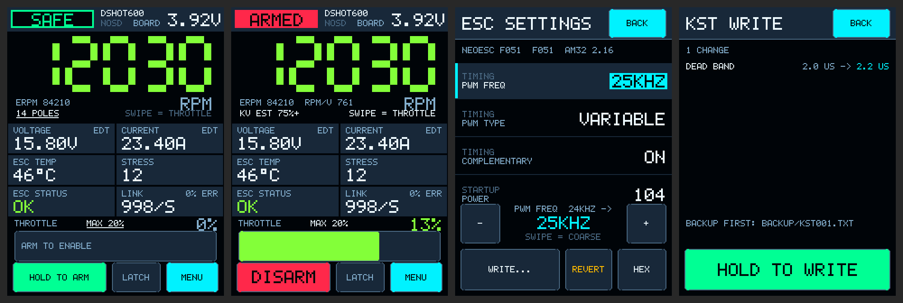
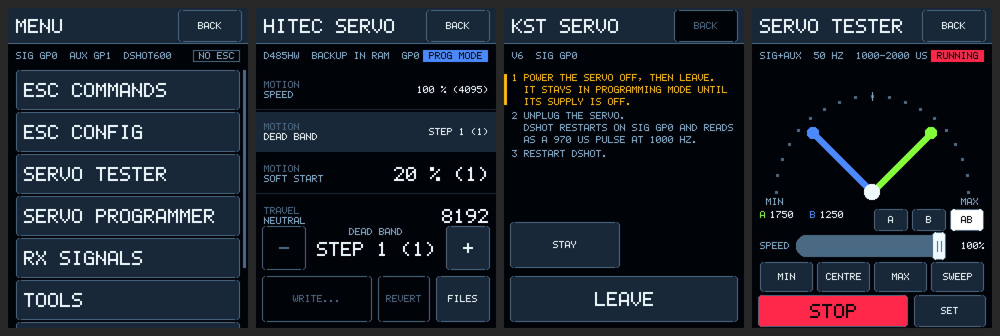

# UI theme after rcbench's

Status: slices 7 and 8 of [the build plan](menu-c.md#build-plan), the palette
and the neutral fills, are built, host tests only
([Slices 7 and 8 as built](#slices-7-and-8-as-built)). Slices 9 to 14 are
proposed, not built. The owner decided its five questions on 2026-11-15.
The two questions the answers raised, and the colours of two buttons of the
DShot lifetime, are settled by the developer's calls of 2026-11-16, pending the
owner's review ([Decisions](#decisions)). Every colour is computed and not seen
on the panel.

The owner's request of 2026-11-15: "Adapt the color scheme and tui to the
MiniRcBench from the big brother." The big brother is rcbench, the larger
bench of the same owner.

This note covers the look: the palette, the colour roles, the header, the
buttons, the lists, the hubs, the chips, the tester's status bar, the
type, the spacing, the pressed and disabled states, and the two themes. It
does not cover three things:

- Which screens exist, their grouping, names and navigation.
  [menu-c.md](menu-c.md) plans them. [The widgets of
  menu-c.md](#the-widgets-of-menu-cmd) gives its widgets their look, and
  [its build plan](menu-c.md#build-plan) orders the slices of both notes.
- DShot's lifetime and the pin claim:
  [dshot-lifetime.md](dshot-lifetime.md). This note gives two of its
  buttons their colours ([decision 16](#decisions)).
- The touch-loss stop of pull request #49, merged into `main` as 3b36588.
  Slice 12 draws its touch loss on HOLD TO ARM and keeps its host cases,
  as [the build plan](menu-c.md#build-plan) names. Its texts take the
  roles of this note unchanged.

Names. The proposal's screens carry the names of
[menu-c.md](menu-c.md#names): SETUP for SETTINGS, LOGS for SD LOG, RECEIVER
for RX SIGNALS and ESC PROGRAM for ESC CONFIG. The sections on cff09ae and
[the mock-ups](#mock-ups), which are rendered from cff09ae, keep the names
in the code.

Terms: UI is user interface, ESC electronic speed controller, DShot the digital
ESC protocol the tester drives, EDT Extended DShot Telemetry, RPM revolutions
per minute, KST and Hitec two servo brands, SD Secure Digital, SPI Serial
Peripheral Interface, IPS in-plane switching, a kind of liquid crystal panel,
USB Universal Serial Bus, RAM random-access memory. RGB565 is a 16-bit colour: 5
bits red, 6 green, 5 blue. WCAG is the Web Content Accessibility Guidelines,
version 2; its contrast ratio runs from 1 to 21, and it asks 4.5 for text and 3
for the parts of a control. CVD is colour vision deficiency: protanopia and
deuteranopia, the two red-green kinds, and tritanopia, the blue-yellow kind. ΔE
is the CIEDE2000 colour difference; this note calls a pair under 10 a collision.

MiniRcBench is read at `main` cff09ae. rcbench is read at `origin/main`
a2d10ccf; the checkout read is d75113c1, whose `shared/ui/` and
`shared/gfx/` are the same (`git diff --stat d75113c1 a2d10ccf -- shared/ui
shared/gfx` is empty). rcbench paths below are relative to its root.

Every number in the tables below is printed by
[ui_theme.py](ui_theme.py), which holds both palettes, the packing, the
contrast ratio, the CVD simulation and the distance.

Not seen on the panel: every colour in this note. The values are computed
for sRGB. The ST7789's gamma tables, the IPS panel's primaries and the
backlight level change what a word of RGB565 looks like, and none of them
is measured.

## rcbench's visual system

rcbench draws on a 1024 x 600 px panel, about 0.150 mm a pixel, assumed and
not measured (`shared/ui/include/ui_layout.h`). The theme is
`shared/ui/ui_theme.c` and `shared/ui/include/ui_theme.h`; the widgets are
`shared/ui/ui_widgets.c`; `docs/Screens.md` is the manual.

### Palette

24 roles in two themes, dark and light (`k_base` in `ui_theme.c`, lines 31
to 83). The values are 8 bits a channel. `GFX_RGB()` in
`shared/gfx/include/gfx.h` packs them to RGB565 by dropping the low bits,
as `rgb()` in MiniRcBench's `src/theme.h` does.

| Role | Dark | RGB565 | Light | RGB565 |
|---|---|---|---|---|
| `UI_C_BG` | 2, 5, 9 | 0x0021 | 234, 239, 245 | 0xEF7E |
| `UI_C_PANEL` | 14, 22, 33 | 0x08A4 | 252, 253, 255 | 0xFFFF |
| `UI_C_PANEL_HI` | 26, 40, 58 | 0x1947 | 228, 236, 246 | 0xE77E |
| `UI_C_PANEL_SUNK` | 5, 9, 15 | 0x0041 | 216, 225, 236 | 0xDF1D |
| `UI_C_EDGE` | 58, 116, 156 | 0x3BB3 | 170, 186, 204 | 0xADD9 |
| `UI_C_EDGE_HI` | 112, 190, 236 | 0x75FD | 104, 126, 150 | 0x6BF2 |
| `UI_C_GRID` | 34, 66, 90 | 0x220B | 204, 215, 228 | 0xCEBC |
| `UI_C_GRID_STRONG` | 70, 126, 164 | 0x43F4 | 162, 180, 200 | 0xA5B9 |
| `UI_C_TEXT` | 232, 248, 255 | 0xEFDF | 10, 18, 28 | 0x0883 |
| `UI_C_TEXT_DIM` | 132, 172, 202 | 0x8579 | 70, 88, 108 | 0x42CD |
| `UI_C_TEXT_FAINT` | 72, 106, 134 | 0x4B50 | 120, 138, 158 | 0x7C53 |
| `UI_C_TEXT_ON_LIGHT` | 4, 8, 14 | 0x0041 | 4, 8, 14 | 0x0041 |
| `UI_C_ACCENT` | 0, 240, 255 | 0x079F | 0, 196, 232 | 0x063D |
| `UI_C_OK` | 0, 255, 148 | 0x07F2 | 0, 198, 128 | 0x0630 |
| `UI_C_WARN` | 255, 186, 0 | 0xFDC0 | 246, 168, 0 | 0xF540 |
| `UI_C_DANGER` | 255, 40, 72 | 0xF949 | 232, 48, 48 | 0xE986 |
| `UI_C_VOLT` | 255, 190, 26 | 0xFDE3 | 196, 122, 0 | 0xC3C0 |
| `UI_C_CURR` | 255, 36, 112 | 0xF92E | 208, 24, 78 | 0xD0C9 |
| `UI_C_POWER` | 0, 208, 255 | 0x069F | 0, 132, 186 | 0x0437 |
| `UI_C_RPM` | 132, 255, 56 | 0x87E7 | 46, 148, 22 | 0x2CA2 |
| `UI_C_LILAC` | 192, 138, 255 | 0xC45F | 118, 80, 200 | 0x7299 |
| `UI_C_TEAL` | 34, 244, 202 | 0x27B9 | 0, 150, 130 | 0x04B0 |
| `UI_C_BEVEL_LIT` | 74, 106, 140 | 0x4B51 | 255, 255, 255 | 0xFFFF |
| `UI_C_BEVEL_DARK` | 2, 5, 9 | 0x0021 | 150, 166, 186 | 0x9537 |

The dark background is near black with a blue cast, and every neutral
carries that cast. The light theme is not the dark one inverted: its accent
fills stay bright, because near-black text sits on them in both themes, and
its series colours are darker to read on white (the comment over `k_base`).

Brightness, 20 to 100 %, and contrast, 60 to 140 %, are settings. Both are
applied to the 8-bit values before packing (`apply_one()`, `rebuild()`).

### Colour roles

How often `shared/` and `firmware/` name each role, as `UI_<role>` or
`UI_C_<role>`, counted with `grep -rhowE`:

| Role | Uses | What it colours |
|---|---|---|
| `BG` | 83 | the page; the fill of a button that takes no press |
| `PANEL` | 123 | the status band, cards, list rows, tiles |
| `PANEL_HI` | 153 | edit and navigation buttons, the selected tab, a pressed tile |
| `PANEL_SUNK` | 94 | value boxes, chip fills, slider and scroll troughs |
| `EDGE`, `EDGE_HI` | 56, 16 | outlines and rules; the `-` and `+` keys of a settings row |
| `GRID`, `GRID_STRONG` | 18, 11 | plot grids |
| `TEXT` | 254 | names, button labels, values of the programmers |
| `TEXT_DIM` | 254 | labels, units, an unselected tab |
| `TEXT_FAINT` | 165 | help lines, disabled labels |
| `TEXT_ON_LIGHT` | 32 | text on a bright fill |
| `ACCENT` | 173 | cyan: the home tag, icons, a settings value, a selected tab, section names, a pressed row's outline, the scroll thumb, a changed value's fill |
| `OK` | 55 | green: a press starts something; LINK up; SAVE with changes waiting |
| `WARN` | 243 | amber: under way or paused, a locked row's reason, notices, FAULT |
| `DANGER` | 107 | red: an output is on, ARMED, STOP, alerts, a failed step |
| `VOLT`, `CURR`, `POWER`, `RPM` | 24, 23, 15, 9 | the four telemetry series: amber, pink, blue, lime |
| `LILAC`, `TEAL` | 8, 11 | the fifth and sixth series |
| `BEVEL_LIT`, `BEVEL_DARK` | 4, 4 | the edges of a raised face |

The button classes of `docs/Screens.md`, "Button colours", and
`ui_action_fill()` (`ui_widgets.c`, line 774):

| Class | Available | Active | Waiting | Refused |
|---|---|---|---|---|
| Output action: "switches an output on, arms, starts a run, writes a servo" | `OK` | `DANGER` | `WARN` | `BG`, faint label |
| Emergency: STOP | `DANGER` | `DANGER`, flashes | | never |
| Edit: `-`, `+`, value boxes, RESET MAX, DISCARD, READ AGAIN | `PANEL_HI` | | | `BG` |
| SAVE on SETUP | `OK` while something is unsaved | | `WARN` | neutral; NOT SAVED with the label `DANGER` |
| Navigation: tiles, tabs, OPEN, CLOSE, openers | neutral; a selected tab's label `ACCENT` | | | `BG` |
| Delete | neutral, the label `DANGER` | | | `BG` |

"The fill of a button says what a press does to an output." The output
actions the manual lists: ARM, OUTPUT ON, PROG 5V ON, HOLD 2s: ARM + START
on TEST, RUDDER AUTO and LIMIT RUN, CENTER on LIVE, SWEEP on SWEEP,
`1000us`, CENTER, `2000us`, `-10us`, `+10us` and ZERO on RUDDER, and the
programmers' CONNECT, WRITE n VALUES and MOVE SERVO. While active the label
says what a press stops: DISARM, OUTPUT OFF, STOP RUN, PAUSE, LEAVE, ABORT.

Green outside a button is a state that is good: the dot of the LINK chip
(`chip_look()` in `ui_band.c`), `FREE`, the report's `PASS`. rcbench has no
green badge: its SAFE chip is the neutral chip, `PANEL_SUNK` with `TEXT`,
amber while a SAFE bench still holds a port or moves a servo, and only
ARMED, HWSTOP and FAULT fill.

A value that differs from the device is marked twice: the value box fills
`ACCENT` and the value gains a `* ` (`kst_panel_draw.c`, lines 908 to 922;
`hitec_panel_draw.c`, line 501). A value a loaded file holds and the write
skips fills `WARN` with `! `. An unchanged value of a programmer is `TEXT`
on `PANEL_SUNK`, not `ACCENT`; a settings list's value is `ACCENT` text
with no box (`ui_setlist_draw.c`, line 208). So on rcbench the accent as
text is a setting, and the accent as a fill is a change.

### Type

Fixed-cell bitmap faces, one cell a code point, with lower case, the German
umlauts, the degree sign and the ohm sign (`shared/gfx/gfx_font*.c`).
`ui_theme.h` names them by role:

| Role | Face | Use |
|---|---|---|
| `UI_FONT_LABEL`, `UI_FONT_FINE` | 8 x 16 | labels, buttons, data columns |
| `UI_FONT_BAND` | 10 x 20 | band chips, help, alerts |
| `UI_FONT_BODY` | 12 x 24 | prose, settings values |
| `UI_FONT_HEAD` | 16 x 28 | headings |
| `UI_FONT_TAG` | 20 x 36 | the home tag, settings names, tile names |
| `UI_FONT_NUM` | 24 x 30, and 32 x 44 | numerals |

Readings are seven-segment digits, 22 x 32 px, 4 px thick, slanted 3 px,
with the unlit segments drawn (`ui_seg_hero()` in `ui_theme.h`).

### Band, home tag, alert band

- **The status band** is the top 60 px of every screen: `PANEL` fill, a 1 px
  `EDGE` rule under it (`ui_band.c`, lines 819 and 820). It holds the home
  tag at the left, status chips, and STOP, 168 x 48 px, at the right.
- **A chip** is a pill 44 px tall on `PANEL_SUNK` with `TEXT`. LINK carries
  a dot, `OK` or `DANGER`. ARMED fills `DANGER` and FAULT fills `WARN`, both
  with `TEXT_ON_LIGHT`: "readable by shape at arm's length, not by colour
  alone" (`chip_look()`, `ui_band.c`).
- **The home tag** is the screen's name in the 20 x 36 face on an `ACCENT`
  tag with two cut corners and a chevron; a press lightens it
  (`ui_home_tag()`, `ui_widgets.c`, line 397). The menu, the root, shows a
  wordmark without the chevron.
- **The alert band** is the bottom 44 px: `DANGER` with `TEXT` for an alert,
  `WARN` with `TEXT_ON_LIGHT` for a notice (`ui_router_alert.c`, line 47).

### Buttons

`ui_button_font()` (`ui_widgets.c`, line 94):

- A filled rectangle with an 8 px radius (`UI_R_CTL`) and no outline, with a
  1 px lighter line inside its top edge.
- The label is `TEXT_ON_LIGHT` on a fill of luma 140 or more and `TEXT` on a
  darker one (`ui_is_light()`, line 61). `DANGER` has luma 108, so STOP and
  LEAVE carry light text, and the ARMED chip, which names its ink, dark.
- Pressed: the fill moves 110/255 toward white.
- Disabled: the fill is `BG`, an outline appears, and the label is
  `TEXT_FAINT`.
- A hold button acts after 2 s (`UI_HOLD_S`). Its fill fades from its base
  to the colour it holds next, then the whole button flashes white, black
  and the settled colour twice, 50 ms a phase (`docs/Screens.md`, "Hold
  buttons" and "The flash").

### Lists, value fields, tabs, tiles

- **A settings row** is 64 px tall at a 70 px pitch, a `PANEL` rectangle
  with two cut corners and an `EDGE` outline, `ACCENT` while pressed. The
  name is `TEXT` in 20 x 36, the help line `TEXT_FAINT`, or `WARN` when the
  row is locked, the value `ACCENT` in 12 x 24, the unit `TEXT_DIM`
  (`ui_setlist_draw.c`).
- **A section heading** is its name in `ACCENT` over an `EDGE` rule.
- **A programmer row** is a `TEXT_DIM` label and a value box on
  `PANEL_SUNK` with `-` and `+` on `PANEL_HI` (`kst_panel_draw.c`).
- **Tabs** sit in a `PANEL_SUNK` trough; the selected tab is `PANEL_HI` with
  an `ACCENT` label, the others `TEXT_DIM` (`ui_tabs.c`, lines 146 to 170).
- **A tile** of the menu is a `PANEL` card with a 10 px radius and an `EDGE`
  outline, an icon in `ACCENT`, the name in `TEXT` and a line in `TEXT_DIM`
  (`ui_tile()`, line 337). A pressed tile is `PANEL_HI`.
- **Icons** are drawn from primitives, 15 functions in
  `shared/ui/include/ui_icons.h`.

### Spacing

`ui_layout.h`: margin 8 px; radii 10 px for a card, 8 px for a control, 5 px
for a chip; the smallest touch target 48 px, 7.2 mm; a button 48 px tall.
`ui_theme.h`: cut corners of 10 px and 5 px.

### Text conventions

- A number and its unit stand together with no space, and the unit keeps its
  case in a label of capitals: `HOLD 2s TO START`, `6.00V`
  (`tools/check_units.py`).
- A value that is not there reads `--` (`ui_fmt()`).
- Names and button texts are capitals; help lines and messages are mixed
  case.
- A group is framed by a card with a title tab (`ui_panel()`) or headed by
  a name over a rule. `ui_widgets.c` draws no frame of line characters.

## MiniRcBench's visual system at cff09ae

### Palette and themes

`src/theme.h` and `src/theme.cpp`: 17 entries, `TC_BG` to `TC_MAGENTA`, in
two tables. `C_*` in `src/gfx.h`, lines 40 to 56, index the table in force.
The themes are Dark and High contrast, chosen by SETTINGS, DISPLAY,
CONTRAST (`themeSet()` in `src/ui.cpp` and `src/ui_settings.cpp`). High
contrast is black on white for sunlight: accents dark enough for white
text, glyphs 1 px heavier, frames 2 px, the backlight at 255.

| Entry | Dark | Shown as | High contrast | Means |
|---|---|---|---|---|
| `TC_BG` | 0x0000 | 0, 0, 0 | 0xFFFF | the screen |
| `TC_PANEL` | 0x18E3 | 24, 28, 24 | 0xCEBB | header, buttons, tiles, the selected row |
| `TC_GRID` | 0x39E7 | 57, 60, 57 | 0x39E9 | frames, rules, disabled labels, hints |
| `TC_DIM` | 0x8410 | 132, 130, 132 | 0x424A | labels |
| `TC_TEXT` | 0xE71C | 231, 227, 231 | 0x0000 | text |
| `TC_INK` | 0xFFFF | 255, 255, 255 | 0x0000 | the strongest mark; a pressed frame |
| `TC_PAPER` | 0x0000 | 0, 0, 0 | 0xFFFF | text on `C_AMBER` and `C_INK` |
| `TC_ONACCENT` | 0xFFFF | 255, 255, 255 | 0xFFFF | text on a saturated fill |
| `TC_GREEN` | 0x2665 | 33, 207, 41 | 0x0366 | safe, done |
| `TC_LIME` | 0x07E0 | 0, 255, 0 | 0x03C5 | a live reading |
| `TC_AMBER` | 0xFD20 | 255, 166, 0 | 0xAAC0 | warning |
| `TC_RED` | 0xF9E7 | 255, 60, 57 | 0xB803 | output on, failure |
| `TC_REDDARK` | 0x6000 | 99, 0, 0 | 0xF5F7 | RPM digits with no telemetry |
| `TC_GHOST` | 0x1082 | 16, 16, 16 | 0xEF9E | unlit segments |
| `TC_BLUE` | 0x2D7F | 41, 174, 255 | 0x01D5 | latched |
| `TC_CYAN` | 0x07FF | 0, 255, 255 | 0x02CF | changed |
| `TC_MAGENTA` | 0xF81F | 255, 0, 255 | 0x9011 | alert |

"Shown as" is the 8-bit colour the word stands for, by bit replication.

How often `src/*.cpp` names each: `C_DIM` 193, `C_TEXT` 172, `C_AMBER` 153
and `UI_COL_WARN` 80, `C_BG` 111, `C_PANEL` 95, `C_GRID` 60, `C_ONACCENT`
38, `C_RED` 36, `C_LIME` 22. `C_GRID` colours text in 22 one-line calls of
`gfxText()` and fills the editor bars' `-` and `+`.

### Roles

`src/ui_widgets.h`, lines 139 to 160, name seven roles on the palette:
`UI_COL_SAFE` `C_GREEN`, `UI_COL_LIVE` `C_LIME`, `UI_COL_ON` `C_RED`,
`UI_COL_WARN` `C_AMBER`, `UI_COL_ALERT` `C_MAGENTA`, `UI_COL_CHANGED`
`C_CYAN`, `UI_COL_LATCHED` `C_BLUE`. The neutral role is `C_TEXT`, `C_DIM`
and `C_GRID`.

Two decisions of [menu-b.md](menu-b.md#decisions) fix them at cff09ae;
[the owner's decisions of 2026-11-15](#decisions) revise both:

- **Decision 8, "Changed is cyan, with a bar."** A value that differs from
  the device is `C_CYAN` with a 3 px `C_CYAN` bar at the row's left edge;
  the bar is `C_AMBER` when the change breaks a soft rule. Selection changes
  the row's fill and label, never the value's colour. Decision 26 is the
  owner's choice of `C_CYAN`.
- **Decision 11, "One meaning per colour."** The role table above with its
  uses, and the table of what each earlier use becomes. Chips are square
  and 12 px tall so that they do not look like buttons.

### Type

One 5 x 7 bitmap face, the characters 0x20 to 0x5F and a degree sign
(`FONT5X7` in `src/gfx.cpp`); `gfxChar()` draws lower case as capitals. A
cell is 6 x 7 px times the scale, and a string is (6 n - 1) x scale px wide
(`gfxTextW()`). Scale 1 is 7 px tall, about 1.2 mm at 0.178 mm a pixel
([menu.md](menu.md#touch-targets)); scale 2 is 14 px, about 2.5 mm. Scale 1
holds 37 characters between the margins and scale 2 holds 18. 208 one-line
calls pass scale 1 as a literal and 21 pass scale 2; scale 4 is the
splash's name and scale 3 SD LOG's USB DRIVE headline. The RPM readout is
seven-segment digits, 36 x 62 px, drawn from rectangles
(`gfxSegNumber()`).

### Layout and widgets

`src/ui_widgets.h` holds the layout table of
[menu-b.md](menu-b.md#decisions) decision 14 and the floors of
[menu.md](menu.md#decisions) decisions 5 and 16:

| Item | Value |
|---|---|
| Header | 36 px (`UI_HDR_H`), title at scale 2 from x 8, BACK 64 x 32 px at x 170 |
| Strip | y 40, 16 px; a chip 12 px tall ending at x 232; two lines at y 42 and y 52 |
| Body | from y 62 (`UI_BODY_Y`) |
| Margins | text x 8 (`UI_MARGIN`); buttons x 6 to x 234 (`UI_EDGE`) |
| Footer | y 268, 46 px tall; three buttons 6/110, 122/52, 180/54; two 6/150, 162/72; one 6/228 |
| Editor `-` and `+` | 44 x 44 px |
| Touch floors | 40 px for a list row and a row control (`UI_LIST_TAP_MIN`), about 7.1 mm; 22 px elsewhere (`UI_TAP_MIN`) |
| List row | 40 px at a 42 px pitch; scroll bar 3 px wide |

The widgets (`src/ui_widgets.cpp`, `src/ui_list.cpp`, `src/ui_hold.cpp`):

- **`uiButton()`**: a fill, a 1 px `C_GRID` frame, the label centred. No
  radius is drawn ([STATUS.md](../../STATUS.md), open item 25). Pressed is
  additive: the frame and a second frame 2 px inside turn `C_INK`, and the
  label moves 1 px. Disabled is `C_BG` with the frame and a `C_GRID` label.
- **`uiHeader()`**: a `C_PANEL` band, the title in `C_TEXT`, BACK as a
  `C_PANEL` button.
- **`uiChip()`**: a filled square-cornered rectangle with a `C_ONACCENT`
  label, `C_PAPER` over `C_AMBER` and `C_INK`.
- **`uiListDrawField()`**: the row of decision 8. The group caption is
  `C_GRID`, the label `C_DIM`, or `C_TEXT` when selected; the value is
  `C_TEXT`, `C_CYAN`, `C_GRID` or `C_AMBER` by state; the selected row
  fills `C_PANEL`; a 1 px `C_PANEL` rule ends the row.
- **`uiHoldDrawBar()`**: a 3 px `C_LIME` bar over a hold button, which fills
  `C_RED` with a `C_ONACCENT` label while held.

### Fit checks

- **At build time.** 377 `static_assert`s in `src/`. Those of
  `ui_widgets.h` hold BACK in the header, the footer on the panel, and the
  floors. `menuRowsFit()` and the four `*EntriesFit()` of
  `src/ui_registry.cpp`, `settingsSectionFits()`, `setRowsFit()` and
  `linesFit()` hold every registry text to its row.
- **In the host suite.** `gfxTextW()` against the room: the hints and notes
  of `test/test_ui.cpp` (lines 268, 309, 3703, 4874), every value name in
  the editor bar's 140 px (7796), the splash (9106), the notes, every MENU
  status and every SETTINGS value of `test/test_menu.cpp` (1099 to 1730).
- **Colour.** The tests find a text by its colour and its background
  (`fakeTextIs()`, `fakeCountColour()` in `test/fakes.h`), so two roles
  need two different words of RGB565. `test/test_widgets.cpp`, line 625,
  holds each `UI_COL_*` to its palette entry in both themes. No test
  computes a contrast ratio or holds a palette value.

## The mapping

The proposal changes the Dark table's 17 values, the widget rules of
[Widgets](#widgets) and what cyan and green mean. It adds no palette entry
and moves no rectangle. High contrast keeps its values and takes the same
widget rules.

### rcbench's roles on MiniRcBench

| rcbench role | MiniRcBench entry | RGB565 | Adaptation |
|---|---|---|---|
| `UI_C_BG` | `TC_BG`, `TC_PAPER` | 0x0021 | |
| `UI_C_PANEL` | `TC_GHOST` | 0x08A4 | 1: not the control face |
| `UI_C_PANEL_HI` | `TC_PANEL` | 0x1947 | 1 |
| `UI_C_PANEL_SUNK` | none | | 2: a neutral chip is a frame |
| `UI_C_EDGE`, `UI_C_EDGE_HI` | none | | 3: one frame colour |
| `UI_C_GRID`, `UI_C_GRID_STRONG` | none | | no plot |
| `UI_C_TEXT` | `TC_TEXT` | 0xEFDF | |
| `UI_C_TEXT_DIM` | `TC_DIM` | 0x8579 | |
| `UI_C_TEXT_FAINT` | `TC_GRID` | 0x4B50 | 3 |
| `UI_C_TEXT_ON_LIGHT` | `TC_ONACCENT` | 0x0041 | 4: dark text on every fill |
| `UI_C_ACCENT` | `TC_CYAN` | 0x079F | 5: the accent, as rcbench |
| `UI_C_OK` | `TC_GREEN` | 0x07F2 | 6: "a press starts" as a fill, "good" as a word or an outline |
| `UI_C_WARN` | `TC_AMBER` | 0xFDC0 | |
| `UI_C_DANGER` | `TC_RED` | 0xF949 | |
| `UI_C_RPM` | `TC_LIME` | 0x87E7 | 7: every live reading |
| `UI_C_VOLT`, `UI_C_CURR`, `UI_C_POWER` | none | | 7 |
| `UI_C_LILAC`, `UI_C_TEAL` | none | | 8 |
| `UI_C_BEVEL_LIT`, `UI_C_BEVEL_DARK` | none | | no raised face |

### The Dark table, proposed

| Entry | Today | Proposed, 8 bit | RGB565 | Shown as | From |
|---|---|---|---|---|---|
| `TC_BG` | 0x0000 | 2, 5, 9 | 0x0021 | 0, 4, 8 | `UI_C_BG` |
| `TC_PANEL` | 0x18E3 | 26, 40, 58 | 0x1947 | 24, 40, 57 | `UI_C_PANEL_HI` |
| `TC_GRID` | 0x39E7 | 72, 106, 134 | 0x4B50 | 74, 105, 132 | `UI_C_TEXT_FAINT` |
| `TC_DIM` | 0x8410 | 132, 172, 202 | 0x8579 | 132, 174, 206 | `UI_C_TEXT_DIM` |
| `TC_TEXT` | 0xE71C | 232, 248, 255 | 0xEFDF | 239, 251, 255 | `UI_C_TEXT` |
| `TC_INK` | 0xFFFF | 255, 255, 255 | 0xFFFF | 255, 255, 255 | `GFX_WHITE` |
| `TC_PAPER` | 0x0000 | 2, 5, 9 | 0x0021 | 0, 4, 8 | `UI_C_BG` |
| `TC_ONACCENT` | 0xFFFF | 4, 8, 14 | 0x0041 | 0, 8, 8 | `UI_C_TEXT_ON_LIGHT` |
| `TC_GREEN` | 0x2665 | 0, 255, 148 | 0x07F2 | 0, 255, 148 | `UI_C_OK` |
| `TC_LIME` | 0x07E0 | 132, 255, 56 | 0x87E7 | 132, 255, 57 | `UI_C_RPM` |
| `TC_AMBER` | 0xFD20 | 255, 186, 0 | 0xFDC0 | 255, 186, 0 | `UI_C_WARN` |
| `TC_RED` | 0xF9E7 | 255, 40, 72 | 0xF949 | 255, 40, 74 | `UI_C_DANGER` |
| `TC_REDDARK` | 0x6000 | 96, 16, 32 | 0x6084 | 99, 16, 33 | own |
| `TC_GHOST` | 0x1082 | 14, 22, 33 | 0x08A4 | 8, 20, 33 | `UI_C_PANEL` |
| `TC_BLUE` | 0x2D7F | 72, 136, 255 | 0x4C5F | 74, 138, 255 | own |
| `TC_CYAN` | 0x07FF | 0, 240, 255 | 0x079F | 0, 243, 255 | `UI_C_ACCENT` |
| `TC_MAGENTA` | 0xF81F | 255, 0, 255 | 0xF81F | 255, 0, 255 | own |

Every word differs from every other but `TC_PAPER`, which equals `TC_BG` by
the rule of `theme.h`, so the tests' colour probes keep working.

### The conversion against the panel

- **Packing.** `rgb()` in `src/theme.h` keeps the top 5, 6 and 5 bits, as
  rcbench's `GFX_RGB()` does. The same 8-bit value gives the same word on
  both benches.
- **Byte order.** `st7789.cpp` sends pixels as 16-bit SPI frames, most
  significant bit first (`spiFormat16()`, line 48), so a word reaches the
  panel big-endian with no swap.
- **Channel order.** COLMOD is 0x55, 16 bits a pixel (line 125). MADCTL is
  0x00 in portrait, with bit 3 clear: red is the top 5 bits (`madctlFor()`,
  line 89).
- **Inversion.** The driver sends INVON, 0x21, which an IPS panel needs for
  a word to show as its own colour (line 148).
- **What a word loses.** The low 3, 2 and 3 bits. Read back by bit
  replication, the largest shift in the table is 7 of 255: `TC_TEXT`'s red,
  232, shows as 239, and `TC_GHOST`'s red, 14, as 8. How the panel expands
  a word is not verified. The contrast and distance numbers below are
  computed on the shown values.
- **Not verified.** The gamma tables the driver loads (0xE0, 0xE1) and the
  panel's primaries. rcbench's values are tuned on its own panel, a
  different one. Whether `TC_PANEL` stands off `TC_BG` at a backlight of
  200 of 255, the default, is the first thing to look at on hardware.

### Contrast

WCAG contrast ratio of each pair a screen draws. Every text here is small
by WCAG's measure, scale 2 included: its capitals are 14 px, about 2.5 mm,
tall. So text needs 4.5.

| Text | On | Today | Proposed | High contrast | Use |
|---|---|---|---|---|---|
| `TEXT` | `BG` | 16.54 | 19.51 | 21.00 | values, titles of text |
| `DIM` | `BG` | 5.51 | 8.74 | 9.10 | labels, captions, the neutral chip |
| `GRID` | `BG` | 1.88 | 3.57 | 10.94 | disabled labels, group captions, hints; frames |
| `GREEN` | `BG` | 10.02 | 15.41 | 6.50 | SAVED, WRITE VERIFIED, SAFE and the outlined chips |
| `LIME` | `BG` | 15.30 | 16.01 | 5.57 | RPM digits, readouts |
| `AMBER` | `BG` | 10.71 | 12.02 | 4.99 | warnings, the current step |
| `RED` | `BG` | 5.96 | 5.54 | 6.61 | failures |
| `CYAN` | `BG` | 16.75 | 14.95 | 7.73 | a settings value, a section caption, `>` |
| `BLUE` | `BG` | 8.59 | 6.24 | 9.68 | servo B's label and horn |
| `MAGENTA` | `BG` | 6.70 | 6.56 | 7.96 | STALLED, the alert lines |
| `TEXT` | `PANEL` | 13.58 | 14.21 | 14.40 | button labels, the header's title, the selected row |
| `DIM` | `PANEL` | 4.52 | 6.37 | 6.24 | LATCH and MENU labels, tile captions |
| `AMBER` | `PANEL` | 8.79 | 8.76 | 3.42 | REVERT and DEFAULTS labels |
| `CYAN` | `PANEL` | 13.75 | 10.89 | 5.30 | a settings value in the selected row, a selected tab |
| `LIME` | `PANEL` | 12.56 | 11.66 | 3.82 | ESC STATUS `OK` in its tile |
| `RED` | `PANEL` | 4.89 | 4.03 | 4.53 | ESC STATUS `ERROR` in its tile |
| `MAGENTA` | `PANEL` | 5.50 | 4.78 | 5.46 | ESC STATUS `ALERT` in its tile |
| `ONACCENT` | `GREEN` | 2.10 | 15.15 | 6.50 | HOLD TO ARM, HOLD TO WRITE, HOLD TO START, HOLD TO APPLY at rest |
| `ONACCENT` | `CYAN` | 1.25 | 14.70 | 7.73 | BACK, the tester's MENU, a changed value |
| `ONACCENT` | `LIME` | 1.37 | 15.74 | 5.57 | servo A's selector, the PORT OPEN chip |
| `ONACCENT` | `RED` | 3.53 | 5.45 | 6.61 | ARMED, DISARM, STOP, a held hold |
| `ONACCENT` | `BLUE` | 2.44 | 6.14 | 9.68 | LATCH on, a toggle on, PROG MODE |
| `ONACCENT` | `MAGENTA` | 3.14 | 6.45 | 7.96 | the OVERCURRENT and STALLED chips |
| `PAPER` | `AMBER` | 10.71 | 12.02 | 4.99 | EJECT, the SDERR chip |
| `PAPER` | `INK` | 21.00 | 20.57 | 21.00 | the AB selector |
| `PANEL` | `BG` | 1.22 | 1.37 | 1.46 | not text: a fill against the screen |
| `GRID` | `PANEL` | 1.54 | 2.60 | 7.50 | not text: BACK's frame in the header |
| `REDDARK` | `BG` | 1.53 | 1.59 | 1.61 | not text: RPM digits with no telemetry |
| `GHOST` | `BG` | 1.10 | 1.11 | 1.12 | not text: unlit segments |

What the numbers say:

- **Today's labels on fills fail.** White on `C_LIME` is 1.37, on
  `C_GREEN` 2.10, on `C_BLUE` 2.44, on `C_MAGENTA` 3.14, on `C_RED` 3.53:
  the SAFE badge, the EDT ON chip, servo A's selector, LATCH, PROG MODE,
  ARMED and STOP. With rcbench's dark ink every label on a fill is 5.45 or
  more ([decision 3](#decisions)).
- **The new fills.** Dark ink on the cyan of BACK and of a changed value is
  14.70, and on the green of a start button 15.15. White on today's cyan
  would be 1.25.
- **One text pair is under 4.5 in the proposal:** `RED` on `PANEL`, 4.03,
  today 4.89. It is the word `ERROR` at scale 2 in the tester's ESC STATUS
  tile (`STATUS_COL` in `src/ui.cpp`). rcbench's own `PANEL` would give
  4.99 and stands off the background at 1.11 only (adaptation 1). Other
  red texts on a `C_PANEL` fill are not searched for.
- **`GRID` as text is 3.57,** today 1.88. It stays under 4.5 by intent: it
  is the disabled label, and WCAG exempts a disabled control. The group
  captions and the `SWIPE = COARSE` hints share it; a slice moves the hints
  to `C_DIM`.
- **Frames.** A button's frame against the screen goes from 1.88 to 3.57,
  over the 3 that WCAG asks of a control's boundary. BACK's frame on the
  header band is 2.60.
- **High contrast** has two pairs under 4.5 today, both on its `PANEL`:
  `AMBER` 3.42 and `LIME` 3.82; `RED` is 4.53. The proposal does not change
  them.

### Colour vision deficiency

Each role colour is passed through the simulation of Machado, Oliveira and
Fernandes (2009) at full severity, and the pairs are compared by ΔE. Pairs
under 10 in any view, among the seven role colours and `TEXT`, `DIM` and
`GRID`:

| Pair | Palette | Normal | Protan | Deutan | Tritan | Told apart by |
|---|---|---|---|---|---|---|
| `GREEN` `AMBER` | today | 45.4 | 4.2 | 7.2 | 59.7 | |
| | proposed | 43.2 | 13.3 | 14.0 | 57.3 | no collision |
| `GREEN` `RED` | today | 79.9 | 28.9 | 6.8 | 73.3 | |
| | proposed | 88.6 | 39.9 | 19.1 | 78.2 | no collision |
| `LIME` `AMBER` | today | 48.1 | 14.4 | 5.0 | 63.8 | |
| | proposed | 36.9 | 10.7 | 4.8 | 52.9 | the word: `OK`, `WARN`; a bar is never amber |
| `BLUE` `MAGENTA` | today | 50.6 | 15.6 | 0.7 | 69.7 | |
| | proposed | 34.4 | 7.3 | 7.5 | 65.9 | the chip's word: `PROG MODE`, `STALLED` |
| `CYAN` `TEXT` | today | 34.5 | 5.3 | 11.8 | 36.9 | |
| | proposed | 21.9 | 8.2 | 14.8 | 20.7 | the 3 px bar of decision 8 |
| `LIME` `CYAN` | today | 34.5 | 37.3 | 44.1 | 9.0 | |
| | proposed | 38.5 | 45.3 | 46.9 | 8.3 | the bar; a reading has no row |
| `GREEN` `LIME` | today | 11.0 | 10.3 | 11.0 | 10.6 | |
| | proposed | 13.0 | 10.5 | 11.7 | 5.4 | shape: a chip or a word against digits and bars |
| `GREEN` `CYAN` | today | 34.1 | 37.9 | 42.9 | 14.8 | |
| | proposed | 28.9 | 34.9 | 37.4 | 4.8 | the bar; `SAVED` is a word |
| `BLUE` `DIM` | today | 29.4 | 26.4 | 24.4 | 34.6 | |
| | proposed | 12.1 | 16.0 | 17.0 | 8.7 | a fill against a label |

What the numbers say:

- **Red-green CVD, the common kinds.** Today five pairs collide, with the
  worst at 0.7: latched and alert look the same to a deuteranope. The
  proposal has three, with the worst at 4.8. Safe against warning and safe
  against failure stop colliding.
- **Tritanopia** gets worse: `GREEN` against `LIME` and against `CYAN` drop
  to 5.4 and 4.8, because rcbench's green leans toward cyan.
- **Normal vision.** `GREEN` and `LIME` are 13.0 apart, today 11.0: two
  greens in both palettes. `BLUE` and `DIM` are 12.1 apart, because
  rcbench's label colour is a blue-grey.
- **No state rests on hue alone.** Every chip and badge carries its word. A
  changed value carries its fill and its bar. LATCH, a toggle and a
  selector show "on" by a fill where "off" has none. The collisions above
  cost a second cue, not the state.
- **Dark ink on red under protanopia.** Red loses luminance for a
  protanope: `ONACCENT` on `RED` is 5.45 for normal vision, 3.61 simulated
  for protanopia, 6.66 for deuteranopia. White on the same red is 3.71,
  5.58 and 3.05. The owner takes dark ink on every fill
  ([decision 3](#decisions)).
- **High contrast** collides more than either dark palette: ten pairs
  under 10 among its accents, `GREEN` against `LIME` at 5.1 for normal
  vision. Its accents are dark by its own rule and cannot spread in
  lightness. Not changed here.

[The fourth mock-up](#mock-ups) shows four screens through the simulation.

### The cues of the decisions

The owner's [decisions 1 and 2](#decisions) give cyan and green two uses
each. Each pair of uses is kept apart by a shape, and a shape is read by
luminance. The table gives the luminance contrast of each cue, for normal
vision and through the three simulations.

| Cue | Pair | Normal | Protan | Deutan | Tritan |
|---|---|---|---|---|---|
| Changed: the fill against the row | `CYAN` on `BG` | 14.95 | 16.71 | 13.82 | 16.00 |
| Changed: the fill against the selected row | `CYAN` on `PANEL` | 10.89 | 11.87 | 10.23 | 11.62 |
| Changed: the ink on the fill; BACK's label | `ONACCENT` on `CYAN` | 14.70 | 16.42 | 13.59 | 15.71 |
| Unchanged: a settings value, no fill | `CYAN` on `BG` | 14.95 | 16.71 | 13.82 | 16.00 |
| A start button's fill against the screen | `GREEN` on `BG` | 15.41 | 16.83 | 14.39 | 15.68 |
| A start button's label | `ONACCENT` on `GREEN` | 15.15 | 16.54 | 14.15 | 15.40 |
| SAFE: the outlined badge's word and frame | `GREEN` on `BG` | 15.41 | 16.83 | 14.39 | 15.68 |
| ARMED: the badge's fill against the status bar | `RED` on `PANEL` | 4.03 | 2.61 | 5.01 | 3.77 |
| ARMED, DISARM, STOP: the ink | `ONACCENT` on `RED` | 5.45 | 3.61 | 6.66 | 5.09 |

Two fills or marks that must not be taken for each other, by ΔE:

| Pair | Where they meet | Normal | Protan | Deutan | Tritan | Told apart by |
|---|---|---|---|---|---|---|
| `GREEN` `RED` | HOLD TO ARM and DISARM, in one rectangle | 88.6 | 39.9 | 19.1 | 78.2 | no collision; the label and its scale |
| `GREEN` `CYAN` | a start button and BACK; HOLD TO ARM and `MENU` in the tester's button row | 28.9 | 34.9 | 37.4 | 4.8 | the place: BACK is in the header at x 170 on every screen, `MENU` at the row's right end; the label |
| `GREEN` `LIME` | a start button and its hold bar | 13.0 | 10.5 | 11.7 | 5.4 | time: the bar runs only while the button is held, and a held button is red |
| `CYAN` `TEXT` | a settings value and a device value | 21.9 | 8.2 | 14.8 | 20.7 | nothing needed: the two never share a list |
| `CYAN` `DIM` | a settings value and its label | 22.4 | 15.0 | 12.1 | 17.8 | no collision; the scale, 2 against 1 |

What the numbers say:

- **Changed against unchanged cyan.** A changed value is dark ink in a
  cyan box; an unchanged settings value is cyan ink on the row. The box
  stands 14.95 off the row and 10.89 off the selected row, and the least in
  any simulation is 10.23. The ink in the box is 14.70, least 13.59. The
  two differ by which of ink and ground is light, not by hue, so no kind of
  CVD merges them. The 3 px bar at the row's left edge is the second cue.
- **Green as a fill and green as a state** differ the same way: a filled
  rounded button with dark ink against a frame and a word on the screen's
  black. Least contrast of either, 14.15.
- **ARMED is the weakest cue in the table.** The red fill stands 4.03 off
  the status bar and 2.61 for a protanope, and its ink 5.45 and 3.61. It
  does not rest on the fill alone: the word changes from SAFE to ARMED,
  the badge from a frame to a fill, the button from HOLD TO ARM at scale 1
  to DISARM at scale 2, and the throttle track fills.
- **Tritanopia** cannot tell the green of a start button from the cyan of
  the way back, 4.8. With a header the two are in different bands. On the
  tester they share the button row, HOLD TO ARM at its left end and `MENU`
  at its right with LATCH between, and the label and the place tell them
  apart ([decision 15](#decisions)).
- **High contrast.** The same cues hold with its dark accents on white:
  the changed fill is 7.73 against the row and 5.30 against the selected
  row, a start button 6.50 with white ink, and `GREEN` against `RED` is
  10.3 for a protanope and 11.5 for a deuteranope, the label apart.

### Adaptations to the small display

1. **`TC_PANEL` is rcbench's `PANEL_HI`, not its `PANEL`.** `C_PANEL` is the
   control face here: buttons, MENU rows, tiles, the selected row and the
   header take it in 95 places, and rcbench's control face is `PANEL_HI`.
   rcbench's `PANEL` stands 1.11 off the background, less than today's
   1.22; `PANEL_HI` stands 1.37 off. The selected row of a field list has
   no frame, so its fill is the whole cue. rcbench's `PANEL` becomes the
   unlit segments, `TC_GHOST`.
2. **No sunk surface.** rcbench's chips and value boxes sit on
   `PANEL_SUNK`, one step of RGB565 from the background. A chip 12 px tall
   needs more than that: a neutral chip is a 1 px `C_GRID` frame on `C_BG`
   with a `C_DIM` label. It reads as "not there", which is what `NO ESC`,
   `PORT CLOSED` and `MOVING` say.
3. **One colour for frames and faint text.** rcbench has six neutrals
   between panel and label; MiniRcBench has `C_GRID` for frames, rules,
   disabled labels and hints. `TEXT_FAINT` fills it: it is rcbench's
   disabled label, 3.57 on the background, and `EDGE`, rcbench's outline,
   is within 0.6 of it at 4.11. Six neutrals cannot be told apart in 1 px
   lines and 7 px glyphs.
4. **Dark ink on every fill.** rcbench picks a button's label by the fill's
   luma, and its accents are bright, so its labels on fills are dark.
   `TC_ONACCENT` takes `TEXT_ON_LIGHT`. This revises the "white" of
   `theme.h`'s table for the Dark theme; High contrast keeps white on its
   dark accents. A 5 x 7 glyph has 1 px strokes at scale 1, and a chip's
   label is scale 1: it needs the ratio more than rcbench's 10 x 20 face
   does.
5. **Cyan is the accent, as rcbench** ([decision 1](#decisions)). It
   marks what rcbench marks with it: the way back, a settings value, a
   section name, a selected tab, and a changed value as a fill. rcbench's
   icons have no part here; the mark `>` of a hub row stands for them. The
   pressed outline stays `C_INK` (adaptation 13) and the scroll bar
   `C_GRID`: a 3 px bar of the accent beside a list of cyan values would be
   the brightest thing on SETUP.
6. **Green is "a press starts", as rcbench** ([decision 2](#decisions)). A
   button that starts an output is green at rest and red while the output
   is on. rcbench fades a held button from green to the colour it holds
   next over 2 s; here a held button is red at once, as
   [menu-b.md](menu-b.md#decisions) decision 14 has every hold, and the
   3 px bar shows the 1000 ms. rcbench has no green badge, and here "safe,
   done" is never a fill ([Green](#green)).
7. **One live colour.** rcbench gives voltage, current, power and speed a
   colour each, for a plot with four traces. The tester has no plot, its
   tiles name their values, and decision 11 gives a live reading one
   colour: rcbench's speed colour, `UI_C_RPM`, for `C_LIME`.
8. **Latched and alert have no rcbench role.** rcbench shows "on" with the
   accent, which is taken, and an alert with the danger red, which decision
   11 keeps apart. `TC_MAGENTA` keeps its value. `TC_BLUE` moves from
   41, 174, 255 to 74, 138, 255: against the new cyan the old blue is 25.9
   away and the new 38.0, and against magenta under deuteranopia 0.7 and
   7.5. rcbench's spare series colours fit worse: `LILAC` is 15.2 from
   magenta for normal vision, and `POWER` 12.3 from cyan.
9. **`TC_REDDARK` is the red at about 37 % over the background,**
   96, 16, 32, as today's 99, 0, 0 is to today's red.
10. **No new face.** rcbench's faces start at 8 x 16 px. 240 px hold 30
    cells of 8 px, and the 5 x 7 face holds 37 characters between the
    margins; the strips, the notes and the leave page's steps are written
    to 37. rcbench's roles map to scales:
    labels, help and chips to scale 1, names, values and button labels to
    scale 2, numerals to the segment digits.
11. **No icons and no tiles.** A MENU row is 40 px tall with a label at
    scale 2; `SERVO PROGRAMMER` is 190 px of the row's 224, and menu-c's
    widest label, `ESC PROGRAM`, is 130 px. rcbench's tile is 243 x 255 px
    for a 40 px icon over a name; this panel is 240 x 320 px.
12. **The same floor in millimetres.** rcbench's smallest target is 48 px
    at 0.150 mm, 7.2 mm. `UI_LIST_TAP_MIN`, 40 px at 0.178 mm, is 7.1 mm.
    The theme moves no rectangle, so the floors of
    [menu.md](menu.md#decisions) decision 5 hold as built: 40 px for list
    rows and row controls, the header 36 px, BACK 64 x 32 px.
13. **Pressed stays additive.** rcbench lightens a pressed fill. The rule
    of `ui_widgets.h` stands: a `C_INK` frame, a second frame and the label
    moved 1 px. It reads on a fill of any colour, and the frame is 20.57
    against the background.
14. **No brightness and contrast scaling of the palette.** rcbench scales
    its palette; MiniRcBench dims the backlight (SETUP, DISPLAY) and has
    High contrast for sunlight.

### High contrast

Unchanged, and not replaced by rcbench's light theme. rcbench's light
accents are fills for dark text. As text on white they are under 4.5:
`ACCENT` 2.02, `OK` 2.21, `WARN` 1.96, `DANGER` 4.09, `RPM` 3.84. Here one
entry is both a fill and a text colour, and High contrast exists for
sunlight, where white and black do the work. The widget rules below apply
in both themes.

## Widgets

What each widget draws in the proposal. Rectangles are today's.

| Widget | Proposed | rcbench's |
|---|---|---|
| Header | `C_PANEL` band; a 1 px `C_GRID` rule at y 35; the title `C_TEXT`, scale 2 | the band: `PANEL` over an `EDGE` rule |
| BACK | the home tag: a `C_CYAN` button, `C_ONACCENT` label, 64 x 32 px at x 170; disabled: `C_BG`, frame, `C_GRID` label; not drawn on MENU, the root | the home tag, on `ACCENT`; none on the menu |
| The tester's `MENU` | the tester's home tag: `C_CYAN`, `C_ONACCENT` label | the home tag |
| Neutral button | `C_PANEL`, a 1 px `C_GRID` frame, `C_TEXT` label; `C_DIM` for LATCH, as today | `PANEL_HI`, no frame |
| Button radius | 5 px (`UI_RADIUS`), drawn ([decision 4](#decisions)) | 8 px of 48 |
| Pressed | `C_INK` frame, inner frame, label + 1 px | fill toward white |
| Disabled | `C_BG`, frame, `C_GRID` label, whatever the button's fill at rest | `BG`, outline, `TEXT_FAINT` |
| Start button | `C_GREEN`, `C_ONACCENT` label: HOLD TO ARM, HOLD TO WRITE, HOLD TO RESTORE, HOLD TO START, HOLD TO APPLY, START DSHOT ([Green](#green)) | output action, available: `OK` |
| The leave page's button to the hub | the hub's title, `SERVO`, `RECEIVER` or `ESC PROGRAM`, on `C_CYAN` with a `C_ONACCENT` label: a way back ([decision 16](#decisions)); disabled during its 1000 ms wait | the home tag |
| Output on | `C_RED` fill, `C_ONACCENT` label: DISARM, STOP | output action, active: `DANGER` |
| Hold | at rest green if it starts an output, else neutral; `C_RED` with `C_ONACCENT` while held; a 3 px `C_LIME` bar | green fading to red or amber, then a flash |
| Editor `-`, `+`; REPAIR | neutral, as SETUP's `-` and `+` are today | edit: `PANEL_HI` |
| Warning label | `C_AMBER` on a neutral button: REVERT, DEFAULTS | the label in `DANGER` on DELETE |
| Chip with a state | square, 12 px, the role's fill, `C_ONACCENT` label; `C_PAPER` on amber | a pill; filled for ARMED and FAULT |
| Chip, safe or done | square, 12 px, a 1 px `C_GREEN` frame on `C_BG`, `C_GREEN` label: SAFE, OK, SETTLED, EDT ON | the neutral pill; a green dot for LINK |
| Neutral chip | square, 12 px, `C_GRID` frame on `C_BG`, `C_DIM` label | a pill on `PANEL_SUNK` |
| Tester badge | a square chip, 92 x 20 px. SAFE: a 2 px `C_GREEN` frame on `C_BG`, the word at scale 2 in `C_GREEN`. ARMED: a `C_RED` fill, the word in `C_ONACCENT` | the ARMED chip; SAFE is the neutral pill |
| Strip | `C_DIM` caption; the guard's and the notes' lines `C_AMBER` | the footer's line, `WARN` while it warns |
| List row, MENU | a neutral button 40 px tall, label scale 2, status scale 1 `C_DIM`; `>` scale 2 `C_CYAN` | a tile |
| Field row | fill `C_BG`, selected `C_PANEL`; caption `C_GRID`, label `C_DIM`, selected `C_TEXT`; value by state; a 1 px `C_PANEL` rule | a `PANEL` row with an `EDGE` outline |
| Value, device list | `C_TEXT`: ESC SETTINGS, KST SERVO, HITEC SERVO | `TEXT` on `PANEL_SUNK` |
| Value, settings list | `C_CYAN`: SETUP, SERVO SET, OUTPUT SET, ANGLE METER's settings view | `ACCENT` |
| Changed value | `C_ONACCENT` on a `C_CYAN` fill, and the 3 px bar; `C_AMBER` bar for a soft rule ([Cyan](#cyan)) | an `ACCENT` fill and `* ` |
| Read-only value | `C_GRID` | `TEXT_FAINT` |
| Value that warns | `C_AMBER`, `C_RED`, as the value functions set today | `WARN` |
| Section caption | `C_CYAN`, scale 1 | `ACCENT` over a rule |
| Tab | none at cff09ae and none in menu-c.md. The first one: `C_PANEL`, the selected label `C_CYAN`, the others `C_DIM` | `PANEL_HI`, the selected label `ACCENT` |
| Scroll bar | 3 px, `C_GRID` | `ACCENT` on `PANEL_SUNK` |
| Slider | trough as today, fill `C_GRID`, thumb `C_TEXT` | a `PANEL_SUNK` trough, a fill between it and `TEXT` |
| Readings | `C_LIME` segments over `C_GHOST`; `C_REDDARK` with no telemetry | series colours, unlit segments drawn |
| Tile, tester | `C_PANEL`, caption `C_DIM`, value `C_TEXT` at scale 2 | a card |

The rules that change a widget, beyond the palette:

- **The header's rule.** One `gfxHLine()` at y 35. The strip starts at
  y 40, so nothing moves.
- **The neutral chip.** `uiChip()` with `C_GRID` draws the frame and the
  `C_DIM` label. On today's fill the proposal's dark ink would be 3.51.
- **Neutral edit buttons.** The editor bars' `-` and `+` and Hitec's REPAIR
  are `C_GRID` fills with a `C_ONACCENT` label today, 11.17 with white ink
  and 3.51 with dark. They become neutral buttons: 14.21.
- **The radius.** `gfxRoundRect()` and `gfxRoundFrame()` draw the 5 px
  that every `uiButton()` call passes; the corner solver draws none today
  ([STATUS.md](../../STATUS.md), open item 25). Chips are drawn with
  `gfxRect()`. The tester's badge and its `SDERR` chip are drawn with
  `gfxRoundRect()` today, radius 4 and 2; they are chips and become
  square. The tester's throttle track, the sliders and the dial's shaft
  are round by intent and stay.
- **The home tag, the changed fill, the start button, the outlined chip
  and the tester's badge:** [Cyan](#cyan) and [Green](#green).

Two uses of a colour change:

- **A slider's fill** is `C_GRID`, today `C_DIM`. `C_DIM` becomes rcbench's
  label colour, 8.74 against the background, and a bar of it as wide as
  the slider outshines the readout over it.
- **Hints** a user reads, `SWIPE = COARSE` and its kin, are `C_DIM`, today
  `C_GRID`. Group captions stay `C_GRID`.

### Cyan

[Decision 1](#decisions): cyan is rcbench's accent. What it marks here:

| Use | Drawn as | rcbench's |
|---|---|---|
| The way back | BACK in the header, `MENU` on the tester and the leave page's wide button to the hub: a `C_CYAN` button with a `C_ONACCENT` label | the home tag |
| A row that opens a level | `>` at the right of a hub row of MENU, `C_CYAN`, scale 2 | the chevron; the icons |
| A selected tab | its label in `C_CYAN`; no screen has a tab yet | a selected tab |
| A settings value | `C_CYAN` text: SETUP, SERVO SET, OUTPUT SET, ANGLE METER's settings view | a settings value |
| A section caption | `C_CYAN` text, scale 1: SETUP's ESC TESTER, WIRING and the others | a section name |
| A changed value | `C_ONACCENT` text on a `C_CYAN` fill, and the 3 px `C_CYAN` bar | the accent fill and `* ` |

The home tag is BACK, not the title. rcbench's tag carries the screen's
name at the left of the band. Here the title stays `C_TEXT` at x 8 and BACK
stays the 64 x 32 px button at x 170 that every test and every habit
knows: the tag's colour moves to the control that climbs. A BACK that
would do nothing is drawn disabled, as today, and is then not cyan.

How "changed" stays apart from an unchanged cyan value:

- **rcbench's cue** is an accent fill behind the value and a `* ` before
  it. Its settings values are accent text without a fill, so fill against
  no fill is the cue there too.
- **Here** a changed value is drawn in `C_ONACCENT` on a `C_CYAN`
  rectangle that reaches 3 px beyond the text on each side and 2 px above
  and below it. The text stays where it is, right-aligned to x 231. The
  3 px bar at x 0 stays, `C_CYAN`, or `C_AMBER` for a soft rule. No `*` is
  added: the bar is the second cue, as [menu-b.md](menu-b.md#decisions)
  decision 8 has it.
- **Where the two meet.** SERVO SET is a settings list with changes that
  wait for HOLD TO APPLY: its plain values are cyan text, its waiting ones
  dark on cyan. On ESC SETTINGS, KST SERVO and HITEC SERVO a plain value
  is `C_TEXT`, so there the fill meets no cyan text at all.
- **The numbers** are in
  [The cues of the decisions](#the-cues-of-the-decisions): the fill is
  14.95 against the row, 10.89 against the selected row, and 10.23 at the
  least through a simulation. The cue is which of ink and ground is light,
  so it does not rest on hue.
- **`old -> new`.** The editor bar and the write page draw the new value
  in `C_CYAN` text after the old value and an arrow, as today
  (`uiChangeText()`). The arrow is the cue there, and no unchanged value
  stands beside it.
- **The fit.** The fill adds 3 px at the value's left. `UI_FIELD_VALUE_W2`,
  104 px, holds the value; the slice checks that the fill ends 4 px or
  more after the row's label.

### Green

[Decision 2](#decisions): a button that starts an output is green.

| Press | Class by rcbench's rule | At rest | While held or on |
|---|---|---|---|
| HOLD TO ARM, the tester | output action: arms | `C_GREEN` | `C_RED` while held; then DISARM, `C_RED` |
| HOLD TO WRITE: ESC WRITE, KST WRITE, HITEC WRITE | output action: writes a device | `C_GREEN` | `C_RED` while held |
| HOLD TO RESTORE: KST, Hitec | the same button and the same write, from a file | `C_GREEN` | `C_RED` while held |
| HOLD TO START: SERVO TESTER, S.BUS OUTPUT | output action: starts a run | `C_GREEN` | `C_RED` while held; then STOP, `C_RED` |
| HOLD TO APPLY, SERVO SET | output action: the pulses change | `C_GREEN` | `C_RED` while held |
| START DSHOT, the start step of ESC TESTER and ESC COMMANDS while the run cue stands | output action: DShot starts | `C_GREEN`; disabled for its first 1000 ms | the screen it opens |
| HOLD TO SAVE, HOLD DEFAULTS, HOLD TO KEEP | edit: flash, no output | neutral | `C_RED` while held |
| HOLD TO REBOOT, KST | a command; starts no output | neutral | `C_RED` while held |
| ESC COMMANDS: BEEP 1 to 5; NORMAL, REVERSED, 3D OFF, 3D ON | a command; each button names a value | neutral | `C_RED` while held |
| START, LOGS | starts a recording, no output | neutral | STOP, `C_RED` |
| LEAVE, STAY, `WRITE...`, `RESTORE...`, MIN, CENTRE, MAX, SWEEP | navigation and edit | neutral | |

The first four rows are the owner's list. HOLD TO RESTORE is this note's
reading of "the WRITE holds"; START DSHOT is [decision 16](#decisions);
the rows under it are [decision 14](#decisions). The leave page's wide
button to the hub is not a start: it is a way back, cyan
([Cyan](#cyan)).

rcbench's list has more: CENTER, SWEEP and the pulse buttons of its servo
screens are green because a press moves an armed servo at once. Here MIN,
CENTRE, MAX and SWEEP choose where the horn goes and act on the output
only after HOLD TO START, so they are edits.

How green as "a press starts" stays apart from green as "safe, done":

- **rcbench's rule.** "The fill of a button says what a press does to an
  output." Green is a fill only on a button. A state that is good is a
  green dot or a green word, and SAFE is the neutral chip.
- **Button against badge and text.** Here a green fill is a button and
  nothing else. "Safe, done" is a word in `C_GREEN`, as `SAVED` and `WRITE
  VERIFIED` are today, or a chip drawn as an outline.
- **Shape.** A button is rounded, 5 px, and 22 px tall or more; a chip is
  square and 12 px tall ([decision 4](#decisions)). The tester's badge is
  a chip: square, 20 px tall.
- **Fill against outline.** A start button is a green fill with dark ink.
  A safe or done chip is a 1 px green frame on the screen's black with a
  green word: SAFE on SERVO TESTER and S.BUS OUTPUT, OK on S.BUS MONITOR,
  SETTLED on ANGLE METER, EDT ON on ESC COMMANDS. The tester's SAFE badge
  is a 2 px green frame with the word at scale 2.
- **The label.** A start button's label is an order: HOLD TO ARM. A
  chip's is a state: SAFE.

A green HOLD TO ARM does not say "safe". What keeps the arm control and
ARMED unambiguous:

1. **Two different things are green while the bench is safe,** and they
   differ in every other way: the badge at the top left is a frame around
   the word SAFE; the button at the bottom left is a fill under the order
   HOLD TO ARM.
2. **Nothing is filled green while armed.** The button reads DISARM on
   `C_RED` at scale 2, and the badge reads ARMED on `C_RED`. A green fill
   on the tester therefore means "not armed, and a hold arms".
3. **ARMED is the only filled badge.** SAFE is an outline. rcbench does
   the same, "readable by shape at arm's length, not by colour alone"
   (`chip_look()`).
4. **The hold shows.** From the first frame of a hold that arming allows
   the button is `C_RED`, and the `C_LIME` progress grows along the badge's
   lower edge, 92 px in 1000 ms (`ARM_HOLD_MS`). At cff09ae the button
   keeps its rest fill while held and shows the press by its frame only
   (`drawButtons()` in `src/ui.cpp`); it takes the rule of every hold.
5. **Refused is not green.** HOLD TO ARM is the disabled button, `C_BG`, a
   frame, a `C_GRID` label, while arming is refused: while a USB host
   holds the card, while the arm gate of
   [dshot-lifetime.md](dshot-lifetime.md#decisions) decisions 10 and 12
   holds, 1500 ms from each bind, and while #49's touch loss refuses
   arming. A press that lands on it then is not timed and draws no
   progress on the badge.
6. **The numbers.** Green against red in the one rectangle is 88.6, and
   19.1 at the least through a simulation, the label and its scale apart
   ([The cues of the decisions](#the-cues-of-the-decisions)).

### Units and groups

- **Units.** rcbench writes `2s` and `6.00V`, the unit in its own case and
  no space. The 5 x 7 face has capitals only, so a lower-case unit shows as
  a capital. The screens are not uniform today: `3.92V`, `15.80V` and `20%`
  have no space, `2.2 US`, `50 HZ` and `1000-2000 US` have one. Which to
  follow is a matter of screen texts and is left to the note that owns the
  names; the theme draws either.
- **No value** is `--` on both benches.
- **Frames.** rcbench frames a group with a card and a title tab. A card
  costs a margin on each side, 16 px of 240. Here a group is a caption
  line, as SETUP draws its sections, and a field row carries its group
  over its label.

### The widgets of menu-c.md

[menu-c.md](menu-c.md) leaves three looks to this note. The names are its
own: the hubs are ESC PROGRAM, SERVO and RECEIVER.

- **The header.** On every screen but two: the band, its rule, the title
  in `C_TEXT` and BACK as the cyan home tag. MENU, the root, draws nothing
  in BACK's rectangle. No wordmark: rcbench's root shows one, and the
  splash already carries the name. ESC TESTER has no header; its `MENU`
  button is its home tag and is cyan.
- **`>` on a row that opens a hub.** `C_CYAN` at scale 2, 10 px wide,
  ending at x 222: at scale 1 the mark is 5 x 7 px, the smallest thing on a
  row whose label is 14 px tall. It starts at x 213, 67 px after the
  widest hub label, `ESC PROGRAM`, ends at x 146. A disabled row draws it
  in `C_GRID`.
- **The hub, `ui_hub`.** An entry is a neutral button, 228 x 46 px, with
  the 5 px radius and its label at scale 2 in `C_TEXT`. Its lines are
  `C_DIM` at scale 1. An entry that is refused is the disabled button, and
  its `why` lines are `C_AMBER`, as PROGRAMMER draws HITEC CLASSIC today.
  The strip is `C_DIM`. The scroll bar is the 3 px `C_GRID` bar at x 235.
  An entry opens a tool, not a level of the menu, so it carries no `>`.

MENU's strip loses its EDT chip in menu-c.md. The chips of ESC COMMANDS
keep the looks above: `EDT ON` is the outlined green chip, `EDT OFF` the
red one, `NO ESC` the neutral one.

## Mock-ups

Rendered by the host suite from a scratch copy of the tree at cff09ae with
the proposal applied by `ui_theme.py --patch DIR --radius`, then tiled by
`ui_theme.py --sheet`. They show the scratch copy, not `src/`. Each
screen is 240 x 320 px, shown at twice its size. The screens are those of
cff09ae: the structure and the names of menu-c.md are not built, so a
title reads SETTINGS where the proposal has SETUP, and PROGRAMMER stands
for a hub.

Today: the tester safe and armed, ESC SETTINGS with an edit, KST WRITE.

Proposed, the same four frames: the outlined SAFE badge over a green HOLD
TO ARM and the cyan `MENU`; ARMED and DISARM; the changed value as a cyan
fill beside device values in the text colour; the green HOLD TO WRITE.

Proposed: SETTINGS with cyan values and captions; SERVO SET with four
values that wait for a green HOLD TO APPLY; SERVO TESTER with the outlined
SAFE chip and a green HOLD TO START; PROGRAMMER, whose entries are the
hub's, with HITEC CLASSIC disabled.

Proposed, through the simulation of protanopia, deuteranopia and
tritanopia, top to bottom, at their own size: the tester safe and armed,
ESC SETTINGS with an edit, SERVO TESTER safe.

What the patch leaves out: the `>` of a hub row, the root's header without
BACK, HOLD TO ARM's red while held, and the cyan values of ANGLE METER's
settings view.

With the patch the host suite fails 202 checks and passes the rest; they
are the tests the slices rewrite:

| Checks | What they read |
|---|---|
| 130 | "BACK is drawn live": BACK's fill, on every screen with a header |
| 72 | a value or a caption of SETTINGS, SERVO SET or OUTPUT SET by its colour; the fill of a SAFE, OK, SETTLED or EDT ON chip; a hold's fill at rest; a changed value's colour; BACK's fill in the cases that name it otherwise; and the six of the first patch: `NO ESC`, `MOVING` and `PORT CLOSED` on a `C_GRID` fill and SPEED's fill |

The 72 are not counted by kind: a case that finds a text by its colour
fails with the first colour that moved.

## Decisions

Decisions of the owner, 2026-11-15, answering the open questions of this
note as it stood at ef2ffb0:

1. **Cyan as rcbench** (question 1). Cyan marks the header's home tag,
   tabs and settings values too, not only "changed". This is not the
   recommendation, which kept cyan for "changed" alone. It revises
   [menu-b.md](menu-b.md#decisions) decision 11 for cyan and decision 8.
   The 3 px bar stays.
2. **Green as rcbench** (question 2). Buttons that start an output turn
   green: HOLD TO ARM, the WRITE holds, START and APPLY. This is not the
   recommendation, which kept them neutral. Green also still means "safe,
   done". It revises decision 11 for green and decision 14's hold fill.
3. **Dark ink on red fills** (question 3). Dark ink on every fill, ARMED
   and STOP among them. This is the recommendation.
4. **5 px rounded button corners** (question 4). Chips stay square. This
   is the recommendation.
5. **The hardware look** (question 5). The owner has no bench session
   soon. The slices proceed on the host, with every colour marked "not
   seen on the panel". The fallback stays as written: a lighter `TC_PANEL`
   between rcbench's `PANEL_HI` and `GRID`, which no other slice depends
   on. This is not the recommendation, which put the first look before
   slices 2 to 7.

Choices of this note where the decisions above leave the choice. The owner
has not decided them:

6. **The home tag is BACK,** and on the tester `MENU`
   ([decision 15](#decisions)); the title stays `C_TEXT`
   ([Cyan](#cyan)).
7. **Changed is the cyan fill** with dark ink, and the bar; no `*`
   ([Cyan](#cyan)).
8. **Section captions and the mark `>` are cyan;** the scroll bar and the
   pressed frame are not (adaptation 5).
9. **Device values stay `C_TEXT`;** the values of SETUP and of the tools'
   own settings lists are cyan ([Widgets](#widgets)).
10. **"Safe, done" is never a fill.** The green chips and the tester's
    SAFE badge become outlines ([Green](#green)).
11. **A hold that starts an output is green at rest and red while held;**
    HOLD TO ARM too ([Green](#green)).
12. **HOLD TO RESTORE is a WRITE hold.** The other presses of
    [the table](#green) stay neutral ([decision 14](#decisions)).
13. **The tester's badge and its `SDERR` chip are square**
    ([Widgets](#widgets)).

Calls of the developer, 2026-11-16, in the owner's absence. Decisions 14
and 15 took the note's own recommendation; decision 16 applies decisions 1
and 2 to two buttons of the DShot lifetime. Each waits for the owner's
review:

14. Developer's call of 2026-11-16, pending the owner's review: **Which
    other presses turn green?** Of the other presses, only HOLD TO RESTORE
    turns green, because it is the WRITE hold's rectangle and the same
    write. HOLD TO SAVE, HOLD DEFAULTS, HOLD TO KEEP, HOLD TO REBOOT,
    the ESC COMMANDS buttons and START on LOGS stay neutral. The price:
    rcbench's programmers fill CONNECT and its SAVE green, and these stay
    neutral here.
15. Developer's call of 2026-11-16, pending the owner's review: **Is the
    tester's `MENU` cyan?** Yes: the tester's `MENU` button is cyan, the
    way back being cyan on every screen. The price: the tester's button row
    holds two bright fills while safe, the green HOLD TO ARM and the cyan
    `MENU`, 66 px apart with LATCH between, and a tritanope sees them as
    one colour, 4.8. A tap on `MENU` disarms and leaves; arming needs the
    1000 ms hold; a slip between the two starts nothing.
16. Developer's call of 2026-11-16, pending the owner's review: **The
    colours of the lifetime's two new buttons.** The leave page's wide
    button that reads the hub's title
    ([dshot-lifetime.md](dshot-lifetime.md#decisions) decision 9) returns
    to the hub and starts nothing, so it is a way back: `C_CYAN` with a
    `C_ONACCENT` label, as decision 15 has the tester's `MENU`. START DSHOT
    on the start step (decision 8 there) starts DShot, so it is a start
    button: `C_GREEN` at rest, by decision 2. Both are disabled, `C_BG`,
    during their 1000 ms waits. Slice 11 draws them on the tools and ESC
    COMMANDS, slice 12 START DSHOT on the tester.

## Revisions

Decisions the theme revises, with the line that stands under each now,
marked "Not built", with "pending the owner's review" for each part that
comes from a developer's call. A slice that builds a line marks it "Built",
with its number, here and in the note the line stands in. Slice 14 of
[the build plan](menu-c.md#build-plan) marks the lines that are left.

1. **[menu-b.md](menu-b.md#decisions) decision 8,** "Changed is cyan, with
   a bar", and decision 26, the owner's choice of `C_CYAN`.

   > Revised by [ui-theme.md](ui-theme.md#decisions) decision 1 of 2026-11-15
   > and the note's choice 7, which the owner has not decided: a changed value
   > in a list row is `C_ONACCENT` on a `C_CYAN` fill, and the 3 px bar stays.
   > Cyan text without a fill is a settings value. The editor bar's and the
   > write page's new value stay `C_CYAN` text after `old ->`. Not built.

2. **menu-b.md decision 11,** the role "changed: `C_CYAN`", and the rows
   "SETTINGS section captions", "SETTINGS `KISS PIN` value", "SETTINGS
   `ESC PIN` value" and "SETTINGS `MAX THROTTLE` value", each "becomes
   `C_TEXT`".

   > Revised by [ui-theme.md](ui-theme.md#decisions) decision 1 of 2026-11-15:
   > `C_CYAN` is rcbench's accent and has more than one meaning. It marks the
   > way back (BACK; the tester's `MENU` and the leave page's button to the hub
   > by ui-theme.md decisions 15 and 16, pending the owner's review), `>` on a
   > row that opens a hub, a selected tab's label, a settings value and a
   > section caption. "Changed" is the cyan fill and the bar of decision 8.
   > SETUP's captions and values are `C_CYAN`. Not built.

3. **menu-b.md decision 11,** the role "safe, done: `C_GREEN`", with its
   uses "SAFE badge and chip, EDT ON chip".

   > Revised by [ui-theme.md](ui-theme.md#decisions) decision 2 of 2026-11-15
   > and the note's choices 10 and 11, which the owner has not decided:
   > `C_GREEN` as a button's fill says that a press starts an output: HOLD TO
   > ARM, HOLD TO WRITE, HOLD TO START and HOLD TO APPLY, and by ui-theme.md
   > decisions 14 and 16, pending the owner's review, HOLD TO RESTORE and START
   > DSHOT. "Safe, done" is never a fill: it is a word in `C_GREEN`, or a square
   > chip with a `C_GREEN` frame and label on `C_BG`, the tester's SAFE badge
   > among them. Not built.

4. **menu-b.md decision 14,** the row "Hold fill: `C_RED`".

   > Revised by [ui-theme.md](ui-theme.md#decisions) decision 2 of 2026-11-15
   > and the note's choice 11, which the owner has not decided: a hold that
   > starts an output is `C_GREEN` with a `C_ONACCENT` label at rest and
   > `C_RED` while held, HOLD TO ARM included. By ui-theme.md decision 14,
   > pending the owner's review, every other hold is neutral at rest and
   > `C_RED` while held. Not built.

5. **menu-b.md decision 11,** the row "MENU `NO ESC` chip, no eRPM:
   `C_GRID`, square".

   > Revised by [ui-theme.md](ui-theme.md#widgets): a chip with no state to
   > report, `NO ESC`, `PORT CLOSED` and `MOVING`, is a 1 px `C_GRID` frame on
   > `C_BG` with a `C_DIM` label, square and 12 px tall. Built: slice 8.

6. **menu-b.md decision 11,** the row "servo SPEED fill: `C_DIM`".

   > Revised by [ui-theme.md](ui-theme.md#widgets): a slider's fill is `C_GRID`.
   > Built: slice 8.

7. **menu-b.md, "The field lists",** the drawing's line "`SWIPE = COARSE`:
   `C_GRID`".

   > Revised by [ui-theme.md](ui-theme.md#widgets): a hint is `C_DIM`. Built:
   > slice 8.

8. **menu-b.md, "Slice 2 as built",** the chip block: the label on a fill.
   Not a decision; the build updates the paragraph and
   [rx-signals.md](rx-signals.md), which records the same rule: `C_ONACCENT`
   is dark in the Dark theme ([decision 3](#decisions)). Built: slice 7.

Decisions the theme leaves as they are:

- **menu-b.md decision 11,** the other roles and rows: live, output on,
  warning, alert, latched and neutral keep their entries; the entries'
  values change. Chips stay square and 12 px tall.
- **menu-b.md decision 14,** the other rows. No rectangle and no text
  moves.
- **[menu.md](menu.md#decisions) decisions 5 and 16.** The floors.

[Decision 4](#decisions) closes open item 25 of
[STATUS.md](../../STATUS.md).

## Slices

The slices of the look are slices 7 to 14 of
[the build plan in menu-c.md](menu-c.md#build-plan), which orders them
with the structure's, names the model each suits and gives each one's host
tests and its dependence on the DShot slices, D1 to D5. None needs hardware
([decision 5](#decisions)).

| Slice of the plan | What |
|---|---|
| 7 | Palette. Built: [Slices 7 and 8 as built](#slices-7-and-8-as-built) |
| 8 | Neutral fills: the edit buttons, the neutral chip, the header's rule, the hints, the slider's fill. Built with slice 7 |
| 9 | Radius |
| 10 | Cyan |
| 11 | Green on the tools |
| 12 | Green on the tester |
| 13 | Screens |
| 14 | The look's records and previews |

Notes on the slices:

- **Slices 7 and 8 merge together.** With only the palette, the six
  `C_GRID` fills, the editor's `-` and `+` and REPAIR among them, would
  carry dark ink at 3.51; slice 8 makes them neutral in the same pull
  request.
- **Not seen on the panel.** Each slice's README, wiki and STATUS lines
  say so of the colours, until the owner has looked. The first things to
  look at are `TC_PANEL` against `TC_BG`, 1.37 computed, and the blue cast
  of the neutrals at a backlight of 200. If the panel fill is too weak, a
  lighter `TC_PANEL` is a change of one table entry.
- **"Grey".** README.md says "grey" 17 times for dim and disabled texts and
  the wiki pages do the same. With the palette they are blue-grey. Slice
  14 replaces the word by the role, "dim" or "faint", in both languages.
- **Slices 10 to 12 touch what the structure and the lifetime build.**
  Slice 10, the header without BACK and the hub rows' `>`, follows slices
  3, 4, 7 and 9. Slice 11 follows slice 10 and D3, for the leave page's
  button to the hub and START DSHOT. Slice 12, the tester's button row,
  follows slices 3, 9 and 11 and D3, for the arm gate's disabled HOLD TO
  ARM and the tester's START DSHOT; #49's disabled HOLD TO ARM on a touch
  loss is on `main` since 3b36588. Slice 14 follows slice 13 and D4.
  [The build plan](menu-c.md#build-plan) lists the same dependencies.
- **Flash and RAM.** The palette is 34 bytes of the same size. The radius
  adds a loop per corner row; the frame cost is not measured.

## Slices 7 and 8 as built

Slice 7, the palette, and slice 8, the neutral fills, of
[the build plan](menu-c.md#build-plan), in one pull request, with host tests
in `test/test_widgets.cpp`, `test/test_ui.cpp`, `test/test_ids.cpp`,
`test/test_servo.cpp`, `test/test_kst_ui.cpp`, `test/test_hitec_ui.cpp`,
`test/test_sbus_out_ui.cpp`, `test/test_angle_ui.cpp`,
`test/test_bridge_ui.cpp` and `test/test_esc_cmd_ui.cpp`. Not seen on the
panel: every colour of both slices is computed, and the suite reads RGB565
words, not light.

| Block | Where | What it draws |
|---|---|---|
| The Dark table | `THEME_DARK`, `src/theme.cpp` | the 17 values of [The Dark table, proposed](#the-dark-table-proposed), each an `rgb()` triple; High contrast's table is not touched |
| Dark ink on a fill | `TC_ONACCENT`, `src/theme.{h,cpp}` | 4, 8, 14, word 0x0041, in Dark ([decision 3](#decisions)); white in High contrast. `theme.h`'s table and the entries' meanings say so |
| Edit buttons | `drawEditBar()` in `ui_am32.cpp`; `drawList()` in `ui_kst.cpp` and `ui_hitec.cpp`; `drawSet()` in `ui_servo.cpp` and `ui_sbus_out.cpp` | `-` and `+` on `C_PANEL` with a `C_TEXT` label; Hitec's REPAIR the same |
| Neutral chip | `uiChip()`, `ui_widgets.{h,cpp}` | with `C_GRID`: a 1 px `C_GRID` frame, `C_BG` inside, the label in `C_DIM`; `NO ESC` on MENU and ESC COMMANDS, `PORT CLOSED` on USB BRIDGE, `MOVING` on ANGLE METER |
| Header rule | `uiHeader()`, `UI_HDR_RULE_Y`, `ui_widgets.{h,cpp}` | 1 px of `C_GRID` at y 35 from x 0 to x 239, on every screen with a header |
| Hints | the editor bars of the five field lists; `ui_sdlog.cpp`; `drawRpm()` in `ui.cpp` | `C_DIM`, as listed below |
| Slider fill | the callers of `uiSliderDraw()`: `drawSpeed()` in `ui_servo.cpp`, the channel rows of `ui_sbus_out.cpp` | `C_GRID`; the thumb stays `C_TEXT`, `C_DIM` while dimmed |

The tests the plan names, and where they are:

- **Values.** `testPaletteValues()`: each Dark word equals its triple
  through `rgb()` and the word of the note's table; each High contrast word
  equals the word of [the table at cff09ae](#palette-and-themes).
- **Distinct words.** `testPaletteDistinct()`: of Dark's 136 pairs one is
  equal, `TC_PAPER` and `TC_BG`.
- **Contrast.** `testPaletteContrast()`: the 29 rows of
  [the contrast table](#contrast), computed as `ui_theme.py` computes them,
  in both themes, each to two decimals. A text pair is 4.5 or more but the
  named exceptions, and each exception is under 4.5; a label on a fill is
  4.5 or more with no exception.
- **Slice 8.** Each edit button's fill and label by control id on ESC
  SETTINGS, KST SERVO, HITEC SERVO, SERVO SET and OUTPUT SET, and REPAIR;
  the neutral chip in `testChipNeutral()` and through `chipIs()`,
  `menuChipIs()` and `neutralChipIs()` on its four screens; the rule in
  `testHeaderRule()` and in `checkControlTable()` of `test/ui_ids.h`, which
  162 frames of screens with a header pass through; each hint by its text
  and `C_DIM`; SPEED's fill and a running channel's fill.
- **A disabled button in High contrast.** `testDisabledFrame()`: in four
  sizes and both themes, how much of the frame's straight edges is drawn,
  the first gap's place and depth, the corners, the fill and the label. On
  KST SERVO with MAX. DUTY at 98 %, in High contrast, the enabled `-` has
  100 % of its frame and the disabled `+` 52 %.

Readings of the note where the code asked for a choice:

- **Distinct words in High contrast.** The plan asks that every entry but
  `TC_PAPER` differ from every other in both themes. High contrast keeps
  its values, and four of its pairs are equal: `TC_BG`, `TC_PAPER` and
  `TC_ONACCENT` are white, and `TC_TEXT` and `TC_INK` black. The test holds
  those four pairs and no other. A probe cannot tell white ink on a fill
  from the screen's white there, as at cff09ae.
- **The contrast exceptions.** Dark: `GRID` on `BG`, 3.57, the disabled
  label and the group captions; `RED` on `PANEL`, 4.03, `ERROR` in the ESC
  STATUS tile. High contrast, unchanged: `AMBER` on `PANEL`, 3.42, and
  `LIME` on `PANEL`, 3.82.
- **Which texts are hints.** A hint is a line the user reads that is
  neither a caption nor a value. Of the lines that were `C_GRID`, these
  are hints: `SWIPE = COARSE`, `TAP A ROW TO EDIT IT`, `TAP A
  SETTING TO EDIT` and `SWIPE IT SIDEWAYS FOR COARSE` in the editor bars;
  the bar's lines of a list that is shown only, `SHOWN ONLY: NOTHING IS
  WRITTEN.`, `TAP A SETTING TO EDIT` and `BACK SENDS LEAVE: THE ESC
  STARTS.` on a Bluejay or BLHeli_S list, `THE BYTES AS READ. THE FIELD
  TABLE` and `IS NOT CHECKED FOR THIS LAYOUT.` on AM32's read-only view,
  `NOTHING IS WRITTEN TO THIS SERVO` on KST SERVO; `EJECT ON THE COMPUTER
  FIRST,` and `OR PRESS EJECT BELOW` on SD LOG; and the tester's `SWIPE =
  THROTTLE` while disarmed, which stays `C_TEXT` while armed.
- **What stays `C_GRID` as text.** Disabled labels, group captions,
  read-only values and their labels, the source tags of the file lists,
  SETUP's read-only values, the tester's `NOSD` and the splash's board and
  version lines. Slice 13 walks them.
- **The neutral chip by its colour.** `uiChip()` keeps its two parameters:
  a caller that passes `C_GRID` gets the neutral chip. No other entry has
  `C_GRID`'s word in either theme.
- **The neutral chip and the rule in High contrast.** Both are 1 px, as in
  Dark; the 2 px frames of High contrast are `gfxRoundFrame()`'s, which a
  chip and a rule do not use.
- **A disabled button in High contrast.** A build call. With `-` and `+`
  on `C_PANEL`, a disabled one at a limit and a live one differ there by
  the fill alone, `C_PANEL` against white at 1.46, under 2 px frames of
  one colour: the disabled label is `C_GRID`, 10.94 on white, and the live
  one black on `C_PANEL`, 14.40. `uiButton()` therefore breaks a disabled
  button's frame into dashes in High contrast: on the four straight edges
  4 px drawn and 4 px open (`UI_DASH`), through both rings, the gaps
  centred on each edge and the corners whole. Half of the straight edges
  or less is drawn, 45 % to 52 % on the sizes the tests hold, against
  100 % on a live button. The rule of [Widgets](#widgets) stands in both
  themes: `C_BG`, the frame, a `C_GRID` label. A faded label was not
  taken: it needs a value the table does not have, and a mid-grey label
  is what High contrast's table gives up for sunlight. Dark is not
  changed: its frame is whole and its `C_GRID` label is 3.57. Every
  disabled control is drawn by `uiButton()`, so the edit buttons, the HOLD
  buttons, BACK, MENU's rows and the hub's entries share it.
- **A dimmed slider in High contrast.** A build call of the same kind.
  S.BUS OUTPUT's channels while SAFE draw a dimmed slider, whose thumb is
  `C_DIM`, 9.10 on white there, against a live thumb in black. In High
  contrast `uiSliderDraw()` draws a dimmed thumb hollow: `C_BG` inside its
  2 px `C_GRID` frame, with the grip lines. Dark is not changed.
  `testSliderDraw()` in `test/test_servo.cpp` holds it.
- **What High contrast does not tell apart.** A read-only value and its
  label are `C_GRID`, and an editable row's label is `C_DIM`: 10.94 and
  9.10 on white. A read-only row is not a control and has no frame; High
  contrast's table collapses the two greys by intent. Not changed here.
- **The throttle ceiling's line.** S.BUS OUTPUT draws the track past the
  ceiling with a 2 px line along its middle. It is `C_GRID`, the fill's
  colour, a fifth of the fill's 10 px; in `C_DIM` it was brighter than
  the fill.
- **Edit buttons' label scale.** As before: 1 on ESC SETTINGS and for
  REPAIR, 2 on the other four.
- **A slider while dimmed** drew `C_GRID` before and still does; S.BUS
  OUTPUT's channels while SAFE look as they did but for the palette.
- **Revision 8.** [menu-b.md](menu-b.md#slice-2-as-built)'s chip row and
  [rx-signals.md](rx-signals.md)'s chip paragraph name `C_ONACCENT` as
  dark in the Dark theme.

Mutations, each run against the suite and restored:

| Mutation | Failing checks |
|---|---|
| `TC_GRID`'s green 106 to 110 | 6: the value, the note's word, four ratios |
| `TC_ONACCENT` white in Dark | 12: the value, the equal pair `TC_INK`, the six labels on fills |
| High contrast's `TC_AMBER` green 88 to 92 | 4: the word, three ratios |
| The edit buttons and REPAIR back on `C_GRID` with `C_ONACCENT` | 8, on all five screens and REPAIR |
| `uiChip()` fills with `C_GRID` | 21: the widget in both themes, MENU, ESC COMMANDS, ANGLE METER, USB BRIDGE |
| The rule not drawn | 166: the widget's four and 162 control-table frames |
| Every hint back to `C_GRID` | 18 |
| Both sliders' fill back to `C_DIM` | 4: SPEED and a running channel |
| `uiButton()` does not dash in High contrast | 9: the widget's four sizes, two checks each, and KST SERVO's `+` |
| `uiButton()` dashes in Dark too | 58: the widget's four sizes, KST SERVO's `+`, the disabled BACK of the write and leave pages |
| The gaps 1 px deep, not the frame's 2 px | 4: the gap's depth in the four sizes |
| The ceiling's line back to `C_DIM` | 1 |
| A dimmed thumb `C_DIM` in High contrast | 1 |

Left to the slices that follow: the radius (slice 9), cyan (slice 10),
green (slices 11 and 12), the walk over every screen's pairs (slice 13),
and "grey" in README and the wiki where slice 8 did not change the thing
named (slice 14). The previews under `docs/` and `wiki/img/` are rendered
with the palette of these slices and the widgets of cff09ae otherwise.

## Open questions

None open. Questions 1 to 5 of this note as it stood at ef2ffb0 are answered
by [decisions 1 to 5](#decisions). The two questions the answers raised are
settled by the developer's calls of 2026-11-16, pending the owner's review:

1. ~~Which other presses turn green?~~ Settled by [decision 14](#decisions).
2. ~~Is the tester's `MENU` cyan?~~ Settled by [decision 15](#decisions).
