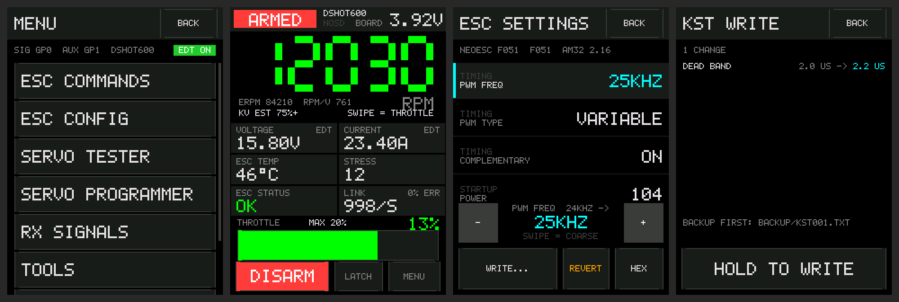
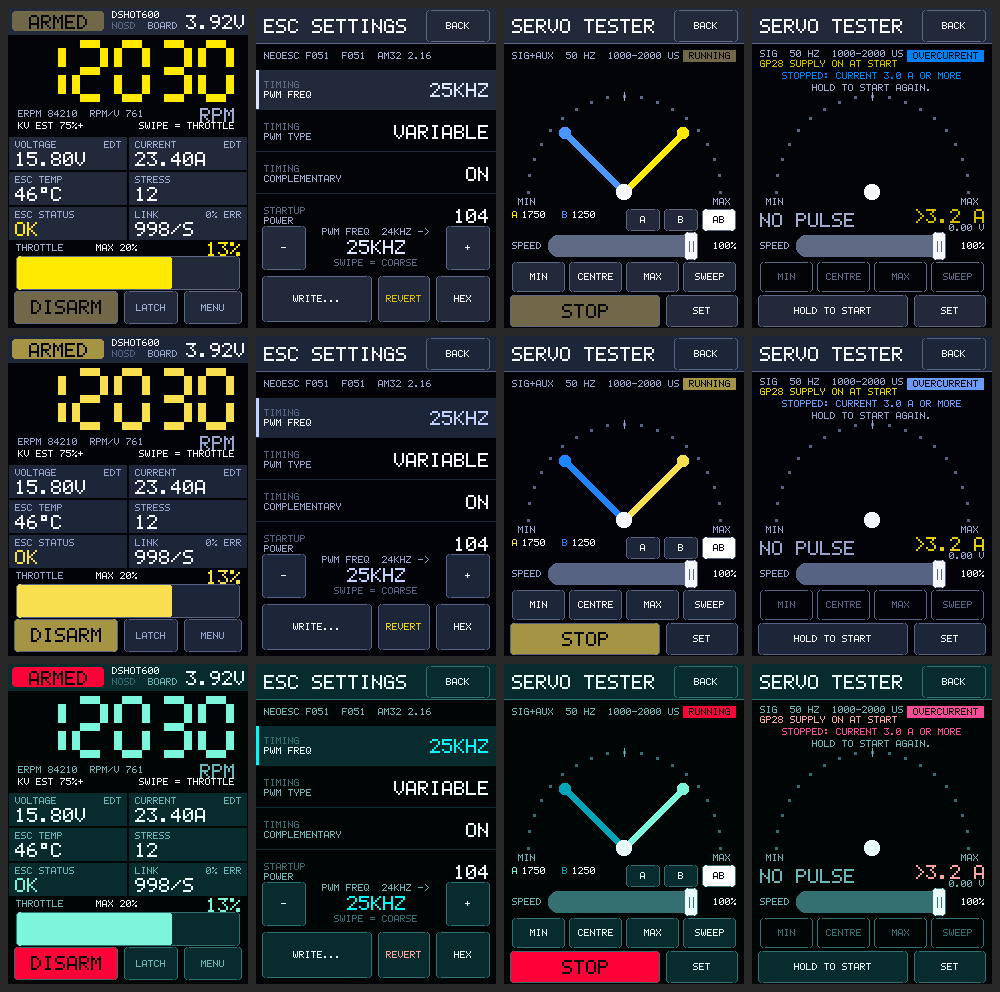

# UI theme after rcbench's

Status: proposed, not built. The owner has not decided its open questions.

The owner's request of 2026-11-15: "Adapt the color scheme and tui to the
MiniRcBench from the big brother." The big brother is rcbench, the larger
bench of the same owner.

This note covers the look: the palette, the colour roles, the header, the
buttons, the lists, the choosers, the chips, the tester's status bar, the
type, the spacing, the pressed and disabled states, and the two themes. It
does not cover three things:

- Which screens exist, their grouping, names and navigation.
  `docs/design/menu-c.md`, on the branch `ccr-menu-rcb` at 71a060f, plans
  them. [The widgets of menu-c.md](#the-widgets-of-menu-cmd) gives its
  widgets their look.
- MENU as the start screen and DShot's lifetime: `docs/design/start-menu.md`
  on the branch `ccr-start-menu`. The branch is not on `origin` as this note
  is written, so the note is not read.
- The touch-loss stop of draft pull request #49. Its texts take the roles of
  this note unchanged.

Terms: UI is user interface, ESC electronic speed controller, DShot the
digital ESC protocol the tester drives, EDT Extended DShot Telemetry, RPM
revolutions per minute, KST and Hitec two servo brands, SD Secure Digital,
SPI Serial Peripheral Interface, IPS in-plane switching, a kind of liquid
crystal panel. RGB565 is a 16-bit colour: 5 bits red, 6 green, 5 blue. WCAG
is the Web Content Accessibility Guidelines, version 2; its contrast ratio
runs from 1 to 21, and it asks 4.5 for text and 3 for the parts of a
control. CVD is colour vision deficiency: protanopia and deuteranopia, the
two red-green kinds, and tritanopia, the blue-yellow kind. ΔE is the
CIEDE2000 colour difference; this note calls a pair under 10 a collision.

MiniRcBench is read at `main` cff09ae. rcbench is read at `origin/main`
a2d10ccf; the checkout read is d75113c1, whose `shared/ui/` and
`shared/gfx/` are the same (`git diff --stat d75113c1 a2d10ccf -- shared/ui
shared/gfx` is empty). rcbench paths below are relative to its root.

Every number in the tables below is printed by
[ui_theme.py](ui_theme.py), which holds both palettes, the packing, the
contrast ratio, the CVD simulation and the distance.

Not seen on the panel: every colour in this note. The values are computed
for sRGB. The ST7789's gamma tables, the IPS panel's primaries and the
backlight level change what a word of RGB565 looks like, and none of them
is measured.

## rcbench's visual system

rcbench draws on a 1024 x 600 px panel, about 0.150 mm a pixel, assumed and
not measured (`shared/ui/include/ui_layout.h`). The theme is
`shared/ui/ui_theme.c` and `shared/ui/include/ui_theme.h`; the widgets are
`shared/ui/ui_widgets.c`; `docs/Screens.md` is the manual.

### Palette

24 roles in two themes, dark and light (`k_base` in `ui_theme.c`, lines 31
to 83). The values are 8 bits a channel. `GFX_RGB()` in
`shared/gfx/include/gfx.h` packs them to RGB565 by dropping the low bits,
as `rgb()` in MiniRcBench's `src/theme.h` does.

| Role | Dark | RGB565 | Light | RGB565 |
|---|---|---|---|---|
| `UI_C_BG` | 2, 5, 9 | 0x0021 | 234, 239, 245 | 0xEF7E |
| `UI_C_PANEL` | 14, 22, 33 | 0x08A4 | 252, 253, 255 | 0xFFFF |
| `UI_C_PANEL_HI` | 26, 40, 58 | 0x1947 | 228, 236, 246 | 0xE77E |
| `UI_C_PANEL_SUNK` | 5, 9, 15 | 0x0041 | 216, 225, 236 | 0xDF1D |
| `UI_C_EDGE` | 58, 116, 156 | 0x3BB3 | 170, 186, 204 | 0xADD9 |
| `UI_C_EDGE_HI` | 112, 190, 236 | 0x75FD | 104, 126, 150 | 0x6BF2 |
| `UI_C_GRID` | 34, 66, 90 | 0x220B | 204, 215, 228 | 0xCEBC |
| `UI_C_GRID_STRONG` | 70, 126, 164 | 0x43F4 | 162, 180, 200 | 0xA5B9 |
| `UI_C_TEXT` | 232, 248, 255 | 0xEFDF | 10, 18, 28 | 0x0883 |
| `UI_C_TEXT_DIM` | 132, 172, 202 | 0x8579 | 70, 88, 108 | 0x42CD |
| `UI_C_TEXT_FAINT` | 72, 106, 134 | 0x4B50 | 120, 138, 158 | 0x7C53 |
| `UI_C_TEXT_ON_LIGHT` | 4, 8, 14 | 0x0041 | 4, 8, 14 | 0x0041 |
| `UI_C_ACCENT` | 0, 240, 255 | 0x079F | 0, 196, 232 | 0x063D |
| `UI_C_OK` | 0, 255, 148 | 0x07F2 | 0, 198, 128 | 0x0630 |
| `UI_C_WARN` | 255, 186, 0 | 0xFDC0 | 246, 168, 0 | 0xF540 |
| `UI_C_DANGER` | 255, 40, 72 | 0xF949 | 232, 48, 48 | 0xE986 |
| `UI_C_VOLT` | 255, 190, 26 | 0xFDE3 | 196, 122, 0 | 0xC3C0 |
| `UI_C_CURR` | 255, 36, 112 | 0xF92E | 208, 24, 78 | 0xD0C9 |
| `UI_C_POWER` | 0, 208, 255 | 0x069F | 0, 132, 186 | 0x0437 |
| `UI_C_RPM` | 132, 255, 56 | 0x87E7 | 46, 148, 22 | 0x2CA2 |
| `UI_C_LILAC` | 192, 138, 255 | 0xC45F | 118, 80, 200 | 0x7299 |
| `UI_C_TEAL` | 34, 244, 202 | 0x27B9 | 0, 150, 130 | 0x04B0 |
| `UI_C_BEVEL_LIT` | 74, 106, 140 | 0x4B51 | 255, 255, 255 | 0xFFFF |
| `UI_C_BEVEL_DARK` | 2, 5, 9 | 0x0021 | 150, 166, 186 | 0x9537 |

The dark background is near black with a blue cast, and every neutral
carries that cast. The light theme is not the dark one inverted: its accent
fills stay bright, because near-black text sits on them in both themes, and
its series colours are darker to read on white (the comment over `k_base`).

Brightness, 20 to 100 %, and contrast, 60 to 140 %, are settings. Both are
applied to the 8-bit values before packing (`apply_one()`, `rebuild()`).

### Colour roles

How often `shared/` and `firmware/` name each role, as `UI_<role>` or
`UI_C_<role>`, counted with `grep -rhowE`:

| Role | Uses | What it colours |
|---|---|---|
| `BG` | 83 | the page; the fill of a button that takes no press |
| `PANEL` | 123 | the status band, cards, list rows, tiles |
| `PANEL_HI` | 153 | edit and navigation buttons, the selected tab, a pressed tile |
| `PANEL_SUNK` | 94 | value boxes, chip fills, slider and scroll troughs |
| `EDGE`, `EDGE_HI` | 56, 16 | outlines and rules; the `-` and `+` keys of a settings row |
| `GRID`, `GRID_STRONG` | 18, 11 | plot grids |
| `TEXT` | 254 | names, button labels, values of the programmers |
| `TEXT_DIM` | 254 | labels, units, an unselected tab |
| `TEXT_FAINT` | 165 | help lines, disabled labels |
| `TEXT_ON_LIGHT` | 32 | text on a bright fill |
| `ACCENT` | 173 | cyan: the home tag, icons, a settings value, a selected tab, section names, a pressed row's outline, the scroll thumb, a changed value's fill |
| `OK` | 55 | green: a press starts something; LINK up; SAVE with changes waiting |
| `WARN` | 243 | amber: under way or paused, a locked row's reason, notices, FAULT |
| `DANGER` | 107 | red: an output is on, ARMED, STOP, alerts, a failed step |
| `VOLT`, `CURR`, `POWER`, `RPM` | 24, 23, 15, 9 | the four telemetry series: amber, pink, blue, lime |
| `LILAC`, `TEAL` | 8, 11 | the fifth and sixth series |
| `BEVEL_LIT`, `BEVEL_DARK` | 4, 4 | the edges of a raised face |

The button classes of `docs/Screens.md`, "Button colours", and
`ui_action_fill()` (`ui_widgets.c`, line 774):

| Class | Available | Active | Waiting | Refused |
|---|---|---|---|---|
| Output action: ARM, OUTPUT ON, CONNECT, WRITE n VALUES | `OK` | `DANGER` | `WARN` | `BG`, faint label |
| Edit: `-`, `+`, value boxes, DISCARD | `PANEL_HI` | | | `BG` |
| Navigation: tiles, tabs, openers | neutral; a selected tab's label `ACCENT` | | | `BG` |
| Delete, NOT SAVED | neutral, the label `DANGER` | | | `BG` |

A value that differs from the device is marked twice: the value box fills
`ACCENT` and the value gains a `* ` (`kst_panel_draw.c`, lines 908 to 922;
`hitec_panel_draw.c`, line 501). A value a loaded file holds and the write
skips fills `WARN` with `! `.

### Type

Fixed-cell bitmap faces, one cell a code point, with lower case, the German
umlauts, the degree sign and the ohm sign (`shared/gfx/gfx_font*.c`).
`ui_theme.h` names them by role:

| Role | Face | Use |
|---|---|---|
| `UI_FONT_LABEL`, `UI_FONT_FINE` | 8 x 16 | labels, buttons, data columns |
| `UI_FONT_BAND` | 10 x 20 | band chips, help, alerts |
| `UI_FONT_BODY` | 12 x 24 | prose, settings values |
| `UI_FONT_HEAD` | 16 x 28 | headings |
| `UI_FONT_TAG` | 20 x 36 | the home tag, settings names, tile names |
| `UI_FONT_NUM` | 24 x 30, and 32 x 44 | numerals |

Readings are seven-segment digits, 22 x 32 px, 4 px thick, slanted 3 px,
with the unlit segments drawn (`ui_seg_hero()` in `ui_theme.h`).

### Band, home tag, alert band

- **The status band** is the top 60 px of every screen: `PANEL` fill, a 1 px
  `EDGE` rule under it (`ui_band.c`, lines 819 and 820). It holds the home
  tag at the left, status chips, and STOP, 168 x 48 px, at the right.
- **A chip** is a pill 44 px tall on `PANEL_SUNK` with `TEXT`. LINK carries
  a dot, `OK` or `DANGER`. ARMED fills `DANGER` and FAULT fills `WARN`, both
  with `TEXT_ON_LIGHT`: "readable by shape at arm's length, not by colour
  alone" (`chip_look()`, `ui_band.c`).
- **The home tag** is the screen's name in the 20 x 36 face on an `ACCENT`
  tag with two cut corners and a chevron; a press lightens it
  (`ui_home_tag()`, `ui_widgets.c`, line 397). The menu, the root, shows a
  wordmark without the chevron.
- **The alert band** is the bottom 44 px: `DANGER` with `TEXT` for an alert,
  `WARN` with `TEXT_ON_LIGHT` for a notice (`ui_router_alert.c`, line 47).

### Buttons

`ui_button_font()` (`ui_widgets.c`, line 94):

- A filled rectangle with an 8 px radius (`UI_R_CTL`) and no outline, with a
  1 px lighter line inside its top edge.
- The label is `TEXT_ON_LIGHT` on a fill of luma 140 or more and `TEXT` on a
  darker one (`ui_is_light()`, line 61). `DANGER` has luma 108, so STOP and
  LEAVE carry light text, and the ARMED chip, which names its ink, dark.
- Pressed: the fill moves 110/255 toward white.
- Disabled: the fill is `BG`, an outline appears, and the label is
  `TEXT_FAINT`.
- A hold button acts after 2 s (`UI_HOLD_S`). Its fill fades from its base
  to the colour it holds next, then the whole button flashes white, black
  and the settled colour twice, 50 ms a phase (`docs/Screens.md`, "Hold
  buttons" and "The flash").

### Lists, value fields, tabs, tiles

- **A settings row** is 64 px tall at a 70 px pitch, a `PANEL` rectangle
  with two cut corners and an `EDGE` outline, `ACCENT` while pressed. The
  name is `TEXT` in 20 x 36, the help line `TEXT_FAINT`, or `WARN` when the
  row is locked, the value `ACCENT` in 12 x 24, the unit `TEXT_DIM`
  (`ui_setlist_draw.c`).
- **A section heading** is its name in `ACCENT` over an `EDGE` rule.
- **A programmer row** is a `TEXT_DIM` label and a value box on
  `PANEL_SUNK` with `-` and `+` on `PANEL_HI` (`kst_panel_draw.c`).
- **Tabs** sit in a `PANEL_SUNK` trough; the selected tab is `PANEL_HI` with
  an `ACCENT` label, the others `TEXT_DIM` (`ui_tabs.c`, lines 146 to 170).
- **A tile** of the menu is a `PANEL` card with a 10 px radius and an `EDGE`
  outline, an icon in `ACCENT`, the name in `TEXT` and a line in `TEXT_DIM`
  (`ui_tile()`, line 337). A pressed tile is `PANEL_HI`.
- **Icons** are drawn from primitives, 15 functions in
  `shared/ui/include/ui_icons.h`.

### Spacing

`ui_layout.h`: margin 8 px; radii 10 px for a card, 8 px for a control, 5 px
for a chip; the smallest touch target 48 px, 7.2 mm; a button 48 px tall.
`ui_theme.h`: cut corners of 10 px and 5 px.

### Text conventions

- A number and its unit stand together with no space, and the unit keeps its
  case in a label of capitals: `HOLD 2s TO START`, `6.00V`
  (`tools/check_units.py`).
- A value that is not there reads `--` (`ui_fmt()`).
- Names and button texts are capitals; help lines and messages are mixed
  case.
- A group is framed by a card with a title tab (`ui_panel()`) or headed by
  a name over a rule. `ui_widgets.c` draws no frame of line characters.

## MiniRcBench's visual system at cff09ae

### Palette and themes

`src/theme.h` and `src/theme.cpp`: 17 entries, `TC_BG` to `TC_MAGENTA`, in
two tables. `C_*` in `src/gfx.h`, lines 40 to 56, index the table in force.
The themes are Dark and High contrast, chosen by SETTINGS, DISPLAY,
CONTRAST (`themeSet()` in `src/ui.cpp` and `src/ui_settings.cpp`). High
contrast is black on white for sunlight: accents dark enough for white
text, glyphs 1 px heavier, frames 2 px, the backlight at 255.

| Entry | Dark | Shown as | High contrast | Means |
|---|---|---|---|---|
| `TC_BG` | 0x0000 | 0, 0, 0 | 0xFFFF | the screen |
| `TC_PANEL` | 0x18E3 | 24, 28, 24 | 0xCEBB | header, buttons, tiles, the selected row |
| `TC_GRID` | 0x39E7 | 57, 60, 57 | 0x39E9 | frames, rules, disabled labels, hints |
| `TC_DIM` | 0x8410 | 132, 130, 132 | 0x424A | labels |
| `TC_TEXT` | 0xE71C | 231, 227, 231 | 0x0000 | text |
| `TC_INK` | 0xFFFF | 255, 255, 255 | 0x0000 | the strongest mark; a pressed frame |
| `TC_PAPER` | 0x0000 | 0, 0, 0 | 0xFFFF | text on `C_AMBER` and `C_INK` |
| `TC_ONACCENT` | 0xFFFF | 255, 255, 255 | 0xFFFF | text on a saturated fill |
| `TC_GREEN` | 0x2665 | 33, 207, 41 | 0x0366 | safe, done |
| `TC_LIME` | 0x07E0 | 0, 255, 0 | 0x03C5 | a live reading |
| `TC_AMBER` | 0xFD20 | 255, 166, 0 | 0xAAC0 | warning |
| `TC_RED` | 0xF9E7 | 255, 60, 57 | 0xB803 | output on, failure |
| `TC_REDDARK` | 0x6000 | 99, 0, 0 | 0xF5F7 | RPM digits with no telemetry |
| `TC_GHOST` | 0x1082 | 16, 16, 16 | 0xEF9E | unlit segments |
| `TC_BLUE` | 0x2D7F | 41, 174, 255 | 0x01D5 | latched |
| `TC_CYAN` | 0x07FF | 0, 255, 255 | 0x02CF | changed |
| `TC_MAGENTA` | 0xF81F | 255, 0, 255 | 0x9011 | alert |

"Shown as" is the 8-bit colour the word stands for, by bit replication.

How often `src/*.cpp` names each: `C_DIM` 193, `C_TEXT` 172, `C_AMBER` 153
and `UI_COL_WARN` 80, `C_BG` 111, `C_PANEL` 95, `C_GRID` 60, `C_ONACCENT`
38, `C_RED` 36, `C_LIME` 22. `C_GRID` colours text in 22 one-line calls of
`gfxText()` and fills the editor bars' `-` and `+`.

### Roles

`src/ui_widgets.h`, lines 139 to 160, name seven roles on the palette:
`UI_COL_SAFE` `C_GREEN`, `UI_COL_LIVE` `C_LIME`, `UI_COL_ON` `C_RED`,
`UI_COL_WARN` `C_AMBER`, `UI_COL_ALERT` `C_MAGENTA`, `UI_COL_CHANGED`
`C_CYAN`, `UI_COL_LATCHED` `C_BLUE`. The neutral role is `C_TEXT`, `C_DIM`
and `C_GRID`.

Two owner decisions of [menu-b.md](menu-b.md#decisions) fix them:

- **Decision 8, "Changed is cyan, with a bar."** A value that differs from
  the device is `C_CYAN` with a 3 px `C_CYAN` bar at the row's left edge;
  the bar is `C_AMBER` when the change breaks a soft rule. Selection changes
  the row's fill and label, never the value's colour. Decision 26 is the
  owner's choice of `C_CYAN`.
- **Decision 11, "One meaning per colour."** The role table above with its
  uses, and the table of what each earlier use becomes. Chips are square
  and 12 px tall so that they do not look like buttons.

### Type

One 5 x 7 bitmap face, the characters 0x20 to 0x5F and a degree sign
(`FONT5X7` in `src/gfx.cpp`); `gfxChar()` draws lower case as capitals. A
cell is 6 x 7 px times the scale, and a string is (6 n - 1) x scale px wide
(`gfxTextW()`). Scale 1 is 7 px tall, about 1.2 mm at 0.178 mm a pixel
([menu.md](menu.md#touch-targets)); scale 2 is 14 px, about 2.5 mm. Scale 1
holds 37 characters between the margins and scale 2 holds 18. 208 one-line
calls pass scale 1 as a literal and 21 pass scale 2; scale 4 is the
splash's name and scale 3 SD LOG's USB DRIVE headline. The RPM readout is
seven-segment digits, 36 x 62 px, drawn from rectangles
(`gfxSegNumber()`).

### Layout and widgets

`src/ui_widgets.h` holds the layout table of
[menu-b.md](menu-b.md#decisions) decision 14 and the floors of
[menu.md](menu.md#decisions) decisions 5 and 16:

| Item | Value |
|---|---|
| Header | 36 px (`UI_HDR_H`), title at scale 2 from x 8, BACK 64 x 32 px at x 170 |
| Strip | y 40, 16 px; a chip 12 px tall ending at x 232; two lines at y 42 and y 52 |
| Body | from y 62 (`UI_BODY_Y`) |
| Margins | text x 8 (`UI_MARGIN`); buttons x 6 to x 234 (`UI_EDGE`) |
| Footer | y 268, 46 px tall; three buttons 6/110, 122/52, 180/54; two 6/150, 162/72; one 6/228 |
| Editor `-` and `+` | 44 x 44 px |
| Touch floors | 40 px for a list row and a row control (`UI_LIST_TAP_MIN`), about 7.1 mm; 22 px elsewhere (`UI_TAP_MIN`) |
| List row | 40 px at a 42 px pitch; scroll bar 3 px wide |

The widgets (`src/ui_widgets.cpp`, `src/ui_list.cpp`, `src/ui_hold.cpp`):

- **`uiButton()`**: a fill, a 1 px `C_GRID` frame, the label centred. No
  radius is drawn ([STATUS.md](../../STATUS.md), open item 25). Pressed is
  additive: the frame and a second frame 2 px inside turn `C_INK`, and the
  label moves 1 px. Disabled is `C_BG` with the frame and a `C_GRID` label.
- **`uiHeader()`**: a `C_PANEL` band, the title in `C_TEXT`, BACK as a
  `C_PANEL` button.
- **`uiChip()`**: a filled square-cornered rectangle with a `C_ONACCENT`
  label, `C_PAPER` over `C_AMBER` and `C_INK`.
- **`uiListDrawField()`**: the row of decision 8. The group caption is
  `C_GRID`, the label `C_DIM`, or `C_TEXT` when selected; the value is
  `C_TEXT`, `C_CYAN`, `C_GRID` or `C_AMBER` by state; the selected row
  fills `C_PANEL`; a 1 px `C_PANEL` rule ends the row.
- **`uiHoldDrawBar()`**: a 3 px `C_LIME` bar over a hold button, which fills
  `C_RED` with a `C_ONACCENT` label while held.

### Fit checks

- **At build time.** 377 `static_assert`s in `src/`. Those of
  `ui_widgets.h` hold BACK in the header, the footer on the panel, and the
  floors. `menuRowsFit()` and the four `*EntriesFit()` of
  `src/ui_registry.cpp`, `settingsSectionFits()`, `setRowsFit()` and
  `linesFit()` hold every registry text to its row.
- **In the host suite.** `gfxTextW()` against the room: the hints and notes
  of `test/test_ui.cpp` (lines 268, 309, 3703, 4874), every value name in
  the editor bar's 140 px (7796), the splash (9106), the notes, every MENU
  status and every SETTINGS value of `test/test_menu.cpp` (1099 to 1730).
- **Colour.** The tests find a text by its colour and its background
  (`fakeTextIs()`, `fakeCountColour()` in `test/fakes.h`), so two roles
  need two different words of RGB565. `test/test_widgets.cpp`, line 625,
  holds each `UI_COL_*` to its palette entry in both themes. No test
  computes a contrast ratio or holds a palette value.

## The mapping

The proposal changes the Dark table's 17 values, three widget rules and two
uses of a colour. It adds no palette entry and no role, and it moves no
rectangle. High contrast keeps its values.

### rcbench's roles on MiniRcBench

| rcbench role | MiniRcBench entry | RGB565 | Adaptation |
|---|---|---|---|
| `UI_C_BG` | `TC_BG`, `TC_PAPER` | 0x0021 | |
| `UI_C_PANEL` | `TC_GHOST` | 0x08A4 | 1: not the control face |
| `UI_C_PANEL_HI` | `TC_PANEL` | 0x1947 | 1 |
| `UI_C_PANEL_SUNK` | none | | 2: a neutral chip is a frame |
| `UI_C_EDGE`, `UI_C_EDGE_HI` | none | | 3: one frame colour |
| `UI_C_GRID`, `UI_C_GRID_STRONG` | none | | no plot |
| `UI_C_TEXT` | `TC_TEXT` | 0xEFDF | |
| `UI_C_TEXT_DIM` | `TC_DIM` | 0x8579 | |
| `UI_C_TEXT_FAINT` | `TC_GRID` | 0x4B50 | 3 |
| `UI_C_TEXT_ON_LIGHT` | `TC_ONACCENT` | 0x0041 | 4: dark text on every fill |
| `UI_C_ACCENT` | `TC_CYAN` | 0x079F | 5: changed only |
| `UI_C_OK` | `TC_GREEN` | 0x07F2 | 6: safe and done, not "a press starts" |
| `UI_C_WARN` | `TC_AMBER` | 0xFDC0 | |
| `UI_C_DANGER` | `TC_RED` | 0xF949 | |
| `UI_C_RPM` | `TC_LIME` | 0x87E7 | 7: every live reading |
| `UI_C_VOLT`, `UI_C_CURR`, `UI_C_POWER` | none | | 7 |
| `UI_C_LILAC`, `UI_C_TEAL` | none | | 8 |
| `UI_C_BEVEL_LIT`, `UI_C_BEVEL_DARK` | none | | no raised face |

### The Dark table, proposed

| Entry | Today | Proposed, 8 bit | RGB565 | Shown as | From |
|---|---|---|---|---|---|
| `TC_BG` | 0x0000 | 2, 5, 9 | 0x0021 | 0, 4, 8 | `UI_C_BG` |
| `TC_PANEL` | 0x18E3 | 26, 40, 58 | 0x1947 | 24, 40, 57 | `UI_C_PANEL_HI` |
| `TC_GRID` | 0x39E7 | 72, 106, 134 | 0x4B50 | 74, 105, 132 | `UI_C_TEXT_FAINT` |
| `TC_DIM` | 0x8410 | 132, 172, 202 | 0x8579 | 132, 174, 206 | `UI_C_TEXT_DIM` |
| `TC_TEXT` | 0xE71C | 232, 248, 255 | 0xEFDF | 239, 251, 255 | `UI_C_TEXT` |
| `TC_INK` | 0xFFFF | 255, 255, 255 | 0xFFFF | 255, 255, 255 | `GFX_WHITE` |
| `TC_PAPER` | 0x0000 | 2, 5, 9 | 0x0021 | 0, 4, 8 | `UI_C_BG` |
| `TC_ONACCENT` | 0xFFFF | 4, 8, 14 | 0x0041 | 0, 8, 8 | `UI_C_TEXT_ON_LIGHT` |
| `TC_GREEN` | 0x2665 | 0, 255, 148 | 0x07F2 | 0, 255, 148 | `UI_C_OK` |
| `TC_LIME` | 0x07E0 | 132, 255, 56 | 0x87E7 | 132, 255, 57 | `UI_C_RPM` |
| `TC_AMBER` | 0xFD20 | 255, 186, 0 | 0xFDC0 | 255, 186, 0 | `UI_C_WARN` |
| `TC_RED` | 0xF9E7 | 255, 40, 72 | 0xF949 | 255, 40, 74 | `UI_C_DANGER` |
| `TC_REDDARK` | 0x6000 | 96, 16, 32 | 0x6084 | 99, 16, 33 | own |
| `TC_GHOST` | 0x1082 | 14, 22, 33 | 0x08A4 | 8, 20, 33 | `UI_C_PANEL` |
| `TC_BLUE` | 0x2D7F | 72, 136, 255 | 0x4C5F | 74, 138, 255 | own |
| `TC_CYAN` | 0x07FF | 0, 240, 255 | 0x079F | 0, 243, 255 | `UI_C_ACCENT` |
| `TC_MAGENTA` | 0xF81F | 255, 0, 255 | 0xF81F | 255, 0, 255 | own |

Every word differs from every other but `TC_PAPER`, which equals `TC_BG` by
the rule of `theme.h`, so the tests' colour probes keep working.

### The conversion against the panel

- **Packing.** `rgb()` in `src/theme.h` keeps the top 5, 6 and 5 bits, as
  rcbench's `GFX_RGB()` does. The same 8-bit value gives the same word on
  both benches.
- **Byte order.** `st7789.cpp` sends pixels as 16-bit SPI frames, most
  significant bit first (`spiFormat16()`, line 48), so a word reaches the
  panel big-endian with no swap.
- **Channel order.** COLMOD is 0x55, 16 bits a pixel (line 125). MADCTL is
  0x00 in portrait, with bit 3 clear: red is the top 5 bits (`madctlFor()`,
  line 89).
- **Inversion.** The driver sends INVON, 0x21, which an IPS panel needs for
  a word to show as its own colour (line 148).
- **What a word loses.** The low 3, 2 and 3 bits. Read back by bit
  replication, the largest shift in the table is 7 of 255: `TC_TEXT`'s red,
  232, shows as 239, and `TC_GHOST`'s red, 14, as 8. How the panel expands
  a word is not verified. The contrast and distance numbers below are
  computed on the shown values.
- **Not verified.** The gamma tables the driver loads (0xE0, 0xE1) and the
  panel's primaries. rcbench's values are tuned on its own panel, a
  different one. Whether `TC_PANEL` stands off `TC_BG` at a backlight of
  200 of 255, the default, is the first thing to look at on hardware.

### Contrast

WCAG contrast ratio of each pair a screen draws. Every text here is small
by WCAG's measure, scale 2 included: its capitals are 14 px, about 2.5 mm,
tall. So text needs 4.5.

| Text | On | Today | Proposed | High contrast | Use |
|---|---|---|---|---|---|
| `TEXT` | `BG` | 16.54 | 19.51 | 21.00 | values, titles of text |
| `DIM` | `BG` | 5.51 | 8.74 | 9.10 | labels, captions, the neutral chip |
| `GRID` | `BG` | 1.88 | 3.57 | 10.94 | disabled labels, group captions, hints; frames |
| `GREEN` | `BG` | 10.02 | 15.41 | 6.50 | SAVED, WRITE VERIFIED |
| `LIME` | `BG` | 15.30 | 16.01 | 5.57 | RPM digits, readouts |
| `AMBER` | `BG` | 10.71 | 12.02 | 4.99 | warnings, the current step |
| `RED` | `BG` | 5.96 | 5.54 | 6.61 | failures |
| `CYAN` | `BG` | 16.75 | 14.95 | 7.73 | a changed value |
| `BLUE` | `BG` | 8.59 | 6.24 | 9.68 | servo B's label and horn |
| `MAGENTA` | `BG` | 6.70 | 6.56 | 7.96 | STALLED, the alert lines |
| `TEXT` | `PANEL` | 13.58 | 14.21 | 14.40 | button labels, the header's title, the selected row |
| `DIM` | `PANEL` | 4.52 | 6.37 | 6.24 | LATCH and MENU labels, tile captions |
| `AMBER` | `PANEL` | 8.79 | 8.76 | 3.42 | REVERT and DEFAULTS labels |
| `CYAN` | `PANEL` | 13.75 | 10.89 | 5.30 | a changed value in the selected row |
| `LIME` | `PANEL` | 12.56 | 11.66 | 3.82 | ESC STATUS `OK` in its tile |
| `RED` | `PANEL` | 4.89 | 4.03 | 4.53 | ESC STATUS `ERROR` in its tile |
| `MAGENTA` | `PANEL` | 5.50 | 4.78 | 5.46 | ESC STATUS `ALERT` in its tile |
| `ONACCENT` | `GREEN` | 2.10 | 15.15 | 6.50 | the SAFE badge, the EDT ON chip |
| `ONACCENT` | `LIME` | 1.37 | 15.74 | 5.57 | servo A's selector, the PORT OPEN chip |
| `ONACCENT` | `RED` | 3.53 | 5.45 | 6.61 | ARMED, DISARM, STOP, a held hold |
| `ONACCENT` | `BLUE` | 2.44 | 6.14 | 9.68 | LATCH on, a toggle on, PROG MODE |
| `ONACCENT` | `MAGENTA` | 3.14 | 6.45 | 7.96 | the OVERCURRENT and STALLED chips |
| `PAPER` | `AMBER` | 10.71 | 12.02 | 4.99 | EJECT, the SDERR chip |
| `PAPER` | `INK` | 21.00 | 20.57 | 21.00 | the AB selector |
| `PANEL` | `BG` | 1.22 | 1.37 | 1.46 | not text: a fill against the screen |
| `GRID` | `PANEL` | 1.54 | 2.60 | 7.50 | not text: BACK's frame in the header |
| `REDDARK` | `BG` | 1.53 | 1.59 | 1.61 | not text: RPM digits with no telemetry |
| `GHOST` | `BG` | 1.10 | 1.11 | 1.12 | not text: unlit segments |

What the numbers say:

- **Today's labels on fills fail.** White on `C_LIME` is 1.37, on
  `C_GREEN` 2.10, on `C_BLUE` 2.44, on `C_MAGENTA` 3.14, on `C_RED` 3.53:
  the SAFE badge, the EDT ON chip, servo A's selector, LATCH, PROG MODE,
  ARMED and STOP. With rcbench's dark ink every label on a fill is 5.45 or
  more.
- **One text pair is under 4.5 in the proposal:** `RED` on `PANEL`, 4.03,
  today 4.89. It is the word `ERROR` at scale 2 in the tester's ESC STATUS
  tile (`STATUS_COL` in `src/ui.cpp`). rcbench's own `PANEL` would give
  4.99 and stands off the background at 1.11 only (adaptation 1). Other
  red texts on a `C_PANEL` fill are not searched for.
- **`GRID` as text is 3.57,** today 1.88. It stays under 4.5 by intent: it
  is the disabled label, and WCAG exempts a disabled control. The group
  captions and the `SWIPE = COARSE` hints share it; a slice moves the hints
  to `C_DIM`.
- **Frames.** A button's frame against the screen goes from 1.88 to 3.57,
  over the 3 that WCAG asks of a control's boundary. BACK's frame on the
  header band is 2.60.
- **High contrast** has two pairs under 4.5 today, both on its `PANEL`:
  `AMBER` 3.42 and `LIME` 3.82; `RED` is 4.53. The proposal does not change
  them.

### Colour vision deficiency

Each role colour is passed through the simulation of Machado, Oliveira and
Fernandes (2009) at full severity, and the pairs are compared by ΔE. Pairs
under 10 in any view, among the seven role colours and `TEXT`, `DIM` and
`GRID`:

| Pair | Palette | Normal | Protan | Deutan | Tritan | Told apart by |
|---|---|---|---|---|---|---|
| `GREEN` `AMBER` | today | 45.4 | 4.2 | 7.2 | 59.7 | |
| | proposed | 43.2 | 13.3 | 14.0 | 57.3 | no collision |
| `GREEN` `RED` | today | 79.9 | 28.9 | 6.8 | 73.3 | |
| | proposed | 88.6 | 39.9 | 19.1 | 78.2 | no collision |
| `LIME` `AMBER` | today | 48.1 | 14.4 | 5.0 | 63.8 | |
| | proposed | 36.9 | 10.7 | 4.8 | 52.9 | the word: `OK`, `WARN`; a bar is never amber |
| `BLUE` `MAGENTA` | today | 50.6 | 15.6 | 0.7 | 69.7 | |
| | proposed | 34.4 | 7.3 | 7.5 | 65.9 | the chip's word: `PROG MODE`, `STALLED` |
| `CYAN` `TEXT` | today | 34.5 | 5.3 | 11.8 | 36.9 | |
| | proposed | 21.9 | 8.2 | 14.8 | 20.7 | the 3 px bar of decision 8 |
| `LIME` `CYAN` | today | 34.5 | 37.3 | 44.1 | 9.0 | |
| | proposed | 38.5 | 45.3 | 46.9 | 8.3 | the bar; a reading has no row |
| `GREEN` `LIME` | today | 11.0 | 10.3 | 11.0 | 10.6 | |
| | proposed | 13.0 | 10.5 | 11.7 | 5.4 | shape: a chip or a word against digits and bars |
| `GREEN` `CYAN` | today | 34.1 | 37.9 | 42.9 | 14.8 | |
| | proposed | 28.9 | 34.9 | 37.4 | 4.8 | the bar; `SAVED` is a word |
| `BLUE` `DIM` | today | 29.4 | 26.4 | 24.4 | 34.6 | |
| | proposed | 12.1 | 16.0 | 17.0 | 8.7 | a fill against a label |

What the numbers say:

- **Red-green CVD, the common kinds.** Today five pairs collide, with the
  worst at 0.7: latched and alert look the same to a deuteranope. The
  proposal has three, with the worst at 4.8. Safe against warning and safe
  against failure stop colliding.
- **Tritanopia** gets worse: `GREEN` against `LIME` and against `CYAN` drop
  to 5.4 and 4.8, because rcbench's green leans toward cyan.
- **Normal vision.** `GREEN` and `LIME` are 13.0 apart, today 11.0: two
  greens in both palettes. `BLUE` and `DIM` are 12.1 apart, because
  rcbench's label colour is a blue-grey.
- **No state rests on hue alone.** Every chip and badge carries its word. A
  changed value carries its bar. LATCH, a toggle and a selector show "on"
  by a fill where "off" has none. The collisions above cost a second cue,
  not the state.
- **Dark ink on red under protanopia.** Red loses luminance for a
  protanope: `ONACCENT` on `RED` is 5.45 for normal vision, 3.61 simulated
  for protanopia, 6.66 for deuteranopia. White on the same red is 3.71,
  5.58 and 3.05 ([question 3](#open-questions)).
- **High contrast** collides more than either dark palette: ten pairs
  under 10 among its accents, `GREEN` against `LIME` at 5.1 for normal
  vision. Its accents are dark by its own rule and cannot spread in
  lightness. Not changed here.

[The fourth mock-up](#mock-ups) shows three screens through the simulation.

### Adaptations to the small display

1. **`TC_PANEL` is rcbench's `PANEL_HI`, not its `PANEL`.** `C_PANEL` is the
   control face here: buttons, MENU rows, tiles, the selected row and the
   header take it in 95 places, and rcbench's control face is `PANEL_HI`.
   rcbench's `PANEL` stands 1.11 off the background, less than today's
   1.22; `PANEL_HI` stands 1.37 off. The selected row of a field list has
   no frame, so its fill is the whole cue. rcbench's `PANEL` becomes the
   unlit segments, `TC_GHOST`.
2. **No sunk surface.** rcbench's chips and value boxes sit on
   `PANEL_SUNK`, one step of RGB565 from the background. A chip 12 px tall
   needs more than that: a neutral chip is a 1 px `C_GRID` frame on `C_BG`
   with a `C_DIM` label. It reads as "not there", which is what `NO ESC`,
   `PORT CLOSED` and `MOVING` say.
3. **One colour for frames and faint text.** rcbench has six neutrals
   between panel and label; MiniRcBench has `C_GRID` for frames, rules,
   disabled labels and hints. `TEXT_FAINT` fills it: it is rcbench's
   disabled label, 3.57 on the background, and `EDGE`, rcbench's outline,
   is within 0.6 of it at 4.11. Six neutrals cannot be told apart in 1 px
   lines and 7 px glyphs.
4. **Dark ink on every fill.** rcbench picks a button's label by the fill's
   luma, and its accents are bright, so its labels on fills are dark.
   `TC_ONACCENT` takes `TEXT_ON_LIGHT`. This revises the "white" of
   `theme.h`'s table for the Dark theme; High contrast keeps white on its
   dark accents. A 5 x 7 glyph has 1 px strokes at scale 1, and a chip's
   label is scale 1: it needs the ratio more than rcbench's 10 x 20 face
   does.
5. **Cyan stays "changed".** rcbench's accent also marks the home tag, the
   icons, every settings value, the selected tab and the section names.
   Decision 11 gives cyan one meaning here, and rcbench marks a changed
   value with the same accent, so the mapping keeps the stronger half of
   rcbench's use and decision 8 as it stands. The header keeps a `C_TEXT`
   title and a neutral BACK ([question 1](#open-questions)).
6. **Green stays "safe, done".** rcbench fills a button green when a press
   starts an output and red while the output is on. Here HOLD TO ARM, HOLD
   TO START and HOLD TO WRITE stay neutral and fill red while held, by
   decisions 11 and 14 ([question 2](#open-questions)).
7. **One live colour.** rcbench gives voltage, current, power and speed a
   colour each, for a plot with four traces. The tester has no plot, its
   tiles name their values, and decision 11 gives a live reading one
   colour: rcbench's speed colour, `UI_C_RPM`, for `C_LIME`.
8. **Latched and alert have no rcbench role.** rcbench shows "on" with the
   accent, which is taken, and an alert with the danger red, which decision
   11 keeps apart. `TC_MAGENTA` keeps its value. `TC_BLUE` moves from
   41, 174, 255 to 74, 138, 255: against the new cyan the old blue is 25.9
   away and the new 38.0, and against magenta under deuteranopia 0.7 and
   7.5. rcbench's spare series colours fit worse: `LILAC` is 15.2 from
   magenta for normal vision, and `POWER` 12.3 from cyan.
9. **`TC_REDDARK` is the red at about 37 % over the background,**
   96, 16, 32, as today's 99, 0, 0 is to today's red.
10. **No new face.** rcbench's faces start at 8 x 16 px. 240 px hold 30
    cells of 8 px, and the 5 x 7 face holds 37 characters between the
    margins; the strips, the notes and the leave page's steps are written
    to 37. rcbench's roles map to scales:
    labels, help and chips to scale 1, names, values and button labels to
    scale 2, numerals to the segment digits.
11. **No icons and no tiles.** A MENU row is 40 px tall with a label at
    scale 2; `SERVO PROGRAMMER` is 190 px of the row's 224, and menu-c's
    widest label is 118 px. rcbench's tile is 243 x 255 px for a 40 px
    icon over a name; this panel is 240 x 320 px.
12. **The same floor in millimetres.** rcbench's smallest target is 48 px
    at 0.150 mm, 7.2 mm. `UI_LIST_TAP_MIN`, 40 px at 0.178 mm, is 7.1 mm.
    The theme moves no rectangle, so the floors of
    [menu.md](menu.md#decisions) decision 5 hold as built: 40 px for list
    rows and row controls, the header 36 px, BACK 64 x 32 px.
13. **Pressed stays additive.** rcbench lightens a pressed fill. The rule
    of `ui_widgets.h` stands: a `C_INK` frame, a second frame and the label
    moved 1 px. It reads on a fill of any colour, and the frame is 20.57
    against the background.
14. **No brightness and contrast scaling of the palette.** rcbench scales
    its palette; MiniRcBench dims the backlight (SETTINGS, DISPLAY) and has
    High contrast for sunlight.

### High contrast

Unchanged, and not replaced by rcbench's light theme. rcbench's light
accents are fills for dark text. As text on white they are under 4.5:
`ACCENT` 2.02, `OK` 2.21, `WARN` 1.96, `DANGER` 4.09, `RPM` 3.84. Here one
entry is both a fill and a text colour, and High contrast exists for
sunlight, where white and black do the work. The widget rules below apply
in both themes.

## Widgets

What each widget draws in the proposal. Rectangles are today's.

| Widget | Proposed | rcbench's |
|---|---|---|
| Header | `C_PANEL` band; a 1 px `C_GRID` rule at y 35; the title `C_TEXT`, scale 2 | the band: `PANEL` over an `EDGE` rule |
| BACK | a neutral button; disabled: `C_BG`, frame, `C_GRID` label | the home tag, on `ACCENT` (adaptation 5) |
| Neutral button | `C_PANEL`, a 1 px `C_GRID` frame, `C_TEXT` label; `C_DIM` for LATCH and MENU, as today | `PANEL_HI`, no frame |
| Button radius | 5 px (`UI_RADIUS`), drawn ([question 4](#open-questions)) | 8 px of 48 |
| Pressed | `C_INK` frame, inner frame, label + 1 px | fill toward white |
| Disabled | `C_BG`, frame, `C_GRID` label | `BG`, outline, `TEXT_FAINT` |
| Output on | `C_RED` fill, `C_ONACCENT` label: DISARM, STOP | `DANGER` |
| Hold | neutral; `C_RED` with `C_ONACCENT` while held; a 3 px `C_LIME` bar | green fading to red or amber, then a flash |
| Editor `-`, `+`; REPAIR | neutral, as SETTINGS' `-` and `+` are today | edit: `PANEL_HI` |
| Warning label | `C_AMBER` on a neutral button: REVERT, DEFAULTS | the label in `DANGER` on DELETE |
| Chip with a state | square, 12 px, the role's fill, `C_ONACCENT` label; `C_PAPER` on amber | a pill; filled for ARMED and FAULT |
| Neutral chip | square, 12 px, `C_GRID` frame on `C_BG`, `C_DIM` label | a pill on `PANEL_SUNK` |
| Tester badge | `C_GREEN` or `C_RED`, the word at scale 2 in `C_ONACCENT` | the ARMED chip |
| Strip | `C_DIM` caption; the guard's and the notes' lines `C_AMBER` | the footer's line, `WARN` while it warns |
| List row, MENU | a neutral button 40 px tall, label scale 2, status scale 1 `C_DIM` | a tile |
| Field row | fill `C_BG`, selected `C_PANEL`; caption `C_GRID`, label `C_DIM`, selected `C_TEXT`; value by state; a 1 px `C_PANEL` rule | a `PANEL` row with an `EDGE` outline |
| Changed value | `C_CYAN` and a 3 px bar; `C_AMBER` bar for a soft rule | an `ACCENT` fill and `* ` |
| Read-only value | `C_GRID` | `TEXT_FAINT` |
| Section caption | `C_TEXT`, scale 1 | `ACCENT` over a rule (adaptation 5) |
| Scroll bar | 3 px, `C_GRID` | `ACCENT` on `PANEL_SUNK` |
| Slider | trough as today, fill `C_GRID`, thumb `C_TEXT` | a `PANEL_SUNK` trough, a fill between it and `TEXT` |
| Readings | `C_LIME` segments over `C_GHOST`; `C_REDDARK` with no telemetry | series colours, unlit segments drawn |
| Tile, tester | `C_PANEL`, caption `C_DIM`, value `C_TEXT` at scale 2 | a card |

Three of these change a widget's rule, beyond the palette:

- **The header's rule.** One `gfxHLine()` at y 35. The strip starts at
  y 40, so nothing moves.
- **The neutral chip.** `uiChip()` with `C_GRID` draws the frame and the
  `C_DIM` label. On today's fill the proposal's dark ink would be 3.51.
- **Neutral edit buttons.** The editor bars' `-` and `+` and Hitec's REPAIR
  are `C_GRID` fills with a `C_ONACCENT` label today, 11.17 with white ink
  and 3.51 with dark. They become neutral buttons: 14.21.

Two uses of a colour change:

- **A slider's fill** is `C_GRID`, today `C_DIM`. `C_DIM` becomes rcbench's
  label colour, 8.74 against the background, and a bar of it as wide as
  the slider outshines the readout over it.
- **Hints** a user reads, `SWIPE = COARSE` and its kin, are `C_DIM`, today
  `C_GRID`. Group captions stay `C_GRID`.

### Units and groups

- **Units.** rcbench writes `2s` and `6.00V`, the unit in its own case and
  no space. The 5 x 7 face has capitals only, so a lower-case unit shows as
  a capital. The screens are not uniform today: `3.92V`, `15.80V` and `20%`
  have no space, `2.2 US`, `50 HZ` and `1000-2000 US` have one. Which to
  follow is a matter of screen texts and is left to the note that owns the
  names; the theme draws either.
- **No value** is `--` on both benches.
- **Frames.** rcbench frames a group with a card and a title tab. A card
  costs a margin on each side, 16 px of 240. Here a group is a caption
  line, as SETTINGS draws its sections, and a field row carries its group
  over its label.

### The widgets of menu-c.md

menu-c.md leaves three looks to this note:

- **A MENU header with no BACK.** The band, its rule and the title; nothing
  is drawn in BACK's rectangle. No wordmark: rcbench's root shows one, and
  the splash already carries the name.
- **`>` on a row that opens a hub.** `C_DIM` at scale 2, 10 px wide, ending
  at x 222: at scale 1 the mark is 5 x 7 px, the smallest thing on a row
  whose label is 14 px tall. It starts at x 213, 79 px after the widest
  hub label ends at x 134. A disabled row draws it in `C_GRID`.
- **The hub, `ui_hub`.** An entry is a neutral button, 228 x 46 px, with
  its label at scale 2 in `C_TEXT`. Its lines are `C_DIM` at scale 1. An
  entry that is refused is the disabled button, and its `why` lines are
  `C_AMBER`, as PROGRAMMER draws HITEC CLASSIC today. The strip is `C_DIM`.
  The scroll bar is the 3 px `C_GRID` bar at x 235.

MENU's strip loses its EDT chip in menu-c.md. The chips of ESC COMMANDS
keep the looks above.

## Mock-ups

Rendered by the host suite from a scratch copy of the tree at cff09ae with
the proposal applied by `ui_theme.py --patch DIR --radius`, then tiled by
`ui_theme.py --sheet`. Nothing in `src/` is changed on this branch. Each
screen is 240 x 320 px, shown at twice its size.

Today: MENU, the tester armed, ESC SETTINGS with an edit, KST WRITE.

Proposed, the same four frames:

Proposed: MENU with the neutral `NO ESC` chip, HITEC SERVO with the PROG
MODE chip and disabled buttons, the leave page with BACK disabled, SERVO
TESTER with two servos.

Proposed, through the simulation of protanopia, deuteranopia and
tritanopia, top to bottom, at their own size: the tester armed, ESC
SETTINGS with an edit, SERVO TESTER with two servos and with OVERCURRENT.

The mock-ups draw the 5 px radius of [question 4](#open-questions). Without
it the corners are those of the first picture.

With the patch the host suite fails six checks and passes the rest; they
are the tests of [the slices](#slices):

| Check | Where |
|---|---|
| `NO ESC` on a `C_GRID` fill, twice | `test/test_ui.cpp`, lines 1650 and 1670 |
| `MOVING` on grey | `test/test_angle_ui.cpp`, line 329 |
| `PORT CLOSED` on grey, twice | `test/test_bridge_ui.cpp`, lines 264 and 333 |
| SPEED's fill dim | `test/test_servo.cpp`, line 3394 |

## Revisions

Decisions the theme revises, with the line the build adds under each. The
notes are not edited now.

1. **[menu-b.md](menu-b.md#decisions) decision 11,** the row "MENU `NO
   ESC` chip, no eRPM: `C_GRID`, square".

   > Revised by [ui-theme.md](ui-theme.md#widgets): a chip with no state
   > to report, `NO ESC`, `PORT CLOSED` and `MOVING`, is a 1 px `C_GRID`
   > frame on `C_BG` with a `C_DIM` label, square and 12 px tall.

2. **menu-b.md decision 11,** the row "servo SPEED fill: `C_DIM`".

   > Revised by [ui-theme.md](ui-theme.md#widgets): a slider's fill is
   > `C_GRID`.

3. **menu-b.md, "The field lists",** the drawing's line "`SWIPE = COARSE`:
   `C_GRID`".

   > Revised by [ui-theme.md](ui-theme.md#widgets): a hint is `C_DIM`.

4. **menu-b.md, "Slice 2 as built",** the chip block: the label on a fill.
   Not a decision; the build updates the paragraph and
   [rx-signals.md](rx-signals.md), which records the same rule: `C_ONACCENT`
   is dark in the Dark theme.

Decisions the theme leaves as they are:

- **menu-b.md decisions 8 and 26.** Changed is `C_CYAN`, with a bar. The
  value of cyan moves from 0x07FF to 0x079F.
- **menu-b.md decision 11,** the role table and every other row. A role
  keeps its entry; the entries' values change.
- **menu-b.md decision 14.** No rectangle and no text moves.
- **[menu.md](menu.md#decisions) decisions 5 and 16.** The floors.

Two open questions would revise more, if the owner takes the other side:
question 1 revises decision 11's cyan, and question 2 its green and
decision 14's hold fill. Question 4 closes open item 25 of
[STATUS.md](../../STATUS.md).

## Slices

Each slice builds and passes the host suite alone. None needs hardware; the
look on the panel is checked once, after slice 1, by the owner.

| Slice | What | Host tests |
|---|---|---|
| 1 | **Palette.** `THEME_DARK` in `src/theme.cpp` as `rgb()` triples; the comments of `theme.h`: the table's `C_ONACCENT` row and the entries' meanings | new, `test_widgets.cpp`: each word equals its triple; every entry but `TC_PAPER` differs from every other in both themes, so the colour probes stay valid; the contrast table above as a check, each text pair 4.5 or more but the three named exceptions, each label on a fill 4.5 or more. Mutation: one value changed |
| 2 | **Labels on fills.** The editor `-` and `+` of ESC SETTINGS, KST SERVO, HITEC SERVO, SERVO SET and S.BUS OUTPUT SET, and REPAIR, as neutral buttons | each button's fill and label by control id, 5 screens |
| 3 | **The neutral chip.** `uiChip()` with `C_GRID` | `test_ui.cpp` 1650 and 1670, `test_angle_ui.cpp` 329, `test_bridge_ui.cpp` 264 and 333 rewritten: frame, `C_BG` inside, `C_DIM` label; `chipIs()` gains the case |
| 4 | **Header rule and hints.** `uiHeader()`; `SWIPE = COARSE` and the other hints in `C_DIM`; the slider's fill | the rule's row on every screen with a header; `test_servo.cpp` 3394; the hints by text and colour. Fit checks do not change: no text moves |
| 5 | **Radius,** if question 4 says so: the corner solver of `gfxRoundRect()` and `roundFrame1px()`; chips stay square | `test_gfx.cpp`: the corner pixels of a 5 px fill and frame, insets 2, 1, 0; `test_widgets.cpp`: a chip's corner pixel lit, a button's not. Mutation: the solver put back |
| 6 | **Screens.** One pass per screen in each theme for a pair the tables above do not name: red text on `C_PANEL`, text on a role fill drawn outside `uiChip()` and `uiButton()` | a walk over the suite's 182 frames: no text pixel under 4.5 against its background outside the listed exceptions, as a suite check or a script over the shots |
| 7 | **Docs and previews.** `tools/make_previews.py`, the README's "High contrast" and the screens' texts, the wiki in both languages, STATUS.md, CHANGELOG.md, the revision lines above | `test/check_docs.py`, `tools/check_wiki.py` |

Notes on the slices:

- **Slice 1 alone is shippable.** With only the palette, the six `C_GRID`
  fills carry dark ink at 3.51 until slices 2 and 3.
- **"Grey".** README.md says "grey" 17 times for dim and disabled texts and
  the wiki pages do the same. With the palette they are blue-grey. Slice 7
  replaces the word by the role, "dim" or "faint", in both languages.
- **menu-c.md's widgets** take their look in menu-c.md's own slices, from
  [the section above](#the-widgets-of-menu-cmd). The order between the two
  notes is free: the theme touches no registry and no navigation.
- **Flash and RAM.** The palette is 34 bytes of the same size. The radius
  adds a loop per corner row; the frame cost is not measured.

## Open questions

Each is a fork the owner decides. The recommendation is first.

1. **Does cyan stay "changed" only?** Recommended: yes. rcbench's cyan
   marks navigation and values as well: the home tag, icons, the selected
   tab, every settings value. Taking that here revises decision 11 and
   leaves "changed" with the bar alone, on rows where every value is cyan.
   The price of yes: the header is neutral and looks less like rcbench's.
2. **Do buttons that start an output turn green?** Recommended: no.
   rcbench fills ARM, OUTPUT ON and WRITE green while a press starts them.
   Here green says safe and done (decision 11), and a green HOLD TO ARM
   beside a green SAFE badge would give one colour two meanings on the
   tester. The price of no: the button classes differ between the benches.
3. **Dark or white text on red?** Recommended: dark, rcbench's ink on its
   ARMED chip. It is 5.45 against white's 3.71, and one ink on every fill
   is one rule. White is rcbench's choice on STOP and LEAVE and reads
   better for a protanope, 5.58 against 3.61 simulated. White on red only
   would need a third ink rule in `uiChip()` and `uiButton()`'s callers.
4. **Draw the 5 px radius?** Recommended: yes. rcbench's controls are
   rounded, 8 px of 48, and decision 11 keeps chips square so that they do
   not look like buttons, which holds only when buttons are not square too.
   `UI_RADIUS` is 5 and every call passes it. The fix is two loops in
   `src/gfx.cpp`; the mock-ups draw it. No is today's look.
5. **Is the first look on hardware before or after slices 2 to 7?**
   Recommended: before. Slice 1 is one table. `TC_PANEL` against `TC_BG`,
   1.37 computed, and the blue cast of the neutrals at a backlight of 200
   are the two things the host cannot show. If the panel fill is too weak,
   the fallback is a lighter `TC_PANEL` between rcbench's `PANEL_HI` and
   `GRID`, which no other slice depends on.
