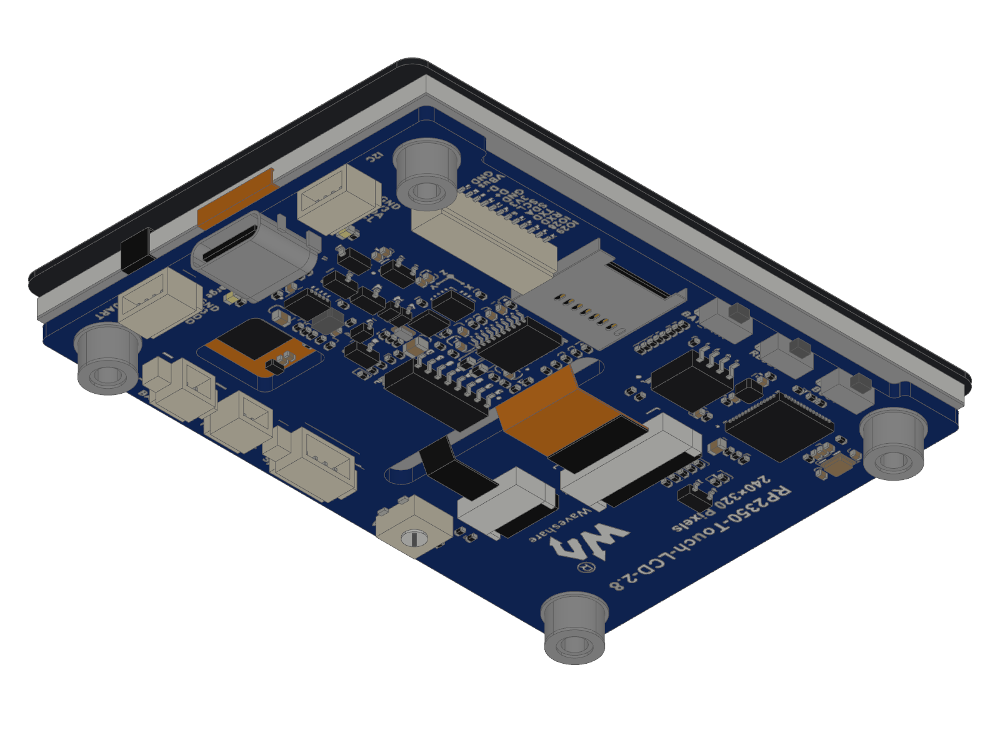
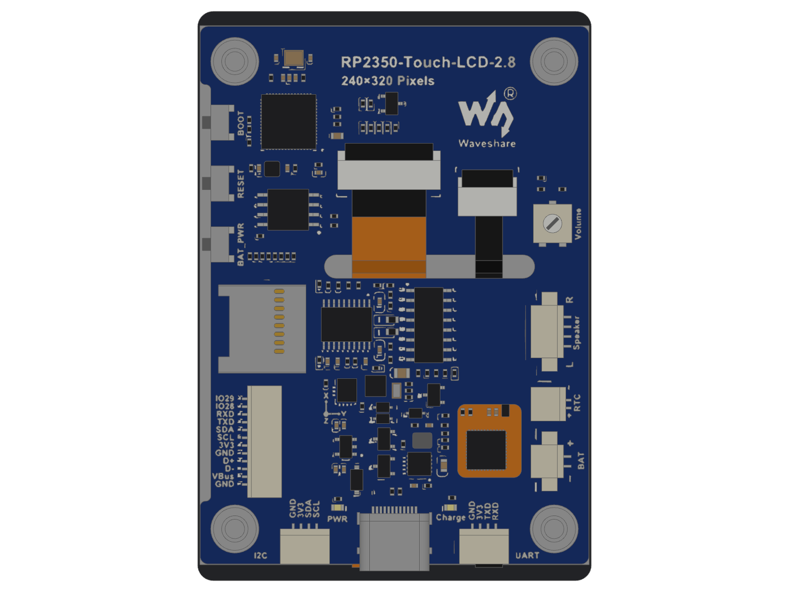
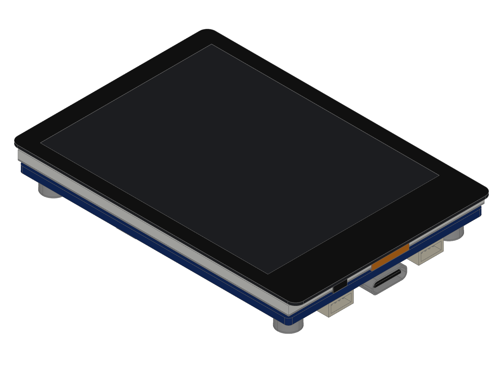
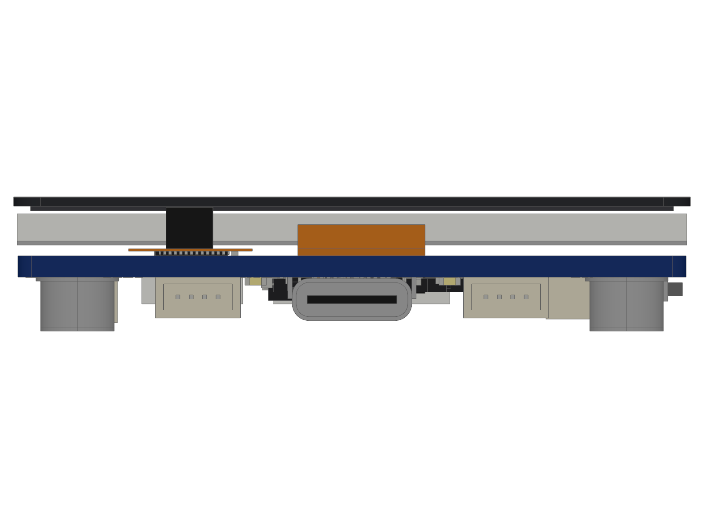
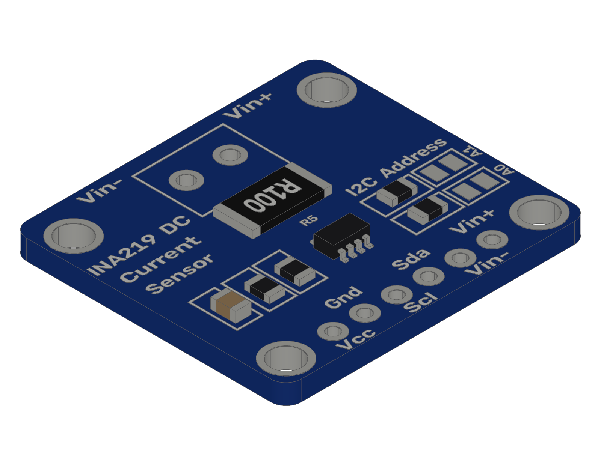
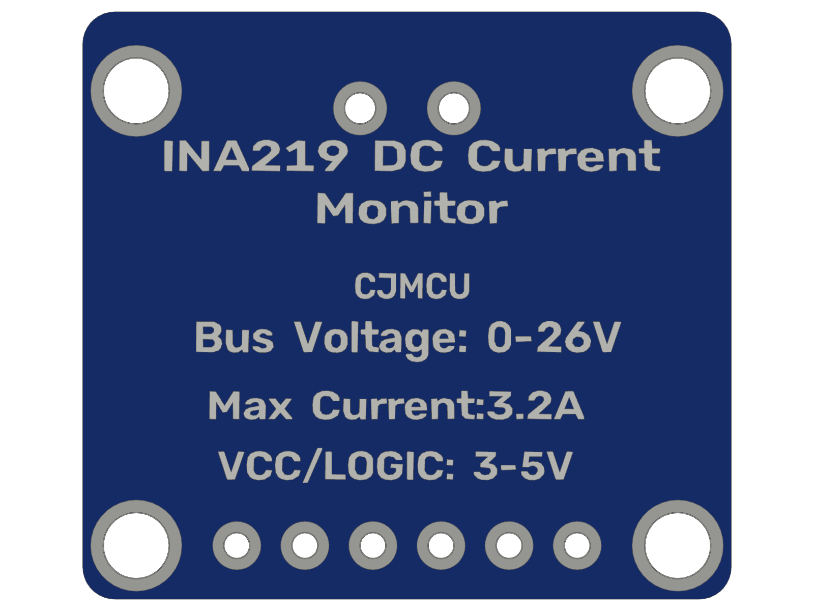
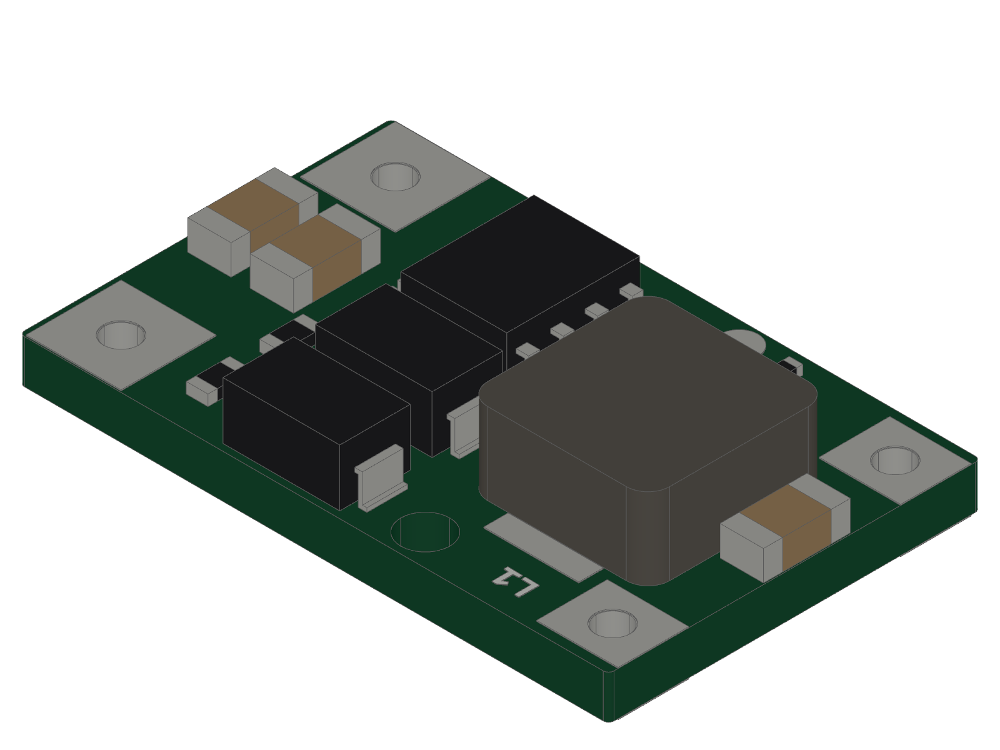
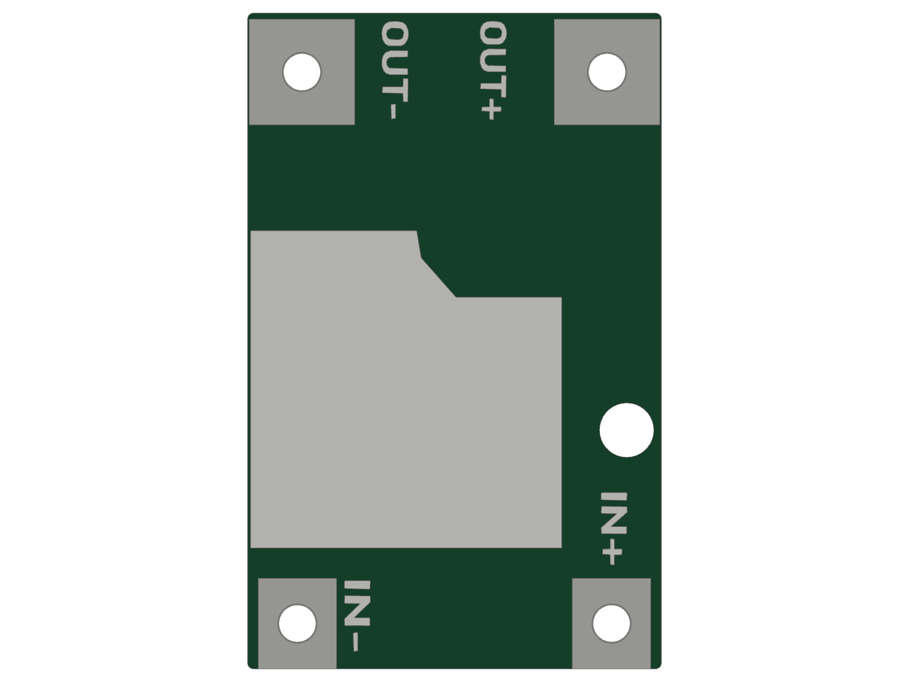

# Mechanical models

The board, and two modules the bench is built with: the
[INA219 current sensor board and the 5V boost converter board](#modules).

## Board

`models/pcb/rp2350_touch_lcd_2_8.step` is a STEP (Standard for the Exchange of
Product model data) model of the Waveshare RP2350-Touch-LCD-2.8, for designing
an enclosure round it. It is a facsimile: drawn here from measurements, not
Waveshare's file. Waveshare publishes no 3D file of this board. All
dimensions are mm.

| | |
| --- | --- |
| Size | 50.54 × 73.06 × 10.03 |
| Solids | 1039, each with a colour |
| Faces | planes and cylinders; no polygon stands in for an arc |
| Schema | AP214, ISO 10303-21 |
| File size | 8.1 MB |









## Frame

The origin is the centre of the display area on the glass's front face.
z = 0 is that face and +z points to the viewer. Seen from the front in
portrait, x points right and y up; the USB-C receptacle is at -y. The display
area is not centred on the glass: the glass reaches 33.53 to +y and 39.53 to
-y.

## What is modelled

| Part | Size | From |
| --- | --- | --- |
| Cover glass, corner radius 2.0 | 50.54 × 73.06 × 0.70 | D, E |
| Clear window of the glass | 43.80 × 58.20, centred on the origin | E |
| Touch film | 48.00 × 64.10 × 0.35 | E |
| Display module | 50.00 × 69.20 × 2.33, front 1.27 behind the glass's front | E |
| Board, corner radius 1.0 | 49.90 × 69.00 × 1.60, front 4.40 behind the glass's front | D, E |
| Step in the board's edge at the buttons | 1.37 deep, y -29.33 to 24.13 | E |
| Slot for the two flat cables | 27.02 × 3.01, round ends | E |
| Window over the touch controller | 8.20 × 9.40, corner radius 1.0 | E |
| 4 standoffs, M2.5 thread | 5.5 across, 4.03 tall, collar 6.2 across at the foot, at x ±20.5, y -32.9 and 27.1 | E, Q, P, D |
| USB-C receptacle | 8.94 × 7.35 × 3.16, 0.88 past the board's edge | E |
| 3 side buttons, PWR, RESET, BOOT | body 2.3 × 4.55 × 1.8, plunger 1.1 long | E |
| microSD card slot | 11.25 × 11.35 × 1.32 | E, P |
| 6 wire sockets: I2C, UART, 12 pins, battery, clock battery, speaker | 3.05 to 3.40 high | E |
| 2 flat-cable sockets, the 2 flat cables | sockets 2.0 high, cables 0.19 thick | P, E |
| Volume trimmer | 4.95 × 4.95 × 2.5 | P; height from Q |
| RP2350A, flash, PCM5101A, APA2068, QMI8658, PCF85063, CST328, charger | package sizes | P, N; APA2068 from E |
| 95 chip parts, 2 crystals, 2 inductors, 4 diodes, 5 SOT-23 parts | package sizes | P, N |

| Print and bare tin on the rear, 374 shapes | drawn 0.02 thick | P |

Every part on the board's rear that is 1.0 or more long is in the model. The
print is traced from P: 25 legends, among them the board's name, the pin
names of the 12-pin socket and the names at each socket, button, lamp and
axis; the outlines printed round parts; and the maker's logo and name. 189
of the 374 shapes are bare tin, pads and solder beside parts. The Waveshare
name and logo are Waveshare's trademarks; the model has them because the
board does.

## Sources

- **D**: Waveshare's dimension drawing of the RP2350-Touch-LCD-2.8, on
  [the board's wiki page](https://www.waveshare.com/wiki/RP2350-Touch-LCD-2.8).
- **E**: Waveshare's STEP file of the ESP32-S3-Touch-LCD-2.8,
  `ESP32-S3-Touch-LCD-2.8_3D.zip` on
  [that board's wiki page](https://www.waveshare.com/wiki/ESP32-S3-Touch-LCD-2.8),
  measured with OpenCASCADE. That board has the same glass, display, board
  outline, cut-outs, sockets, buttons, card slot and amplifier in the same
  places. Waveshare states no licence for the file, so it is not in this
  repository; only dimensions measured in it are.
- **P**: Waveshare's photo of the RP2350 board's rear, 1600 × 1200 pixels,
  `RP2350-Touch-LCD-2.8-3.jpg` on the product page. It is fitted to the 4
  standoffs at 13.3 pixels per mm, with 1 pixel left over at each standoff.
- **Q**: Waveshare's angled photo of the rear, 1600 × 1200 pixels,
  `RP2350-Touch-LCD-2.8-5.jpg`. The tops of the 4 standoffs, 4.03 high in
  E, give its scale: 14.25 pixels per mm across and 9.6 pixels per mm of
  height. It gives the standoffs' body, 5.5 ± 0.3 across, and the
  trimmer's height, 2.5 ± 0.3.
- **N**: nominal package sizes.

E gives every height, the stack and the parts both boards share. P gives the
position of every part E does not have in that place. Against the parts E and
P share, positions read from P lie 0.15 to one side of E on average; the
positions from P are corrected by that. The table of positions is in
[touch_lcd_2_8.py](touch_lcd_2_8.py), in the rear view's frame.

## Limits

- No dimension is verified with a caliper on a board.
- A position from P is good to 0.3. A height from N is the package's nominal
  one.
- The standoffs' body is 5.5 across in E and in Q. The 6.2 seen in P is
  the collar at their foot; its height, 0.3, is estimated.
- Estimated, in no source: the wall thickness of the
  sockets (0.6) and of the USB-C shell (0.3), the display module as a steel
  back 0.3 thick with a white frame 0.3 wide, the depth of the standoffs' counterbore (0.3).
- The printed border is drawn 0.05 thick on the glass's front; on the board
  it is on the glass's rear.
- The flat cables fold round the display's lower end 0.25 from it. That
  distance is estimated.
- A traced edge follows the photo to 0.1. Print and tin are told apart by
  brightness only, so a shape can carry the wrong one of the two colours.
- Nothing is traced within 0.6 of a part more than 1.2 high, of the board's
  edge, a cut-out or a standoff, nor on the flat cables: the print there,
  the pads under parts and the marks on the cables are left out.
- Not modelled: tracks, vias, parts under 1.0 long, the battery, the
  speaker.

## Modules

Two STEP models of modules wired to the board, drawn part by part with the
print of both sides. Their specs are rcbench's, copied unchanged to
[lib/rcbench/hardware/mechanical/](../../lib/rcbench/README.md), and the two
files are the same bytes as rcbench's.

| | |
| --- | --- |
|  |  |
|  |  |

| File | Content | Size | Origin |
| --- | --- | --- | --- |
| `models/pcb/ina219_cjmcu219.step` | INA219 current sensor board, print CJMCU: 12 plated holes, shunt R100, INA219, 5 chip parts, 4 bridge pads, print; 225 solids, 3.5 MB | 24.20 × 21.90 × 2.74 | header hole 1 (Vcc) on the underside; x along the header, y towards the terminal holes, +z up |
| `models/pcb/boost_5v_en.step` | 5V boost converter board: 4 plated corner holes, enable pad, chip, inductor, 2 diodes, 3 capacitors, 3 resistors, print; 69 solids, 0.6 MB | 13.70 × 21.70 × 4.63 | IN+ hole on the underside; x towards IN-, y towards the outputs, +z up |

The INA219 board has a 6-hole header at 2.54 pitch, Vcc Gnd Scl Sda Vin-
Vin+, 2.0 above one long edge, and 4 mounting holes of about 2.5, 20.2 ×
16.95 apart. The boost board has IN+ and IN- at the inductor's end and OUT+
and OUT- at the other, with holes of about 1.3; seen from the top side with
the inductor down, both plus pads are on the left.

Sources: owner photos of both sides of each board on 5 mm squared paper,
which are not in the repository. Limits:

- Positions are within about 0.2. No dimension is verified with a caliper.
- Not measured: the boards' thickness (drawn 1.6) and the inductor's height
  (3.0).
- Part sizes and heights are the packages' nominal ones. The boost board's
  chip is not identified.
- The boost board does not name its enable pad. It is the one round pad
  besides the 4 corner pads, next to R3 (owner, 2026-11-19). The level that
  switches the output on is not known.
- The print is set in a stroke font at the height and width each line has
  in the photo; it is not traced.
- Not modelled: tracks, vias, pads under parts, solder, the print 2R2 on
  the inductor.

## Files

| File | Holds |
| --- | --- |
| `touch_lcd_2_8.py` | the board's dimensions and the position of each part |
| `_parts.py` | the parts: chip parts, leaded and leadless packages, sockets, USB-C, button, card slot, trimmer |
| `_solid.py` | profiles with straight sides and arcs, pushed along an axis, turned and moved |
| `gen_models.py` | writes `models/pcb/*.step` from the specs here and the two module specs in `lib/rcbench/hardware/mechanical/`; `--check` compares, and fails on a file under `models/` or `renders/` that `_models.py` does not account for |
| `_models.py` | names the folder of each model under `models/` and `renders/`: `pcb`, `casing` or `parts`, as in rcbench |
| `check_models.py` | reads the files back with OpenCASCADE; `--render` draws them |
| `check_photo.py` | draws the model's rear parts on photo P |
| `_trace_print.py` | traces print and bare tin from photo P into `_print.py` |
| `_print.py` | the traced outlines; written by `_trace_print.py` |
| `models/pcb/` | 3 boards: `rp2350_touch_lcd_2_8.step`, `ina219_cjmcu219.step`, `boost_5v_en.step` |
| `models/casing/` | 2 printed parts of the case: `case_shell_esp_rp_touch_lcd.stp`, `button.stp` |
| `models/parts/` | the cell `lipo_102540_1000mah.step` and the assembled bench `minircbench.stp` |
| `renders/pcb/` | 4 views of the board and 2 of each module, 1600 × 1200 pixels |

## Commands

```sh
python3 hardware/mechanical/gen_models.py            # write models/pcb/*.step
python3 hardware/mechanical/gen_models.py --check    # exit 1 when a file differs from its spec
pip install cadquery-ocp
python3 hardware/mechanical/check_models.py          # valid solids, no shared volume, size
xvfb-run -a python3 hardware/mechanical/check_models.py --render hardware/mechanical/renders
python3 hardware/mechanical/check_photo.py RP2350-Touch-LCD-2.8-3.jpg overlay.png
pip install opencv-python-headless
python3 hardware/mechanical/_trace_print.py RP2350-Touch-LCD-2.8-3.jpg   # rewrite _print.py
```

`gen_models.py` needs Python 3 only and writes the same bytes on every run.
The Docs job of `ci.yml` runs `gen_models.py --check`. `check_models.py`
needs OpenCASCADE and is not run in CI (continuous integration); it passes on
the committed file: 1039 valid solids, no two sharing more than 1e-6 mm³.
`check_photo.py` needs photo P, numpy and Pillow and is not run in CI either.
On P it reports 13.30 pixels per mm and 1.06 pixels left at the worst
standoff, and every box it draws lies on its part.

## Licence

The models, renders and Python scripts in this directory, and everything in
`hardware/cad/`, are licensed under
[CC BY-NC-SA 4.0](https://creativecommons.org/licenses/by-nc-sa/4.0/)
(Creative Commons Attribution-NonCommercial-ShareAlike 4.0 International):
the STEP models, the renders and the scripts that generate or trace them or
check the models, `_print.py` included. You may share and adapt them for
non-commercial purposes, with credit, and must distribute adaptations under
the same licence. The legal code is in
[hardware/LICENSE-CAD.txt](../LICENSE-CAD.txt).

This README is documentation and is MIT, as is `check_photo.py`, which
overlays the model on Waveshare's photo to verify it and generates nothing.
The rest of the repository, the software, is MIT.

| File type | Where the licence is stated |
| --- | --- |
| `*.py` | the line `# SPDX-License-Identifier: CC-BY-NC-SA-4.0` at the top, except `check_photo.py`, which reads MIT |
| `models/*/*.step`, `models/*/*.stp`, `renders/*/*.png`, `hardware/cad/` | no line in the file; `hardware/LICENSE-CAD.txt` covers them |

The Waveshare name and logo on the board's model are Waveshare's trademarks;
the licence gives no right to them.

`lib/rcbench/hardware/` holds copies of rcbench's model generators. They are
under CC BY-NC-SA 4.0 as model generators. The copies carry no
`SPDX-License-Identifier` line at the rcbench commits they were taken from.
rcbench's licence change (pull request 860) puts the CC line at the end of
each module docstring, and the copies take it when they are copied again.
`test/check_docs.py` allows either state there, checks every other file under
`hardware/` for the CC line only, and every file elsewhere for MIT.
