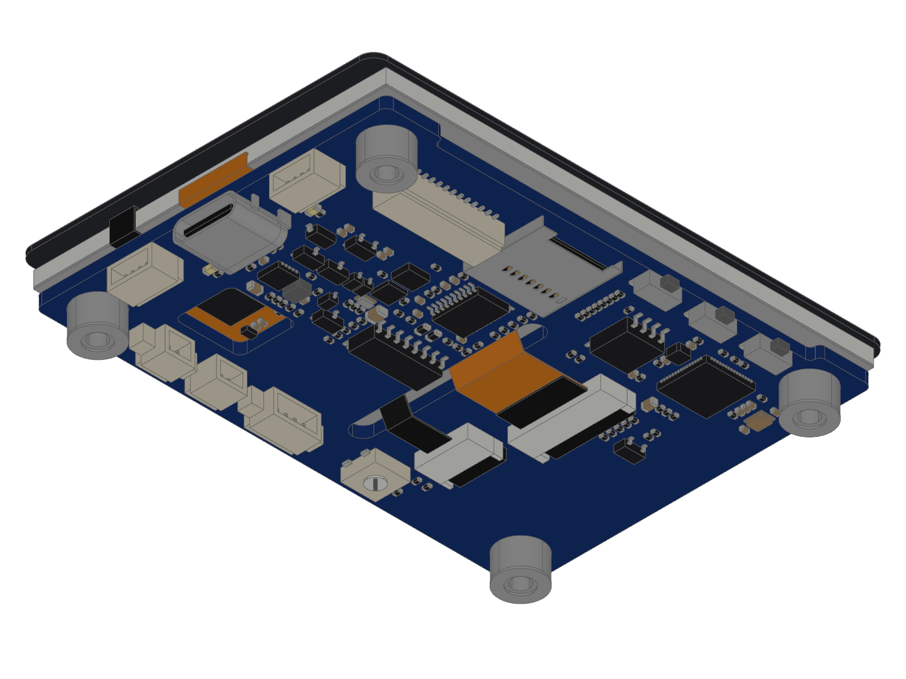
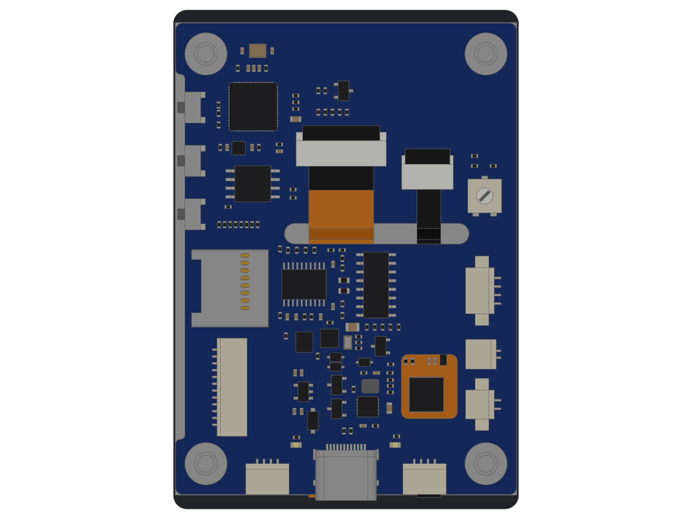
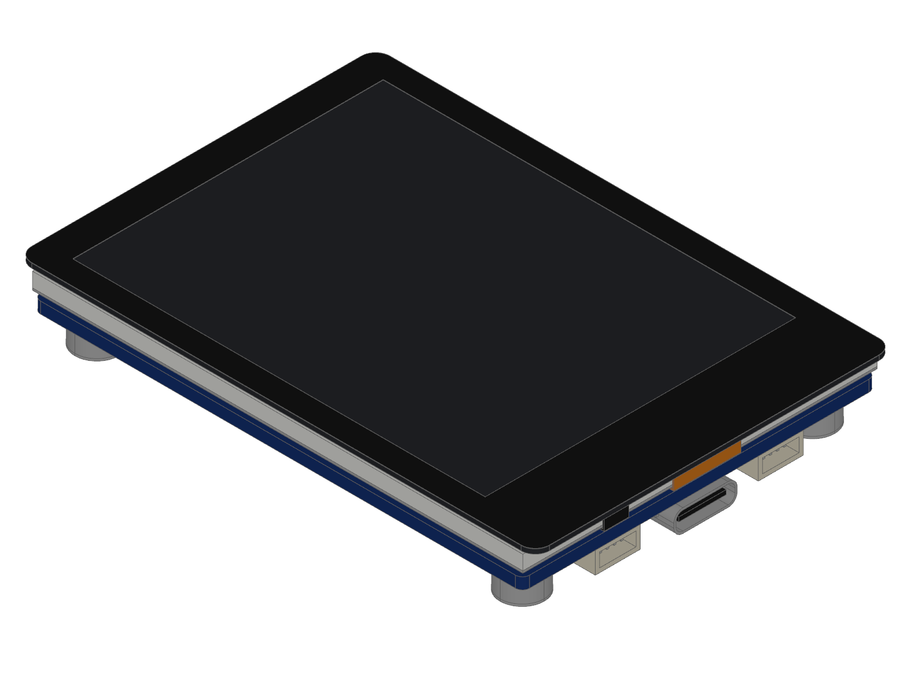
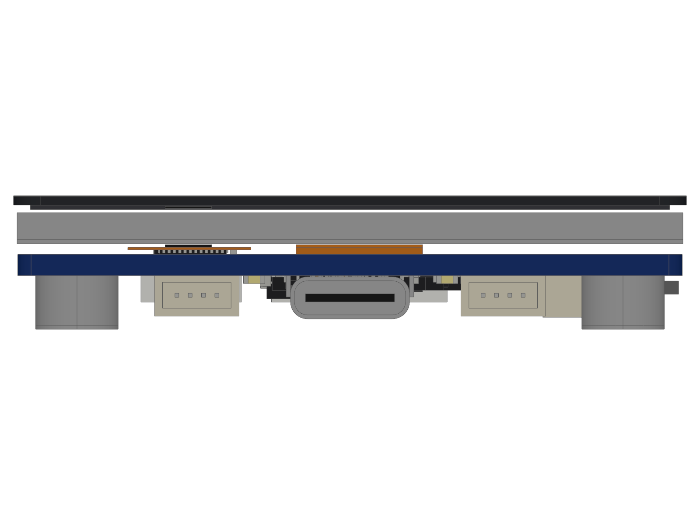

# Mechanical model of the board

`models/rp2350_touch_lcd_2_8.step` is a STEP (Standard for the Exchange of
Product model data) model of the Waveshare RP2350-Touch-LCD-2.8, for designing
an enclosure round it. It is a facsimile: drawn here from measurements, not
Waveshare's file. Waveshare publishes no 3D file of this board. All
dimensions are mm.

| | |
| --- | --- |
| Size | 50.54 × 73.06 × 10.03 |
| Solids | 661, each with a colour |
| Faces | planes and cylinders; no polygon stands in for an arc |
| Schema | AP214, ISO 10303-21 |
| File size | 3.5 MB |









## Frame

The origin is the centre of the display area on the glass's front face.
z = 0 is that face and +z points to the viewer. Seen from the front in
portrait, x points right and y up; the USB-C receptacle is at -y. The display
area is not centred on the glass: the glass reaches 33.53 to +y and 39.53 to
-y.

## What is modelled

| Part | Size | From |
| --- | --- | --- |
| Cover glass, corner radius 2.0 | 50.54 × 73.06 × 0.70 | D, E |
| Clear window of the glass | 43.80 × 58.20, centred on the origin | E |
| Touch film | 48.00 × 64.10 × 0.35 | E |
| Display module | 50.00 × 69.20 × 2.33, front 1.27 behind the glass's front | E |
| Board, corner radius 1.0 | 49.90 × 69.00 × 1.60, front 4.40 behind the glass's front | D, E |
| Step in the board's edge at the buttons | 1.37 deep, y -29.33 to 24.13 | E |
| Slot for the two flat cables | 27.02 × 3.01, round ends | E |
| Window over the touch controller | 8.20 × 9.40, corner radius 1.0 | E |
| 4 standoffs, M2.5 thread | 6.2 across, 4.03 tall, at x ±20.5, y -32.9 and 27.1 | P, E, D |
| USB-C receptacle | 8.94 × 7.35 × 3.16, 0.88 past the board's edge | E |
| 3 side buttons, PWR, RESET, BOOT | body 2.3 × 4.55 × 1.8, plunger 1.1 long | E |
| microSD card slot | 11.25 × 11.35 × 1.32 | E, P |
| 6 wire sockets: I2C, UART, 12 pins, battery, clock battery, speaker | 3.05 to 3.40 high | E |
| 2 flat-cable sockets, the 2 flat cables | sockets 2.0 high, cables 0.19 thick | P, E |
| Volume trimmer | 4.95 × 4.95 × 2.0 | P; height estimated |
| RP2350A, flash, PCM5101A, APA2068, QMI8658, PCF85063, CST328, charger | package sizes | P, N; APA2068 from E |
| 95 chip parts, 2 crystals, 2 inductors, 4 diodes, 5 SOT-23 parts | package sizes | P, N |

Every part on the board's rear that is 1.0 or more long is in the model.

## Sources

- **D**: Waveshare's dimension drawing of the RP2350-Touch-LCD-2.8, on
  [the board's wiki page](https://www.waveshare.com/wiki/RP2350-Touch-LCD-2.8).
- **E**: Waveshare's STEP file of the ESP32-S3-Touch-LCD-2.8,
  `ESP32-S3-Touch-LCD-2.8_3D.zip` on
  [that board's wiki page](https://www.waveshare.com/wiki/ESP32-S3-Touch-LCD-2.8),
  measured with OpenCASCADE. That board has the same glass, display, board
  outline, cut-outs, sockets, buttons, card slot and amplifier in the same
  places. Waveshare states no licence for the file, so it is not in this
  repository; only dimensions measured in it are.
- **P**: Waveshare's photo of the RP2350 board's rear, 1600 × 1200 pixels,
  `RP2350-Touch-LCD-2.8-3.jpg` on the product page. It is fitted to the 4
  standoffs at 13.3 pixels per mm, with 1 pixel left over at each standoff.
- **N**: nominal package sizes.

E gives every height, the stack and the parts both boards share. P gives the
position of every part E does not have in that place. Against the parts E and
P share, positions read from P lie 0.15 to one side of E on average; the
positions from P are corrected by that. The table of positions is in
[touch_lcd_2_8.py](touch_lcd_2_8.py), in the rear view's frame.

## Limits

- No dimension is verified with a caliper on a board.
- A position from P is good to 0.3. A height from N is the package's nominal
  one.
- The standoffs are 6.2 across in P and 5.5 in E. The model follows P;
  Waveshare's angled photo, `RP2350-Touch-LCD-2.8-4.jpg`, shows them as
  plain cylinders.
- Estimated, in no source: the trimmer's height, the wall thickness of the
  sockets (0.6) and of the USB-C shell (0.3), the display module as a steel
  back 0.3 thick with a white frame 0.3 wide, the depth of the standoffs' counterbore (0.3).
- The printed border is drawn 0.05 thick on the glass's front; on the board
  it is on the glass's rear.
- The flat cables fold round the display's lower end 0.25 from it. That
  distance is estimated.
- Not modelled: solder, pads, print, tracks, vias, parts under 1.0 long, the
  battery, the speaker.

## Files

| File | Holds |
| --- | --- |
| `touch_lcd_2_8.py` | the board's dimensions and the position of each part |
| `_parts.py` | the parts: chip parts, leaded and leadless packages, sockets, USB-C, button, card slot, trimmer |
| `_solid.py` | profiles with straight sides and arcs, pushed along an axis, turned and moved |
| `gen_models.py` | writes `models/*.step` from the specs; `--check` compares |
| `check_models.py` | reads the files back with OpenCASCADE; `--render` draws them |
| `models/` | the STEP files |
| `renders/` | 4 views, 1600 × 1200 pixels |

## Commands

```sh
python3 hardware/mechanical/gen_models.py            # write models/*.step
python3 hardware/mechanical/gen_models.py --check    # exit 1 when a file differs from its spec
pip install cadquery-ocp
python3 hardware/mechanical/check_models.py          # valid solids, no shared volume, size
xvfb-run -a python3 hardware/mechanical/check_models.py --render hardware/mechanical/renders
```

`gen_models.py` needs Python 3 only and writes the same bytes on every run.
The Docs job of `ci.yml` runs `gen_models.py --check`. `check_models.py`
needs OpenCASCADE and is not run in CI (continuous integration); it passes on
the committed file: 661 valid solids, no two sharing more than 1e-6 mm³.
